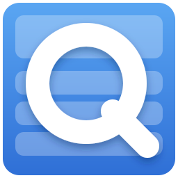
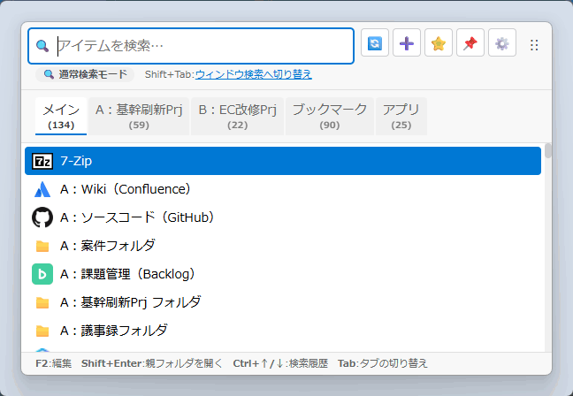
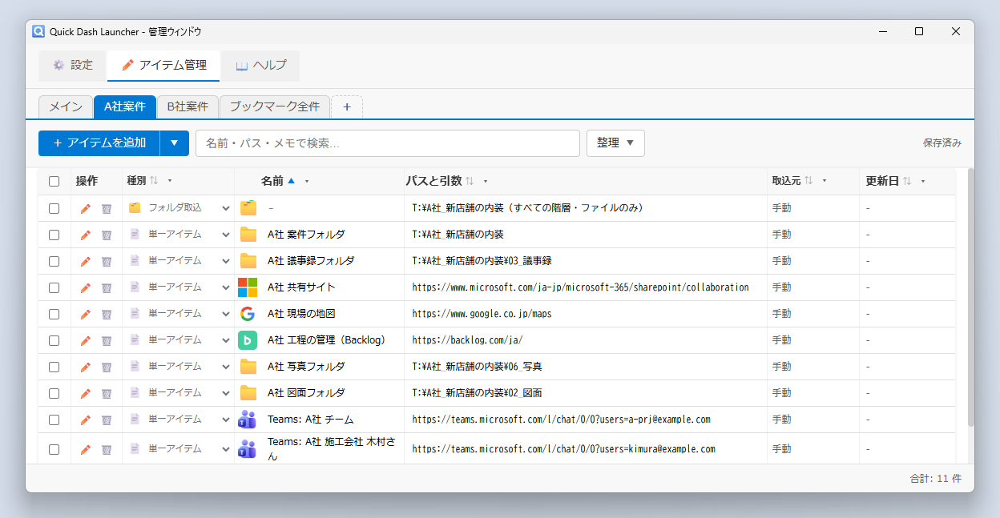
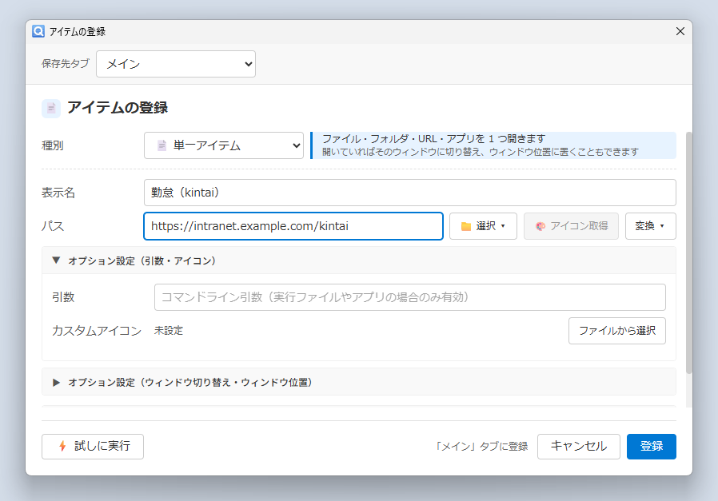
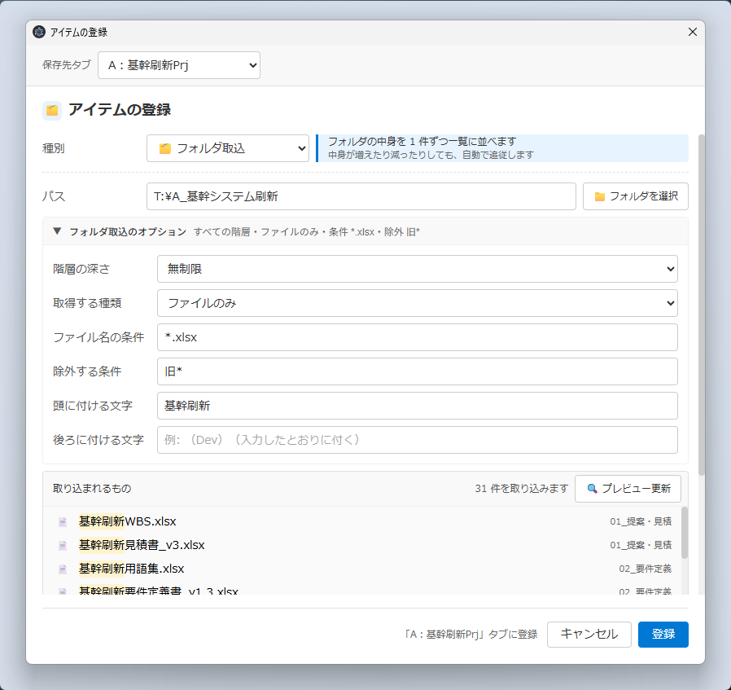
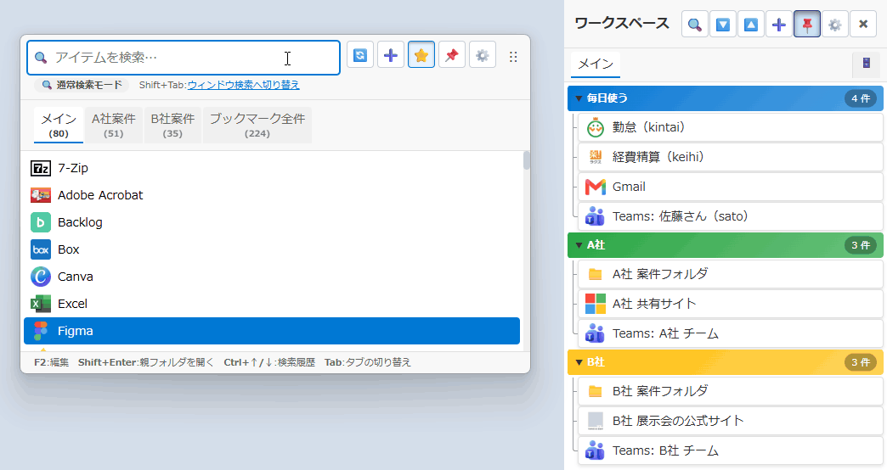

<p align="center">
  
</p>

<h1 align="center">Quick Dash Launcher</h1>

<p align="center"><a href="README.md">English</a> | <b>日本語</b></p>

<p align="center"><b>いつもの呼び名で、迷わず開く</b><br /><sub>登録型検索ランチャー</sub></p>

**アプリ・ファイル・フォルダ・URL を登録して、キーワードを打って開くランチャーです。**

スタートメニューやランチャーで検索すると、関係のないファイルまで並んでうんざりしたことはありませんか。Quick Dash Launcher の候補に出るのは、自分で登録したものだけです。キーワードは付けた名前の一部でよく、「毎日使うもの」「案件ごと」のように自由にタブで分けて、使いながら育てていけます。

<p align="center">
  <a href="https://github.com/masaodev/quick-dash-launcher/releases"></a>
  <a href="LICENSE"></a>
  <a href="https://github.com/masaodev/quick-dash-launcher/releases"></a>
</p>

<p align="center">
  <a href="#インストール">インストール</a> ·
  <a href="#登録と管理の画面">登録と管理の画面</a> ·
  <a href="#ワークスペース">ワークスペース</a> ·
  <a href="docs/README.md">ドキュメント</a> ·
  <a href="https://github.com/masaodev/quick-dash-launcher/releases">リリース</a>
</p>

<p align="center">
  <br />
  <sub>▶ デモ（約 30 秒）</sub>
</p>

<!-- 日本語版が正本。英語版（README.md）は訳で、同じ PR で両方を直す。メインデモ GIF は `npm run docs:demo-gif` で撮り直す（英語版は docs:demo-gif:en。デモデータ＝tests/demo-gif/demo-content-ja.ts と tests/e2e/templates/demo/） -->

無料のオープンソース（MIT）です。winget ですぐに試せます（ほかの入れ方は[インストール](#インストール)）。

```powershell
winget install masaodev.quick-dash-launcher
```

---

## 特徴

- **全部ここから開ける**
  - アプリ、フォルダ、ファイル、Web ページに加えて、Teams のチャットのようなリンクも同じ画面から開けます。
  - 保存しておいた定型文や画像も、選ぶとクリップボードに戻せます。
- **名前を付けて、タブで分ける**
  - 長いパスや URL も「勤怠（kintai）」「経費精算（keihi）」のような、いつもの呼び名で開けます。
    - 💡 ローマ字を添えておくと、かなを変換せずに「kin」と打つだけで開けます。
  - タブは「毎日使うもの」「案件ごと」「ブックマーク」のように自由に分けられます。
- **まとめて取り込める**
  - スタートメニューのアプリやブラウザのブックマークを、一覧から選んで取り込めます。
  - フォルダを指定すると中のファイルが候補に並び、後からファイルが増えても登録し直す必要はありません（「`*.xlsx` だけ」「`旧*` は除く」のような指定もできます）。
- **打ちかけで候補が出て、すぐ開ける**
  - 名前の一部を打つと 1 文字ごとに絞り込まれ、Enter で開きます。「goo」と打てば Google のサービスが並び、「goo map」とスペースで区切って足せば Google Maps だけになります。
  - ほかのタブで当たったものには、Tab キーで移れます。
- **よく使うものは、画面の端に出しておける**
  - ランチャーとは別に、[ワークスペース](#ワークスペース)という常に出しておけるウィンドウがあります。

---

## なぜ登録型なのか

PowerToys Run や Command Palette のような多くのランチャーは、インストール済みのアプリやファイルを自動で全部読み込むので、使わないものまで候補に並びます。Quick Dash Launcher は、このノイズを嫌った作者が作った「登録型」のランチャーです。登録したものだけが候補に出るので、数文字で目当てにたどり着けます。登録の手間を減らすために、ドラッグ＆ドロップでの登録、アプリ・ブックマーク・フォルダのまとめての取り込み、登録したものを一覧で直せる[専用の管理画面](#登録と管理の画面)など、機能を揃えています。

| 観点 | 全部読み込む型（PowerToys Run など） | Quick Dash Launcher |
| --- | --- | --- |
| 候補に出るもの | インストール済みのもの全部 | 自分で登録したものだけ |
| 登録の手間 | なし（自動で入る） | フォルダ・アプリ・ブックマークはまとめて取り込める |
| 整理のしかた | なし | タブで自由に分ける |
| 名前 | アプリ名やファイル名のまま | 自由に付けられる（ファイル名のままでもよい） |
| フォルダの中身 | 出ない | 取り込めば候補に出る |

---

## 登録と管理の画面

### アイテム管理

登録したものをタブごとに一覧で直せます。ランチャーの ⚙ →「アイテム管理」で開きます。

<p align="center">
  
</p>

### アイテム登録画面

1 件ずつ登録します。ランチャーの ➕ →「アイテムを追加」か、ドラッグ＆ドロップで開きます。

<p align="center">
  
</p>

### アイテム登録画面（フォルダ取込）

種別を「フォルダ取込」にすると、フォルダの中のファイルをまとめて候補に並べられます。

<p align="center">
  
</p>

<!-- 画面イメージは `npm run docs:readme-images` で撮り直す（英語版は docs:readme-images:en。デモデータ＝tests/demo-gif/demo-content-ja.ts） -->

---

## ワークスペース

ランチャーとは別に、よく使うものを並べて画面の端に出しておける専用のウィンドウです。今取りかかっている案件の資料やフォルダを、クリックだけで開けます。常に表示しておくか、ランチャーと一緒に表示するかを選べます。

<p align="center">
  <br />
  <sub>▶ デモ（約 25 秒）</sub>
</p>

- **ドラッグで追加**: ランチャーのアイテムのほか、ファイル・URL・開いているウィンドウも置けます。
- **グループで分ける**: 色付きのグループに分け、使わないときは畳んでおけます。
- **切り離して置く**: グループを外へドラッグすると独立したウィンドウになり、好きな場所に置けます。

詳しくは[ワークスペース機能](docs/features/workspace.md)を参照してください。

<!-- デモ GIF は `npm run docs:demo-gif-workspace` で撮り直す（英語版は docs:demo-gif-workspace:en。撮影中は実際のマウスが動く。デモデータ＝tests/demo-gif/demo-content-ja.ts の workspace） -->

---

## ほかにできること

登録画面の種別を変えると、ファイルや URL を開く以外の使い方もできます。種別ごとの説明は[アイテムの種別](docs/features/item-categories.md)にまとめています。

| 機能 | できること |
| --- | --- |
| [セット](docs/features/set.md) | 登録済みのアイテムやパスをまとめて一度に開き、必要ならウィンドウを記録した位置に並べる |
| クリップボード | テキストや画像を保存しておき、選ぶとクリップボードに戻す |
| WSグループ | ワークスペースのグループを一覧と検索に並べ、選ぶと切り離しウィンドウで開く（アイテム管理の「＋ アイテムを追加」の ▼ から追加） |
| [ブックマークの取り込み](docs/features/bookmark-import.md) | ブラウザのブックマークを取り込む。自動で取り込み直す設定もできる |
| [ウィンドウ検索](docs/screens/main-window.md#526-ウィンドウ検索モード) | 開いているウィンドウを名前で探して切り替える。ほかの仮想デスクトップのウィンドウも出る（`Ctrl+Alt+Space` で直接開く） |
| [コマンドライン（qdl）](docs/features/cli.md) | `qdl` コマンドで、アイテム・ワークスペースのグループ・設定を足したり変えたりする。結果を JSON で返すので、スクリプトや AI エージェント（Claude Code など）からも使える。基本設定でオンにすると使える |

---

## インストール

Windows 10 以降で動きます。表示言語は Windows に合わせて日本語か英語になり、「設定」で変えられます。

### winget

```powershell
winget install masaodev.quick-dash-launcher
```

更新は `winget upgrade masaodev.quick-dash-launcher`。winget には正式版だけを公開しています（ベータ版は Releases のプレリリースから入手できます）。

### インストーラー版・ZIP 版

[Releases](https://github.com/masaodev/quick-dash-launcher/releases) からダウンロードします。

- インストーラー版: `QuickDashLauncher.Setup.x.x.x.exe` を実行します。インストールが終わると起動します。
- ZIP 版: `QuickDashLauncher-x.x.x-portable.zip` を好きなフォルダに展開し、`QuickDashLauncher.exe` を実行します（インストール不要）。

<details>
<summary>ZIP 版のデータの置き場所とポータブルモード</summary>

設定とデータはインストーラー版と同じ `%APPDATA%\quick-dash-launcher` に保存されるので、新しいバージョンの ZIP を別のフォルダに展開しても同じデータを使えます。

初回設定画面でポータブルモードにチェックを付けるか、exe の横に `QuickDashLauncher-data` フォルダを作るとポータブルモードになり、設定とデータをそのフォルダに保存します（フォルダごと USB メモリで持ち歩けます。新しいバージョンにするときは `QuickDashLauncher-data` を新しいフォルダへ移します）。

正式版とベータ版を同じ PC で使い分けるときは、ベータ版をポータブルモードにしてください。既定のままだと両方が同じデータを読み、同時には起動できません。

</details>

インストーラー版・ZIP 版は署名していないため、初回の実行時に Windows SmartScreen の警告が出ることがあります。そのときは「詳細情報」→「実行」で起動できます。

初回起動の画面で、ランチャーを呼び出すホットキー（初期値は Alt+Space）を決めます。キー操作は[キーボードショートカット](docs/features/keyboard-shortcuts.md)を参照してください。

うまく動かないときは[困ったとき](docs/features/troubleshooting.md)を参照してください。

---

## バグ報告・開発への参加

バグ報告と機能の要望は [GitHub Issues](https://github.com/masaodev/quick-dash-launcher/issues) へお願いします。プルリクエストも歓迎します。

Electron・React・TypeScript で作っています（CLI の `qdl.exe` は Rust）。ソースからビルドするには、Node.js に加えて、ネイティブモジュールのコンパイルに Visual Studio Build Tools（C++）と Python が必要です。詳しくは[開発ガイド](docs/setup/development.md)を、設計やテストは [docs](docs/README.md) を参照してください。

```bash
git clone https://github.com/masaodev/quick-dash-launcher.git
cd quick-dash-launcher
npm install
npm run dev          # 開発モード起動
npm run test:unit    # 単体テスト
```

---

## プライバシー

Quick Dash Launcher は、利用者の情報を作者やほかの誰かに送りません。データはすべて PC の中に保存します。詳しくは[プライバシーポリシー](./PRIVACY.ja.md)をご覧ください。

## ライセンス

[MIT ライセンス](./LICENSE)で公開しています。
