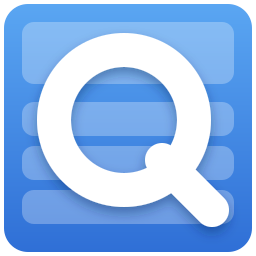
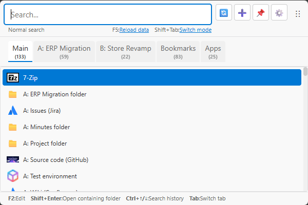
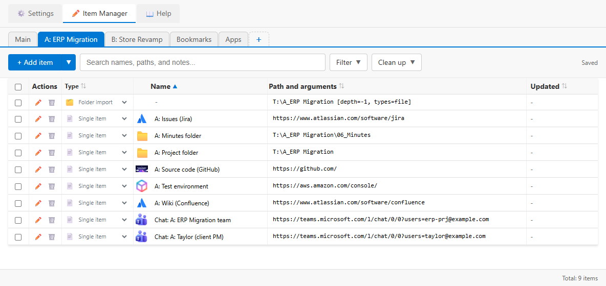
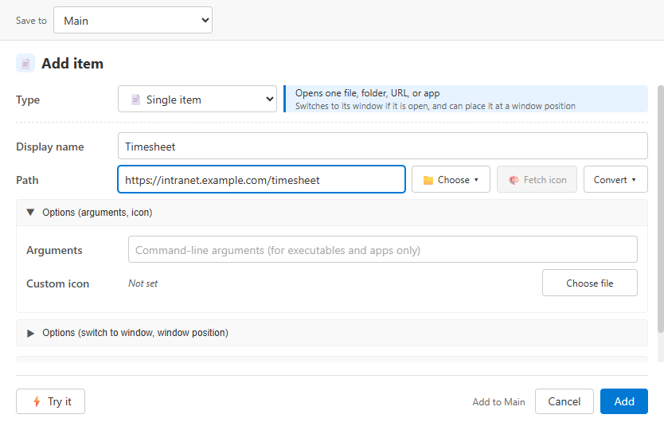
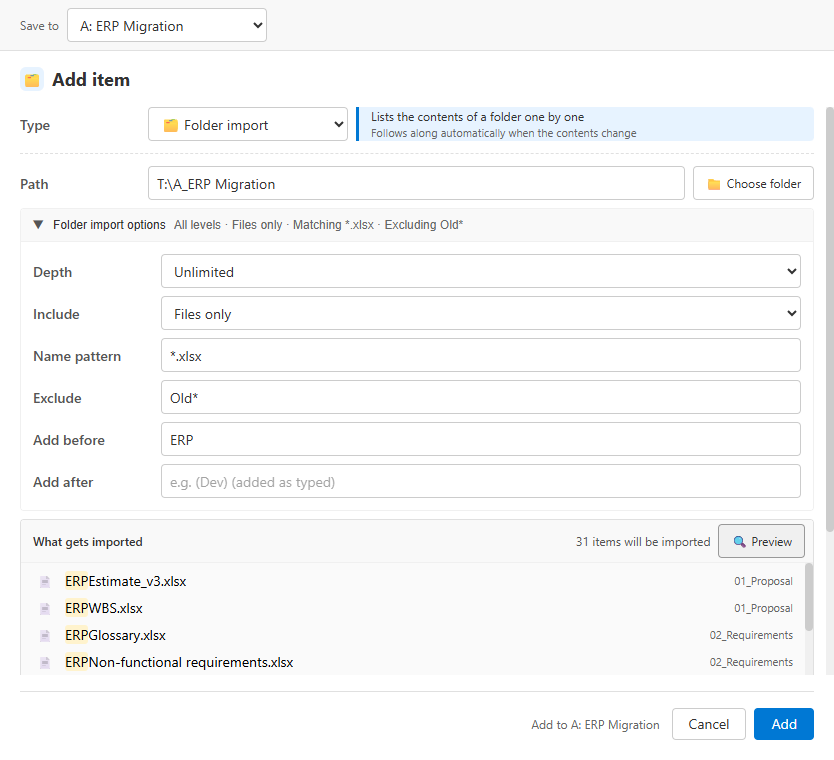
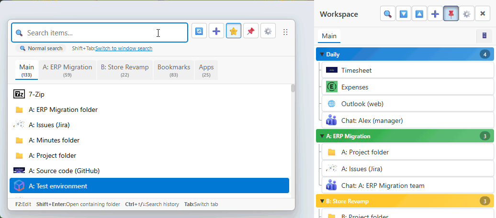

<p align="center">
  
</p>

<h1 align="center">QuickDashLauncher</h1>

<p align="center"><b>English</b> | <a href="README.ja.md">日本語</a></p>

**A launcher where you add your apps, files, folders, and URLs, then open them by typing a keyword.**

Only what you've added shows up. A keyword can be any part of the name you gave it, and you can sort items into tabs such as "Work," "Personal," or "Client A."

<p align="center">
  <a href="https://github.com/masaodev/quick-dash-launcher/releases"></a>
  <a href="LICENSE"></a>
  <a href="https://github.com/masaodev/quick-dash-launcher/releases"></a>
</p>

<p align="center">
  <a href="#installation">Installation</a> ·
  <a href="#screenshots">Screenshots</a> ·
  <a href="#workspace">Workspace</a> ·
  <a href="docs/README.md">Documentation (Japanese)</a> ·
  <a href="https://github.com/masaodev/quick-dash-launcher/releases">Releases</a>
</p>

<p align="center">
  
</p>

<!-- Translation of README.ja.md (the source). Change both in the same PR. Re-record the demo GIF with `npm run docs:demo-gif:en` (demo data: tests/demo-gif/demo-content-en.ts and tests/e2e/templates/demo/) -->

## Features

- **Open everything from one place**
  - Open apps, folders, files, and websites, plus links such as Teams chats, from the same window.
  - Save snippets of text or images and copy them back to the clipboard when you need them.
  - Keep the things you use most in the [workspace](#workspace), a window that stays at the edge of your screen.
- **Add what you use and organize it with tabs**
  - Add items one at a time with drag and drop, or import apps from the Start menu and your browser bookmarks in bulk.
  - Create whatever tabs you like, such as "Work," "Personal," or "Client A."
  - Only the items you've added show up, so the list stays tidy.
  - Give each item any name you like, so long paths and URLs open by the name you actually use, such as "Timesheet" or "Expenses."
- **Import a whole folder**
  - Point to a folder, and the files in it show up in the list. You can choose whether to include subfolders.
  - Use wildcards to choose what to include and what to skip, such as "Excel files only (`*.xlsx`)" or "skip old versions (`Old*`)."
  - When files are added to the folder later, there's no need to add them again.
- **Matches appear as you type, ready to open**
  - Type part of a name, and the list narrows with each character. The match doesn't have to be at the start, and you can narrow it further with more words separated by spaces, such as "basic design screen."
  - Select what you want and press Enter to open it.
  - If a match is in another tab, the number of matches shows on that tab, and you can press Tab to switch to it.

It's free and open source (MIT). Try it right away with winget (for other ways, see [Installation](#installation)).

```powershell
winget install masaodev.quick-dash-launcher
```

---

## Why you add items yourself

Many launchers, such as PowerToys Run, index every installed app and file automatically. Things you never use end up in the results, and you still have to hunt for what you want. The author built QuickDashLauncher to get rid of that noise: you choose and add the things you use. Because only those items show up, a few keystrokes get you there.

Adding items one at a time takes effort, so there are ways to add many at once. Point to a folder, and the files in it show up in the list (folder import). You can also pick apps from the Start menu and your browser bookmarks from a list and import them.

Everything you've added appears in a list in the [settings window](#screenshots), where you can edit it all together.

| | Search-based launchers (PowerToys Run and others) | QuickDashLauncher |
| --- | --- | --- |
| What shows up | Everything installed | Only what you've added |
| Setup effort | None (added automatically) | Import folders, apps, and bookmarks in bulk |
| Organization | None | Sort into tabs as you like |
| Names | App and file names as they are | Names you choose |
| Files inside folders | Not shown | Shown once you import the folder |

### Who it's for

- You juggle several projects and keep searching for the same folders, documents, and web admin pages.
- You click through deep shared-folder paths every time.
- You open apps or bookmarks just to find a Teams chat or a webpage you use often.
- You don't want apps and files you never use showing up in the results.

---

## Screenshots

### Item Manager

Edit everything you've added, tab by tab. To open it, select ⚙ > **Item Manager** in the launcher.

<p align="center">
  
</p>

### Add item

Add one item at a time. To open it, select ➕ > **Add item** in the launcher, or drag and drop a file onto it.

<p align="center">
  
</p>

### Add item (folder import)

Set the type to **Folder import** to add all the files in a folder to the list.

<p align="center">
  
</p>

<!-- Re-take the screenshots with `npm run docs:readme-images:en` (demo data: tests/demo-gif/demo-content-en.ts) -->

---

## Workspace

The workspace is a separate window that keeps the things you use most at the edge of your screen. To open it, select ⭐ in the launcher or press `Ctrl+W`. Unlike the launcher, it stays visible while you work in other windows.

<p align="center">
  
</p>

- **Add items**: Right-click an item in the launcher, or drag it to the workspace. You can also drag files and URLs, or copy a path or text and press `Ctrl+V` in the workspace.
- **Organize with groups**: Sort items into color-coded groups, and create groups inside groups.
- **Detach a group**: Drag a group out of the workspace to open it in a window of its own, and put it anywhere on your screen.

For details, see [Workspace](docs/features/workspace.md) (Japanese).

<!-- Re-record the demo GIF with `npm run docs:demo-gif-workspace:en` (the real mouse pointer moves while recording; demo data: workspace in tests/demo-gif/demo-content-en.ts) -->

---

## More you can do

Change the type in the Add item window to do more than open files and URLs. For details on each type, see [Item types](docs/features/item-categories.md) (Japanese).

| Feature | What it does |
| --- | --- |
| [Set](docs/features/set.md) | Open several items or paths at once, and optionally move their windows to recorded positions |
| Clipboard item | Save text or images and copy them back to the clipboard when you select them |
| [Bookmark import](docs/features/bookmark-import.md) | Import your browser bookmarks, and optionally keep them up to date automatically |

---

## Installation

Runs on Windows 10 or later. The display language follows Windows (English or Japanese), and you can change it in **Settings**.

### winget

```powershell
winget install masaodev.quick-dash-launcher
```

To update, run `winget upgrade masaodev.quick-dash-launcher`. Only stable releases are published to winget (beta versions are available as pre-releases on the Releases page).

### Installer and portable versions

Download them from [Releases](https://github.com/masaodev/quick-dash-launcher/releases).

- Installer: Run `QuickDashLauncher.Setup.x.x.x.exe`. The app starts when the installation finishes.
- Portable: Put `QuickDashLauncher.x.x.x.exe` in any folder and run it (no installation needed).

The installer and portable versions aren't signed, so Windows SmartScreen may show a warning the first time you run them. If it does, select **More info** > **Run anyway**.

When you first start the app, choose the launch hotkey that opens the launcher (Alt+Space by default). For keyboard operations, see [Keyboard shortcuts](docs/features/keyboard-shortcuts.md) (Japanese).

If something isn't working, see [Troubleshooting](docs/features/troubleshooting.md) (Japanese).

---

## Bug reports and contributing

Please report bugs and request features in [GitHub Issues](https://github.com/masaodev/quick-dash-launcher/issues). Issues in English are welcome, and so are pull requests.

To build from source, you need Node.js, plus Visual Studio Build Tools (C++) and Python to compile native modules. For details, see the [development guide](docs/setup/development.md). For design and testing, see the [docs](docs/README.md). The documentation is in Japanese.

```bash
git clone https://github.com/masaodev/quick-dash-launcher.git
cd quick-dash-launcher
npm install
npm run dev          # Start in development mode
npm run test:unit    # Run unit tests
```

---

## License

Released under the [MIT License](./LICENSE).
