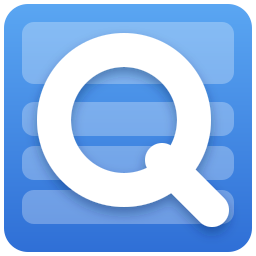
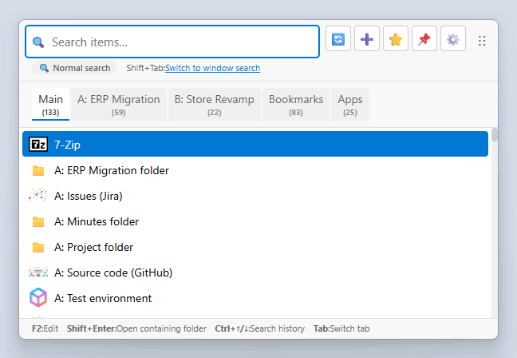
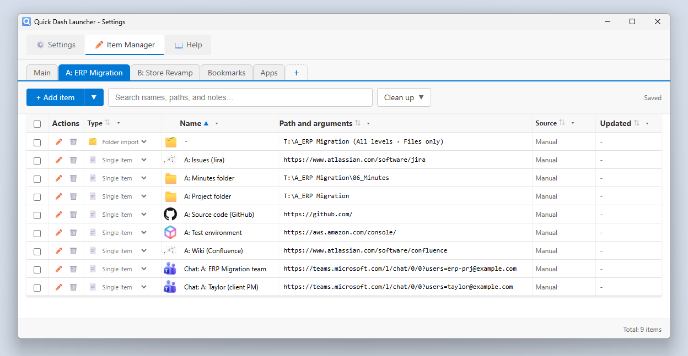
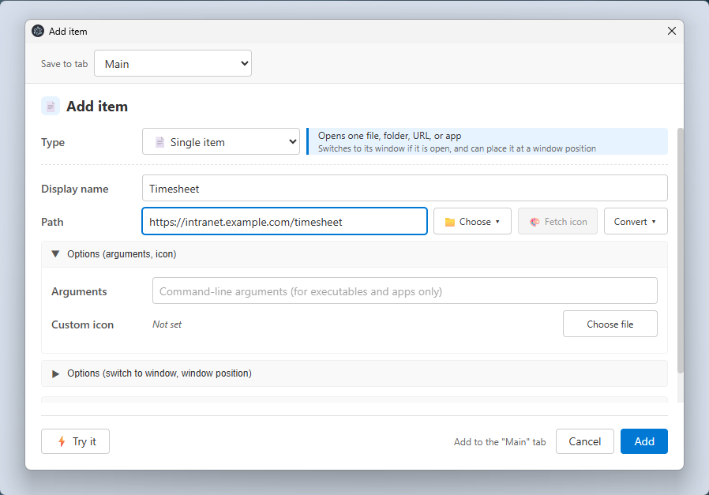
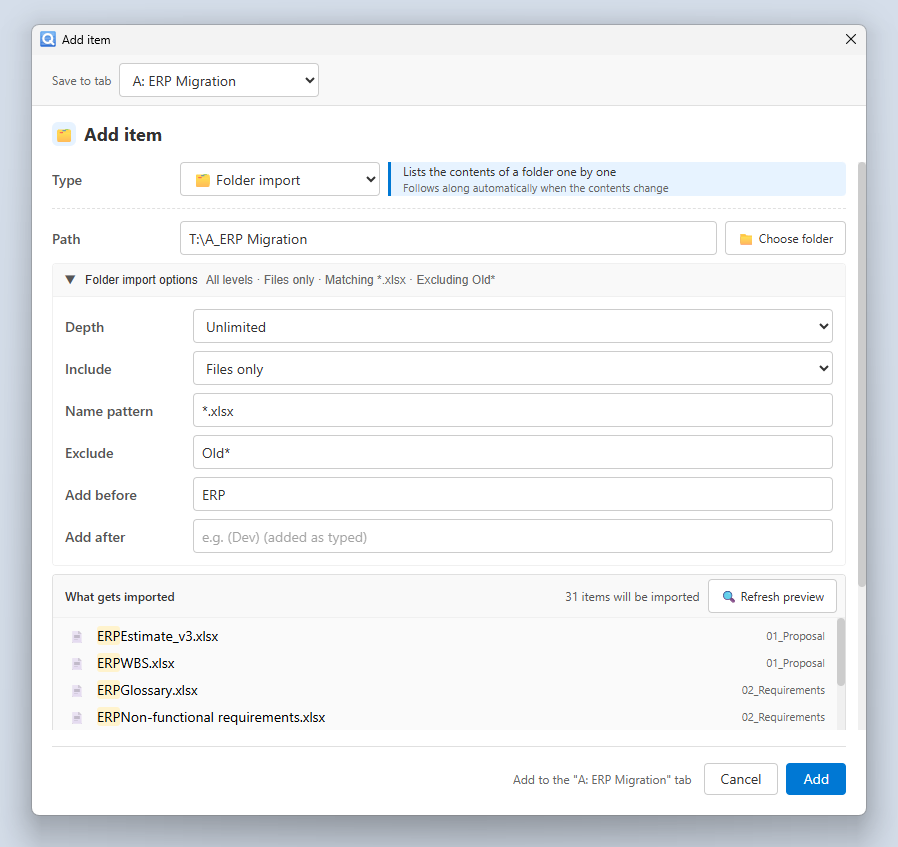
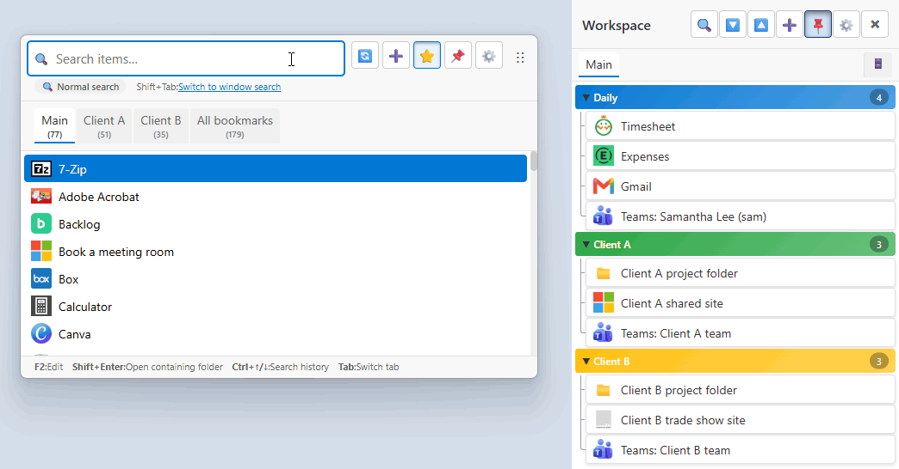

<p align="center">
  
</p>

<h1 align="center">Quick Dash Launcher</h1>

<p align="center"><b>English</b> | <a href="README.ja.md">日本語</a></p>

**A launcher where you add your apps, files, folders, and URLs, then open them by typing a keyword.**

Only what you've added shows up. A keyword can be any part of the name you gave it, and you can sort items into tabs such as "Daily" or one per project.

<p align="center">
  <a href="https://github.com/masaodev/quick-dash-launcher/releases"></a>
  <a href="LICENSE"></a>
  <a href="https://github.com/masaodev/quick-dash-launcher/releases"></a>
</p>

<p align="center">
  <a href="#installation">Installation</a> ·
  <a href="#adding-and-managing-items">Adding and managing items</a> ·
  <a href="#workspace">Workspace</a> ·
  <a href="docs/README.md">Documentation (Japanese)</a> ·
  <a href="https://github.com/masaodev/quick-dash-launcher/releases">Releases</a>
</p>

<p align="center">
  
</p>

<!-- Translation of README.ja.md (the source). Change both in the same PR. Re-record the demo GIF with `npm run docs:demo-gif:en` (demo data: tests/demo-gif/demo-content-en.ts and tests/e2e/templates/demo/) -->

## Who it's for

- You juggle several projects and keep searching for the same folders, documents, and web admin pages.
- You click through deep shared-folder paths every time.
- You open apps or bookmarks just to find a Teams chat or a webpage you use often.
- You don't want apps and files you never use showing up in the results.

It's free and open source (MIT). Try it right away with winget (for other ways, see [Installation](#installation)).

```powershell
winget install masaodev.quick-dash-launcher
```

---

## Features

- **Open everything from one place**
  - Open apps, folders, files, and websites, plus links such as Teams chats, from the same window.
  - Save snippets of text or images, and copy them back to the clipboard when you select them.
- **Name items and sort them into tabs**
  - Long paths and URLs open by the name you actually use, such as "Timesheet" or "Expenses."
  - Create whatever tabs you like, such as "Daily," one per project, or "Bookmarks."
- **Import many at once**
  - Pick apps from the Start menu and your browser bookmarks from a list and import them.
  - Point to a folder, and the files in it show up in the list. When files are added later, there's no need to add them again (you can also choose, for example, "`*.xlsx` only" or "skip `Old*`").
- **Matches appear as you type, ready to open**
  - Type part of a name, and the list narrows with each character. Press Enter to open it. Type "goo" to list your Google services, then add "map" after a space ("goo map") to narrow it to Google Maps.
  - If a match is in another tab, press Tab to switch to it.

---

## Why you add items yourself

Many launchers, such as PowerToys Run and Command Palette, index every installed app and file automatically, so things you never use end up in the results. The author built Quick Dash Launcher to get rid of that noise: you choose and add the things you use. Because only those items show up, a few keystrokes get you there. [Importing many at once](#features) keeps the setup effort low.

| | Search-based launchers (PowerToys Run and others) | Quick Dash Launcher |
| --- | --- | --- |
| What shows up | Everything installed | Only what you've added |
| Setup effort | None (added automatically) | Import folders, apps, and bookmarks in bulk |
| Organization | None | Sort into tabs as you like |
| Names | App and file names as they are | Names you choose |
| Files inside folders | Not shown | Shown once you import the folder |

---

## Adding and managing items

### Item Manager

Edit everything you've added, tab by tab. To open it, select ⚙ > **Item Manager** in the launcher.

<p align="center">
  
</p>

### Add item

Add one item at a time. To open it, select ➕ > **Add item** in the launcher, or drag and drop a file onto it.

<p align="center">
  
</p>

### Add item (folder import)

Set the type to **Folder import** to add all the files in a folder to the list.

<p align="center">
  
</p>

<!-- Re-take the screenshots with `npm run docs:readme-images:en` (demo data: tests/demo-gif/demo-content-en.ts) -->

---

## Workspace

The workspace is a separate window that keeps the things you use most at the edge of your screen. To open it, select ⭐ in the launcher or press `Ctrl+W`. Unlike the launcher, it stays visible while you work in other windows.

<p align="center">
  
</p>

- **Add items**: Right-click an item in the launcher, or drag it to the workspace. You can also drag files and URLs, or copy a path or text and press `Ctrl+V` in the workspace.
- **Organize with groups**: Sort items into color-coded groups, and create groups inside groups.
- **Detach a group**: Drag a group out of the workspace to open it in a window of its own, and put it anywhere on your screen.

For details, see [Workspace](docs/features/workspace.md) (Japanese).

<!-- Re-record the demo GIF with `npm run docs:demo-gif-workspace:en` (the real mouse pointer moves while recording; demo data: workspace in tests/demo-gif/demo-content-en.ts) -->

---

## More you can do

Change the type in the Add item window to do more than open files and URLs. For details on each type, see [Item types](docs/features/item-categories.md) (Japanese).

| Feature | What it does |
| --- | --- |
| [Set](docs/features/set.md) | Open several items or paths at once, and optionally move their windows to recorded positions |
| Clipboard item | Save text or images and copy them back to the clipboard when you select them |
| WS group | List workspace groups in the launcher and in search, and open a group in a detached window when you select it (add one from the ▼ next to "+ Add item" in Item Manager) |
| [Bookmark import](docs/features/bookmark-import.md) | Import your browser bookmarks, and optionally keep them up to date automatically |
| [Window search](docs/screens/main-window.md#526-ウィンドウ検索モード) | Find an open window by name and switch to it, including windows on other virtual desktops (press `Ctrl+Alt+Space` to open it directly) |
| [Command line (qdl)](docs/features/cli.md) | Add and change items, workspace groups, and settings with the `qdl` command. Results come back as JSON, so scripts and AI agents (such as Claude Code) can use it too. Turn it on in the basic settings |

---

## Installation

Runs on Windows 10 or later. The display language follows Windows (English or Japanese), and you can change it in **Settings**.

### winget

```powershell
winget install masaodev.quick-dash-launcher
```

To update, run `winget upgrade masaodev.quick-dash-launcher`. Only stable releases are published to winget (beta versions are available as pre-releases on the Releases page).

### Installer and ZIP versions

Download them from [Releases](https://github.com/masaodev/quick-dash-launcher/releases).

- Installer: Run `QuickDashLauncher.Setup.x.x.x.exe`. The app starts when the installation finishes.
- ZIP: Extract `QuickDashLauncher-x.x.x-portable.zip` to any folder and run `QuickDashLauncher.exe` (no installation needed).

<details>
<summary>Where the ZIP version saves data, and portable mode</summary>

Settings and data are saved in `%APPDATA%\quick-dash-launcher`, the same place as the installer, so a new version extracted to another folder uses the same data.

To use portable mode, check the portable mode option on the first-run setup screen, or create a `QuickDashLauncher-data` folder next to the exe. Settings and data are then saved in that folder, so you can carry the whole folder on a USB drive (to update, move `QuickDashLauncher-data` into the new folder).

If you use both a stable version and a beta version on the same PC, run the beta in portable mode. Otherwise both read the same data and can't run at the same time.

</details>

The installer and ZIP versions aren't signed, so Windows SmartScreen may show a warning the first time you run them. If it does, select **More info** > **Run anyway**.

When you first start the app, choose the launch hotkey that opens the launcher (Alt+Space by default). For keyboard operations, see [Keyboard shortcuts](docs/features/keyboard-shortcuts.md) (Japanese).

If something isn't working, see [Troubleshooting](docs/features/troubleshooting.md) (Japanese).

---

## Bug reports and contributing

Please report bugs and request features in [GitHub Issues](https://github.com/masaodev/quick-dash-launcher/issues). Issues in English are welcome, and so are pull requests.

Quick Dash Launcher is built with Electron, React, and TypeScript (the `qdl.exe` CLI is written in Rust). To build from source, you need Node.js, plus Visual Studio Build Tools (C++) and Python to compile native modules. For details, see the [development guide](docs/setup/development.md). For design and testing, see the [docs](docs/README.md). The documentation is in Japanese.

```bash
git clone https://github.com/masaodev/quick-dash-launcher.git
cd quick-dash-launcher
npm install
npm run dev          # Start in development mode
npm run test:unit    # Run unit tests
```

---

## License

Released under the [MIT License](./LICENSE).
