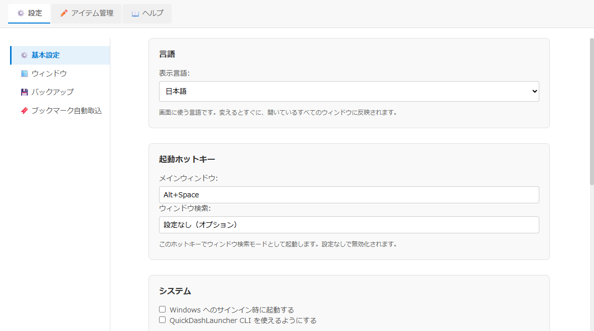
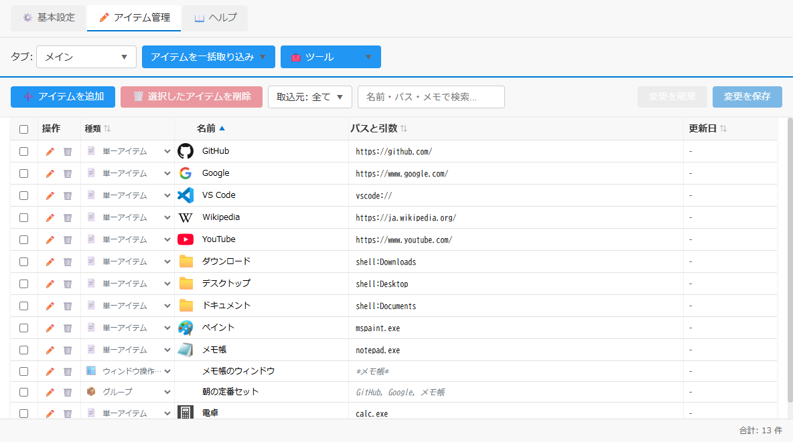
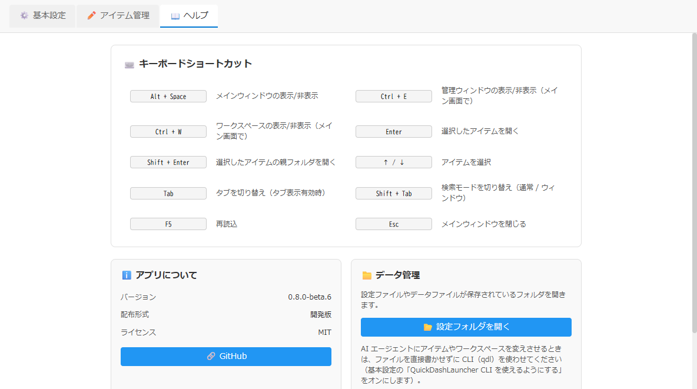

# 管理ウィンドウ仕様書

## 関連ドキュメント

- [画面一覧](./README.md) - 全画面構成の概要
- [メインウィンドウ仕様書](./main-window.md) - メイン画面の詳細な仕様
- [初回設定画面](./first-launch-setup.md) - 起動ホットキーが未設定のときに出る画面
- [ホットキー入力](./hotkey-input.md) - ホットキー入力欄の録画・確定・検証
- [設定ファイル形式](../architecture/file-formats/settings-format.md) - 設定項目のキー・型・既定値
- [データファイル形式](../architecture/file-formats/data-format.md) - アイテム管理で編集するデータの形式

## 1. 概要

管理ウィンドウは、QuickDashLauncherの設定変更とデータ編集を行う管理画面です。「設定」「アイテム管理」「ヘルプ」の3つのタブで構成され、アプリケーションの動作をカスタマイズできます。

**キーボードショートカット**:

- Ctrl+E: メインウィンドウから管理ウィンドウを開く/閉じる（トグル）
- Ctrl+S: 変更を保存（アイテム管理タブ）
- Delete: 選択したアイテムを削除（アイテム管理タブ。確認ダイアログあり。入力欄の中では文字の削除として扱う）

### 主要機能

- **設定タブ**: ホットキー、ウィンドウサイズ、ウィンドウ表示位置、自動起動、QuickDashLauncher CLI、バックアップ設定、ワークスペースウィンドウ設定、複数タブの表示
- **アイテム管理タブ**: data.jsonの直接編集、アイテムの追加・削除・重複削除、ブックマークインポート、タブとデータファイルの追加・名前の変更・削除
- **ヘルプタブ**: ファイル管理、システム情報表示、ショートカット一覧
- **設定の即座反映**: すべての設定変更が自動保存され、メインウィンドウに即座に反映される
- **リアルタイムバリデーション**: ホットキーの有効性をリアルタイムチェック

### 画面イメージ

**設定タブ**

**アイテム管理タブ**

**ヘルプタブ**

## 2. 基本情報

| 項目 | 内容 |
| --- | --- |
| **ファイル名** | `src/renderer/AdminApp.tsx` |
| **コンポーネント名** | `AdminApp` |
| **表示条件** | Ctrl+E、設定メニューから「⚙️ 設定」または「✏️ アイテム管理」を選択 |
| **画面タイプ** | ウィンドウ |
| **親画面** | メインウィンドウ |

## 3. 画面項目一覧

| エリア | 項目名 | 内容・説明 | 表示条件 | 機能詳細 |
| --- | --- | --- | --- | --- |
| **ヘッダー** | タブボタン（⚙️ 設定） | 設定タブへの切り替え | 常時表示 | [5.1](#51-タブボタンをクリック) |
| **ヘッダー** | タブボタン（✏️ アイテム管理） | アイテム管理タブへの切り替え | 常時表示 | [5.1](#51-タブボタンをクリック) |
| **ヘッダー** | タブボタン（📖 ヘルプ） | ヘルプタブへの切り替え | 常時表示 | [5.1](#51-タブボタンをクリック) |
| **設定** | 表示言語の選択欄 | 画面に使う言語（自動（Windows の表示言語に合わせる）／日本語／English）。変えるとすぐに、開いているすべてのウィンドウに反映される | 設定タブ（⚙️ 基本設定カテゴリの先頭「言語」） | [5.8](#58-表示言語を変更) |
| **設定** | ホットキー入力欄 | メインウィンドウのホットキーの設定 | 設定タブ | [5.2](#52-ホットキー入力欄でキー押下) |
| **設定** | ウィンドウ検索の起動ホットキー入力欄 | ウィンドウ検索のホットキー設定 | 設定タブ | [5.2](#52-ホットキー入力欄でキー押下) |
| **設定** | ウィンドウサイズ設定 | メインウィンドウと管理ウィンドウのサイズ設定 | 設定タブ | [5.3](#53-ウィンドウサイズを変更) |
| **設定** | 自動起動チェックボックス | Windows へのサインイン時に起動する設定 | 設定タブ | [5.4](#54-自動起動チェックボックスを変更) |
| **設定** | QuickDashLauncher CLI のチェックボックス | qdl コマンドを PATH から使えるようにする設定 | 設定タブ | [5.4](#quickdashlauncher-cli-を使えるようにする) |
| **設定** | バックアップ設定 | バックアップ機能の詳細設定 | 設定タブ | [5.5](#55-バックアップ設定を変更) |
| **設定** | スナップショット一覧ボタン | バックアップのスナップショット一覧を開く | 設定タブ（💾 バックアップカテゴリ）、バックアップ機能が有効なとき | [5.5.1](#551-スナップショット一覧) |
| **設定** | ウィンドウ表示位置設定 | ウィンドウ表示位置の選択（中央/カーソル位置/固定） | 設定タブ | [5.7](#57-ウィンドウ表示位置を変更) |
| **設定** | ワークスペース自動表示チェックボックス | メインウィンドウ表示時にワークスペースを自動表示 | 設定タブ | [5.28](#528-ワークスペースウィンドウ設定を変更) |
| **設定** | 左メニュー（4カテゴリ） | 「⚙️ 基本設定」「🪟 ウィンドウ」「💾 バックアップ」「🔖 ブックマーク自動取込」を切り替える | 設定タブ | [5.1](#51-タブボタンをクリック) |
| **設定** | 操作のヒントを表示チェックボックス | メインウィンドウの下に、気づきにくいキー操作（F2 で編集、Shift+Enter で親フォルダを開くなど）のヒントを出す（既定 ON）。変えるとメインウィンドウにすぐ反映される | 設定タブ（⚙️ 基本設定カテゴリ） | - |
| **設定** | ワークスペース表示位置設定 | ワークスペースの表示位置を選択（ディスプレイの左端/右端/固定位置） | 設定タブ | [5.28](#528-ワークスペースウィンドウ設定を変更) |
| **設定** | 切り離しウィンドウ連動非表示チェックボックス | メインウィンドウ非表示時にメインウィンドウと一緒に切り離しウィンドウも隠すにする | 設定タブ（🪟 ウィンドウカテゴリ） | - |
| **設定** | 切り離しウィンドウの表示位置設定 | 切り離しウィンドウの表示位置を選択（メインウィンドウと同じディスプレイ/置いた場所） | 設定タブ（🪟 ウィンドウカテゴリ） | [5.28](#528-ワークスペースウィンドウ設定を変更) |
| **設定** | すべての仮想デスクトップに表示チェックボックス | ワークスペースウィンドウをすべての仮想デスクトップに表示する | 設定タブ（🪟 ウィンドウカテゴリ） | - |
| **設定** | 切り離しウィンドウもすべての仮想デスクトップに表示チェックボックス | 切り離しウィンドウもすべての仮想デスクトップに表示する | 設定タブ（🪟 ウィンドウカテゴリ） | - |
| **設定** | ウィンドウ吸着チェックボックス | ワークスペースウィンドウや切り離しウィンドウをモニター端に近づけたとき自動的に吸着する（モニター端へのスナップ） | 設定タブ（🪟 ウィンドウカテゴリ） | - |
| **設定** | ワークスペースウィンドウ不透明度 | ワークスペースウィンドウの不透明度を設定（0-100%） | 設定タブ | [5.28](#528-ワークスペースウィンドウ設定を変更) |
| **設定** | ワークスペースウィンドウ背景透過 | 背景のみを透過するか設定 | 設定タブ | [5.28](#528-ワークスペースウィンドウ設定を変更) |
| **設定** | 複数タブを表示チェックボックス | メインウィンドウにタブを出し、別のデータファイルのアイテムを切り替えて表示する。タブとデータファイルの追加・変更はアイテム管理で行う | 設定タブ（⚙️ 基本設定カテゴリ） | [5.23](#523-タブ表示設定を変更) |
| **設定** | 既定値に戻すボタン | そのカテゴリの項目だけを既定値に戻す | 基本設定・ウィンドウ・バックアップの各カテゴリ末尾 | [5.6](#56-既定値に戻すボタンをクリック) |
| **アイテム管理** | タブの列 | 編集対象のタブを選ぶ。ファイルが 2 つ以上のタブには「📄2」のようにファイル数を添える。右クリックで名前の変更・移動・データファイルの追加・削除 | アイテム管理タブ | [5.25](#525-タブの列を操作) |
| **アイテム管理** | ＋（タブを追加） | タブの列の末尾。押すと名前の入力欄になり、Enter でタブを作る | アイテム管理タブ | [5.25](#525-タブの列を操作) |
| **アイテム管理** | データファイルの札の列 | 編集対象のデータファイルを 1 つ選ぶ。右端に選んでいるファイルの物理名。右クリックで名前の変更・移動・外す／削除 | アイテム管理タブ、ファイルが 2 つ以上のタブを選んでいるとき | [5.26](#526-データファイルの札を操作) |
| **アイテム管理** | ＋ ファイル | 新しいデータファイルを作る、または既存のファイルを入れるメニュー | 札の列があるとき | [5.26](#526-データファイルの札を操作) |
| **アイテム管理** | 検索入力欄 | 行の内容を検索して絞り込み | アイテム管理タブ | [5.9](#59-検索入力欄に文字入力アイテム管理) |
| **アイテム管理** | 検索クリアボタン（×） | 検索クエリをクリア | アイテム管理タブ、検索文字入力時 | [5.10](#510-検索クリアボタンをクリック) |
| **アイテム管理** | ＋ アイテムを追加ボタン | 単一アイテムを先頭に追加する。ツールバーの左端 | アイテム管理タブ（行を選んでいないとき） | [5.13](#513-アイテムを追加ボタンをクリック) |
| **アイテム管理** | 追加の ▼ メニュー | 「＋ アイテムを追加」の右隣。「📝 一覧に行を追加」「🗂️ フォルダ取込を追加」「🔖 ブラウザのブックマークから追加」「💻 インストール済みアプリから追加」「⚙️ ブックマーク自動取込の設定…」を選ぶ | アイテム管理タブ（行を選んでいないとき） | [5.11](#511-追加のメニューを選ぶ) |
| **アイテム管理** | 絞り込み ▼ | 取込元（すべて / 自動取込のみ / 手動登録のみ / ルール名）と「リンク切れだけ表示」で一覧を絞り込む。かかっている条件の数を「絞り込み（1）」のように添える | アイテム管理タブ（行を選んでいないとき） | [5.15](#515-絞り込みと整理のメニュー) |
| **アイテム管理** | 絞り込みの条件の札 | かかっている絞り込みをツールバーの下に並べる（例:「取込元: 自動取込のみ ×」「リンク切れだけ ×」）。× でその条件を外す | 絞り込みがかかっているとき | [5.15](#515-絞り込みと整理のメニュー) |
| **アイテム管理** | 整理 ▼ | 一覧の点検と片付け。「リンク切れを確認」「重複を削除」 | アイテム管理タブ（行を選んでいないとき） | [5.15](#515-絞り込みと整理のメニュー) |
| **アイテム管理** | 選択中の操作 | 「N 件を選択中」「削除」「複製」「選択を解除」。表示中のアイテムを選ぶと、ツールバーの左側（追加・検索・絞り込み・整理）がこれに切り替わる | 表示中のアイテムを 1 件以上選んでいるとき | [5.14](#514-選択したアイテムをまとめて削除複製する) |
| **アイテム管理** | 保存済みの表示 | ツールバーの右端に「保存済み」と出す | 未保存の変更が無いとき | [5.12](#512-変更を保存ボタンをクリック) |
| **アイテム管理** | 未保存の変更の件数 | ツールバーの右側に「変更 N 件」（変更・追加・削除の合計）と出す | 未保存の変更があるとき | [5.12](#512-変更を保存ボタンをクリック) |
| **アイテム管理** | 変更を保存ボタン | データファイルへの書き込み | 未保存の変更があるとき | [5.12](#512-変更を保存ボタンをクリック) |
| **アイテム管理** | 変更を破棄ボタン | 未保存の変更（追加・削除・編集）をすべて捨てる | 未保存の変更があるとき | [5.12](#512-変更を保存ボタンをクリック) |
| **アイテム管理** | 行一覧テーブル | データファイルの全行を表示・編集（アイコン表示を含む） | アイテム管理タブ | [5.16](#516-行の内容を直接編集) |
| **アイテム管理** | 行選択チェックボックス | 各行の選択状態を管理 | アイテム管理タブ | [5.17](#517-行選択チェックボックスをクリック) |
| **アイテム管理** | 右クリックメニュー | 行を右クリックで表示（複製・詳細編集・削除） | アイテム管理タブ、行選択時 | [5.29](#529-右クリックメニューを表示) |
| **アイテム管理** | ✏️ ボタン | 登録・編集フォームで詳細編集。アイコンだけのボタンで、ツールチップは「詳細編集（種類・引数・メモ・保存先など、すべての設定を編集）」 | アイテム管理タブ | [5.18](#518-編集ボタンをクリック) |
| **アイテム管理** | ステータスバー | 選択件数、合計件数、入力不備の件数、リンク切れの件数、未保存の変更件数の表示。トーストはこの帯に重ならないよう、その上に出る | アイテム管理タブ | - |
| **ヘルプ** | 📂 設定フォルダを開くボタン | 設定フォルダをエクスプローラーで開く | ヘルプタブ | [5.19](#519-設定フォルダを開くボタンをクリック) |
| **ヘルプ** | アプリケーション情報 | バージョン、配布形式（Microsoft Store 版・ポータブル版・インストーラー版・開発版）、ライセンス情報を表示 | ヘルプタブ | - |
| **ヘルプ** | 🔗 GitHubボタン | GitHubリポジトリを開く | ヘルプタブ | [5.22](#522-githubリポジトリボタンをクリック) |
| **ヘルプ** | ショートカット一覧 | 利用可能なキーボードショートカット。起動ホットキー・ウィンドウ検索のホットキーは設定の値をそのまま表示（未設定の起動ホットキーは「（未設定）」、ウィンドウ検索は設定したときだけ）。続けて Ctrl+E、Ctrl+W、Enter、Shift+Enter、F2（選択したアイテムを編集。通常の検索モードで）、↑/↓、Ctrl+↑/↓（検索履歴をたどる）、Tab、Shift+Tab、F5、Esc の順に並べる。キーは「Alt+Space」「Ctrl+E」のように + の前後に空白を入れずに書く（メイン画面の下のヒントと同じ書き方） | ヘルプタブ | - |
| **ヘルプ** | 🚪 アプリを終了ボタン | アプリを終了 | ヘルプタブ | [5.21](#521-アプリを終了ボタンをクリック) |

## 4. アクション一覧

| No | アクション名 | トリガー | 主な処理内容 | 詳細 |
| --- | --- | --- | --- | --- |
| 5.1 | タブボタンをクリック | タブボタンクリック | タブ切り替え（アイテム管理の未保存の変更は保持される） | [詳細](#51-タブボタンをクリック) |
| 5.2 | ホットキー入力欄でキー押下 | ホットキー入力欄でキー押下 | ホットキーの設定とバリデーション | [詳細](#52-ホットキー入力欄でキー押下) |
| 5.3 | ウィンドウサイズを変更 | 数値入力欄に入力 | ウィンドウサイズの変更 | [詳細](#53-ウィンドウサイズを変更) |
| 5.4 | 自動起動チェックボックスを変更 | チェックボックスクリック | 自動起動設定の変更（即座反映） | [詳細](#54-自動起動チェックボックスを変更) |
| 5.5 | バックアップ設定を変更 | チェックボックス・数値入力 | バックアップ設定の変更（即座反映） | [詳細](#55-バックアップ設定を変更) |
| 5.5.1 | スナップショット一覧 | 「スナップショット一覧」ボタンクリック | スナップショットの一覧表示・復元・削除 | [詳細](#551-スナップショット一覧) |
| 5.6 | 既定値に戻すボタンをクリック | ボタンクリック | カテゴリの項目を既定値に戻す（即座反映） | [詳細](#56-既定値に戻すボタンをクリック) |
| 5.7 | ウィンドウ表示位置を変更 | ラジオボタン選択 | ウィンドウ表示位置の変更（即座反映） | [詳細](#57-ウィンドウ表示位置を変更) |
| 5.8 | 表示言語を変更 | 選択欄で選ぶ | 画面に使う言語の変更（即座反映） | [詳細](#58-表示言語を変更) |
| 5.9 | 検索入力欄に文字入力（アイテム管理） | テキスト入力 | 行の絞り込み | [詳細](#59-検索入力欄に文字入力アイテム管理) |
| 5.10 | 検索クリアボタンをクリック | クリアボタン（×）クリック | 検索クエリをクリア | [詳細](#510-検索クリアボタンをクリック) |
| 5.11 | 追加のメニューを選ぶ | 「＋ アイテムを追加」の右隣の ▼ から項目を選ぶ | フォルダ取込の追加、ブックマーク取込画面・アプリ取込画面などを開く | [詳細](#511-追加のメニューを選ぶ) |
| 5.12 | 変更を保存ボタンをクリック | 保存ボタンクリック / Ctrl+S | データファイルに書き込み | [詳細](#512-変更を保存ボタンをクリック) |
| 5.13 | アイテムを追加ボタンをクリック | ボタンクリック | 新規アイテムを先頭に追加 | [詳細](#513-アイテムを追加ボタンをクリック) |
| 5.14 | 選択したアイテムをまとめて削除・複製する | 選択中の操作の「削除」「複製」 / Deleteキー | 確認後、選択中のアイテムを削除。または複製 | [詳細](#514-選択したアイテムをまとめて削除複製する) |
| 5.15 | 絞り込みと整理のメニュー | 「絞り込み ▼」「整理 ▼」 | 取込元・リンク切れでの絞り込み、リンク切れの確認、重複の削除 | [詳細](#515-絞り込みと整理のメニュー) |
| 5.16 | 行の内容を直接編集 | テーブルセル編集 | 行の内容を変更 | [詳細](#516-行の内容を直接編集) |
| 5.17 | 行選択チェックボックスをクリック | チェックボックスクリック | 行の選択状態を変更 | [詳細](#517-行選択チェックボックスをクリック) |
| 5.18 | 編集ボタンをクリック | ✏️ボタンクリック | 登録・編集フォームで詳細編集 | [詳細](#518-編集ボタンをクリック) |
| 5.19 | 設定フォルダを開くボタンをクリック | ボタンクリック | エクスプローラーで設定フォルダを開く | [詳細](#519-設定フォルダを開くボタンをクリック) |
| 5.21 | アプリを終了ボタンをクリック | ボタンクリック | アプリを終了 | [詳細](#521-アプリを終了ボタンをクリック) |
| 5.22 | GitHubリポジトリボタンをクリック | ボタンクリック | ブラウザでGitHubリポジトリを開く | [詳細](#522-githubリポジトリボタンをクリック) |
| 5.23 | タブ表示設定を変更 | チェックボックスクリック | タブ表示のON/OFFを切り替え | [詳細](#523-タブ表示設定を変更) |
| 5.25 | タブの列を操作 | クリック・右クリック・＋ | 編集対象のタブの切り替え、タブの追加・名前の変更・移動・削除（その場で確定） | [詳細](#525-タブの列を操作) |
| 5.26 | データファイルの札を操作 | クリック・右クリック・＋ ファイル | 編集対象のファイルの切り替え、データファイルの追加・名前の変更・移動・外す・削除（その場で確定） | [詳細](#526-データファイルの札を操作) |
| 5.27 | ウィンドウを閉じる操作 | ウィンドウ閉じるボタン / Ctrl+E | 未保存変更の確認後、ウィンドウを閉じる | [詳細](#527-ウィンドウを閉じる操作) |
| 5.28 | ワークスペースウィンドウ設定を変更 | スライダー・チェックボックス | ワークスペースウィンドウの不透明度と背景透過設定の変更（即座反映） | [詳細](#528-ワークスペースウィンドウ設定を変更) |
| 5.29 | 右クリックメニューを表示 | テーブル行を右クリック | 行の複製・詳細編集・削除のメニューを表示 | [詳細](#529-右クリックメニューを表示) |

## 5. 機能詳細

### 5.1. タブボタンをクリック

#### アクション

- ヘッダーのタブボタン（⚙️ 設定、✏️ アイテム管理、📖 ヘルプ）をクリック

#### 処理フロー

1. タブを切り替え、選択されたタブのコンテンツを表示
2. **アイテム管理タブの未保存の変更は管理ウィンドウ全体で保持される**ため、他のタブを見て戻っても消えない。
   未保存の変更がある間は、タブボタンに「✏️ アイテム管理 *」と印が付く

#### タブ内容

- **⚙️ 設定**: 設定項目を表示する（変更はその場で保存・反映）
- **✏️ アイテム管理**: データファイルの行一覧を表示する（「変更を保存」で確定）
- **📖 ヘルプ**: ファイル管理・アプリケーション情報・ショートカット一覧を表示する

#### 注意

- 左メニューのカテゴリを切り替えるときに、未保存の確認は出ない（設定タブの変更はその場で保存されるため）

### 5.2. ホットキー入力欄でキー押下

#### アクション

- ホットキー入力欄をクリックして、キーを押下

#### 処理フロー

1. ユーザーがキーを押下（例：Ctrl+Alt+Q）
2. 入力欄が押されたキーの組み合わせを読み取る
3. リアルタイムでバリデーションを実行：
   - 修飾キー（Ctrl、Alt、Shift）が含まれているか
   - 有効なキーの組み合わせか
4. バリデーション結果を表示：
   - 有効な場合：入力欄に表示
   - 無効な場合：エラーメッセージを表示
5. **即座保存**: バリデーション成功時、設定が自動的に保存され、全ウィンドウに設定変更が通知される

#### バリデーション条件

- 最低1つの修飾キー（Ctrl、Alt、Shift）が必要
- 単体のキーのみは不可
- Electronがサポートするキー組み合わせであること

#### 表示例

- **有効**: `Ctrl+Alt+Q`、`Ctrl+Shift+L`、`Alt+F1`
- **無効**: `Q`（修飾キーなし）、`Ctrl+Ctrl`（無効な組み合わせ）

入力欄の録画・確定・検証の細かい挙動は [ホットキー入力](./hotkey-input.md) を参照。

#### ウィンドウ検索の起動ホットキー

- 任意の設定。このホットキーで呼び出すと、最初からウィンドウ検索モードで開く
- 起動ホットキーとは別に設定する。既定値は `Ctrl+Alt+Space`。入力欄の「クリア」ボタンで空にすると、この機能は無効になる

#### うまくいかないとき

- **ホットキーが動作しない**: 他のアプリと競合している → 別のキー組み合わせに変える。管理者権限が要る場合がある → 管理者として実行する。ホットキーは「既定値に戻す」の対象外なので（[5.6](#56-既定値に戻すボタンをクリック)）、入力欄で設定し直す

### 5.3. ウィンドウサイズを変更

#### アクション

- ウィンドウサイズの数値入力欄に値を入力

#### 処理フロー

1. 入力値を取得
2. 範囲チェック：
   - メインウィンドウの幅: 400-2000px
   - メインウィンドウの高さ: 300-1200px
   - 管理ウィンドウの幅: 800-2000px
   - 管理ウィンドウの高さ: 600-1200px
3. **即座保存**: 設定が自動的に保存され、全ウィンドウに設定変更が通知される

#### 設定項目

- 「ウィンドウサイズ」セクションで、メインウィンドウと管理ウィンドウのそれぞれ「幅」「高さ」（px）を入力する
- 既定値は [設定ファイルの形式](../architecture/file-formats/settings-format.md#33-ウィンドウサイズ設定) を参照

### 5.4. 自動起動チェックボックスを変更

#### アクション

- 「Windows へのサインイン時に起動する」チェックボックスをクリック

#### 処理フロー

1. チェック状態を反転
2. **即座保存**: 設定が自動的に保存され、メインウィンドウに反映される
3. システム登録処理を実行（Windowsログイン時の自動起動を設定/解除）

#### 動作

- **有効**: Windowsログイン時にアプリケーションが自動起動
  - スタートアップフォルダにショートカットが作られる
- **無効**: 手動で起動する必要がある
  - スタートアップフォルダのショートカットが削除される

#### システム登録の詳細

- **登録先**: スタートアップフォルダ（`%APPDATA%\Microsoft\Windows\Start Menu\Programs\Startup`）の `QuickDashLauncher.lnk`
- **ショートカットのターゲット**: ポータブル版では起動した元の exe、インストーラー版では実行中の exe（ポータブル版は起動時に一時フォルダへ自己展開して実行されるため、実行中の exe を指すと一時フォルダになってしまう）
- **再作成**: アプリを起動するたびにショートカットを作り直すので、exe の移動やバージョン更新（ファイル名の変更）の後も、次に起動したときにパスが直る
- **開発環境・別インスタンス**: パッケージ化されていない起動と、`APP_INSTANCE` を付けた起動では、設定は保存されますが実際の登録はスキップされます（ショートカットはインスタンスを区別しない 1 つだけなので、試験用のインスタンスで本番のショートカットを変えないため）

#### Store 版（MSIX）の場合

- **登録先**: ショートカットは作らず、Windows の「スタートアップ アプリ」に Store 版として登録されたもの（StartupTask）を有効・無効にする。同じ PC にポータブル版・インストーラー版があっても、そちらのショートカットには触れない
- **起動時**: チェックがオンで、Windows 側の登録が無効のときだけ有効にする（Windows 側で有効にしたものを、起動のたびに無効へ戻さない）。起動を待たせないよう、裏で反映する
- **ほかの設定を変えたとき**: チェックの値が変わったときだけ Windows 側に反映する（ほかの設定の保存で、Windows 側で有効にしたものを無効に戻さない）。反映に失敗しても設定の保存は止めない
- **Windows 側で無効にされているとき**: タスク マネージャーや Windows の［設定］→［アプリ］→［スタートアップ］で利用者が無効にすると、アプリからは有効にできない（Windows の決まり）。そのときはチェックの下に「Windows の［設定］→［アプリ］→［スタートアップ］で QuickDashLauncher をオンにしてください」と出す。組織のポリシーで無効のときは、ここからは有効にできない旨だけを出す。案内はチェックがオンのときだけ出す
- **チェックがオフで Windows 側が有効のとき**: Windows 側で有効になっている旨と止め方を、チェックの下に出す（組織のポリシーで有効なときは、その旨だけ）
- **状態を読み直すとき**: 設定を保存した後と、管理ウィンドウにフォーカスが戻ったとき（Windows の設定で変えて戻ってきたとき）

#### 確認方法

- Windowsのタスクマネージャー → スタートアップタブで登録状態を確認できます
- 設定が正しく反映されているか確認する際に便利です

#### うまくいかないとき

- 二重に起動する: 一度無効にしてから、もう一度有効にする
- ポータブル版で exe を移動・リネーム（バージョン更新）した: 新しい exe を一度手で起動すると、ショートカットのターゲットが更新される

#### QuickDashLauncher CLI を使えるようにする

同じ「システム」欄の「QuickDashLauncher CLI を使えるようにする」チェックボックスも、変えるとすぐ保存して反映する。

- **有効**: 同梱の `qdl.exe` を `%LOCALAPPDATA%\quick-dash-launcher\bin` にコピーし、そのフォルダをユーザーの環境変数 PATH に足す。PATH を書き換えたときは「QuickDashLauncher CLI を使えるようにしました。新しく開いたターミナルから qdl で使えます」とトーストで知らせる
- **無効**: PATH からそのフォルダを外し、コピーした `qdl.exe` を消す。PATH を書き換えたときは「QuickDashLauncher CLI を使えないようにしました（qdl コマンドを PATH から外しました）」とトーストで知らせる
- **起動のたび**: 有効なら、同梱の `qdl.exe` とコピー済みのものを比べ、違えば入れ替える（本体を更新したときに CLI の版が追従する）
- **開発環境・別インスタンス**: 自動起動と同じく、パッケージ化されていない起動と `APP_INSTANCE` を付けた起動では何もしない（PATH とコピー先はインスタンスを区別しない 1 つだけのため）

CLI でできることは [QuickDashLauncher CLI](../features/cli.md) を参照。

### 5.5. バックアップ設定を変更

#### アクション

- バックアップ関連のチェックボックス、または数値入力欄を変更

#### 処理フロー

1. 変更された項目の値を取得
2. **即座保存**: 設定が自動的に保存され、全ウィンドウに設定変更が通知される

#### 設定項目

- **バックアップ機能を有効にする**: バックアップ機能全体のON/OFF
- **バックアップ保存件数**: 3〜50 件
- **クリップボードデータもバックアップに含める**: 説明文「クリップボードデータは容量が大きくなる可能性があります。」が付く

既定値は [設定ファイルの形式](../architecture/file-formats/settings-format.md#35-バックアップ設定) を参照。

#### 表示条件

- 「バックアップ機能を有効にする」がOFFの場合、他のバックアップ設定は非表示

#### 保存されるもの

- 設定フォルダの `backup/<タイムスタンプ>/` に、データファイル・設定ファイルなどをまとめてスナップショットとして保存する。復元は「スナップショット一覧」から選ぶ（[5.5.1](#551-スナップショット一覧)）
- 対象のファイルと作るタイミングは [ファイル形式一覧 - バックアップ](../architecture/file-formats/README.md#バックアップ) を参照

### 5.5.1. スナップショット一覧

#### アクション

- 💾 バックアップカテゴリの「スナップショット一覧」ボタンをクリック（「バックアップ機能を有効にする」が ON のときだけ表示）

#### 表示内容

| エリア | 項目 | 内容 |
| --- | --- | --- |
| ヘッダー | 見出し・件数 | 「スナップショット一覧」と「N 件」 |
| メッセージ | 結果の表示 | 復元・削除の結果。一覧の上に出る |
| 一覧 | 各行 | 作成日時（表示言語の書式。日本語なら「2026/2/11 8:30:00」の形）、フォルダ名、ファイル数（「N ファイル」）、合計サイズ（B・KB・MB） |
| フッター | 「削除」「復元」「閉じる」ボタン | 「削除」「復元」は、行を選んでいて処理中でないときだけ押せる |

- 一覧は新しい順に並ぶ。日次のスナップショットのほか、復元の前・外部変更の前・形式の移行の前に自動で作られたもの（フォルダ名の末尾に `_pre-restore` などが付く。[ファイル形式一覧 - バックアップ](../architecture/file-formats/README.md#バックアップ)）も並ぶ
- 読み込み中で一覧が空のときは「読み込み中…」、スナップショットが 1 つもないときは「スナップショットはありません」を表示する
- 行をクリックすると、その行を選ぶ

#### 処理フロー（復元）

1. 「復元」を押すと、確認ダイアログ（[ConfirmDialog](./dialogs.md#3-confirmdialog)）「スナップショットの復元」を出す。文面は「選択したスナップショット（<フォルダ名>）からデータを復元します。復元前に現在の状態が自動バックアップされます。続行しますか？」、ボタンは「復元する」「キャンセル」
2. 「復元する」を押すと、今のファイルをフォルダ名の末尾に `_pre-restore` を付けたスナップショットに残す（バックアップ機能の設定にかかわらず作る。作れなくても復元は続ける）
3. スナップショットの中のファイルを、設定フォルダへすべて上書きでコピーする（スナップショットにないファイルは消さない）
4. 「復元が完了しました。設定を反映するためにアプリの再起動を推奨します。」を表示し、一覧を読み直す

#### 処理フロー（削除）

1. 「削除」を押すと、確認ダイアログ「スナップショットの削除」を危険操作の表示で出す。文面は「選択したスナップショット（<フォルダ名>）を削除します。この操作は元に戻せません。」、ボタンは「削除する」「キャンセル」
2. 「削除する」を押すと、スナップショットのフォルダを消し、「スナップショットを削除しました」を表示する。行の選択は外れ、一覧を読み直す

#### 閉じる操作

- 「閉じる」ボタン、Escape キー、モーダルの外側のクリックで閉じる。確認ダイアログが出ているときの Escape は、確認ダイアログだけを閉じる
- 開いたときと閉じたときに、バックアップカテゴリの「スナップショット: N 件」「最終バックアップ」を読み直す

#### エラーハンドリング

- 復元・削除に失敗したら、一覧の上に「復元に失敗しました: <理由>」「削除に失敗しました: <理由>」を表示する。選んだスナップショットのフォルダがもう無いときの理由は「スナップショットが見つかりません」
- 処理の途中でエラーが起きたら、「復元中にエラーが発生しました」「削除中にエラーが発生しました」を表示する
- 一覧を読み込めなかったときは、スナップショットがないときと同じ表示になる

### 5.6. 既定値に戻すボタンをクリック

#### アクション

- 基本設定・ウィンドウ・バックアップの各カテゴリの末尾にある「〈カテゴリ名〉を既定値に戻す」ボタンをクリック
- ボタンは危険操作の表示（白地に赤の枠と赤文字の小さめのボタン）。既定値に戻している間は押せない
- ボタンの上に「「〈カテゴリ名〉」の設定を既定値に戻します。」と説明を出す（基本設定では続けて「ホットキーは変更しません。」）

#### 処理フロー

1. 確認ダイアログ（タイトル「既定値に戻す」）を危険操作の表示で出す。文面は「「〈カテゴリ名〉」の設定を既定値に戻しますか？」で、基本設定では次の行に「ホットキーは変更しません。」を添える。ボタンは「既定値に戻す」「キャンセル」
2. 「既定値に戻す」を選んだ場合：
   - そのカテゴリの項目だけを既定値に戻す
   - 副作用のある設定（自動起動・QuickDashLauncher CLI・ワークスペースの不透明度と位置・全デスクトップ表示・スナップ）を適用し直す
   - 全ウィンドウに設定変更を通知し、設定画面と管理ウィンドウの状態を戻した後の値に更新する
   - トーストで「「〈カテゴリ名〉」を既定値に戻しました」と知らせる
3. キャンセルの場合：処理を中止

#### 戻す範囲

| カテゴリ | 戻す項目 | 戻さない項目 |
| --- | --- | --- |
| 基本設定 | Windows へのサインイン時に起動する、QuickDashLauncher CLI を使えるようにする、操作のヒントを表示 | ホットキー（メインウィンドウ・ウィンドウ検索）、表示言語。ホットキーは利用者が決めた値で、メインウィンドウのホットキーは既定値が空のため、戻すと次回起動が初回起動扱いになるため |
| ウィンドウ | ウィンドウサイズ、表示位置、ワークスペースウィンドウの各項目 | — |
| バックアップ | バックアップの有効・保存件数・クリップボードを含める | — |

ブックマーク自動取込には置かない（自動取込ルールはそのカテゴリで管理し、既定値に戻す操作の対象にしない）。タブ構成（アイテム管理で管理する）と「複数タブを表示」も戻さない（戻すと、作ったタブが急に見えなくなるため）。

#### エラーハンドリング

- リセット失敗時：「設定のリセットに失敗しました。」というアラートを表示

#### 注意

- 即座に反映され、「保存」ボタンは不要。

### 5.7. ウィンドウ表示位置を変更

#### アクション

- ウィンドウ表示位置のラジオボタンを選択

#### 処理フロー

1. 選択した表示位置モードを取得
2. **即座保存**: 設定が自動的に保存され、メインウィンドウに反映される

#### 選択肢

| 選択肢 | 説明 |
| --- | --- |
| **画面中央（固定）** | 常にプライマリモニターの中央にウィンドウを表示します |
| **画面中央（自動で切り替え）** | マウスカーソルがあるモニターの中央にウィンドウを表示します（マルチモニター推奨） |
| **カーソル付近** | マウスカーソルの近くにウィンドウを表示します（検索入力がしやすい位置） |
| **固定位置（手動設定）** | ウィンドウを移動した位置を記憶して、次回も同じ位置に表示します |

#### 注意

- 既定値は [設定ファイルの形式](../architecture/file-formats/settings-format.md#37-ウィンドウ表示位置設定) を参照
- 「画面中央（自動で切り替え）」は、マルチモニター環境で作業中のモニターにウィンドウを表示したい場合に便利です
- 「固定位置（手動設定）」では、ウィンドウを手動で移動した後の位置が記憶されます。記憶した位置がどのモニターにも入らないとき（モニターを外した後など）は、画面中央に表示し、その位置を記憶し直します。表示中に画面外に出てしまったときは、システムトレイメニューの「画面中央に表示」で戻せます

### 5.8. 表示言語を変更

#### アクション

- 「言語」の「表示言語」で選ぶ

#### 処理フロー

1. 選んだ言語を保存する
2. **即座反映**: 開いているすべてのウィンドウの文言が、その言語に切り替わる（再起動は要らない）

#### 選択肢

| 選択肢 | 説明 |
| --- | --- |
| **自動（Windows の表示言語に合わせる）** | Windows の表示言語が日本語なら日本語、それ以外なら英語にする（既定） |
| **日本語** | 日本語で表示する |
| **English** | 英語で表示する |

#### 注意

- 選択肢の「日本語」「English」は、どちらの言語で表示しているときも同じ書き方で出す

### 5.9. 検索入力欄に文字入力（アイテム管理）

#### アクション

- アイテム管理タブの検索入力欄に文字を入力

#### 処理フロー

1. 入力値を取得
2. 入力値をスペースで分割してキーワード配列を作成
3. 各行をキーワードで絞り込む（検索の対象は下の「検索の対象」）：
   - すべてのキーワードが含まれる行のみ表示
   - 大文字小文字を区別しない
4. 絞り込み結果を表示
5. 非表示になった行の選択状態をクリア

#### 検索の対象

- 行の表示テキスト（名前・パス・引数など）
- メモ
- セットは、セットの名前と、各行の名前・行が指すアイテムの名前・行で開くパス

#### 検索例

- 入力: `chrome google` → "chrome" AND "google"を含む行のみ表示
- 入力: `data.json` → "data.json"を含む行のみ表示

### 5.10. 検索クリアボタンをクリック

#### アクション

- 検索入力欄の「×」ボタンをクリック

#### 処理フロー

1. 検索クエリをクリア
2. すべての行を表示

#### 表示条件

- 検索文字が入力されている時のみ「×」ボタンを表示

### 5.11. 追加のメニューを選ぶ

#### アクション

- 「＋ アイテムを追加」の右隣の ▼ を押し、メニューから項目を選ぶ
  - 「📝 一覧に行を追加」: 一覧に空の行を足す。「＋ アイテムを追加」ボタンと同じ（5.13）
  - 「🗂️ フォルダ取込を追加」: パスが空のフォルダ取込を先頭に追加し（パス列は「（フォルダパスなし）」）、パスセルをすぐ編集状態にする。それ以外は 5.13 と同じ（フォルダ取込は名前を持たないため、パスの入力から始める）
  - 「🔖 ブラウザのブックマークから追加」: 下記の処理フロー
  - 「💻 インストール済みアプリから追加」: [アプリ取込画面](./app-import-modal.md) を開く。取込先の初期値は、選択中のタブに作る新しいデータファイル
  - 「⚙️ ブックマーク自動取込の設定…」: 設定タブの「🔖 ブックマーク自動取込」を開く

#### 処理フロー（ブラウザのブックマークから追加）

1. [ブックマーク取込画面](./bookmark-import-modal.md) を開く。取込先の初期値は、選択中のタブに作る新しいデータファイル
2. ユーザーが取込元（Chrome / Edge / HTML ファイル）を選び、フォルダの木にチェックを入れて選ぶ
3. 「取り込む」: 取込先が新しいタブ・データファイルならここで作り、選んだブックマークを新規行として追加（先頭に追加、行番号を振り直し、未保存の変更として扱う）する。自動取込ルールとの紐づけは付かない。取込先のタブ・データファイルを開く
4. 「〜を、これからも自動で取り込む」をオンにして取り込む（フォルダごと選んだときだけ）: 設定にルールを追加してすぐ実行する（データファイルへ直接書く。未保存の変更があれば外部変更の取り込みで載せ直す）

#### 関連ドキュメント

- [ブックマーク取込画面仕様書](./bookmark-import-modal.md)
- [ブックマークの取り込み](../features/bookmark-import.md)

### 5.12. 変更を保存ボタンをクリック

#### アクション

- 「変更を保存」ボタンをクリック、またはCtrl+Sキーを押下
- セルの入力中にCtrl+Sを押した場合は、入力欄を確定してから保存に進む

#### 処理フロー

1. 未保存の変更（追加・削除・編集）が無ければ何もしない
2. 保存確認ダイアログを表示：
   - メッセージ: 「変更を保存しますか？」
   - 名前やパスが空など入力に不備があるアイテムがあれば、その件数を併記する（保存は妨げない）
   - 確認ボタン: 「保存」
3. 保存内容を作る：
   - 内容が変わったアイテムにだけ更新日時を付け直す
   - ファイル別に行番号（ファイル内の位置）を振り直す
4. データファイルに書き込む：
   - 読み込み時（または前回保存時）のハッシュと突き合わせ、外部で変わっていれば拒否する（楽観ロック）
   - 内容が変わったファイルだけを書く。書き込みに失敗したらエラーにする
   - 一覧から消えたクリップボードアイテムの実データも削除する
   - 保存後の全ファイルのハッシュを返し、次回の保存に使う
5. 保存が成功したときだけ編集状態を確定し、「変更を保存しました」を表示する
6. 実際に書いたファイルがあれば、全ウィンドウにデータ変更を通知する

#### 保存に失敗したとき

- **外部変更との競合**: 「データファイルが QDL の外で変更されていた（または他の画面で編集された）ため…」の
  警告を出し、最新の内容を読み込み直す。**未保存の変更は捨てず、新しい内容の上に載せ直す**（5.16 の「外部変更の取り込み」）。
  内容を確認してもう一度保存する
- **読み込みに失敗している状態**: 保存を拒否する（読めなかったファイルを空で上書きしないため）
- **その他の失敗**: エラーダイアログを出し、編集状態は未保存のまま残す

#### 表示条件

- 未保存の変更があるときだけ、ツールバーの右側に「変更 N 件」（変更・追加・削除の合計）と「変更を破棄」「変更を保存」を出す
- 未保存の変更が無いときはボタンを出さず、「保存済み」とだけ表示する。Ctrl+S を押しても何もしない

#### 変更を破棄ボタン

- 未保存の変更があるときだけ表示する
- 確認「未保存の変更をすべて捨てて、ファイルの内容に戻しますか？」の後、追加・削除・編集をすべて元に戻す

### 5.13. アイテムを追加ボタンをクリック

#### アクション

- 「＋ アイテムを追加」ボタンをクリック（追加の ▼ メニューの「📝 一覧に行を追加」も同じ）

#### 処理フロー

1. 検索と絞り込み（取込元・リンク切れだけ表示）を外す（追加した行が隠れないように）
2. 単一アイテム（名前・パスが空）を作る。id はこの時点で採番する
3. 現在選択中のデータファイルの先頭に追加し、行番号を振り直す。一覧でも先頭に表示され、名前セルがすぐ編集状態になる
4. パスが空の間は、パス列に「（パスなし）」と表示し、ステータスバーの「入力不備」に数える
5. 名前を入れて Enter（または Tab）を押すと、同じ行のパスセルの編集に進む。並べ替えは編集中に適用されないので行は動かない
6. 種類を変えるには「種類」列のプルダウン。セット・クリップボードを選ぶと、その種別で詳細編集が開く

### 5.14. 選択したアイテムをまとめて削除・複製する

#### アクション

- 行のチェックボックスでアイテムを選ぶと、ツールバーの左側が「N 件を選択中」「削除」「複製」「選択を解除」に切り替わる
- 「削除」をクリック、またはDeleteキーを押下
- Deleteキーは、検索欄やセルの入力中には文字の削除として扱い、アイテムは削除しない

#### 処理フロー

1. **表示中の**選択アイテムを取得（検索・絞り込みで見えていないアイテムは対象にしない）
2. 確認ダイアログを表示：1 件なら「「{名前}」を削除しますか？」、2〜3 件なら「「{名前}」、「{名前}」 の {N} 件を削除しますか？」、4 件以上なら「{N} 件のアイテムを削除しますか？」。その下に空行を挟んで「一覧から外すだけで、ファイルやフォルダは消えません。」を添え、消すものにクリップボードが含まれるときは続けて「保存したクリップボードの中身も消えます。」も添える（確認ボタンは「削除」）
3. 「削除」の場合：一覧から除き、行番号を振り直し、選択を解除する。未保存の変更として扱う
4. キャンセルの場合：処理を中止

#### 複製・選択を解除

- 「複製」: 表示中の選択アイテムを新しい id で複製し、選んだアイテムのうち最後のものの直後に入れる（右クリックメニューの「複製」と同じ。未保存の変更として扱う）
- 「選択を解除」: 選択をすべて外し、ツールバーを元の表示に戻す

#### 表示条件

- 表示中のアイテムを 1 件以上選んでいるときだけ表示する（その間は追加・検索・絞り込み・整理を隠す。保存の表示はそのまま）
- 見出しのチェックボックスで、表示中のアイテムをすべて選べる。絞り込んでから全選択すれば、絞り込んだアイテムだけをまとめて削除できる
- 行の 🗑️ ボタン、右クリックメニューの「削除」も同じ確認を経る

### 5.15. 絞り込みと整理のメニュー

ツールバーの「絞り込み ▼」に一覧の絞り込み、「整理 ▼」に一覧の点検と片付けをまとめる。

#### 絞り込み ▼

- 取込元: 「すべて」「自動取込のみ」「手動登録のみ」と、選んでいるデータファイルを取込先とする自動取込ルールの名前から 1 つ選ぶ
- 表示: 「☐ リンク切れだけ表示」。「整理 ▼」の「リンク切れを確認」を実行した後だけ選べる。選ぶとパスが見つからなかったアイテムだけを表示し、もう一度選ぶと戻る
- かかっている条件の数をボタンに添え（例:「絞り込み（1）」）、ボタンの色を変える。条件はツールバーの下に札で並べ、札の × でその条件を外せる
- データファイルを切り替えると取込元の絞り込みは「すべて」に戻る

#### リンク切れを確認（整理 ▼）

1. 表示中のデータファイルの単一アイテム・フォルダ取込のうち、ローカルパスを持つものをまとめて確認する。
   確認しないパス: URL、カスタム URI（`ms-todo:` など）、`shell:` で始まるもの、区切り文字を含まない裸のコマンド名（`notepad.exe` など。PATH から解決されるため）
2. **押したときだけ確認する**（自動では確認しない）。ネットワークパスは応答に時間がかかることがあるため
3. 環境変数（`%APPDATA%` など）を展開してから、パスにアクセスできるかを確かめる。1 パスごとに 3 秒の時間切れを設け、同時 8 件までで並行する。時間内に応答が無いパスは「応答なし」（リンク切れとは数えない）
4. 結果を 1 行のトーストで知らせる（例:「リンク切れ 2 件（12 件を確認・応答なし 1 件）」、無ければ「リンク切れなし（12 件を確認）」。5 秒はリンク切れがあるときの警告トーストだけで、無いときは成功トーストの既定の長さ）。確かめるローカルパスが 1 つも無いときは、代わりに「確認対象のローカルパスがありません（URL・shell:・コマンド名は確認しません）」と知らせる。パスが実在しないアイテムはパス列の先頭に「⚠ 見つかりません」の印、ステータスバーに「リンク切れ: N 件」。その件数のツールチップに「「絞り込み ▼」の「リンク切れだけ表示」で絞り込めます。応答のないネットワークパスなどは、リンク切れに数えません」を出す
5. 結果は読み込み・保存で捨てる。セルでパスを直したアイテムは印が消える（直した結果は次の確認で反映）

#### 重複を削除（整理 ▼）

#### 処理フロー

1. **現在選択中のデータファイルのみ**を対象に、種類と表示テキスト（名前・パスなど）が同じアイテムを探す
2. 重複が無ければ「重複するアイテムはありません」と表示して終了
3. 重複があれば確認ダイアログを危険操作の表示で出す：「{ファイル名} に、種類・名前・パスが同じアイテムが {N} 件あります。先にある 1 件を残して削除しますか？（保存で確定）」。確認ボタンは「削除」
4. 「削除」の場合：ファイル内で後にある重複を除き、「重複 {N} 件を削除しました」と表示する。消したアイテムを指していたセットの行は、残す 1 件を指すように付け替える（どのデータファイルのセットでも）。どちらも未保存の変更として扱う（保存するまでファイルは変わらない）

#### 注意

- 並び順の整列は行わない。メイン画面は常に表示名の昇順で表示するため、ファイル内の並びを変えても見た目は変わらない
- 他のデータファイルのアイテムは消さない（セットの行の付け替えだけは、ほかのデータファイルのセットにも及ぶ）

### 5.16. 行の内容を直接編集

#### テーブル構造

アイテム管理タブの行一覧テーブルは、以下のカラム構成で表示されます：

| カラム | 説明 |
| --- | --- |
| **選択チェックボックス** | 行の選択状態を管理（ヘッダーで全選択/解除可能） |
| **操作** | ✏️ 詳細編集ボタン（すべての項目を編集）、🗑️ 削除ボタン。見つけやすいよう先頭に置く |
| **種類** | プルダウンで 4 種類（単一アイテム・フォルダ取込・セット・クリップボード）から選ぶ。単一アイテム・フォルダ取込はその場で切り替わる（id・メモは引き継ぎ、名前・パスは持てる範囲で残す）。セット・クリップボードは必須データが要るので、選ぶとその種別で詳細編集が開く（選択肢の名前の後に「…」が付く） |
| **アイコン** | メインウィンドウと同じアイコン表示（単一アイテムのみ） |
| **名前** | 表示名（クリックして編集可能。フォルダ取込は名前を持たないため「-」） |
| **パスと引数** | パスと引数の組み合わせ（パスが無く切り替える先のウィンドウだけを持つ単一アイテムは「（パスなし・切り替えるだけ: <対象ウィンドウ>）」と出し、入力不備には数えない。単一アイテム・フォルダ取込はパスをクリックして編集可能。セット・クリップボードは ✏️ の詳細編集から。ダブルクリックでも開く。セットは「n 行」、ウィンドウ位置を記録した行があれば「n 行（ウィンドウ位置のある行 m）」、行が 0 件なら「（アイテムなし）」と出す。フォルダ取込はパスの後ろにオプションを「C:\Windows\Web（2 階層・ファイルのみ・条件 \*.jpg・除外 \*4k\*）」の形で添える。深さは 0 なら「このフォルダのみ」、無制限なら「すべての階層」、種類は「ファイルとフォルダ」なら書かず、条件・除外は指定があるときだけ。この列での並べ替えも、この文字列で並べる）。1 行に収めて省略し、全文はツールチップに出す。「リンク切れを確認」で見つからなかったパスは先頭に「⚠ 見つかりません」の印 |
| **更新日** | 最後に保存した日時 |

一覧が空のときは、表の代わりに案内を出す。絞り込み中なら「条件に一致するアイテムがありません」、そうでなければ「このデータファイルにアイテムがありません。「＋ アイテムを追加」で追加できます。横の ▼ から、ブラウザのブックマークやインストール済みアプリも取り込めます」。

#### アイコン列の表示

**単一アイテムのアイコン表示:**

- メインウィンドウと同じアイコン表示機能を使用
- ファビコン、自動取得アイコン、カスタムアイコンの順で表示
- 取得済みのアイコンをまとめて読み込んで表示する
- アイコン画像が無いときは、メインウィンドウと同じ種類ごとの絵文字を出す（URL 🌐・ファイル 📄・アプリ ⚙️・フォルダ 📁・カスタム URI 🔗・パスなし 🪟）

**アイコン表示の対象:**

- **単一アイテム**: アイコン画像、無ければ種類ごとの絵文字
- **クリップボード・セット**: カスタムアイコンを設定した行はそのアイコン、無ければクリップボードは 📋、セットは 📦
- **フォルダ取込**: 🗂️

**アイコンの種類:**

1. **カスタムアイコン**: ユーザーが設定した画像ファイル（最優先）
2. **自動取得アイコン**: アプリケーション実行ファイルから抽出したアイコン
3. **ファビコン**: WebサイトURLの場合、自動取得されたファビコン
4. **種類ごとの絵文字**: 上のどれも無いとき（上の「アイコン表示の対象」の絵文字）

#### アクション

- 行一覧テーブルのセルを編集

#### 処理フロー

1. セルの内容を編集し、Enter またはフォーカス移動で確定する（日本語入力の変換を確定する Enter では確定しない）。名前セルで Enter / Tab を押すと同じ行のパスセルの編集に進む。名前は前後の空白を除き、空にしたときは元の名前のまま
2. アイテムの id をキーに作業中の一覧を差し替え、表示テキストと検証結果を作り直す
   （行番号は使わない。行の追加・削除で行番号がずれても、編集は元のアイテムに付いたまま）
3. ディスクの内容との差分から未保存の変更を求める。編集して元に戻せば未保存扱いにならない
4. 未保存の変更があるアイテムは行の左端に印が付く

#### リンク切れ（パスが実在しない）の表示

- 「整理 ▼」の「リンク切れを確認」を実行したときだけ確認し、見つからなかったパスに「⚠ 見つかりません」の印を付ける（5.15）

#### 並べ替えの適用タイミング

- 見出し（種類・名前・パスと引数・更新日）のクリックで asc → desc → 解除（ファイル順）と切り替わる。初期値は名前の昇順（メイン画面と同じ）。見出しには Tab でフォーカスでき、Enter／Space でもクリックと同じく切り替わる
- 並べ替えは**見出しをクリックしたときと、読み込み・保存でディスクの内容を採用したときにだけ**適用する。編集中は行の位置を固定し、追加した行は先頭に置く（名前を入力した瞬間に行が飛ばないようにするため）
- 検索や絞り込みをしても順は変わらない

#### 編集可能な項目

- 名前（表示名を持つ種類）
- パス（単一アイテム・フォルダ取込）

名前・パスのセルには Tab でフォーカスでき、Enter／Space でクリックと同じく編集を始める。パスをセルで編集できない種類のセルは、Enter／Space で詳細編集を開く（ダブルクリックと同じ）。

#### 外部変更の取り込み

編集中にデータファイルが外部（利用者の AI や他の画面）で変わって再読み込みされたとき、未保存の変更は新しい内容の上に載せ直す：

- 自分が触っていないアイテムは新しい内容を採用する
- 自分が変更したアイテムは、外部が変えていなければ自分の版を残す
- 双方が変えたアイテム、外部で削除されたアイテムは外部を採用し、取り消した変更の名前をトーストで知らせる
- 自分が追加したアイテムはそのファイルの先頭に残す

### 5.17. 行選択チェックボックスをクリック

#### アクション

- 各行のチェックボックスをクリック、またはヘッダーの全選択チェックボックスをクリック

#### 処理フロー

**個別行のチェックボックス:**

1. チェック状態を取得
2. アイテムの id を選択集合に追加/削除（行番号がずれても選択は同じアイテムを指す）
3. 選択件数を更新

**ヘッダーの全選択チェックボックス:**

1. チェック状態を取得
2. チェックON時：表示中のすべての行を選択
3. チェックOFF時：すべての選択を解除
4. 選択行数を更新

#### 表示

- ステータスバーに選択件数を表示（例：「3 件を選択中」）。検索・絞り込みで見えなくなったアイテムの選択は外れる

### 5.18. 編集ボタンをクリック

#### アクション

- 行の操作列の ✏️ ボタン（アイコンだけ。ツールチップは「詳細編集（種類・引数・メモ・保存先など、すべての設定を編集）」）をクリック

#### 処理フロー

1. 編集対象の行を取得
2. 登録・編集フォームを独立した子ウィンドウで開く（管理ウィンドウが親。閉じるまで管理画面は操作できない。v0.7.39 以降。それまでは管理ウィンドウの中のモーダル）
3. 設定からタブ情報を読み込み、保存先選択肢を構築
4. 行の内容を編集用フォーマットに変換してフォームに渡す
5. ユーザーがフォームで編集（保存先タブの変更も可能）
6. 「保存」時：
   - 子ウィンドウはファイルに保存せず、フォームの内容を管理画面へ返して閉じる
   - 管理画面が編集内容を行データに変換し、編集済み行として記録（未保存の変更。「変更を保存」で確定）
7. 「削除」時（フッターの「削除」で確認ダイアログを経たあと。[登録・編集モーダル - 削除ボタンをクリック](./register-modal.md#518-削除ボタンをクリック)）：
   - 子ウィンドウはファイルを変えず、削除を管理画面へ返して閉じる
   - 管理画面は確認を出し直さずにその行を一覧から除く（未保存の削除。「変更を保存」で確定）
8. 「キャンセル」・Escape・ウィンドウを閉じた場合は何も変わらない

#### 保存先タブ・ファイルの変更

保存先を変えて更新すると、そのアイテムは選んだデータファイルへ移る（トーストで移動先を知らせる）。移動は保存ボタンをクリックするまで確定されない。

#### 引き継がれる項目

- メモだけを変えた場合も変更として記録される
- 自動取込で登録されたアイテムの、自動取込ルールとの紐づけは詳細編集後も残る

#### 編集用フォーマットへの変換

- **アイテム行**: 名前、パス、引数、カスタムアイコンに分割
- **フォルダ取込**: フォルダパスとオプションに分割
- **セット**: 名前、行、開き方、カスタムアイコンに分割

### 5.19. 設定フォルダを開くボタンをクリック

#### アクション

- 「📂 設定フォルダを開く」ボタンをクリック

#### 処理フロー

1. エクスプローラーで設定フォルダを開く

#### 対象フォルダ

- 設定フォルダ。既定は `%APPDATA%\quick-dash-launcher\config\` で、環境変数 `QUICK_DASH_CONFIG_DIR` で別の場所に変えられる（[ファイル形式一覧 - 設定フォルダの場所](../architecture/file-formats/README.md#設定フォルダの場所)。システムフォルダは指定できない。既存のデータは自動では移らないので、手でコピーする）

#### 補足

- ボタンの下に「AI エージェントにアイテムやワークスペースを変えさせるときは、ファイルを直接書かせずに CLI（qdl）を使わせてください」という案内を表示する。ファイルを直接書き換える使い方はサポートしない（[ファイル形式一覧の「QDL の外での変更」](../architecture/file-formats/README.md#qdl-の外での変更)・[CLI を使えるようにする](#quickdashlauncher-cli-を使えるようにする)）

#### うまくいかないとき

- **設定が保存されない**: 設定フォルダへの書き込み権限とディスクの空き容量を確かめる
- **環境変数で指定したフォルダが使われない**: 環境変数が正しく設定されているか確かめ、アプリを再起動する。フォルダの書き込み権限も確かめる

### 5.21. アプリを終了ボタンをクリック

#### アクション

- 「🚪 アプリを終了」ボタンをクリック

#### 処理フロー

1. 確認ダイアログを表示：「アプリを終了しますか？」
2. OKの場合：アプリを終了
3. キャンセルの場合：処理を中止

### 5.22. GitHubリポジトリボタンをクリック

#### アクション

- 「🔗 GitHub」ボタンをクリック

#### 処理フロー

1. 既定のブラウザでGitHubリポジトリページを開く

#### 対象URL

- `https://github.com/masaodev/quick-dash-launcher`

#### 表示条件

- アプリケーション情報の読み込みが完了するまでボタンは無効化

### 5.23. タブ表示設定を変更

#### アクション

- ⚙️ 基本設定カテゴリの「表示」セクションにある「複数タブを表示」チェックボックスをクリック

#### 処理フロー

1. チェックボックスの状態を切り替え
2. **即座保存**: 設定が自動的に保存され、メインウィンドウに反映される

#### 設定の反映

- 設定が即座に保存され、メインウィンドウがある場合は自動的に反映される
- メインウィンドウにタブバーが表示/非表示される

#### 画面の構成

- チェックボックスのラベルは「複数タブを表示」。「操作のヒントを表示」の下に置く。説明文「メインウィンドウでタブを切り替えて、別のデータファイルのアイテムを表示します。タブとデータファイルの追加・変更は「アイテム管理」で行います。」が付く
- タブとデータファイルの追加・名前の変更・移動・削除は、アイテム管理タブのタブの列・データファイルの札（[5.25](#525-タブの列を操作)・[5.26](#526-データファイルの札を操作)）で行う
- 既定はオン（タブが 1 つでも「メイン」のタブを出す）。v0.8.0-beta.3 まではオフだった。設定ファイルに値が書かれている利用者は、そのまま変わらない
- 「基本設定を既定値に戻す」の対象には含めない（[5.6](#56-既定値に戻すボタンをクリック)）

### 5.25. タブの列を操作

#### アクション

- アイテム管理タブの上部に並ぶタブをクリック・右クリックする、または末尾の「＋」を押す

#### 処理フロー

**タブを選ぶ**

1. クリックしたタブを編集対象にする
2. 選択中のファイルがそのタブに無ければ、タブの最初のファイルを選ぶ
3. 選んだファイルの内容を表に出す。未保存の変更はファイルをまたいで保持され、保存時にまとめて書き込まれる（確認ダイアログは出ない）

**タブを追加する（＋）**

1. 「＋」がタブ名の入力欄（プレースホルダー「新しいタブ名」）に変わる
2. Enter で確定すると（日本語入力の変換を確定する Enter は除く）、データファイルを 1 つ作り（次の番号の `data{N}.json`）、タブを末尾に足して選ぶ。データファイルの名前は「{タブ名}用データファイル」（英語の表示では「{タブ名} data file」。作るときの表示言語で付け、後から言語を変えても名前は変わらない）
3. Esc を押す、または入力欄からフォーカスが外れると取り消す（タブは作らない）
4. 基本設定で「複数タブを表示」がオフのときは、作る前に「タブの表示」の確認（「表示する」「表示しない」）を出す。「表示する」なら設定をオンにする

**右クリックメニュー**

| メニュー | 動作 |
| --- | --- |
| ✏️ 名前を変更 | タブ名がその場で入力欄になる。Enter（日本語入力の変換の Enter は除く）かフォーカスが外れると確定、Esc で取り消し。空の名前は受け付けない |
| ◀ 左へ移動／▶ 右へ移動 | 隣のタブと入れ替える（端では無効）。タブの順はメイン画面のタブの順 |
| データファイルを追加 | 「新しいデータファイルを作る」と、既存のファイル（このタブに入っていない `datafiles/` のファイル）の一覧。選んだファイルをタブの末尾に入れて選ぶ |
| 🗑️ タブを削除… | 確認ダイアログ（タイトル「タブの削除」）を出してから消す |

#### タブの削除

- 確認ダイアログには、ディスクから消えるデータファイルごとに名前・物理名・アイテム数を出す。保存していない変更があればその件数も添える（「元に戻せません」）
- ほかのタブでも使っているデータファイルは消さない（その旨を確認に出す。この場合は危険操作の配色にしない）
- メインのデータファイル（data.json）が入っていて、ほかのタブに data.json が無いタブは削除できない（メニューが無効になり、理由をツールチップに出す）。タブが 1 つしかないときも削除できない
- 消したデータファイルを取込先にしていた自動取込ルールは無効になり、その旨をトーストで知らせる

#### 確定のタイミング

- タブ・データファイルの構成の変更（追加・名前の変更・移動・削除）は、操作したその場で設定とディスクに反映し、トーストで知らせる。アイテムの「変更を保存」とは別で、アイテムの未保存の変更には影響しない
- 失敗したときは「タブ設定の保存に失敗しました。」にエラー内容を続けてトーストで出す
- 空の名前・端での移動など受け付けられない操作は、確定せずに理由（例: 「タブ名を入力してください。」「これ以上移動できません。」）を警告のトーストで出す

#### タブ名の表示

- 設定のタブ名をそのまま表示する。ファイルが 2 つ以上のタブには「📄2」のようにファイル数を添える
- ツールチップには、タブに入っているデータファイルの名前と物理名を 1 行ずつ出す

#### 初期選択

- アイテム管理タブを開いた際は、最初のタブが選ばれる。選んでいたタブを削除したときは、左隣のタブ（先頭のタブなら次のタブ）を選ぶ。ほかの理由で選んでいたタブが無くなったときは、最後のタブを選ぶ

### 5.26. データファイルの札を操作

#### アクション

- タブの列の下に並ぶデータファイルの札をクリック・右クリックする、または「＋ ファイル」を押す

#### 表示条件

- 選んでいるタブにデータファイルが 2 つ以上あるときだけ表示する。1 つのタブでは表示しない（2 つ目は、タブの右クリックの「➕ データファイルを追加」から入れる）

#### 処理フロー

**ファイルを選ぶ**

1. クリックした札のファイルを編集対象にする。札は常に 1 つだけ選べる（タブ内の複数のファイルをまとめて表示することはない）
2. 追加・取り込み・リンク切れの確認・重複の削除は、選んでいるファイルが対象

**右クリックメニュー**

| メニュー | 動作 |
| --- | --- |
| ✏️ 名前を変更 | 札がその場で入力欄になる。Enter（日本語入力の変換の Enter は除く）かフォーカスが外れると確定、Esc で取り消し。名前（ラベル）はすべてのタブで共通 |
| ◀ 左へ移動／▶ 右へ移動 | タブの中で隣のファイルと入れ替える（端では無効） |
| ↗ このタブから外す… | ほかのタブでも使っているファイルのときに出る。確認（タイトル「タブから外す」）の後、このタブから外すだけで、ファイルとアイテムは残る |
| 🗑️ ファイルを削除… | ほかのタブで使っていないファイルのときに出る。確認（タイトル「データファイルの削除」、危険操作の配色）の後、ディスクから消す。確認にはアイテム数と保存していない変更の件数を出す |

- タブに最後に残った 1 ファイルと、ほかのタブに無い data.json は外せない・削除できない（メニューが無効になり、理由をツールチップに出す）
- 削除したファイルの保存していない変更は捨てる（残すと、保存したときにファイルが作り直されるため）

**＋ ファイル**

- タブの右クリックの「➕ データファイルを追加」と同じメニュー（新しいデータファイルを作る／既存のファイルを入れる）

#### 札の表示

- **データファイル名が設定されている場合**: データファイル名を表示（例: 「ブックマーク☆」）
- **データファイル名が未設定の場合**: 物理ファイル名をフォルダ付きで表示（例: `datafiles/data4.json`）
- 帯の右端に、選んでいるファイルの物理名（例: `data4.json`）を出す

### 5.27. ウィンドウを閉じる操作

#### アクション

- ウィンドウの閉じるボタン（×）をクリック、またはCtrl+Eキーを押下

#### 処理フロー

- **×（閉じるボタン）の場合**:
  1. アイテム管理に未保存の変更があるかチェック
  2. 未保存の変更がある場合：確認ダイアログ「アイテム管理に未保存の変更があります。変更を破棄してウィンドウを閉じますか？」（続けて「保存する場合はキャンセルして「変更を保存」を押してください。」）を表示
     - 「破棄して閉じる」の場合：変更を破棄してウィンドウを隠す
     - キャンセルの場合：処理を中止
  3. 未保存の変更がない場合：ウィンドウを隠す
- **Ctrl+E の場合**: 確認なしでウィンドウを隠す（再表示すれば編集状態は残っている）

#### 管理ウィンドウを閉じる方法

**ウィンドウ右上の閉じるボタン（×）:**

- すべてのタブで使用可能
- アイテム管理に未保存変更がある場合は確認ダイアログが表示される

**Ctrl+Eキー:**

- メインウィンドウから管理ウィンドウを開く/閉じるトグル操作
- 確認ダイアログは表示されず、そのまま隠れる

メインウィンドウの設定メニュー（⚙）に管理ウィンドウを閉じる項目は無い。

#### Escapeキーについて

**重要**: 管理ウィンドウでは、Escapeキーでウィンドウを閉じる機能は**無効化されています**。Escape はセル編集の取り消しや確認ダイアログを閉じるのに使います。

**理由:**

- アイテム管理中の誤操作防止
- 編集作業中に誤ってEscapeキーを押してウィンドウが閉じるのを防ぐ
- テキスト編集中のキャンセル操作との混同を防ぐ

**代替方法:**

- 上記の2つの方法（閉じるボタン、Ctrl+E）のいずれかを使用してください

#### 未保存変更の扱い

**確認ダイアログの条件:**

- ウィンドウの × ボタン: アイテム管理に未保存の変更がある場合に「アイテム管理に未保存の変更があります。変更を破棄してウィンドウを閉じますか？」を表示する
- Ctrl+E: 確認なしで隠す。編集状態はウィンドウを再表示すれば残っている
  （ただし非表示のまま 5 分たつとウィンドウが破棄され、未保存の変更は失われる）
- 設定タブとヘルプタブでは、すべての変更が自動保存されるため確認ダイアログは表示されない

**確認ダイアログの動作:**

- 「破棄して閉じる」を選択：未保存の変更を破棄してウィンドウを閉じる
- キャンセルを選択：ウィンドウを閉じずに編集を継続する（保存するには「変更を保存」）

### 5.28. ワークスペースウィンドウ設定を変更

#### アクション

- ワークスペースの自動表示チェックボックスをクリック
- ワークスペースの表示位置ラジオボタンを選択
- ワークスペースウィンドウの不透明度スライダーを変更、または背景透過チェックボックスをクリック

#### 処理フロー

1. 変更された項目の値を取得
2. **即座保存**: 設定が自動的に保存され、ワークスペースウィンドウに即座に反映される

#### 設定項目

**メインウィンドウ表示時にワークスペースを自動表示:**

- チェックボックスで有効/無効を切り替え
- 有効時: メイン画面を開いたときにワークスペースが非表示なら自動で表示
- 無効時: 手動で表示

**表示位置:**

- ラジオボタンで以下の2モードから選択
- **ディスプレイの端に配置（既定）**: 選択したディスプレイの左端または右端にワークスペースを固定配置
  - ディスプレイ選択ドロップダウンで対象ディスプレイを指定。先頭の「メインウィンドウと同じディスプレイ」（既定）を選ぶと、表示するたびにメイン側のディスプレイの端へ移す。配置先のディスプレイが接続されていないときは「ディスプレイ N（今は接続されていないため、プライマリに表示中）」と出す
  - 「左端」「右端」の切り替えはラジオボタンで選択
- **固定位置（手動設定）**: ワークスペースを移動した位置を記憶して、次回も同じ位置に表示

**切り離しウィンドウの表示位置:**

- ラジオボタンで以下の2モードから選択
- **置いた場所**: 切り離しウィンドウを、最後に置いた場所に表示
- **メインウィンドウと同じディスプレイ（既定）**: メインウィンドウと一緒に表示するとき、ピン留めしていない切り離しウィンドウを、メインと同じディスプレイの同じ位置へ移す。「メインウィンドウと一緒に切り離しウィンドウも隠す」が有効なときに働く（位置の決め方＝[ウィンドウ制御](../architecture/window-control.md#切り離しウィンドウの表示位置)）

**不透明度:**

- スライダーで0-100%を設定
- 0%: 完全透明
- 100%: 完全不透明
- ワークスペースウィンドウ全体の不透明度を制御

**背景のみを透過（アイテムやグループは通常表示）:**

- チェックボックスで有効/無効を切り替え
- 有効時: 背景のみが透過され、アイテムやグループは通常通り表示される
- 無効時: ウィンドウ全体が不透明度設定に従って透過される

各項目の既定値は [設定ファイルの形式](../architecture/file-formats/settings-format.md#38-ワークスペース設定) を参照。

### 5.29. 右クリックメニューを表示

#### アクション

- アイテム管理タブのテーブル行を右クリック

#### 処理フロー

1. 右クリックした行が選択されていない場合は、その行だけをメニューの対象にする（選択状態は変えない）。選択されている場合は、選択中の全行が対象
2. 右クリック位置にコンテキストメニューを表示
3. メニュー項目：
   - **📋 複製**: 選択した行を複製（選択行の直後に挿入）
   - **✏️ 詳細編集**: 登録・編集フォームで詳細編集（単一行選択時のみ表示）
   - **🗑️ 削除**: 選択した行を削除

#### 複製処理の詳細

1. 選択した行をコピー
2. 新しい行番号を割り当て（ファイル内で連番）
3. 選択した行のうちファイル内で最後の行の直後に、複製をまとめて挿入する（複製には新しい id を振る）
4. 未保存変更フラグをセット
5. 保存ボタンで変更を確定

#### メニュー表示内容

- **単一行選択時**:
  - 📋 複製
  - ✏️ 詳細編集
  - 🗑️ 削除
- **複数行選択時**:
  - 📋 複製（N 行）
  - 🗑️ 削除（N 行）

#### メニューを閉じる操作

- Escapeキー
- メニュー外をクリック
- メニュー項目を選択

---

## 6. キーボード操作

| キー | 動作 |
| --- | --- |
| `Ctrl+S` | アイテム管理タブの変更を保存 |
| `Delete` | 選択した行を削除（確認ダイアログあり。入力欄の中では文字の削除） |
| `Enter` | セル編集を確定（日本語入力の変換を確定する Enter は除く）。名前セルでは同じ行のパスセルの編集に進む |
| `Tab` | 名前セルでは同じ行のパスセルの編集に進む |
| `Escape` | セル編集を取り消す。管理ウィンドウそのものは閉じない（[5.27](#527-ウィンドウを閉じる操作)） |
