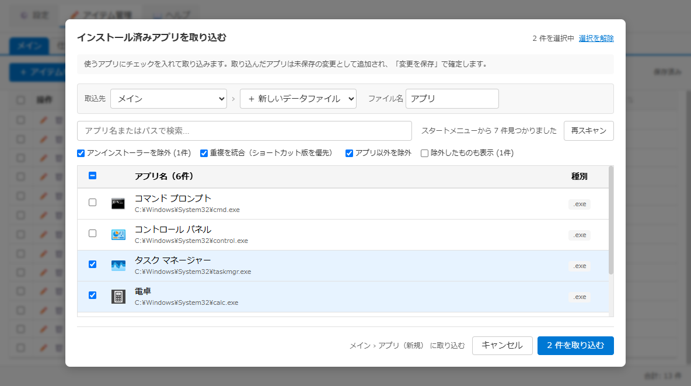

# アプリ取込画面 仕様書

## 関連ドキュメント

- [画面一覧](./README.md) - 全画面構成の概要
- [管理ウィンドウ](./admin-window.md) - 開き元（アイテム管理タブの追加の ▼ メニュー）
- [アイテム登録・編集モーダル](./register-modal.md) - 取込先の帯と同じ形の「保存先の帯」
- [ブックマーク取込画面](./bookmark-import-modal.md) - 取込先の帯・選び方・フッターをそろえている取込画面

## 1. 概要

スタートメニューにあるアプリを一覧にし、使うアプリを選んでランチャーのアイテムにする画面です。開いた時点では何も選ばれていません。検索で探してチェックを入れたアプリだけを、取込先のデータファイルに取り込みます。

取込先の初期値は「アイテム管理で選んでいるタブに新しいデータファイルを作って入れる」です。既存のデータファイルや、新しいタブ（とそのデータファイル）も選べます。取込先は、登録画面の「保存先の帯」と同じ形の帯で選び、フッターのボタンの左に「〜 に取り込む」と出します。新しいタブ・データファイルは「取り込む」を押した時点で作ります（キャンセルしたら何も作りません）。

ブックマークと違って条件だけでまとめて選ぶ形にはせず、1 件ずつチェックで選びます。アプリは数百件あっても使うのはその一部で、並びにも利用者の整理が入っていないためです。ルール（自動取込）は作りません。

**キーボードショートカット**: Escape キーで閉じます（選択は破棄されます）。

### 画面イメージ

## 2. 基本情報

| 項目 | 内容 |
| --- | --- |
| **ファイル名** | `src/renderer/components/AppImportModal.tsx` |
| **コンポーネント名** | `AppImportModal` |
| **重複の判定** | `src/common/utils/appDuplicateDetector.ts` |
| **新しいタブ・データファイルの作成** | `src/renderer/hooks/useAdminTabStructure.ts` の `createImportFile`（タブバーの「＋」と同じ計算＝`src/common/utils/tabManager/tabStructureEdits.ts`） |
| **取込先の帯** | `src/renderer/components/ImportDestinationBand.tsx`（ブックマーク取込・取込ルールの画面と共通） |
| **スタイル** | `src/renderer/styles/components/AppImport.css`（見出し・案内・取込先の帯・フッターは `ImportModal.css`、検索欄・重複警告は `BookmarkImport.css` を共用） |
| **表示条件** | アイテム管理の「＋ アイテムを追加」の右隣の ▼ →「インストール済みアプリを取り込む」、メインウィンドウの ➕ の「💻 インストール済みアプリを取り込む」（管理ウィンドウのアイテム管理タブでこの画面を開く） |
| **画面タイプ** | オーバーレイ型モーダル（管理ウィンドウ内） |
| **親画面** | 管理ウィンドウ（アイテム管理タブ） |

## 3. 画面項目一覧

| エリア | 項目名 | 内容・説明 | 表示条件 | 機能詳細 |
| --- | --- | --- | --- | --- |
| **ヘッダー** | タイトル | 「インストール済みアプリを取り込む」 | 常時表示 | - |
| **ヘッダー** | 選択中の件数 | タイトルの右に「N 件を選択中」。1 件以上選んでいるときは「選択を解除」も出す | 常時表示 | [4.3](#43-選ぶ) |
| **案内** | 説明 | チェックを入れて取り込むこと、未保存の変更として入り「変更を保存」で確定すること | 常時表示 | - |
| **取込先の帯** | タブ | 取り込むタブ。初期値はアイテム管理で選んでいるタブ。末尾に「＋ 新しいタブ」 | 常時表示 | [4.4](#44-取込先を選ぶ) |
| **取込先の帯** | データファイル | タブの右に「›」でつないで出す。先頭の「＋ 新しいデータファイル」が初期値で、続けてタブのデータファイル | 新しいタブでないとき | [4.4](#44-取込先を選ぶ) |
| **取込先の帯** | タブ名 | 新しいタブの名前（新しいデータファイルの名前にもなる）。初期値は「アプリ」 | タブが「＋ 新しいタブ」のとき | [4.4](#44-取込先を選ぶ) |
| **取込先の帯** | ファイル名 | 新しいデータファイルの名前。初期値は「アプリ」 | 既存のタブでデータファイルが「＋ 新しいデータファイル」のとき | [4.4](#44-取込先を選ぶ) |
| **取込元・絞り込み** | 検索 | アプリ名またはパスの部分一致（大文字小文字を区別しない）。入力があるときだけ「×」でクリア | 常時表示 | [4.2](#42-絞り込む) |
| **取込元・絞り込み** | 読み込み状況 | 検索欄の右に「スタートメニューから N 件見つかりました」／スキャン中は「スタートメニューをスキャン中...」 | 常時表示 | [4.1](#41-スキャンする) |
| **取込元・絞り込み** | 再スキャン | スタートメニューを読み直す。スキャン中は無効 | 常時表示 | [4.1](#41-スキャンする) |
| **取込元・絞り込み** | 除外の条件 | 「アンインストーラーを除外」「重複を統合（ショートカット版を優先）」「アプリ以外を除外」。どれも初期はオン。当てはまる件数があれば「(N件)」を添える | 常時表示 | [4.2](#42-絞り込む) |
| **取込元・絞り込み** | 除外したものも表示 | オンにすると除外の条件に当たるアプリも一覧に出す（文字を薄く表示）。除外の件数があれば「(N件)」を添える | 常時表示 | [4.2](#42-絞り込む) |
| **アプリ一覧** | 見出し | 「アプリ名（N件）」（N は今一覧に出ている件数）と「種別」 | 常時表示 | - |
| **アプリ一覧** | 見出しのチェック | 一覧に出ているアプリをまとめて選ぶ・外す。一部だけ選んでいるときは中間の表示 | 常時表示（一覧が空なら無効） | [4.3](#43-選ぶ) |
| **アプリ一覧** | 行 | チェック・アイコン・アプリ名（下に小さくターゲットパス）・種別（拡張子。拡張子がなければ「(なし)」、登録アプリは「(登録アプリ)」、URI で開く登録アプリはスキーム名（例: `ms-settings:`））。取込先にすでにあるアプリはアプリ名の横に「登録済み」。選んだ行は色が変わる | スキャン後 | [4.3](#43-選ぶ) |
| **アプリ一覧** | 空の表示 | 「条件に一致するアプリはありません」 | スキャンで見つかったアプリはあるが、絞り込みで一覧に出るアプリが 0 件のとき | - |
| **重複警告** | 重複時の処理 | 「選んだアプリのうち N 件は取込先に登録済みです」と、「重複時の処理:」の選択肢「スキップ（重複アイテムはインポートしない）」「上書き（既存アイテムを新しい情報で更新）」 | 既存のデータファイルが取込先で、登録済みのアプリを選んでいるとき | [4.5](#45-取り込む) |
| **フッター** | 取込先の確認 | ボタンの左に「〈取込先〉 に取り込む」。〈取込先〉は「タブ名 › ファイル名」（ファイルが 1 つのタブはタブ名だけ）。新しいファイルは「メイン › アプリ（新規）」、新しいタブは「ツール（新しいタブ）」 | 常時表示 | [4.4](#44-取込先を選ぶ) |
| **フッター** | キャンセル | 閉じる | 常時表示 | - |
| **フッター** | N 件を取り込む | 選んだアプリを取り込む。0 件のとき・取り込み中は無効 | 常時表示 | [4.5](#45-取り込む) |

## 4. 機能詳細

### 4.1. スキャンする

#### アクション

- 画面を開く、または「再スキャン」を押す

#### 処理フロー

1. スタートメニュー（全ユーザー分と自分の分）のショートカットと、Windows に登録されたアプリ（ストアアプリなど）を読み、アプリ名の順に並べる
2. 一覧に出し、アイコンは裏で少しずつ読み込む
3. 再スキャンでは選択を外す（読み直した一覧は別物として扱う）

#### 判定

- アンインストーラー: 名前に「uninstall」「アンインストール」を含むか、Inno Setup のアンインストーラー（unins000.exe など）を指すもの
- アプリ以外: 実行ファイル（.exe・.bat・.msi など）でないものを指すショートカット（PDF・URL など）と、設定画面などの URI で開く登録アプリ

#### エラーハンドリング

- 1 件も見つからないときは、ダイアログで「インストール済みアプリが見つかりませんでした」
- スキャンに失敗したときは、ダイアログで「アプリのスキャンに失敗しました」

### 4.2. 絞り込む

- 一覧に出すのは、除外の条件に当たらず（「除外したものも表示」がオンなら当たるものも）、検索に一致するアプリ
- 「重複を統合」は、同じアプリ名が複数あるときに 1 件だけ残す（ショートカットがあればショートカットを残す）
- 絞り込みを変えても選択は外れない。検索で探して選び、別の言葉で探してまた選ぶ、という使い方ができる

### 4.3. 選ぶ

- 行のどこかをクリックするか、チェックで選ぶ・外す
- 見出しのチェックは、今一覧に出ているアプリだけを対象にする
- 一覧に出ていないアプリの選択も残るので、見出しの右の件数は選択の合計を出す。「選択を解除」ですべて外す

### 4.4. 取込先を選ぶ

- 開くたびに、取込先は「アイテム管理で選んでいるタブ › ＋ 新しいデータファイル」、ファイル名（新しいタブならタブ名も）は「アプリ」に戻る
- タブを変えると、データファイルは「＋ 新しいデータファイル」に戻る
- 「＋ 新しいタブ」を選ぶと、データファイルの欄は出さず、タブ名の欄だけを出す。新しいタブにはデータファイルが 1 つでき、その名前はタブ名と同じにする（ファイルが 1 つのタブはどこでもタブ名で表示されるため）
- 「登録済み」の印は、既存のデータファイルならそのファイルと、新しいデータファイルならそのタブのデータファイルすべてと照らして付ける（新しいタブなら付かない）。新しいデータファイルは空なので、登録済みを選んでも重複時の処理は聞かない
- ファイル名・タブ名が空なら、タブバーの「＋」で作るときと同じ既定の名前（「〈タブ名〉用データファイル」・「サブN」）にする。ほかのデータファイルと同じ名前なら末尾に番号を付ける（「アプリ2」）

### 4.5. 取り込む

#### 処理フロー

1. 取込先が新しいタブ・データファイルなら、ここで作る（データファイルを作る → タブの構成を保存、の順。タブバーの「＋」と同じ）。新しいタブを作るときに設定でタブを表示していなければ、表示するかを確認ダイアログで聞く
2. 選んだアプリを、アイテム管理の編集中の内容に追加する（未保存の変更として入り、「変更を保存」で確定）。表示名はショートカットの名前、開く先はショートカット（登録アプリはアプリの ID）
3. 既存のデータファイルに入れるときは、登録済みのアプリを選んでいれば「重複時の処理」に従う。スキップは登録済みの分を入れない。上書きは既存のアイテムの ID を引き継いで内容を置き換える
4. 画面を閉じ、アイテム管理で取込先のタブ・データファイルを開いて、トーストで「N 件を〈取込先〉に追加しました（保存で確定）」を出す（N は実際に入る件数。〈取込先〉はデータファイルの表示名）

#### エラーハンドリング

- 新しいタブ・データファイルを作れなかったときは、警告のトーストで理由を出し、画面は開いたままにする（アプリは取り込まない）
- 作った後に「変更を保存」をせずに変更を破棄しても、作ったタブ・データファイルは残る（タブバーから消せる）

### 4.6. 閉じる

- キャンセル・Escape・オーバーレイのクリックで閉じる。選択・絞り込み・取込先は破棄され、次に開くとスキャンからやり直す

## 5. 以前との違い

v0.8.0-beta.12 までは次の作りでした。

- 取込先はアイテム管理で開いているデータファイルに固定で、画面では選べなかった（画面名は「インストール済みアプリの追加」）
- 取込元と取込先を横に並べた区画があり、ターゲットパスは一覧の列だった。選択中の件数はフッターに出ていた

v0.8.0-beta.2 までは次の作りでした。

- 開いた時点で、除外の条件を通ったアプリがすべて選ばれていた。そのまま押すと数百件が入ることがあった
- 表示の切り替え（フィルタ適用・全体・除外済み）と、選択のボタン（表示中を選択・解除、全て選択・解除）があった。いまは「除外したものも表示」と見出しのチェックにまとめた
- 取り込み済みかどうかは、選んだ後に件数で出るだけだった。いまは一覧に「登録済み」を出す
- 取り込んだ後のトーストはなかった
