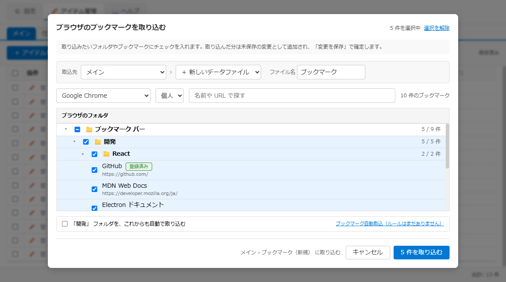

# ブックマーク取込画面 仕様書

## 関連ドキュメント

- [画面一覧](./README.md) - 全画面構成の概要
- [ブックマークの取り込み](../features/bookmark-import.md) - 今回だけ取り込むか、これからも自動で取り込む（自動取込のルール）か
- [ブックマークの取込ルールの追加・編集画面](./bookmark-rule-modal.md) - 名前の条件や表示名のある細かいルールを作る画面
- [アプリ取込画面](./app-import-modal.md) - 取込先の帯・選び方・フッターをそろえている取込画面
- [管理ウィンドウ](./admin-window.md) - 開き元（アイテム管理タブの追加の ▼ メニュー）

## 1. 概要

ブラウザのブックマークから使うものを選び、ランチャーのアイテムにする画面です。アプリ取込画面と同じく、一覧にチェックを入れて取り込みます。一覧はブラウザのフォルダの木で、フォルダにチェックを入れると中のブックマーク（サブフォルダも）がまとめて選ばれます。1 件ずつ選ぶこともできます。開いた時点では何も選ばれていません。

取込先の初期値は「アイテム管理で選んでいるタブに新しいデータファイル『ブックマーク』を作って入れる」です。既存のデータファイルや、新しいタブ（とそのデータファイル）も選べます。新しいタブ・データファイルは「取り込む」を押した時点で作ります（キャンセルしたら何も作りません）。

フォルダごと選んだときは、フッターの「〜を、これからも自動で取り込む」をオンにして、自動取込のルールとして保存できます。名前の条件や表示名を付けたルールは、設定の [ブックマークの取込ルールの追加・編集画面](./bookmark-rule-modal.md) で作ります。

**キーボードショートカット**: Escape キーで閉じます（選択は破棄されます）。

### 画面イメージ

## 2. 基本情報

| 項目 | 内容 |
| --- | --- |
| **ファイル名** | `src/renderer/components/BookmarkImportModal.tsx` |
| **コンポーネント名** | `BookmarkImportModal` |
| **選択からルールへの置き換え** | `src/common/utils/bookmarkSelection.ts` |
| **取込先の帯** | `src/renderer/components/ImportDestinationBand.tsx`（アプリ取込・取込ルールの画面と共通） |
| **スタイル** | `src/renderer/styles/components/BookmarkImport.css`（見出し・案内・取込先の帯・フッターは `ImportModal.css`） |
| **表示条件** | アイテム管理の「＋ アイテムを追加」の右隣の ▼ →「🔖 ブラウザのブックマークから追加」、メインウィンドウの ➕ の「🔖 ブラウザのブックマークから追加」、設定「ブックマーク自動取込」の「手動で取り込む」（どれも管理ウィンドウのアイテム管理タブでこの画面を開く） |
| **画面タイプ** | オーバーレイ型モーダル（管理ウィンドウ内） |
| **親画面** | 管理ウィンドウ（アイテム管理タブ） |

## 3. 画面項目一覧

| エリア | 項目名 | 内容・説明 | 表示条件 | 機能詳細 |
| --- | --- | --- | --- | --- |
| **ヘッダー** | タイトル | 「ブラウザのブックマークを取り込む」 | 常時表示 | - |
| **ヘッダー** | 選択中の件数 | タイトルの右に「N 件を選択中」。1 件以上選んでいるときは「選択を解除」も出す | 常時表示 | [4.3](#43-選ぶ) |
| **案内** | 説明 | チェックを入れて取り込むこと、未保存の変更として入り「変更を保存」で確定すること | 常時表示 | - |
| **取込先の帯** | タブ・データファイル・タブ名・ファイル名 | アプリ取込画面と同じ。新しいタブ・データファイルの名前の初期値は「ブックマーク」 | 常時表示 | [4.5](#45-取込先を選ぶ) |
| **取込元・検索** | 取込元 | インストール済みの Chrome / Edge と「HTML ファイル（他ブラウザからの書き出し）」から選ぶ。ブラウザが 1 つも無いときは「インストール済みブラウザが見つかりません」を出す | 常時表示 | [4.1](#41-取込元を選ぶ) |
| **取込元・検索** | プロファイル | 選んだブラウザのプロファイルから 1 つ選ぶ（「すべてのプロファイル」は無い） | 取込元がブラウザ | [4.1](#41-取込元を選ぶ) |
| **取込元・検索** | ファイルを選択 | HTML ファイルの選択ダイアログ。選んだファイル名を表示（選ぶ前は「未選択」） | 取込元が HTML ファイル | [4.1](#41-取込元を選ぶ) |
| **取込元・検索** | 検索 | 名前または URL の部分一致（大文字小文字を区別しない）。入力があるときだけ「×」でクリア | 常時表示 | [4.2](#42-探す) |
| **取込元・検索** | 読み込み状況 | 右端に「N 件のブックマーク」／読み込み中は「ブックマークを読み込み中…」／失敗時は「読み込みに失敗: 〈理由〉」 | 常時表示 | - |
| **一覧** | 見出し | 「ブラウザのフォルダ」。検索中は「見つかった N 件をすべて選ぶ」のチェックと「（チェックは検索を消しても残ります）」。検索中は先頭 300 件までを出し、残りは「ほかに N 件あります。言葉を足して絞り込んでください」と出す | 常時表示 | [4.2](#42-探す) |
| **一覧** | フォルダの行 | 開閉の ▸（開くと下を向く）、チェック、📁 フォルダ名、右に件数（中身の件数。選んでいれば「選んだ件数 / 中身の件数」）。一番上のフォルダは「ブックマーク バー」「その他のブックマーク」「モバイルのブックマーク」と出す。中身の一部だけ選んでいるときはチェックが中間の表示 | 検索していないとき | [4.3](#43-選ぶ) |
| **一覧** | ブックマークの行 | チェック・名前（下に小さく URL）。取込先にすでにある URL は名前の横に「登録済み」。取込先が新しいデータファイルのときは、「登録済み」にマウスを乗せると「このタブのほかのデータファイルに登録済み」と出る。検索中は URL の前にフォルダを出す。選んだ行は色が変わる | フォルダを開いたとき、検索中 | [4.3](#43-選ぶ) |
| **一覧** | 空の表示 | 取込元を選ぶ前は「取込元を選ぶとブックマークが読み込まれます」、検索で 0 件なら「一致するブックマークはありません」 | 該当するとき | - |
| **重複警告** | 重複時の処理 | 「選んだブックマークのうち N 件は取込先に登録済みです」と、「重複時の処理」の選択肢「スキップ」「上書き」 | 既存のデータファイルが取込先で、登録済みの URL を選んでいて、自動で取り込むをオンにしていないとき | [4.6](#46-取り込む) |
| **自動取込の帯** | これからも自動で取り込む | フッターのすぐ上の帯。「〈フォルダ〉 フォルダを、これからも自動で取り込む」のチェック（フォルダ名は 2 つまで出し、3 つ以上は「選んだ N フォルダを、これからも自動で取り込む」、全部を選んでいれば「すべてのブックマークを、これからも自動で取り込む」）。使えないときは理由を下に出す | 常時表示（フォルダごと選んでいるときだけ使える） | [4.4](#44-これからも自動で取り込む) |
| **自動取込の帯** | ブックマーク自動取込のリンク | 帯の右端に「ブックマーク自動取込（ルール N 件）」（ルールが無ければ「ブックマーク自動取込（ルールはまだありません）」）。押すと画面を閉じて、設定タブの「ブックマーク自動取込」を開く（選んでいたものは消える） | 常時表示（チェックが使えないときも出す） | - |
| **自動取込の帯** | ルール名・保存されるルール | ルール名の欄（帯の幅いっぱい。空なら自動の名前）と、「保存されるルール: 〈ブラウザ（プロファイル）〉 ・ 〈フォルダ〉。名前の条件や表示名は、あとで「ブックマーク自動取込」で足せます」 | 自動で取り込むをオンにしたとき | [4.4](#44-これからも自動で取り込む) |
| **フッター** | 取込先の確認 | ボタンの左に「〈取込先〉 に取り込む」（アプリ取込画面と同じ） | 常時表示 | [4.5](#45-取込先を選ぶ) |
| **フッター** | キャンセル | 閉じる | 常時表示 | - |
| **フッター** | N 件を取り込む | 選んだブックマークを取り込む。自動で取り込むをオンにしたときは「N 件を取り込み、自動取込に登録」。0 件のとき・処理中は無効 | 常時表示 | [4.6](#46-取り込む) |

## 4. 機能詳細

### 4.1. 取込元を選ぶ

- 開いた直後にインストール済みのブラウザを探し、最初のブラウザの最初のプロファイルを選ぶ。ブラウザが無ければ HTML ファイルにする
- 取込元・プロファイルが決まるとフォルダ付きの一覧を読み、一番上のフォルダを開いた状態で出す。読み直すと選択は空に戻る
- プロファイルは 1 つだけ選ぶ。全プロファイルを混ぜると、同じ名前のフォルダが 1 つにまとまり、どのプロファイルのものか分からなくなるため
- HTML ファイルは Netscape 形式（ブラウザの書き出し形式）を読み、フォルダの入れ子を復元する。フォルダの外にあるブックマークは一覧の最後に並ぶ

### 4.2. 探す

- 検索欄に入れると、一覧はフォルダの木から、名前か URL に入れた文字を含むブックマークの一覧に変わる
- 見出しのチェックで、見つかった分をまとめて選ぶ・外す
- 検索で選んだ分は、検索を消しても選んだまま残る
- 検索は探すためだけで、ルールの条件にはならない（名前の条件のあるルールは [取込ルールの画面](./bookmark-rule-modal.md) で作る）

### 4.3. 選ぶ

- フォルダのチェックは、そのフォルダの中のブックマーク（サブフォルダも）をまとめて選ぶ・外す
- ブックマークは、行のどこかをクリックするか、チェックで 1 件ずつ選ぶ・外す
- フォルダの行は、行をクリックするか ▸ で開閉する（開くと ▸ が下を向く）
- 見出しの右の件数は選択の合計を出す。「選択を解除」ですべて外す

### 4.4. これからも自動で取り込む

- 次の両方を満たすときだけ、チェックを使える。満たさないときは理由を出す
  - 選んだ中身が、いくつかのフォルダの中身ぜんぶ（サブフォルダも）になっている。1 件ずつ選んだ分が混ざると「1 件ずつ選んだ分があるので自動取込にできません。フォルダごと選ぶと使えます」
  - 取込元がブラウザで、検索していない。HTML ファイルは「HTML ファイルは自動取込にできません」、検索中は「検索中は自動取込にできません。検索を消して、フォルダごと選ぶと使えます」
- 保存するルールの中身
  - 取込元: 選んでいるブラウザとプロファイル
  - フォルダ: 選んだフォルダ（いちばん上のもの。サブフォルダも対象）。ブックマークを全部選んでいれば「すべてのフォルダ」になり、あとから増えたフォルダも対象
  - 名前・URL の条件と表示名は付けない
- ルール名が空なら、フォルダ名（全部なら「ブックマーク全件」）にする

### 4.5. 取込先を選ぶ

- アプリ取込画面の [取込先を選ぶ](./app-import-modal.md#44-取込先を選ぶ) と同じ。新しいタブ・データファイルの名前の初期値は「ブックマーク」
- 「登録済み」の印は、既存のデータファイルならそのファイルと、新しいデータファイルならそのタブのデータファイルすべてと URL で照らして付ける

### 4.6. 取り込む

#### 処理フロー

1. 取込先が新しいタブ・データファイルなら、ここで作る（アプリ取込画面と同じ）
2. 自動で取り込むをオンにしていないとき: 選んだブックマークを、アイテム管理の編集中の内容に追加する（未保存の変更として入り、「変更を保存」で確定）。自動取込の印は付かない。既存のデータファイルに入れるときは「重複時の処理」に従う（スキップは登録済みの URL を入れない。上書きは既存の ID と自動取込の印を引き継いで内容を置き換える）
3. 自動で取り込むをオンにしたとき: ルールを設定に足し、続けてそのルールを実行する（データファイルへ直接書く）。結果はトーストで知らせ、手動分との重複があれば警告にする。実行に失敗したときは、ルールは保存したまま警告のトーストで知らせる
4. 画面を閉じ、アイテム管理で取込先のタブ・データファイルを開く。オンにしていないときはトースト「N 件を〈取込先〉に追加しました（保存で確定）」を出す

#### エラーハンドリング

- 新しいタブ・データファイルを作れなかったときは、警告のトーストで理由を出し、画面は開いたままにする（何も取り込まない）
- 自動で取り込むをオンにしたとき、ルールの保存に失敗したら、警告のトースト「ルールを保存できませんでした: 〈理由〉」を出し、取込先のタブ・データファイルを開き、画面は開いたままにする

### 4.7. 閉じる

- キャンセル・Escape・オーバーレイのクリックで閉じる。選択・検索・取込先は破棄される

## 5. 以前との違い

v0.8.0-beta.13 までは次の作りでした。

- 画面名は「ブラウザのブックマークの追加」。設定のルール編集と同じフォームで、条件（フォルダの木・「選択フォルダのみ／除外」・「サブフォルダも含める」・URL と名前のパターン（正規表現）・表示名）で絞り込み、結果は一番下のプレビューで見ていた
- 先頭に「ルール名」の欄があり、フッターに「今回だけ取り込む (N 件)」と「ルールとして保存」の 2 つのボタンがあった
- 取込先（「インポート先」）は既存のデータファイルから選ぶだけだった

v0.7.37 までは、手動取込は専用の画面（フラット一覧をチェックで選ぶ）で、自動取込のルール編集とは別の画面だった。
