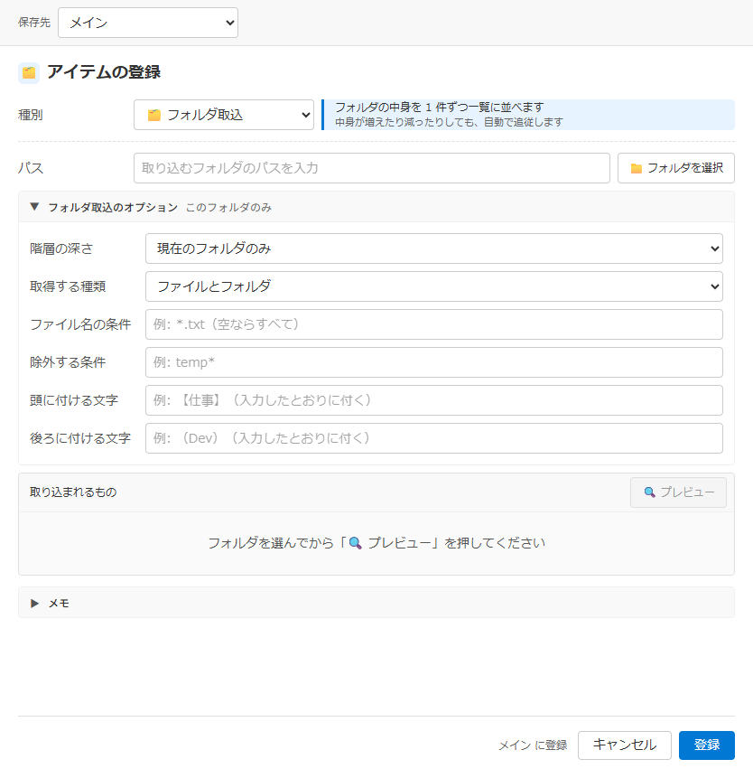

# フォルダ取込オプションエディタ仕様書

## 関連ドキュメント

- [画面一覧](./README.md) - 全画面構成の概要
- [アイテム登録・編集モーダル](./register-modal.md) - 親モーダル
- [フォルダ取込](./register-modal.md#56-フォルダ取込オプションを設定) - フォルダ取込機能の詳細

## 1. 概要

フォルダ取込オプションエディタは、フォルダ取込アイテムの詳細設定を行うためのフォームです。アイテム登録・編集モーダルで種別「🗂️ フォルダ取込」を選び、折りたたみ欄「フォルダ取込のオプション」を開いたときに表示されます（欄は最初は閉じています）。

### 主要機能

- **階層の深さ**: サブディレクトリをどこまで探索するかを指定
- **取得する種類**: ファイルのみ、フォルダのみ、両方を選択
- **ファイル名の条件**: ワイルドカードでファイル名を絞り込む
- **除外する条件**: 特定のパターンを除外
- **表示名の前後の文字**: 表示名の頭と後ろに、入力したとおりの文字を付ける

### 画面イメージ

## 2. 基本情報

| 項目 | 内容 |
| --- | --- |
| **ファイル名** | `src/renderer/components/DirOptionsEditor.tsx` |
| **コンポーネント名** | `DirOptionsEditor` |
| **表示条件** | アイテム登録・編集モーダルで種別「🗂️ フォルダ取込」を選び、折りたたみ欄「フォルダ取込のオプション」を開いたとき（最初は閉じている） |
| **コンポーネントタイプ** | インラインフォーム |
| **親画面** | アイテム登録・編集モーダル |

## 3. 画面項目一覧

| 項目名 | ラベル表記 | 入力タイプ | デフォルト | 説明 | 機能詳細 |
| --- | --- | --- | --- | --- | --- |
| 階層の深さ | 階層の深さ | ドロップダウン | 現在のフォルダのみ | サブディレクトリの探索深度 | [4.1](#41-階層の深さを変更) |
| 取得する種類 | 取得する種類 | ドロップダウン | ファイルとフォルダ | 取得するアイテムの種類 | [4.2](#42-取得する種類を変更) |
| ファイル名の条件 | ファイル名の条件 | テキスト入力 | なし | ファイル名を絞り込むパターン | [4.3](#43-ファイル名の条件を入力) |
| 除外する条件 | 除外する条件 | テキスト入力 | なし | 除外するファイル名パターン | [4.4](#44-除外する条件を入力) |
| 頭に付ける文字 | 頭に付ける文字 | テキスト入力 | なし | 表示名の前に付ける文字列 | [4.5](#45-頭に付ける文字を入力) |
| 後ろに付ける文字 | 後ろに付ける文字 | テキスト入力 | なし | 表示名の後に付ける文字列 | [4.6](#46-後ろに付ける文字を入力) |

ラベルにはコロンも例も付けない。例は入力欄のプレースホルダーに出す。

## 4. 機能詳細

### 4.1. 階層の深さを変更

#### アクション

- 「階層の深さ」のドロップダウンで選択肢を変更

#### 選択肢

| 表示 | 説明 |
| --- | --- |
| 現在のフォルダのみ | 指定フォルダ直下のみ |
| 1階層下まで | サブフォルダ1階層まで |
| 2階層下まで | サブフォルダ2階層まで |
| 3階層下まで | サブフォルダ3階層まで |
| 無制限 | 全てのサブフォルダ |

#### 処理フロー

1. 階層の深さの設定を選んだ値に更新

### 4.2. 取得する種類を変更

#### アクション

- 「取得する種類」のドロップダウンで選択肢を変更

#### 選択肢

| 表示 | 説明 |
| --- | --- |
| ファイルのみ | ファイルのみを取得 |
| フォルダのみ | フォルダのみを取得 |
| ファイルとフォルダ | 両方を取得 |

#### 処理フロー

1. 取得する種類の設定を選んだ値に更新

### 4.3. ファイル名の条件を入力

#### アクション

- 「ファイル名の条件」の入力欄にテキストを入力

#### 入力形式

- ワイルドカードパターン（例: `*.txt`, `*.exe`, `readme*`）

#### 判定のしかた

- ファイル名・フォルダ名（パスを含まない名前）に対して照合する。大文字小文字は区別する
- 一致しないファイルは一覧に出ない
- 一致しないフォルダは一覧に出ないが、その中の探索は階層の深さの範囲で続く（中にある一致するファイルは一覧に出る）

#### プレースホルダー

- 「例: \*.txt（空ならすべて）」

#### 処理フロー

1. 入力値を取得
2. 空文字の場合は設定なしとして扱う
3. ファイル名の条件の設定を更新

#### 使用例

- `*.txt` - テキストファイルのみ
- `*.exe` - 実行ファイルのみ
- `doc*` - docで始まるファイル

### 4.4. 除外する条件を入力

#### アクション

- 「除外する条件」の入力欄にテキストを入力

#### 入力形式

- ワイルドカードパターン（例: `temp*`, `*.bak`, `~*`）

#### 判定のしかた

- ファイル名・フォルダ名（パスを含まない名前）に対して照合する。大文字小文字は区別する
- ファイルにもフォルダにも効く。一致したフォルダは一覧に出ず、その中も探索しない
- ファイル名の条件より先に判定する（両方に一致するものは除外される）

#### プレースホルダー

- 「例: temp\*」

#### 処理フロー

1. 入力値を取得
2. 空文字の場合は設定なしとして扱う
3. 除外する条件の設定を更新

#### 使用例

- `temp*` - tempで始まるファイルを除外
- `*.bak` - バックアップファイルを除外
- `~*` - 一時ファイルを除外

### 4.5. 頭に付ける文字を入力

#### アクション

- 「頭に付ける文字」の入力欄にテキストを入力

#### 説明

- 展開されるアイテムの表示名の前に付ける文字列

#### プレースホルダー

- 「例: 【仕事】（入力したとおりに付く）」

#### 処理フロー

1. 入力値を取得
2. 空文字の場合は設定なしとして扱う
3. 頭に付ける文字の設定を更新

#### 使用例

入力したとおりの文字を表示名の頭につなげる。区切りや括弧は足さないので、要るなら自分で入力する。

- `【仕事】` → 「【仕事】ファイル名」として表示
- `[重要]` → 「[重要]ファイル名」として表示

### 4.6. 後ろに付ける文字を入力

#### アクション

- 「後ろに付ける文字」の入力欄にテキストを入力

#### 説明

- 展開されるアイテムの表示名の後に付ける文字列

#### プレースホルダー

- 「例: （Dev）（入力したとおりに付く）」

#### 処理フロー

1. 入力値を取得
2. 空文字の場合は設定なしとして扱う
3. 後ろに付ける文字の設定を更新

#### 使用例

入力したとおりの文字を表示名の後ろにつなげる。区切りや括弧は足さない。

- `（Dev）` → 「ファイル名（Dev）」として表示
- `_dev` → 「ファイル名_dev」として表示

以前は頭の文字のあとに「: 」を、後ろの文字を「 (」「)」で囲んで足していた。今あるデータは書き換えないので、以前に設定したフォルダ取込は、表示名から区切りと括弧が消えて見える。

## 5. 表示条件

フォルダ取込の設定値がないときは何も表示しません。種別をフォルダ取込に切り替えたとき、設定値がなければ既定値（現在のフォルダのみ、ファイルとフォルダ）が入ります。

保存されるデータの項目と既定値は [スキャンオプション](../architecture/file-formats/data-format.md#322-スキャンオプションjsondiroptions) を参照してください。
