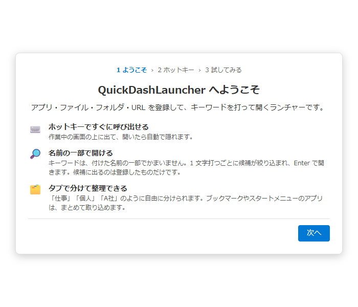
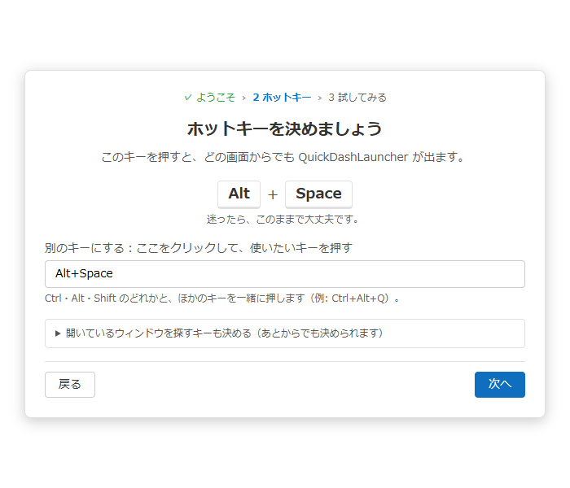
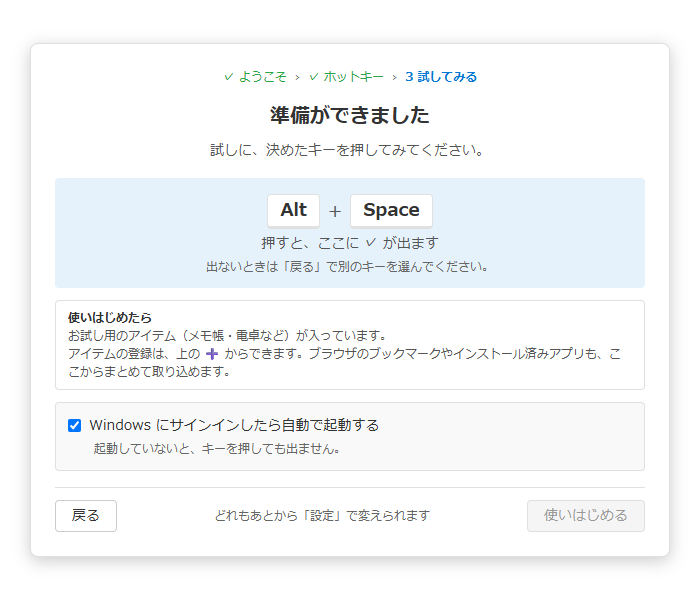

# 初回設定画面仕様書

## 関連ドキュメント

- [画面一覧](./README.md) - 全画面構成の概要
- [メインウィンドウ](./main-window.md) - メイン画面の詳細
- [ホットキー入力](./hotkey-input.md) - ホットキー入力欄の録画・確定・バリデーションの詳細
- [管理ウィンドウ](./admin-window.md) - 初回設定のあとでホットキー・自動起動を変える画面
- [設定ファイル形式](../architecture/file-formats/settings-format.md) - 保存される設定項目

## 1. 概要

初回設定画面は、QuickDashLauncherを初めて起動した際に表示される画面です。「ようこそ」「ホットキー」「試してみる」の 3 ステップで、何をするソフトかを伝え、起動ホットキーと自動起動を決めてもらいます。最初に起動したときにのみ表示され、設定完了後は通常のメインウィンドウが表示されます。

### 主要機能

- **ようこそ**: 何をするソフトか（1 行の説明と特徴 3 つ）を伝える
- **ホットキー**: 起動ホットキー（既定: Alt+Space）を決める。ウィンドウ検索のホットキー（既定: Ctrl+Alt+Space）は折りたたみの中で決められる。「次へ」で起動ホットキーを登録してみて、ほかのアプリが使っていれば先へ進まない
- **試してみる**: 決めたキーを押すと ✓ を出し、「使いはじめる」が押せるようになる。自動起動（既定: 有効）を決めて「使いはじめる」で完了する
- **強制設定**: ESCキー、フォーカス喪失、起動ホットキーのいずれでも隠れず、設定完了が必須

### 画面イメージ

ようこそ:

ホットキー:

試してみる（キーを押す前）:

## 2. 基本情報

| 項目 | 内容 |
| --- | --- |
| **ファイル名** | `src/renderer/components/SetupFirstLaunch.tsx` |
| **スタイルファイル** | `src/renderer/styles/components/SetupFirstLaunch.css` |
| **コンポーネント名** | `SetupFirstLaunch` |
| **表示条件** | 設定ファイルの起動ホットキーが空または未設定の場合 |
| **画面タイプ** | メインウィンドウ内の全面表示（初回起動時はウィンドウを700x600で作成。中身が収まらないときはスクロールする） |
| **親コンポーネント** | `App.tsx` |
| **自動表示タイミング** | スプラッシュウィンドウ終了後 |

## 3. 画面項目一覧

どのステップでも、上に「1 ようこそ」「2 ホットキー」「3 試してみる」の並びを表示する。今のステップを塗りつぶし、済んだステップは ✓ を付ける。

| エリア | 項目名 | 内容・説明 | 表示条件 | 機能詳細 |
| --- | --- | --- | --- | --- |
| **ようこそ** | タイトル | 「QuickDashLauncher へようこそ」 | ようこそ | - |
| **ようこそ** | 説明文 | 「アプリ・ファイル・フォルダ・URL を登録して、キーワードを打って開くランチャーです。」 | ようこそ | - |
| **ようこそ** | 特徴 3 つ | ⌨️「ホットキーですぐに呼び出せる」、🔎「名前の一部で開ける」、🗂️「タブで分けて整理できる」。それぞれ下に 1〜2 行の説明 | ようこそ | - |
| **ようこそ** | 「次へ」ボタン | ホットキーへ進む | ようこそ | [5.1](#51-ステップの移動) |
| **ホットキー** | タイトル・説明文 | 「ホットキーを決めましょう」「このキーを押すと、どの画面からでも QuickDashLauncher が出ます。」 | ホットキー | - |
| **ホットキー** | キーの表示 | 今の起動ホットキーをキーの形で大きく表示（例: ［Alt］+［Space］） | ホットキー | - |
| **ホットキー** | 案内・エラー | ふだんは「迷ったら、このままで大丈夫です。」。登録に失敗したときは赤字で「このキーはほかのアプリが使っています。別のキーを選んでください。」 | ホットキー | [5.3](#53-ホットキーの次へボタン押下) |
| **ホットキー** | 起動ホットキーの入力欄 | 見出し「別のキーにする：ここをクリックして、使いたいキーを押す」。初期表示は`Alt+Space`。下にヒント「Ctrl・Alt・Shift のどれかと、ほかのキーを一緒に押します（例: Ctrl+Alt+Q）。」 | ホットキー | [5.2](#52-起動ホットキーの入力欄への入力) |
| **ホットキー** | バリデーションエラー（起動ホットキー） | 入力欄の下に赤字で表示するエラーメッセージ | バリデーション失敗時 | [5.2](#52-起動ホットキーの入力欄への入力) |
| **ホットキー** | ウィンドウ検索のホットキー（折りたたみ） | 見出し「開いているウィンドウを探すキーも決める（あとからでも決められます）」。開くと説明「開いているウィンドウを名前で探して、切り替えます。」と入力欄。未入力時のプレースホルダーは「未設定」。キーが入力されている間は右に「使わない」ボタンを表示 | ホットキー（既定は閉じている） | [5.8](#58-ウィンドウ検索のホットキー入力欄への入力) |
| **ホットキー** | 「戻る」「次へ」ボタン | 「戻る」でようこそへ。「次へ」は両方のホットキーが有効なときだけ押せる | ホットキー | [5.1](#51-ステップの移動)、[5.3](#53-ホットキーの次へボタン押下) |
| **試してみる** | タイトル・説明文 | 「準備ができました」「試しに、決めたキーを押してみてください。」 | 試してみる | - |
| **試してみる** | 押したかの表示 | キーの表示と、押す前は「押すと、ここに ✓ が出ます」「出ないときは「戻る」で別のキーを選んでください。」。押したら「✓ 呼び出せました」 | 試してみる | [5.4](#54-試してみるで起動ホットキーを押す) |
| **試してみる** | 使いはじめたら | 「お試し用のアイテム（メモ帳・電卓など）が入っています。」「アイテムの登録は、上の ➕ からできます。ブラウザのブックマークやインストール済みアプリも、ここからまとめて取り込めます。」 | 試してみる | - |
| **試してみる** | 自動起動チェックボックス | ラベル「Windows にサインインしたら自動で起動する」（既定: 有効）、下にヒント「起動していないと、キーを押しても出ません。」 | 試してみる | [5.7](#57-自動起動設定の変更) |
| **試してみる** | 「戻る」「使いはじめる」ボタン | 間に「どれもあとから「設定」で変えられます」。「戻る」でホットキーへ。「使いはじめる」で設定を保存して完了。ホットキーを押して ✓ が出るまでと、保存中は無効 | 試してみる | [5.5](#55-使いはじめるボタン押下) |

## 4. アクション一覧

| No | アクション名 | トリガー | 主な処理内容 | 詳細 |
| --- | --- | --- | --- | --- |
| 5.1 | ステップの移動 | 「次へ」「戻る」クリック | ステップを切り替える | [詳細](#51-ステップの移動) |
| 5.2 | 起動ホットキーの入力欄への入力 | キー押下 | ホットキーのリアルタイムバリデーション | [詳細](#52-起動ホットキーの入力欄への入力) |
| 5.3 | ホットキーの「次へ」ボタン押下 | ボタンクリック | 起動ホットキーを登録してみて、できたら試してみるへ | [詳細](#53-ホットキーの次へボタン押下) |
| 5.4 | 試してみるで起動ホットキーを押す | 起動ホットキー押下 | 隠さずに ✓ を出す | [詳細](#54-試してみるで起動ホットキーを押す) |
| 5.5 | 「使いはじめる」ボタン押下 | ボタンクリック | 設定を保存して完了 | [詳細](#55-使いはじめるボタン押下) |
| 5.6 | 初回起動チェック | アプリケーション起動時 | 初回設定画面の表示判定 | [詳細](#56-初回起動チェック) |
| 5.7 | 自動起動設定の変更 | チェックボックスクリック | 自動起動の有効/無効を切り替え | [詳細](#57-自動起動設定の変更) |
| 5.8 | ウィンドウ検索のホットキー入力欄への入力 | キー押下 | ホットキーのリアルタイムバリデーション（空許可） | [詳細](#58-ウィンドウ検索のホットキー入力欄への入力) |
| 5.9 | ESCキー/フォーカス喪失 | キー押下/フォーカス喪失 | 無視（閉じない） | [詳細](#59-escキーフォーカス喪失の無視) |

## 5. 機能詳細

### 5.1. ステップの移動

- ようこその「次へ」でホットキーへ、ホットキーの「戻る」でようこそへ、試してみるの「戻る」でホットキーへ移る
- ホットキーの「次へ」は、起動ホットキーを登録してから移る（[5.3](#53-ホットキーの次へボタン押下)）
- 入力したホットキー・自動起動のチェックは、ステップを行き来しても保つ

### 5.2. 起動ホットキーの入力欄への入力

#### アクション

- 起動ホットキーの入力欄をクリックし、キー組み合わせを入力

#### 処理フロー

1. 入力欄をクリックすると録画を開始し、欄に「キーを押してください…」を表示（右に「キー入力待ち…」と「キャンセル」ボタンを表示）
2. 録画中に押したキーを「Ctrl + Alt + Q」の形で表示し、修飾キーと通常キーがそろった状態でキーを離した時点でホットキー（例: `Ctrl+Alt+Q`）として確定して録画を終了（「キャンセル」ボタンを押す、またはフォーカスが外れると録画をやめ、元の値のまま）
3. 確定したホットキーを、上のキーの表示にも反映し、登録失敗のエラーを消す
4. 確定したホットキーのバリデーションを実行:
   - 空チェック
   - 形式チェック（使えるキー名の組み合わせか）
   - 修飾キーの有無チェック
5. バリデーション結果を表示:
   - 有効な場合: エラー表示なし、「次へ」ボタン有効化
   - 無効な場合: エラーメッセージ表示、「次へ」ボタン無効化

入力欄は管理ウィンドウの設定タブと共通の部品で、録画の開始・確定・キャンセルの細かい挙動は [ホットキー入力](./hotkey-input.md) を参照。

#### バリデーション詳細

形は「修飾キー 1 つ以上 + 通常キーちょうど 1 つ」。空のとき、修飾キーがないとき、通常キーがない・2 つ以上あるとき、知らないキー名のときは、入力欄の下に理由を表示する。チェックと文言の一覧は [ホットキー入力 - バリデーション](./hotkey-input.md#44-バリデーション) を参照。ほかのアプリと重なっているかは、ここでは見ない（[5.3](#53-ホットキーの次へボタン押下) で登録してみて確かめる）。

**有効なキーパターン**:

- 修飾キー: `Ctrl`, `Alt`, `Shift`, `CmdOrCtrl`, `Command`, `Cmd`
- 通常キー: `A-Z`, `0-9`, `Space`, `Enter`, `Tab`, `Escape`, `Delete`, `Backspace`, `F1-F12`

#### 既定値

- 初期表示: `Alt+Space`（保存先の項目と設定ファイル上の既定値は[設定ファイル形式](../architecture/file-formats/settings-format.md#32-ホットキー設定)）

### 5.3. ホットキーの「次へ」ボタン押下

#### 処理フロー

1. 両ホットキーのバリデーション状態を確認（無効ならボタンが押せない）
2. 起動ホットキーを登録する（設定ファイルにも保存する。管理ウィンドウでホットキーを変えるときと同じ処理）。登録中はボタンと入力欄を無効にする
3. 登録できたら試してみるへ進む
4. 登録できなかったら（ほかのアプリが同じキーを使っているなど）、先へ進まず、キーの表示の下に赤字で「このキーはほかのアプリが使っています。別のキーを選んでください。」を出す。キーを入力し直すと消える

#### 補足

- ホットキーをここで登録するので、試してみるで実際に押して確かめられる。初回起動モードは「使いはじめる」まで続く
- 試してみるから「戻る」で別のキーに変えて「次へ」を押すと、前のキーの登録を外して新しいキーを登録する
- 起動ホットキーを無効にして起動しているとき（E2E。環境変数 `DISABLE_GLOBAL_HOTKEY=1`）は、登録せずに設定ファイルへの保存だけ行い、成功として扱う

### 5.4. 試してみるで起動ホットキーを押す

#### 処理フロー

1. 試してみるを表示している間に起動ホットキーが押される
2. メインプロセスは初回起動モードなのでウィンドウを隠さず、レンダラーに「押された」ことを知らせる（イベント `first-launch-hotkey-pressed`）
3. 画面の表示を「✓ 呼び出せました」に変える

✓ が出るまで「使いはじめる」は押せない（キーで呼び出せることを確かめてから使いはじめてもらうため）。キーを押しても出ないときは、「戻る」で別のキーを選び直す。ほかのステップにいる間に押しても、ウィンドウは隠れず表示も変わらない。

### 5.5. 「使いはじめる」ボタン押下

#### 処理フロー

1. 入力されたホットキー、ウィンドウ検索ホットキー、自動起動設定を設定ファイルに保存
2. 起動ホットキーを登録（[5.3](#53-ホットキーの次へボタン押下) で登録済みのキーなので、そのまま）。ウィンドウ検索のホットキーが入力されていれば、それも登録
3. データファイルタブを既定の1つ（名前「メイン」）で初期化
4. 自動起動設定を適用（スタートアップフォルダへのショートカット作成/削除。Store 版では Windows のスタートアップ アプリへの登録を有効/無効にする）
5. 初回起動モードを終了
6. 初回設定画面を非表示にして、メインウィンドウに遷移
7. アイコンが未取得のアイテムのアイコンを全タブ分、自動で取りに行く（メイン画面の「🎨 アイコン取得（全タブ）」と同じ処理。初回のサンプルにはアイコンがまだないため）

#### エラーハンドリング

- 設定保存失敗時: アラート「設定の保存に失敗しました。」

### 5.6. 初回起動チェック

#### アクション

- アプリケーション起動時に自動判定

#### 処理フロー

1. スプラッシュウィンドウを表示
2. 設定ファイルから起動ホットキーを読み込む
3. ホットキーが空または未設定の場合:
   - 初回起動モードを有効化
   - スプラッシュウィンドウ終了後、初回設定画面を表示
4. ホットキーに値がある場合:
   - 通常モードで起動
   - メインウィンドウを表示

#### 表示判定

- **初回起動**: ホットキーが空または未設定 → 初回設定画面
- **2回目以降**: ホットキーに値がある → メインウィンドウ
- ホットキーの「次へ」で起動ホットキーを保存するので、試してみるの途中で終了すると、次の起動では初回設定画面を出さない
- 初回設定画面をもう一度出したいときは、設定ファイルの起動ホットキーを空にして再起動する（項目は [設定ファイルの形式](../architecture/file-formats/settings-format.md#32-ホットキー設定)）
- 起動時にデータファイルがなければ、サンプルのアイテム入りで作る（初回起動かどうかによらない。中身はコードを正とする）。サンプルの名前と URL は作るときの表示言語で決まる（日本語は名前に読みのローマ字を添え、日本向けのサイトにする）

### 5.7. 自動起動設定の変更

#### 処理フロー

1. チェックボックスの状態を切り替え（チェック/未チェック）
2. 選択状態は画面内で保持し、この時点では保存しない
3. 「使いはじめる」押下時に設定ファイルに反映

#### 既定値

- 初期表示: 有効（チェックあり）。ランチャーは起動していないとホットキーで出せないため。設定ファイル上の既定値（無効）とは別

#### 設定の反映

- 「使いはじめる」押下時に設定ファイルへ保存（保存先の項目は[設定ファイル形式](../architecture/file-formats/settings-format.md#34-自動起動cli-設定)）
- 有効ならWindowsのスタートアップフォルダにショートカットを作成し、無効なら削除（Store 版の動きは[管理ウィンドウ 5.4](./admin-window.md#54-自動起動チェックボックスを変更)）
- 設定タブでいつでも変更可能

### 5.8. ウィンドウ検索のホットキー入力欄への入力

#### アクション

- 折りたたみを開き、ウィンドウ検索のホットキー入力欄をクリックしてキー組み合わせを入力（または「使わない」ボタンで削除）

#### 処理フロー

1. 入力欄をクリックすると録画を開始する（空でもよい、「使わない」ボタンで消せる）
2. 修飾キーと通常キーがそろった状態でキーを離した時点でホットキー（例: `Ctrl+Alt+S`）として確定する。録画の開始・確定・キャンセルの細かい挙動は [ホットキー入力](./hotkey-input.md) を参照
3. 確定したホットキーのバリデーションを実行:
   - 空文字列の場合は有効（設定しないことが可能）
   - 入力がある場合は形式チェック・修飾キー有無チェック
4. バリデーション結果を表示:
   - 有効（または空）: エラー表示なし
   - 無効: エラーメッセージ表示、「次へ」ボタン無効化

#### 既定値

- 初期表示: `Ctrl+Alt+Space`（設定ファイルの既定値と同じ）。折りたたみを開かずに進めば、この値で完了する

#### 設定の反映

- 「使いはじめる」押下時に設定ファイルへ保存（保存先の項目は[設定ファイル形式](../architecture/file-formats/settings-format.md#310-追加ホットキー設定)）
- 空のまま完了した場合は、ウィンドウ検索のホットキーは使えない
- 初回設定を完了するまでは、ウィンドウ検索のホットキーを登録しない（既定値が入っていても、この画面の途中でウィンドウ検索が開かないようにするため）。完了時に登録する
- 初回設定後、設定画面からいつでも変更可能

### 5.9. ESCキー/フォーカス喪失の無視

#### アクション

- ESCキーまたは起動ホットキーを押下、またはウィンドウからフォーカスが外れる

#### 処理フロー

1. メインプロセスで初回起動モードが有効かチェック
2. 初回起動モードの場合:
   - ESCキーによるウィンドウの非表示を無視
   - フォーカス喪失によるウィンドウの非表示を無視
   - 起動ホットキーではウィンドウを隠さず、レンダラーに押されたことを知らせる（[5.4](#54-試してみるで起動ホットキーを押す)）
3. 通常モードの場合:
   - 通常通りウィンドウを非表示

#### 目的

- ユーザーが初回設定を完了するまで、誤ってウィンドウを閉じないようにする
- 設定完了を強制することで、アプリケーションの正常な動作を保証
