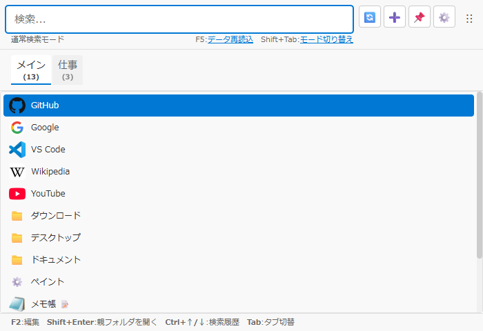

# メインウィンドウ仕様書

## 関連ドキュメント

- [画面一覧](./README.md) - 全画面構成の概要
- [アイテム登録・編集モーダル](./register-modal.md) - アイテムの新規登録・編集機能
- [右クリックメニュー](./context-menu.md) - コンテキストメニュー詳細
- [共通ダイアログ](./dialogs.md) - アラート・確認・ファイル選択のダイアログ
- [アイコン取得進捗詳細モーダル](./icon-progress-detail-modal.md) - アイコン一括取得の結果表示
- [ブックマーク取込画面](./bookmark-import-modal.md) - ブックマーク取込の詳細
- [アイテム管理](./admin-window.md) - アイテム管理タブでの編集

## 1. 概要

メインウィンドウは、QuickDashLauncherの中核となる、検索とアイテムの一覧の画面です。起動ホットキー（Alt+Space）で呼び出され、アプリケーション、ファイル、フォルダ、URLに素早くアクセスできます。

**注意**: 初回起動時（起動ホットキーが未設定の場合）は、メインウィンドウの代わりに[初回設定画面](./first-launch-setup.md)が表示されます。初回設定完了後、このメインウィンドウが表示されるようになります。

**キーボードショートカット**:

- Alt+Space: ウィンドウ表示/非表示（既定、設定で変更可能）
- Ctrl+E: 管理ウィンドウの表示/非表示を切り替え
- Ctrl+W: ワークスペースウィンドウの表示/非表示を切り替え
- Enter: 選択したアイテムを開く
- Shift+Enter: 選択したアイテムの親フォルダを開く（URL・カスタムURI では「このアイテムには親フォルダがありません」とトースト表示）
- Ctrl+Shift+Enter: 選択したアプリを管理者として実行（右クリックの「🛡️ 管理者として実行」と同じ。[右クリックメニュー](./context-menu.md#415-管理者として実行)）。アプリ以外では「「{名前}」は管理者として実行できません（アプリだけ）」とトースト表示
- F2: 選択したアイテムの編集ウィンドウを開く（通常モードのみ。右クリックの「✏️ 編集」と同じ）
- Ctrl+C／Ctrl+Shift+C: 選択したアイテムのパス／親フォルダのパスをコピー（通常モードのみ。検索欄で文字を選んでいるときの Ctrl+C は文字のコピー）
- Shift+F10・アプリケーションキー: 選択した行の右クリックメニューを行の左下に出す
- Arrow Keys: アイテムの選択の移動
- PageUp/PageDown: 1 画面分（見えている行数より 1 つ少ない分）選択を動かす。端で止まる。Ctrl+Home／Ctrl+End で先頭／末尾（Home・End だけは検索欄のカーソル移動）
- Ctrl+↑/↓: 検索履歴をさかのぼる／進む（検索欄の右クリックの「🕘 検索履歴 ▸」からも選べる。[右クリックメニュー](./context-menu.md#413-文字入力欄の右クリック)）
- F5: データを再読み込み（ウィンドウ検索モードではウィンドウの一覧の更新）
- Tab: タブ切り替え（通常モードで、タブ表示有効時・複数タブ存在時のみ）
- Shift+Tab: 検索モードの切り替え（通常⇔ウィンドウ。タブは移らない）
- Escape: ウィンドウを非表示（一部の状態では無効、下記参照）

ウィンドウ検索モードでは、Tab（仮想デスクトップタブの切り替え）、Ctrl+P（ウィンドウのピン留め/解除）、Ctrl+D（ウィンドウを閉じる）、Ctrl+←/→（個別のデスクトップのタブで、選択中のウィンドウを隣の仮想デスクトップへ移動）も使えます。キー操作の全体は[キーボードショートカット](../features/keyboard-shortcuts.md)を参照してください。

### 主要機能

- **リアルタイム検索**: 入力に応じてアイテムをリアルタイム絞り込み
- **検索モード切り替え**: Shift+Tabで通常検索・ウィンドウ検索の2モードを切り替え
- **ウィンドウ検索**: 開いているウィンドウを検索して前面に出す
- **キーボードナビゲーション**: 矢印キーとEnterキーでアイテムを選択・起動
- **コンテキストメニュー**: 右クリックでアイテム操作メニューを表示
- **ドラッグ&ドロップ登録**: ファイル、フォルダ、URL、ワークスペースのアイテムをドロップして簡単登録
- **ピン留め**: 📌ボタンでフォーカスアウト時も非表示にならない設定（通常モードでは、フォーカスがQDLのウィンドウ群の外へ移ると自動的に非表示。詳細は[ウィンドウ制御](../architecture/window-control.md#ウィンドウ非表示の判定)）
- **アイコン管理**: ファビコン取得・アイコン抽出機能
- **進捗表示**: アイコン処理中の進捗バー表示
- **詳細情報表示**: アイテムにマウスを重ねると、種類に応じた情報をツールチップで表示（アイテムはパスとデータファイル・ID、セットは行、パスの無い単一アイテムは切り替えるウィンドウ、クリップボードアイテムは保存した形式、ウィンドウ検索の一覧はウィンドウの状態など。[5.20](#520-アイテムにマウスホバー)）

### 画面イメージ



## 2. 基本情報

| 項目 | 内容 |
| --- | --- |
| **ファイル名** | `src/renderer/App.tsx` |
| **コンポーネント名** | `App` |
| **表示条件** | 起動ホットキー押下時（初回設定で決める。入力欄の初期値は Alt+Space） |
| **画面タイプ** | メインウィンドウ |
| **親画面** | なし（ルートコンポーネント） |

## 3. 画面項目一覧

| エリア | 項目名 | 内容・説明 | 表示条件 | 機能詳細 |
| --- | --- | --- | --- | --- |
| **タブバー** | データファイルタブ | データファイル切り替え用のタブボタン（ツールチップにタブ名と、ファイルラベルとファイル名を表示）。タブ名は 160px（`--data-tab-name-max-width`）を超えると「…」で省略する（全体はツールチップで見える）。ウィンドウの幅に収まらないときはタブバーを横にスクロールできる（マウスホイール。スクロールバーは出さない）。選んだタブは見える位置まで自動で動く | タブ表示ON時 | [5.23](#523-データファイルタブをクリック) |
| **タブバー** | タブ名の変更 | タブを右クリックして「✏️ 名前を変更」を選ぶと、タブ名をその場で編集できる（Enterで確定、Escapeで取消） | タブ表示ON時 | [5.23](#523-データファイルタブをクリック) |
| **タブバー** | 仮想デスクトップタブバー | 「すべて」「全デスクトップ」「各デスクトップ」のタブでウィンドウを絞り込む。収まらないときの横スクロールはデータファイルタブと同じ | ウィンドウ検索モードで仮想デスクトップが2つ以上あるとき | [5.26](#526-ウィンドウ検索モード) |
| **ヘッダー** | 検索入力欄 | 検索用のテキスト入力欄、クリアボタン付き。左端に今の検索モードの目印（通常は 🔍、ウィンドウ検索は紫の塗りに 🪟。両モードで同じ幅）を出し、プレースホルダーもモードで変える（「アイテムを検索…」／「ウィンドウを検索…」）。空のときはクリアボタンの分の余白を詰め、ウィンドウが狭くて収まらなければプレースホルダーを「…」で切る（幅 400px なら収まる） | 常時表示 | [5.1](#51-検索入力欄への文字入力)・[5.27](#527-検索モード切り替え) |
| **ヘッダー** | 更新ボタン（🔄） | データ再読み込み・アイコン取得メニュー。ツールチップ「更新・取得」（通常モードでは「更新・取得（F5: データを再読み込み）」）。ヘッダーのメニュー（🔄・➕・⚙️）はボタンの右端にそろえて開き、ウィンドウが狭くてはみ出すときは、はみ出す分だけ横にずらしてウィンドウの中に収める（開いたまま大きさが変わったときも） | 常時表示 | [5.3](#53-更新メニュー操作) |
| **ヘッダー** | └ 🔃 データを再読み込み | データファイルの再読み込み。通常モードでは「（F5）」を添える（ウィンドウ検索モードの F5 はウィンドウの取り直しなので添えない） | ドロップダウン展開時 | [5.3](#53-更新メニュー操作) |
| **ヘッダー** | └ 🔁 ブックマーク自動取込を実行 | 設定済みのブックマーク自動取込のルールをすべて実行 | ドロップダウン展開時で、有効なルールが 1 つ以上あるとき（開くたびに確かめる） | [5.3](#53-更新メニュー操作) |
| **ヘッダー** | └ ──────────── | 区切り線 | ドロップダウン展開時 | - |
| **ヘッダー** | └ 🎨 アイコンをすべて取り直す | データを読み直し、全部のアイコンを保存してあるものを使わずに取り直す。ツールチップ「データを読み直し、保存してあるアイコンを使わずに全部取り直します（前に取れなかったものも試します）」 | ドロップダウン展開時 | [5.3](#53-更新メニュー操作) |
| **ヘッダー** | アイテム登録ボタン（➕） | アイテム登録・インポートメニュー（ドロップダウン）。ツールチップ「アイテムを追加」 | 常時表示 | [5.22](#522-アイテム登録ボタン押下) |
| **ヘッダー** | └ 📄 アイテムを追加 | アイテム登録モーダルを開く | ドロップダウン展開時 | [5.22](#522-アイテム登録ボタン押下) |
| **ヘッダー** | └ 🗂️ フォルダからアイテムを追加 | 登録画面を種別「フォルダ取込」で開く。ツールチップ「フォルダ内のファイルを、開くたびに一覧へ並べるアイテム（フォルダ取込）を追加します」 | ドロップダウン展開時 | [5.22](#522-アイテム登録ボタン押下) |
| **ヘッダー** | └ ──────────── | 区切り線（1 件ずつの追加と、まとめて追加する入口を分ける） | ドロップダウン展開時 | - |
| **ヘッダー** | └ 🔖 ブラウザのブックマークから追加 | 管理ウィンドウのブックマーク取込画面を開く | ドロップダウン展開時 | [5.22](#522-アイテム登録ボタン押下) |
| **ヘッダー** | └ 💻 インストール済みアプリから追加 | 管理ウィンドウのアプリ取込画面を開く | ドロップダウン展開時 | [5.22](#522-アイテム登録ボタン押下) |
| **ヘッダー** | ワークスペースボタン（⭐） | ワークスペースを開く・閉じる（Ctrl+W と同じ）。開いている間は押し込まれた見た目。ツールチップ「ワークスペースを開く（Ctrl+W）」／「ワークスペースを閉じる（Ctrl+W）」 | 常時表示 | [ワークスペースウィンドウ](./workspace-window.md) |
| **ヘッダー** | ピン留めボタン（📌） | クリックで表示固定のオン・オフ、右クリックで表示固定・常に最前面のメニュー | 常時表示 | [5.4](#54-ピン留めボタン押下) |
| **ヘッダー** | 設定ボタン（⚙️） | 設定メニューへのアクセス。ツールチップ「設定」 | 常時表示 | [5.5](#55-設定メニュー操作) |
| **ヘッダー** | └ ⚙️ 設定 | 管理ウィンドウの設定タブを開く | ドロップダウン展開時 | [5.5](#55-設定メニュー操作) |
| **ヘッダー** | └ ✏️ アイテム管理（Ctrl+E） | 管理ウィンドウの「アイテム管理」タブを開く。項目名に Ctrl+E を添える（Ctrl+E はタブを切り替えない。[5.5](#55-設定メニュー操作)） | ドロップダウン展開時 | [5.5](#55-設定メニュー操作) |
| **ヘッダー** | └ ──────────── | 区切り線 | ドロップダウン展開時 | - |
| **ヘッダー** | └ 🚪 アプリを終了 | アプリを終了 | ドロップダウン展開時 | [5.5](#55-設定メニュー操作) |
| **メイン** | アイテムリスト | 絞り込まれたアイテム一覧表示 | 常時表示 | [5.6](#56-アイテムをクリック) |
| **メイン** | 一覧が空のときの案内 | 検索で 0 件のとき、ほかの場所に合うものがあるかで 2 行の案内を変える（タブの並び順は変えず、タブは自動で切り替えない）。通常モード: 他のタブに合うアイテムがあれば「「{検索語}」に合うアイテムはこのタブにはありません」と「他のタブに合うアイテムがあります。 Tab:タブを切り替える」（タブ表示が ON でタブが 2 つ以上のとき。「タブを切り替える」はリンクで、押すと Tab キーと同じく合うアイテムのある次のタブへ切り替え、検索欄にフォーカスを戻す）、どのタブにも無ければ「「{検索語}」に合うアイテムはありません」と「開いているウィンドウを探すときは Shift+Tab でウィンドウ検索に切り替えます」と［📄 アイテムを追加］ボタン、その下に空のタブと同じ［🔖 ブックマークから］［💻 アプリから］［🗂️ フォルダから］（他のタブに合うアイテムがあるときは、追加・取込のボタンはどれも出さない。先に「タブを切り替える」を見てもらうため。A3-189）。ウィンドウ検索モード: 「すべて」以外のデスクトップのタブで、ほかのタブに合うウィンドウがあれば「「{検索語}」に合うウィンドウはこのタブにはありません」と「他のタブに合うウィンドウがあります。 Tab:タブを切り替える」（リンクの動きは通常モードと同じ）、どこにも無ければ「「{検索語}」に合うウィンドウはありません」と「Shift+Tab で通常の検索に戻ります」（通常の検索に合うアイテムがあるときは前に「通常の検索には合うアイテムがあります。」を付ける）。検索語が無く、通常モードでタブにアイテムが無いとき: 「このタブにはまだアイテムがありません」と［📄 アイテムを追加］ボタン（登録画面を子ウィンドウで開く）、その下に［🔖 ブックマークから］［💻 アプリから］［🗂️ フォルダから］（➕ の同じ名前の項目と同じ動き。まとめて追加する方法があることに、初めての人が気づけるように） | 一覧が 0 件のとき（ウィンドウ検索モードで検索語が無いときは出さない） | [5.1](#51-検索入力欄への文字入力)・[5.22](#522-アイテム登録ボタン押下) |
| **メイン** | 選択ハイライト | 現在選択中のアイテムをハイライト表示 | アイテム存在時 | [5.7](#57-検索入力欄で-enter-キー押下) |
| **メイン** | 詳細ツールチップ | アイテムにマウスを重ねたとき、種類に応じた情報を表示（パスとデータファイル・ID、セットの行、パスの無い単一アイテムの切り替えるウィンドウ、クリップボードアイテムの形式、ウィンドウ検索の一覧ではウィンドウの状態など） | ホバー時 | [5.20](#520-アイテムにマウスホバー) |
| **メイン** | コンテキストメニュー | 右クリック時に表示されるアイテムメニュー。先頭の「✏️ 編集」の右端に F2 を添え、いちばん下に「🗑️ 削除…」を置く | 右クリック時 | [5.10](#510-アイテムを右クリック) |
| **メイン** | 余白の右クリックメニュー | 一覧のアイテムの無い所の右クリックで出すメニュー（「📄 アイテムを追加」「🗂️ フォルダからアイテムを追加」「📋 クリップボードのパス・URL から追加」、区切り線、「🔖 ブラウザのブックマークから追加」「💻 インストール済みアプリから追加」） | 通常検索で右クリック時 | [右クリックメニュー 4.12](./context-menu.md#412-一覧の余白の右クリック) |
| **メイン** | 進捗バー | アイコン処理の進捗表示。完了しても自動では消えず、右端の「×」で閉じる（閉じた取得の進捗はもう出さない。次の取得では出す）。完了後、結果があれば「×」の左に「詳細」ボタンを出す | 処理の開始から「×」で閉じるまで | [5.3](#53-更新メニュー操作) |
| **メイン** | アイテム数表示 | 検索・絞り込み後の表示件数を「n 件」で表示 | 通常モードでタブ表示OFFのとき／ウィンドウ検索モードで仮想デスクトップのタブが出ていないとき | [5.23](#523-データファイルタブをクリック) |
| **メイン** | 選択数のバッジ | ウィンドウ検索で選んでいるウィンドウの数を「n 件を選択中」で表示（件数表示の行に並べる。件数表示が出ていないときもこの行を出す） | ウィンドウ検索モードで 1 つ以上選んでいるとき | [5.26](#526-ウィンドウ検索モード) |
| **メイン** | 閉じる確認の帯 | 一覧の下に「n 個のウィンドウを閉じます　Enter:閉じる　Esc:キャンセル」を表示 | ウィンドウ検索モードで 2 つ以上を閉じようとしたとき | [5.26](#526-ウィンドウ検索モード) |
| **メイン** | メモバッジ（📝） | 表示名の右に表示。クリックでメモを表示 | メモが設定されたアイテム | [5.10.1](#5101-メモを表示) |
| **メイン** | ウィンドウ検索設定バッジ（🔍） | 表示名の右に表示。ホバーで「ウィンドウ検索: （タイトル。無ければ exe 名）」を表示 | 対象ウィンドウ（exe 名かタイトル）があるアイテム（パスの無い単一アイテムにも出る） | - |
| **メイン** | セットの行数「（n 件）」 | セット名の右にセットの行数を表示。ウィンドウ位置を記録した行があれば続けて 📍 を出す（ホバーで「ウィンドウ位置のある行があります」） | セット | [5.20](#520-アイテムにマウスホバー) |
| **メイン** | アイコン未取得の通知 | 「🎨 アイコンがまだ無いアイテムが n 件あります」と、その下に小さく「サイトや PC から 1 回だけ取りに行き、その後は保存したものを使います」、右に「取得する」ボタン（ツールチップ「アイコンを取得」）を画面下部に表示（狭いときは左の説明を折り返し、ボタンの文字は折り返さない）。「取得する」で全タブの未取得アイコンを取得 | 通常検索モードで、未取得アイコンがあり、進捗バーが出ておらず、アイコンを取得していないとき（ウィンドウ検索モードでは出さない。進捗バーを × で閉じても、取得が終わるまでは出さない。初回設定の後の裏の取得の間も出さない＝[初回設定画面 5.5](./first-launch-setup.md#55-使いはじめるボタン押下)） | [5.3](#53-更新メニュー操作) |
| **メイン** | 操作のヒント行 | ウィンドウの一番下（リスト・アイコン未取得の通知・進捗バーより下）に、画面上のボタン・表示からは気づきにくいキー操作を「キー:説明」の形で 1 行に表示。通常モードは「F2:編集」「Shift+Enter:親フォルダを開く」「Ctrl+↑/↓:検索履歴」と、タブ表示が ON でタブが 2 つ以上のときは「Tab:タブの切り替え」。ウィンドウ検索モードはよく使う順に「Ctrl+D:ウィンドウを閉じる」「Ctrl+P:全デスクトップ表示/解除」「Shift+↑/↓:複数選択」「F5:ウィンドウを取り直す」（Ctrl+P は仮想デスクトップが使えるときだけ）と、個別のデスクトップのタブを選んでいるときは最後に「Ctrl+←/→:仮想デスクトップ移動」（Tab のデスクトップ切り替えはタブの表示で分かるので出さない）。ウィンドウを選んでいるあいだは「Ctrl+D:n 件を閉じる」「Ctrl+P:n 件を全デスクトップ表示/解除」（仮想デスクトップが使えるときだけ）「Esc:選択を外す」（と、移動できるときは Ctrl+←/→）に変わる。Enter・矢印キー・Escape のような自明なキー、検索モードの行にある Shift+Tab、⚙️ メニューに添えてある Ctrl+E、⭐ ボタンのツールチップに添えてある Ctrl+W、🔄 メニューに添えてある通常モードの F5 は出さない。幅が足りないときは折り返さず、右側を「…」で省略する | 設定「操作のヒントを表示」が ON（既定）のとき（[アイテム管理の画面項目](./admin-window.md#3-画面項目一覧)） | 通常モード: [5.21](#521-コンテキストメニューから編集選択)・[5.8](#58-検索入力欄で-shiftenter-キー押下)・[5.24](#524-tabshifttabキー押下)／ウィンドウ検索モード: [5.26](#526-ウィンドウ検索モード) |
| **別ウィンドウ** | 登録画面 | ドロップしたファイル・URL を初期値にして、[アイテム登録・編集](./register-modal.md)をメインウィンドウの子ウィンドウで開く（ワークスペースのアイテムをドロップしたときは、そのアイテムを初期値にする） | ドロップ時 | [5.18](#518-ドラッグドロップ操作) |
| **オーバーレイ** | ドラッグオーバーレイ | ドラッグ中の視覚的フィードバック。「ファイル / URLをドロップして登録」（ワークスペースのアイテムのときは「ドロップしてメインウィンドウへ移す（ワークスペースのアイテムは参照になります）」） | ファイル・URL・テキストか、ワークスペースのアイテムをドラッグしている間（ワークスペースのグループなど、どれも持たないドラッグでは出さない）。登録画面が開いている間は出さない | [5.18](#518-ドラッグドロップ操作) |

## 4. アクション一覧

| No | アクション名 | トリガー | 主な処理内容 | 詳細 |
| --- | --- | --- | --- | --- |
| 5.1 | 検索入力欄への文字入力 | テキスト入力 | アイテムのリアルタイム絞り込み | [詳細](#51-検索入力欄への文字入力) |
| 5.2 | 検索入力欄のクリアボタン押下 | クリアボタン（×）クリック | 入力内容をクリア、全アイテム表示 | [詳細](#52-検索入力欄のクリアボタン押下) |
| 5.3 | 更新メニュー操作 | 更新ボタン（🔄）クリック / メニュー選択 | データ再読み込み、ブックマーク自動取込、アイコンの取り直し | [詳細](#53-更新メニュー操作) |
| 5.4 | ピン留めボタン押下 | ピン留めボタン（📌）クリック・右クリック | ピン留めモードの切り替え | [詳細](#54-ピン留めボタン押下) |
| 5.5 | 設定メニュー操作 | 設定ボタン（⚙️）クリック / メニュー選択 / Ctrl+E | 設定、アイテム管理、終了 | [詳細](#55-設定メニュー操作) |
| 5.6 | アイテムをクリック | アイテムクリック | 選択アイテムの起動（開く） | [詳細](#56-アイテムをクリック) |
| 5.7 | 検索入力欄で Enter キー押下 | Enterキー | 選択中のアイテムを開く | [詳細](#57-検索入力欄で-enter-キー押下) |
| 5.8 | 検索入力欄で Shift+Enter キー押下 | Shift+Enterキー | 選択中のアイテムの親フォルダを開く | [詳細](#58-検索入力欄で-shiftenter-キー押下) |
| 5.9 | 検索入力欄で ArrowUp/ArrowDown キー押下 | ArrowUp/ArrowDownキー | アイテム選択の移動（循環） | [詳細](#59-検索入力欄で-arrowuparrowdown-キー押下) |
| 5.10 | アイテムを右クリック | アイテム右クリック | コンテキストメニュー表示 | [詳細](#510-アイテムを右クリック) |
| 5.10.1 | メモを表示 | 📝 クリック / メニュー選択 | アイテムのメモをモーダルで表示 | [詳細](#5101-メモを表示) |
| 5.11 | コンテキストメニューから「パスをコピー」選択 | メニュー項目選択 | アイテムパスをクリップボードにコピー | [詳細](#511-コンテキストメニューからパスをコピー選択) |
| 5.12 | コンテキストメニューから「親フォルダのパスをコピー」選択 | メニュー項目選択 | アイテムの親フォルダパスをクリップボードにコピー | [詳細](#512-コンテキストメニューから親フォルダのパスをコピー選択) |
| 5.13 | コンテキストメニューから「親フォルダを開く」選択 | メニュー項目選択 | エクスプローラーで親フォルダを開く | [詳細](#513-コンテキストメニューから親フォルダを開く選択) |
| 5.14 | コンテキストメニューから「リンク先のパスをコピー」選択 | メニュー項目選択 | .lnkファイルのリンク先パスをクリップボードにコピー | [詳細](#514-コンテキストメニューからリンク先のパスをコピー選択) |
| 5.15 | コンテキストメニューから「リンク先の親フォルダのパスをコピー」選択 | メニュー項目選択 | .lnkファイルのリンク先の親フォルダパスをクリップボードにコピー | [詳細](#515-コンテキストメニューからリンク先の親フォルダのパスをコピー選択) |
| 5.16 | コンテキストメニューから「リンク先の親フォルダを開く」選択 | メニュー項目選択 | .lnkファイルのリンク先の親フォルダをエクスプローラーで開く | [詳細](#516-コンテキストメニューからリンク先の親フォルダを開く選択) |
| 5.18 | ドラッグ&ドロップ操作 | ドラッグ / ドロップ操作 | ファイル・フォルダ・URL・ワークスペースのアイテムの登録 | [詳細](#518-ドラッグドロップ操作) |
| 5.19 | ウィンドウ表示時の初期化 | 起動ホットキー（既定: Alt+Space） | データ読み込み、アイコン適用、画面初期化 | [詳細](#519-ウィンドウ表示時の初期化) |
| 5.20 | アイテムにマウスホバー | アイテムにマウスカーソルをホバー | 種類に応じた情報（パス・引数など）をツールチップ表示 | [詳細](#520-アイテムにマウスホバー) |
| 5.21 | コンテキストメニューから「編集」選択 | メニュー項目選択 / F2キー（通常モード） | アイテムの編集ウィンドウを開く | [詳細](#521-コンテキストメニューから編集選択) |
| 5.22 | アイテム登録ボタン押下 | 登録ボタン（➕）クリック / メニュー選択 | 登録方法を選択（アイテムを追加・ブックマークから追加・アプリから追加） | [詳細](#522-アイテム登録ボタン押下) |
| 5.23 | データファイルタブをクリック | タブボタンクリック | アクティブなデータファイルを切り替え | [詳細](#523-データファイルタブをクリック) |
| 5.24 | Tab/Shift+Tabキー押下 | Tab/Shift+Tabキー | Tabでタブを切り替え（Shift+Tabは検索モードの切り替え） | [詳細](#524-tabshifttabキー押下) |
| 5.25 | Escapeキー押下 | Escapeキー | ウィンドウを非表示（条件付き） | [詳細](#525-escapeキー押下) |
| 5.26 | ウィンドウ検索モード | Shift+Tab／検索欄下のリンク／専用ホットキー | ウィンドウ検索モードに切り替え、開いているウィンドウを検索・ワークスペースに登録 | [詳細](#526-ウィンドウ検索モード) |
| 5.27 | 検索モード切り替え | Shift+Tabキー押下 | 検索モードを切り替え（通常⇔ウィンドウ） | [詳細](#527-検索モード切り替え) |

## 5. 機能詳細

### 5.1. 検索入力欄への文字入力

#### アクション

- 検索入力欄に文字を入力

#### 処理フロー

**通常モード:**

1. 入力値の変更を検知
2. アイテムを絞り込む（表示名の部分一致。設定「検索でメモにも当てる」がオンならメモも対象（パスは対象にしない）。スペース区切りで複数のキーワードをAND検索し、キーワードごとに表示名・メモのどちらかに含まれればよい。大文字小文字は区別しない。全角・半角とひらがな・カタカナは、設定「検索で全角と半角を区別しない」「検索でひらがなとカタカナを区別しない」がオンのときだけ区別しない（既定は区別する。`src/renderer/utils/dataParser.ts` の `normalizeForSearch`））
3. 選択を先頭にリセット（最初のアイテムを選択）
4. 絞り込まれたアイテムリストを表示。0 件なら一覧の場所に案内を出す。他のタブに合うアイテムがあれば、そのことと Tab でのタブの切り替えを、どのタブにも無ければウィンドウ検索（Shift+Tab）への切り替え方と［📄 アイテムを追加］・取込の 3 つのボタンを出す（文言は [画面項目](#3-画面項目一覧) の「一覧が空のときの案内」）

**ウィンドウ検索モード（Shift+Tab 等で切り替えているとき）:**

1. 入力値の変更を検知
2. （モードの切り替えは入力では起きない。5.27 参照）
3. 入力ではウィンドウを取り直さない。モードに入ったとき（または F5）に取得した一覧を絞り込む（取得の内容は [5.26](#526-ウィンドウ検索モード)）
4. 検索クエリでウィンドウタイトルと exe 名を絞り込む（スペース区切りでAND検索。先頭の `<` は無視する）
5. 絞り込まれたウィンドウリストを表示。0 件なら案内を出す。ほかのデスクトップのタブに合うウィンドウがあればそのことと Tab でのタブの切り替えを、どこにも無ければ「Shift+Tab で通常の検索に戻ります」を出す（通常の検索に合うアイテムがあるときはそのことも添える。文言は [画面項目](#3-画面項目一覧) の「一覧が空のときの案内」）
6. ウィンドウ検索の一覧の行には青い左境界線とウィンドウアイコン（または🪟絵文字）を表示

#### モード切り替え

- **Shift+Tab**キー押下: 検索モードをトグル切り替え（通常⇔ウィンドウ）
- 検索欄下のリンク（「Shift+Tab: ウィンドウ検索へ切り替え」（ウィンドウ検索モードでは「通常検索へ切り替え」））のクリックでも切り替え可能
- ウィンドウを閉じる: 通常モードに自動リセット（次回表示時のラグ防止）

#### 関連アクション

- ウィンドウ表示時に検索入力欄に自動フォーカス
- ウィンドウ検索モードの詳細は[5.26](#526-ウィンドウ検索モード)を参照
- 検索モード切り替えの詳細は[5.27](#527-検索モード切り替え)を参照（通常⇔ウィンドウの2モード）
- アイテム起動後に検索テキストを自動クリア

### 5.2. 検索入力欄のクリアボタン押下

#### アクション

- 検索入力欄の「×」ボタンをクリック

#### 処理フロー

1. 入力内容をクリア
2. 全アイテムを表示
3. 選択を先頭にリセット

#### 表示条件

- テキストが入力されている時のみ「×」ボタンを表示

### 5.3. 更新メニュー操作

#### アクション

- ヘッダーの更新ボタン（🔄。ツールチップ「更新・取得」）をクリックしてメニューを開き、メニュー項目を選択
- 「🔃 データを再読み込み」は、通常モードの検索入力欄で F5 キーを押しても同じ（メニューの項目とツールチップに「F5」を添える）

#### メニュー項目と処理フロー

**🔃 データを再読み込み:**

1. データファイル（data.json）を再読み込み
2. パースしてアイテム配列に変換（拡張子の無いファイルとして記録してあるパスは、ディスクで確かめ直す。[データファイル形式 3.1.2](../architecture/file-formats/data-format.md#312-サポートされるパス種類)）
3. アイコンキャッシュを適用
4. アイテムリストを更新
5. メニューを閉じる

**🔁 ブックマーク自動取込を実行:**

1. 管理ウィンドウの設定で登録済みのブックマーク自動取込のルールをすべて実行
2. 取込結果をトーストで表示
3. データを再読み込みして画面に反映
4. 有効なブックマーク取込ルールがない場合は、この項目を出さない（メニューを開くたびに設定を読んで決める）

**🎨 アイコンをすべて取り直す:**

1. データファイルを再読み込み（拡張子の無いパスがファイルかフォルダかも確かめ直す。[データファイル形式 3.1.2](../architecture/file-formats/data-format.md#312-サポートされるパス種類)）
2. すべてのアイテムのアイコンを強制再取得（既存キャッシュを無視し、前に取れなかった記録も消して試す）
3. 進捗バーで処理状況を表示
4. メニューは項目を選んだ時点で閉じる（処理の完了は待たない）
5. 完了後に表示される「詳細」ボタンで[アイコン取得結果](./icon-progress-detail-modal.md)を表示（進捗バー自体のクリックでは開かない）
6. アイコンの取得中に選ぶと、始めずにトースト「アイコンを取得しています。終わってからもう一度お試しください」を出す

アイコンが無いものだけを取るのは、画面下部の「アイコン未取得」の通知の「取得する」。前は 🔄 にも「🎨 アイコン取得（現在のタブ）」「🎨 アイコン取得（全タブ）」があったが、通知の「取得する」と同じことをしていたので無くした。「アイコンをすべて取り直す」の前の名前は「🔄 完全リフレッシュ」で、ブックマーク自動取込も流していた（v0.8.0-beta.22 まで。A3-182）

アイコンの取得方法・キャッシュ・強制再取得時の挙動は[アイコンシステム](../features/icons.md)を参照。

#### 各メニュー項目の違い

- **データ再読み込み**: アイコンには影響せず、データファイルのみ再読み込み
- **ブックマーク自動取込を実行**: 設定済みの取込ルールを一括実行（データ再読み込みを含む）
- **アイコンをすべて取り直す**: データ再読み込み＋すべてのアイコンを強制再取得

#### 共通動作

- メニュー外をクリックすると自動的にメニューを閉じる
- メニュー項目選択後は自動的にメニューを閉じる

### 5.4. ピン留めボタン（📌）押下

#### アクション

- ヘッダーのピン留めボタン（📌）をクリック、または右クリック

#### 処理フロー

1. クリック: 表示固定のオン・オフを切り替える（通常モード → 表示固定モード → 通常モード。常に最前面モードのときは通常モードに戻す）
2. 右クリック: 「📌 表示固定（隠さずに残す）」「⬆️ 常に最前面」のチェック付きメニューを出し、選んだモードにする
3. 新しいモードに合わせて、ボタンの見た目とツールチップを替える。通常モードはふつうのボタン、表示固定モードは押し込んだ見た目でピンが立ち、常に最前面モードはさらに黄色と ▲ が付く

ワークスペース・切り離しウィンドウの 📌 も同じ決まりで動く（[ウィンドウ制御](../architecture/window-control.md#概要)）。

#### ピン留めモードの種類

- **通常モード**: フォーカスがQDLのウィンドウ群（メイン・ワークスペース・切り離しウィンドウとその子ウィンドウ）の外へ移ると自動的に非表示。群の中での移動では隠れない。管理ウィンドウは群の外として扱う（詳細は[ウィンドウ非表示の判定](../architecture/window-control.md#ウィンドウ非表示の判定)）
- **常に最前面モード**: フォーカスアウトでも表示を維持し、他ウィンドウの上に表示
- **表示固定モード**: フォーカスアウトでも表示を維持（最前面にはしない）

📌ボタンのツールチップは、今のモードを表示する（「ピン留め: なし。クリックすると表示固定（隠さずに残す）。右クリックで常に最前面も選べます」「ピン留め: 表示固定（隠さずに残します）。クリックで解除」「ピン留め: 常に最前面。クリックで解除」）。

### 5.5. 設定メニュー操作

#### アクション

- ヘッダーの設定ボタン（⚙️。ツールチップ「設定」）をクリックしてメニューを開き、メニュー項目を選択。メニューを開いている間、⚙️ は ⭐・📌 のオンと同じ、薄い青のへこんだ見た目になる（ワークスペースの ⚙️、ヘッダーの 🔄・➕ のメニューも同じ）
- または、Ctrl+Eキーを押下（管理ウィンドウの表示/非表示の切り替え）

#### メニュー項目と処理フロー

**⚙️ 設定:**

1. 管理ウィンドウを「設定」タブで開く
2. メニューを閉じる

**✏️ アイテム管理（Ctrl+E）:**

1. 管理ウィンドウを「アイテム管理」タブで開く
2. メニューを閉じる

- **ショートカット**: Ctrl+Eキーでも管理ウィンドウを開ける。ただしタブは切り替えず（前回表示していたタブのまま。初めて開くときは設定タブ）、管理ウィンドウが表示中なら閉じる

**🚪 アプリを終了:**

1. アプリを終了

#### 各メニュー項目の違い

- **設定**: ホットキー、ウィンドウサイズ等の設定変更
- **アイテム管理**: data.jsonの内容を直接編集
- **アプリを終了**: アプリケーションの終了

#### 共通動作

- メニュー外をクリックすると自動的にメニューを閉じる
- メニュー項目選択後は自動的にメニューを閉じる

### 5.6. アイテムをクリック

#### アクション

- アイテムリスト内のアイテムをクリック

#### 処理フロー

1. アイテムを起動（開く）
2. アイテムの種別に応じて起動：
   - URL: 既定のブラウザで開く
   - ファイル: 関連付けられたアプリで開く
   - フォルダ: エクスプローラーで開く
   - アプリケーション: 実行ファイルを起動
   - パスの無い単一アイテム（対象ウィンドウだけを持つ。一覧では 🪟 で出す）: 対象ウィンドウが開いていれば切り替える（ウィンドウ位置があれば当てる）。開いていなければ何も開かず、トーストで「開いていないので切り替えませんでした」と知らせる（[アイテムの種別](../features/item-categories.md#単一アイテム)）
   - クリップボード: 保存した内容をクリップボードに書き戻し、「クリップボードにコピーしました」とトーストで知らせる。書き戻せなければエラーのトーストで「「{名前}」を開けませんでした: {理由}」と知らせる
   - セット: 行を上から順に（開き方が「同時に開く」なら一度に）開き、ウィンドウ位置を記録した行はウィンドウをその位置へ動かす。トーストで「n 件のアイテムを起動します」と先頭 3 行の名前（4 行以上なら「{名前}… 他 n 件」）を表示する。位置を記録した行があるときは、画面の隅に進み具合を表示し（途中で中止できる）、その間はトーストを出さない。開けなかった行は、位置を記録した行が無いセットなら警告のトーストで「{名前}: n 件を開けませんでした: {行の名前}」と知らせ、あるセットなら進み具合の表示に結果を出す（詳細は [セット](../features/set.md)）
3. ウィンドウを非表示（ピン留めモードが通常モードの場合）

### 5.7. 検索入力欄で Enter キー押下

#### アクション

- 検索入力欄でEnterキーを押下

#### 処理フロー

**通常モードの場合:**

1. 現在選択中のアイテムを取得
2. アイテムが存在する場合、アイテムを起動（開く）
3. アイテムの種別に応じて起動（5.6と同様）
4. ウィンドウを非表示（ピン留めモードが通常モードの場合）。隠すと検索テキストがクリアされる（ピン留め中は残る）

**ウィンドウ検索モードの場合:**

1. 現在選択中のウィンドウ情報を取得
2. ウィンドウが存在する場合：
   - 最小化されている場合は元のサイズに戻す（最大化中は最大化のまま）
   - 別の仮想デスクトップにあるウィンドウなら、そのデスクトップへ切り替える
   - ウィンドウを前面に出す
   - ピン留めモードが通常モードの場合、メインウィンドウを自動的に非表示（アイテムの起動と同じく、隠すと検索テキストがクリアされ、通常モードに戻る）
3. 選択されたウィンドウが前面に表示される

#### エラーハンドリング

- アイテムまたはウィンドウが存在しない場合は何もしない
- Enter を押しっぱなしにしたとき（キーリピート）は起動しない（多重起動を防ぐ）
- ウィンドウを前面に出せなかった場合は、エラーの[トースト](../features/toast-notifications.md)で「ウィンドウを前面に出せませんでした」と表示（成功時は成功のトーストを表示）

### 5.8. 検索入力欄で Shift+Enter キー押下

#### アクション

- 検索入力欄でShift+Enterキーを押下

#### 処理フロー

1. 現在選択中のアイテムを取得
2. アイテムの親フォルダをエクスプローラーで開き、アイテムを選んだ状態にする（ファイル・フォルダ・アプリのとき）。パスの環境変数（`%USERPROFILE%` など）は展開する。ファイル名だけで登録したアプリ（`notepad.exe` など）は、起動と同じく PATH から探したフルパスを使う。パスが見つからないときは開かずに「親フォルダが見つかりませんでした」と[トースト](../features/toast-notifications.md)で表示する（応答しないネットワークパスは、確かめるのを 3 秒で打ち切って開いてみる）
   - URL・カスタムURI・ストアアプリなど `shell:` で始まるアプリ・パスの無い単一アイテム・クリップボードのときは、開かず（起動もせず）に、トーストで「このアイテムには親フォルダがありません」と表示する
   - セットのときは起動せず、トーストで「「{名前}」には親フォルダがありません」と表示する
3. ウィンドウを非表示（ピン留めモードが通常モードの場合）

### 5.9. 検索入力欄で ArrowUp/ArrowDown キー押下

#### アクション

- 検索入力欄でArrowUpキーまたはArrowDownキーを押下

#### 処理フロー

**ArrowUpキー押下時:**

1. 選択を上に移動（1つ前のアイテムを選択）
2. 先頭の場合、末尾のアイテムにループ
3. 選択中のアイテムをハイライト表示
4. 必要に応じてスクロール

**ArrowDownキー押下時:**

1. 選択を下に移動（1つ次のアイテムを選択）
2. 末尾の場合、先頭のアイテムにループ
3. 選択中のアイテムをハイライト表示
4. 必要に応じてスクロール

#### 動作の違い

- **ArrowUp**: 選択を**上方向（前のアイテム）**に移動。先頭で押下すると末尾にループ
- **ArrowDown**: 選択を**下方向（次のアイテム）**に移動。末尾で押下すると先頭にループ

#### 共通動作

- どちらのキーも循環選択をサポート（リストの端に到達すると反対側にループ）
- 選択されたアイテムは自動的にビュー内にスクロール
- ハイライト表示により現在選択中のアイテムが視覚的に明確
- リストの行や余白をクリックして検索欄からフォーカスが外れても、キーは検索欄にフォーカスを戻してから同じように効く（通常モード・ウィンドウ検索モードとも）

### 5.10. アイテムを右クリック

#### アクション

- アイテムリスト内のアイテムを右クリック
- Shift+F10 またはアプリケーションキー（選択中の行のメニューを、その行の左下に出す）

#### 処理フロー

1. クリック位置（マウス座標。キーで出したときは選択中の行の左下）を取得
2. 画面端の場合は表示位置を自動調整
3. コンテキストメニューを表示（詳細は[右クリックメニュー仕様書](./context-menu.md)を参照）
4. 以下のメニュー項目を表示：
   - ✏️ 編集（常に表示）
   - 📝 メモを表示（メモが設定されているときだけ）
   - ──────────────── （区切り線、パスを持つアイテムだけ。セット・クリップボード・パスの無い単一アイテム以外）
   - 📍 ウィンドウ位置を更新（ウィンドウ位置を記録した行があるセットだけ。前後に区切り線が入る）
   - ⭐ ワークスペースに追加 ▸（常に表示）
   - 📄 ワークスペースにコピーを追加 ▸（参照できるアイテムだけ。フォルダ取込で並んだアイテムには出さない）
   - ──────────────── （区切り線、同上）
   - 📋 パスをコピー（同上）
   - 📋 親フォルダのパスをコピー（同上で、URL・カスタムURI以外）
   - 📂 親フォルダを開く（同上）
   - ──────────────── （区切り線、.lnkファイルのみ）
   - 📋 リンク先のパスをコピー（.lnkファイルのみ）
   - 📋 リンク先の親フォルダのパスをコピー（.lnkファイルのみ）
   - 📂 リンク先の親フォルダを開く（.lnkファイルのみ）
   - ──────────────── （区切り線、削除できるアイテムだけ）
   - 🗑️ 削除…（フォルダ取込で並んだアイテム・ブックマーク自動取込のアイテム以外）

#### メニュー項目

- **✏️ 編集**: アイテムの編集ウィンドウを開く（すべてのアイテムタイプで表示）
- **📝 メモを表示**: アイテムのメモを表示する（メモがあるアイテムのみ。[5.10.1](#5101-メモを表示)）
- **📍 ウィンドウ位置を更新**: セットの行のウィンドウを今の画面から探し、ウィンドウ位置を取り直して保存する（[右クリックメニュー仕様書](./context-menu.md#43-ウィンドウ位置を更新)）
- **⭐ ワークスペースに追加 ▸**: サブメニューで入れるグループを選び（ワークスペースが 2 つ以上ならワークスペースから。「➕ 新しいグループを作って入れる」も選べる）、アイテムを指す参照をそこへ追加（すべてのアイテムタイプで表示。参照できないアイテム（フォルダ取込で並んだアイテム・ID の無いアイテム）はコピーを追加し、トーストで「参照できないアイテムなので、コピーで追加しました」と知らせる。[右クリックメニュー仕様書](./context-menu.md#44-ワークスペースに追加)）
- **📄 ワークスペースにコピーを追加 ▸**: サブメニューで選んだグループに、アイテムのコピーを追加（[右クリックメニュー仕様書](./context-menu.md#44-ワークスペースに追加)）
- **🗑️ 削除…**: メインウィンドウの中の確認ダイアログで確かめてから、アイテムをデータファイルから削除する（[右クリックメニュー仕様書](./context-menu.md#411-削除)）

#### 表示条件

- **編集**: すべてのアイテムタイプで表示
- **メモを表示**: メモが設定されている（空白のみではない）アイテムで表示
- **ワークスペースに追加**: すべてのアイテムタイプで表示
- **ワークスペースにコピーを追加**: フォルダ取込で並んだアイテム・ID の無いアイテムには表示しない
- **セット・クリップボード・パスの無い単一アイテム**: 「編集」「メモを表示」（メモがあるとき）「ワークスペースに追加」「ワークスペースにコピーを追加」のみ表示（パス関連メニューは非表示）。ウィンドウ位置を記録した行があるセットは「ウィンドウ位置を更新」も表示
- **URL・カスタムURI**: 「パスをコピー」までを表示（親フォルダ関連は非表示）
- **ファイル・フォルダ・アプリ**: 「パスをコピー」「親フォルダのパスをコピー」「親フォルダを開く」を表示
- **.lnkファイル**: 上記に加えて、区切り線の後にショートカット関連のメニュー（「リンク先のパスをコピー」「リンク先の親フォルダのパスをコピー」「リンク先の親フォルダを開く」）を表示
- **削除…**: フォルダ取込で並んだアイテム・ブックマーク自動取込のアイテムには表示しない

一覧のアイテムの無い所（余白・一覧が空のときの案内）を右クリックすると、通常検索のときだけ、追加の入口のメニューを出す（[右クリックメニュー - 一覧の余白の右クリック](./context-menu.md#412-一覧の余白の右クリック)）。

右クリックメニューはOS標準のネイティブメニューで、各項目にツールチップは表示されません。

#### メニューを閉じる操作

- メニュー外をクリック
- Escapeキーを押下
- メニュー項目選択後は自動的に閉じる

### 5.10.1. メモを表示

#### アクション

- 表示名の右の「📝」をクリック（マウスを重ねると「メモを表示」と出る）
- 右クリックメニューの「📝 メモを表示」をクリック（[右クリックメニュー - メモを表示](./context-menu.md#42-メモを表示)）

#### 表示条件

- 「📝」は、メモが空でないアイテムに出る（ウィンドウ検索の結果には出ない）
- 右クリックメニューの「📝 メモを表示」は、メモに空白以外の文字があるときだけ出る

メモの入力は [アイテム登録・編集 - メモを入力](./register-modal.md#517-メモを入力) を参照。

#### 表示内容

| エリア | 項目 | 内容 |
| --- | --- | --- |
| ヘッダー | 見出し | アイテムの表示名 |
| 本文 | メモ | メモの全文。改行はそのまま表示し、長いときは本文の中でスクロールする。文字を選んでコピーできる |
| フッター | 「📋 コピー」ボタン | メモの全文をクリップボードにコピーする。モーダルは閉じない |
| フッター | 「閉じる」ボタン | モーダルを閉じる |

#### 処理フロー

1. 「📝」のクリックではアイテムを開かず、メモのモーダルだけを開く
2. 「📋 コピー」を押すと、メモの全文をクリップボードにコピーする。成功しても失敗しても通知は出ない

#### 閉じる操作

- 「閉じる」ボタン、Escape キー、モーダルの外側のクリックで閉じる。Escape はモーダルを閉じるだけで、メインウィンドウは隠さない

### 5.11. コンテキストメニューから「パスをコピー」選択

#### アクション

- コンテキストメニューから「📋 パスをコピー」を選択

#### 処理フロー

1. 選択中のアイテムのパス（ファイルパス・URL等）を取得
2. 引数が設定されている場合は、パスと引数を結合して完全なコマンドラインを生成
3. クリップボードにコピー
4. 成功のトーストを表示
5. メニューを閉じる

#### コピー例

- **引数なし**: `C:\Windows\System32\notepad.exe`
- **引数あり**: `C:\Program Files\Microsoft VS Code\Code.exe --new-window`
  - パス: `C:\Program Files\Microsoft VS Code\Code.exe`
  - 引数: `--new-window`
  - コピー内容: `C:\Program Files\Microsoft VS Code\Code.exe --new-window`
- **ショートカットファイル**: `C:\Users\Username\Desktop\MyApp.lnk`
  - ショートカットファイル自身のパスをコピー

#### 動作の詳細

- 引数が設定されていないアイテムの場合は、パスのみをコピー
- 引数が設定されているアイテムの場合は、パスと引数をスペースで結合した完全なコマンドラインをコピー
- ショートカットファイルの場合は、ショートカットファイル自身のパス（.lnkファイル）をコピー
- ターミナルやバッチファイルなどにそのまま貼り付けて使用可能

#### エラーハンドリング

- コピー失敗時は[トースト](../features/toast-notifications.md)で「パスのコピーに失敗しました」と表示

### 5.12. コンテキストメニューから「親フォルダのパスをコピー」選択

#### アクション

- コンテキストメニューから「📋 親フォルダのパスをコピー」を選択

#### 処理フロー

1. 選択中のアイテムのタイプを確認
2. URLまたはカスタムURIの場合は警告のトーストを表示（親フォルダが存在しないため）
3. ファイル、フォルダ、アプリケーションの場合：
   - 親フォルダのパスを抽出
   - クリップボードにコピー
   - 成功のトーストを表示
4. メニューを閉じる

#### 対応アイテムタイプ

- **対応**: ファイル、フォルダ、アプリケーション
- **非対応**: URL、カスタムURI（警告メッセージを表示）

#### コピー例

- `C:\Users\username\Documents\file.txt` → `C:\Users\username\Documents`
- `/home/user/files/app.exe` → `/home/user/files`

#### エラーハンドリング

- URLまたはカスタムURIの場合: [トースト](../features/toast-notifications.md)で「URLおよびカスタムURIには親フォルダがありません」と表示
- 親フォルダパスの取得失敗時: [トースト](../features/toast-notifications.md)で「親フォルダのパスを取得できませんでした」と表示
- コピー失敗時: [トースト](../features/toast-notifications.md)でコピー失敗を表示（「親フォルダのパスのコピーに失敗しました」のように、コピー対象の名前つき）

### 5.13. コンテキストメニューから「親フォルダを開く」選択

#### アクション

- コンテキストメニューから「📂 親フォルダを開く」を選択

#### 処理フロー

1. 親フォルダを開く処理を実行
2. エクスプローラーで親フォルダを開き、アイテムを選択状態で表示
3. メニューを閉じる
4. ウィンドウを非表示（ピン留めモードが通常モードの場合）

#### 対応アイテムタイプ

- **対応**: ファイル、フォルダ、アプリケーション
- **非対応**: URL、カスタムURI（メニュー項目自体が表示されない）

#### 動作例

- `C:\Users\username\Documents\file.txt` → エクスプローラーで `C:\Users\username\Documents` を開き、`file.txt` を選択状態で表示
- `C:\Program Files\MyApp\app.exe` → エクスプローラーで `C:\Program Files\MyApp` を開き、`app.exe` を選択状態で表示

#### 用途

- アイテムの保存場所を素早く確認したい場合
- 同じフォルダ内の他のファイルを確認したい場合
- エクスプローラーでファイル操作を行いたい場合

#### Shift+Enterとの違い

- **Shift+Enter**: 選択中のアイテムに対して実行（キーボード操作）
- **右クリックメニュー**: 右クリックしたアイテムに対して実行（マウス操作）
- 両方とも同じ機能を使用

#### エラーハンドリング

- 親フォルダを開くのに失敗した場合: [トースト](../features/toast-notifications.md)で「親フォルダを開くのに失敗しました」と表示

### 5.14. コンテキストメニューから「リンク先のパスをコピー」選択

#### アクション

- コンテキストメニューから「📋 リンク先のパスをコピー」を選択（.lnkファイルのみ）

#### 処理フロー

1. リンク先パスを確認
2. リンク先パスが存在しない場合は警告のトーストを表示
3. リンク先パスをクリップボードにコピー
4. 成功のトーストを表示
5. メニューを閉じる

#### 対応アイテムタイプ

- **対応**: .lnkファイル（ショートカット）のみ
- **非対応**: 通常のファイル、フォルダ、URL、カスタムURI（メニュー項目自体が表示されない）

#### コピー例

- `.lnk` のリンク先: `C:\Program Files\Google\Chrome\Application\chrome.exe`
- `.lnk` のリンク先: `C:\Users\username\Documents\project`

#### 用途

- ショートカットファイルが指しているリンク先の実際のパスを取得したい場合
- スクリプトやバッチファイルでリンク先パスを使用したい場合

#### 「パスをコピー」との違い

- **パスをコピー**: .lnkファイル自体のパスをコピー（例: `C:\Users\username\Desktop\app.lnk`）
- **リンク先のパスをコピー**: リンク先の実際のパスをコピー（例: `C:\Program Files\App\app.exe`）

#### エラーハンドリング

- リンク先パスが存在しない場合: [トースト](../features/toast-notifications.md)で「リンク先のパスが見つかりません」と表示
- コピー失敗時: [トースト](../features/toast-notifications.md)でコピー失敗を表示（「親フォルダのパスのコピーに失敗しました」のように、コピー対象の名前つき）

### 5.15. コンテキストメニューから「リンク先の親フォルダのパスをコピー」選択

#### アクション

- コンテキストメニューから「📋 リンク先の親フォルダのパスをコピー」を選択（.lnkファイルのみ）

#### 処理フロー

1. リンク先パスを確認
2. リンク先パスが存在しない場合は警告のトーストを表示
3. リンク先パスから親フォルダのパスを抽出
4. クリップボードにコピー
5. 成功のトーストを表示
6. メニューを閉じる

#### 対応アイテムタイプ

- **対応**: .lnkファイル（ショートカット）のみ
- **非対応**: 通常のファイル、フォルダ、URL、カスタムURI（メニュー項目自体が表示されない）

#### コピー例

- リンク先: `C:\Program Files\Google\Chrome\Application\chrome.exe`
  → 親フォルダ: `C:\Program Files\Google\Chrome\Application`
- リンク先: `C:\Users\username\Documents\file.txt`
  → 親フォルダ: `C:\Users\username\Documents`

#### 用途

- ショートカットのリンク先ファイルが保存されているフォルダのパスを取得したい場合
- リンク先の周辺ファイルにアクセスしたい場合

#### 「親フォルダのパスをコピー」との違い

- **親フォルダのパスをコピー**: .lnkファイル自体の親フォルダをコピー（例: `C:\Users\username\Desktop`）
- **リンク先の親フォルダのパスをコピー**: リンク先の親フォルダをコピー（例: `C:\Program Files\App`）

#### エラーハンドリング

- リンク先パスが存在しない場合: [トースト](../features/toast-notifications.md)で「リンク先のパスが見つかりません」と表示
- 親フォルダパスの取得失敗時: [トースト](../features/toast-notifications.md)で「リンク先の親フォルダのパスを取得できませんでした」と表示
- コピー失敗時: [トースト](../features/toast-notifications.md)でコピー失敗を表示（「親フォルダのパスのコピーに失敗しました」のように、コピー対象の名前つき）

### 5.16. コンテキストメニューから「リンク先の親フォルダを開く」選択

#### アクション

- コンテキストメニューから「📂 リンク先の親フォルダを開く」を選択（.lnkファイルのみ）

#### 処理フロー

1. リンク先パスを確認
2. リンク先パスが存在しない場合は警告のトーストを表示
3. リンク先の親フォルダを開く処理を実行
4. エクスプローラーでリンク先の親フォルダを開き、リンク先ファイル/フォルダを選択状態で表示
5. メニューを閉じる
6. ウィンドウを非表示（ピン留めモードが通常モードの場合）

#### 対応アイテムタイプ

- **対応**: .lnkファイル（ショートカット）のみ
- **非対応**: 通常のファイル、フォルダ、URL、カスタムURI（メニュー項目自体が表示されない）

#### 動作例

- リンク先: `C:\Program Files\App\app.exe`
  → エクスプローラーで `C:\Program Files\App` を開き、`app.exe` を選択状態で表示
- リンク先: `C:\Users\username\Documents\Project`
  → エクスプローラーで `C:\Users\username\Documents` を開き、`Project` フォルダを選択状態で表示

#### 用途

- ショートカットのリンク先ファイルの実際の保存場所を確認したい場合
- リンク先ファイルと同じフォルダ内の他のファイルを確認したい場合
- エクスプローラーでリンク先ファイル/フォルダを操作したい場合

#### 「親フォルダを開く」との違い

- **親フォルダを開く**: .lnkファイル自体の親フォルダを開く（例: デスクトップ）
- **リンク先の親フォルダを開く**: リンク先の親フォルダを開く（例: `C:\Program Files\App`）

#### エラーハンドリング

- リンク先パスが存在しない場合: [トースト](../features/toast-notifications.md)で「リンク先のパスが見つかりません」と表示
- リンク先の親フォルダを開くのに失敗した場合: [トースト](../features/toast-notifications.md)で「リンク先の親フォルダを開くのに失敗しました」と表示

### 5.18. ドラッグ&ドロップ操作

#### アクション

- ファイル、フォルダ、またはURLをウィンドウにドラッグ&ドロップしてアイテム登録
- ワークスペースウィンドウのアイテムをウィンドウにドラッグ&ドロップして、メインウィンドウへ移す（ワークスペース側は参照になる）

#### 処理フロー

**ドラッグ中（ドロップ前）:**

1. ドラッグしているものを確かめる。ファイル・URL・テキストのどれも持たず、ワークスペースのアイテムでもないドラッグ（ワークスペースのグループなど）では、オーバーレイを出さない（落としても何も起きないため）
2. 半透明オーバーレイを表示
3. 「ファイル / URLをドロップして登録」メッセージを表示（ワークスペースのアイテムをドラッグしているときは「ドロップしてメインウィンドウへ移す（ワークスペースのアイテムは参照になります）」）
4. ドラッグ中の視覚効果を適用

**ドロップ時（ワークスペースのアイテム）:**

ワークスペースのアイテムかどうかを、ファイル・URL より先に判定する。

1. ドロップしたアイテムを、今のタブの先頭のデータファイルへ移す。登録画面は開かない。同じ中身（種別・名前・パス・引数・ウィンドウ切り替え・メモなど）のアイテムを新しい id で足す
2. ワークスペース側のアイテムは、移したアイテムの参照になる
3. クリップボードアイテムは、保存データを複製せず、移したアイテムが引き継ぐ
4. 終わるとトーストで「「{名前}」をメインウィンドウの「{タブ}」タブへ移し、ワークスペースのアイテムは参照にしました」と知らせる

ドロップしたのがワークスペースの参照（メインウィンドウのアイテムを指すもの）なら、移さず、警告のトーストで「「{名前}」はメインウィンドウのアイテムを参照しています（もうメインウィンドウにあります）」と知らせる。元のアイテムが見つからない参照なら「「{名前}」は元のアイテムが見つからないので、メインウィンドウへ移せません」と知らせる。

移すのはドロップした 1 つのアイテムだけ。グループをドロップしても移さない。タブの上にドロップして移す先を選ぶことはできない（選ぶときはワークスペースの右クリックメニューの「🚀 メインウィンドウへ移して参照にする」から。[ワークスペースウィンドウ - コンテキストメニュー操作](./workspace-window.md#511-コンテキストメニュー操作)）。詳細は [ワークスペース機能 - メインウィンドウへ移す](../features/workspace.md#メインウィンドウへ移す)。

**ドロップ時（ファイル・URL）:**

1. ドラッグ状態を解除してオーバーレイを非表示
2. ドロップされたファイルのパス（ファイルがなければ URL）を取得。複数あればすべて
3. それを初期値にして、登録画面（新規登録）を子ウィンドウで開く（詳細は[アイテム登録・編集モーダル仕様書](./register-modal.md#520-画面を開く)を参照）

登録画面が開いている間は、ドロップを受けない（オーバーレイも出さず、ドロップしても何もしない）。

#### 保存先選択

- **選択肢**: 管理ウィンドウのアイテム管理（タブの列）で定義されたタブ（データファイル）のリスト
- **既定の選択**: 現在開いているタブ（アクティブタブ）
- **ユーザー変更可能**: モーダル内で任意のタブに変更可能

#### 動作の違い

- **ドラッグ中**: 視覚的フィードバック（オーバーレイ・メッセージ）の表示
- **ドロップ時**: 実際の登録処理の開始

#### エラーハンドリング

- パス取得失敗時: [アラートダイアログ](./dialogs.md#2-alertdialog)で「ファイルパスを取得できませんでした」を表示

### 5.19. ウィンドウ表示時の初期化

#### アクション

- 起動ホットキー（Alt+Space、既定）でウィンドウを表示

#### 処理フロー

1. データファイル（data.json）を読み込み
2. データを解析してアイテム配列に変換
3. アイコンキャッシュを適用
4. アイテムリストを表示
5. 検索入力欄に自動フォーカス
6. ピン留めモードを取得
7. ピン留めボタンの状態を反映

### 5.20. アイテムにマウスホバー

#### アクション

- アイテムリスト内のアイテムにマウスカーソルをホバー

#### 処理フロー

1. マウスを動かしてアイテムの上に来たら、そのアイテムを選択する。矢印キーで一覧がスクロールし、止まっているカーソルの下に別のアイテムが来ても選択は変えない
2. ツールチップ情報が設定される
3. ブラウザのネイティブツールチップが自動的に表示される
4. ツールチップには以下の内容が表示される：

**通常のアイテムの場合:**

- **パス情報**（最初に表示）
  - 引数なし: パスのみ
  - 引数あり: パスと引数を結合した完全なコマンドライン
  - パスの無い単一アイテム: パスの代わりに「開いているウィンドウに切り替えるだけ: {exe 名} / {タイトル}」
- **空行**
- **データファイル**: アイテムが定義されているファイル（data.json または data2.json）
- **ID**: アイテムの一意識別子（フォルダ取込から展開されたアイテムには ID がなく、出さない）
- **取込元 ID**: フォルダ取込から展開されたアイテムの場合のみ、展開元のフォルダ取込アイテムの ID
- **行番号**: ID も取込元 ID もないアイテムの場合のみ、データファイルの中で何番目のアイテムか（1 始まり）
- **取込元**: フォルダ取込から展開されたアイテムの場合のみ、取込元のフォルダのパス
- **設定**: フォルダ取込から展開されたアイテムの場合のみ、フォルダ取込のオプション情報

**セットの場合:**

- **行数**: `セット: n 件`
- **行の名前**: `行: 名前1、名前2、名前3`（先頭 3 行。4 行以上、または名前の分からない行があれば `ほか n 件` を添える）
- **ウィンドウ位置のある行**: `ウィンドウ位置のある行: n 件`（位置を記録した行があるときだけ）
- **空行**
- **データファイル**: データファイル名
- **ID**: アイテムの一意識別子（ID がなければ代わりに **行番号**）

**クリップボードアイテムの場合:**

- **フォーマット**: 保存した形式（テキスト、HTML、RTF、画像、ファイル）を「, 」でつないで表示
- **プレビュー**: 保存した内容の先頭（50 文字を超える分は「...」で省略。プレビューがあるときだけ）
- **保存日時**: 保存した日時（表示言語の書き方。記録があるときだけ）
- **空行**
- **データファイル**: データファイル名
- **ID**: アイテムの一意識別子（ID がなければ代わりに **行番号**）

**ウィンドウ検索の一覧の場合:**

- **ウィンドウタイトル**: ウィンドウのタイトル
- **exe 名**: 取得できた場合のみ
- **実行ファイルパス**: 取得できた場合のみ
- **状態**: 最小化／最大化／通常（取得できた場合のみ）
- **空行**
- **位置**: `(x, y)`
- **サイズ**: `幅x高さ`
- **プロセスID**: ウィンドウのプロセスID

#### 表示例

**通常アイテム（引数なし）:**

```
C:\Users\Desktop\myapp.exe

データファイル: data.json
ID: abc123
```

**通常アイテム（引数あり）:**

```
C:\Program Files\Microsoft VS Code\Code.exe --new-window

データファイル: data.json
ID: def456
```

**フォルダ取込から展開されたアイテム:**

```
C:\Work\projects\myproject\readme.pdf

データファイル: data.json
取込元 ID: ghi789
取込元: C:\Work\projects
設定: 深さ: 2、種類: ファイルのみ、条件: *.pdf
```

**セット:**

```
セット: 3件
行: Gmail、一時メモ.txt - サクラエディタ32bit 2.4.3.7173、Obsidian
ウィンドウ位置のある行: 2件

データファイル: data.json
ID: jkl012
```

**ウィンドウ検索の一覧:**

```
ウィンドウタイトル: myproject - Visual Studio Code
exe 名: Code.exe
実行ファイルパス: C:\Program Files\Microsoft VS Code\Code.exe
状態: 通常

位置: (100, 200)
サイズ: 1920x1080
プロセスID: 12345
```

#### フォルダ取込オプション情報の表示形式

フォルダ取込から展開されたアイテムの場合、「設定」行に以下の形式でオプション情報が表示されます（表示言語の言葉で出る。下は日本語の例）：

- **深さ**: `深さ: 2` または `深さ: 無制限`
- **種類**: `種類: ファイルのみ` / `種類: フォルダのみ` / `種類: ファイルとフォルダ`
- **条件**: `条件: *.pdf` （設定されている場合のみ）
- **除外**: `除外: *.tmp` （設定されている場合のみ）
- **頭に付ける文字**: `頭に付ける文字: 【仕事】` （設定されている場合のみ）
- **後ろに付ける文字**: `後ろに付ける文字: （backup）` （設定されている場合のみ）

項目は「、」で区切る。例：`深さ: 2、種類: ファイルのみ、条件: *.{pdf,docx}、除外: *.tmp、頭に付ける文字: 【仕事】`

#### 用途

- アイテムのパスを確認したい場合
- 引数が設定されているか確認したい場合
- コマンドラインの完全な形式を知りたい場合
- アイテムがどのデータファイルに定義されているか確認したい場合
- フォルダ取込から展開されたアイテムの取込元のフォルダや設定を確認したい場合
- セットの行数と、ウィンドウ位置のある行があるかを確認したい場合

#### 動作の詳細

- ホバー時に自動的に表示（マウスをアイテム上に置くだけで表示）
- ブラウザのネイティブツールチップを使用（OSの設定に従った表示タイミング）
- マウスを離すと自動的に非表示
- 複数行の情報を見やすく整形して表示

### 5.21. コンテキストメニューから「編集」選択

#### アクション

- コンテキストメニューから「✏️ 編集」を選択
- または、通常モードの検索入力欄で F2 キーを押下（選択中のアイテムが対象。ウィンドウ検索モードや、アイテムを選んでいないときは何もしない）

#### 処理フロー

1. 選択中のアイテムを編集用データ形式に変換
2. フォルダ取込から展開されたアイテムの場合:
   - 展開元のフォルダ取込アイテムを取得
   - 元のIDとデータファイル情報を保持
3. 編集ウィンドウ（独立した子ウィンドウ）を編集として開く（詳細は[アイテム登録・編集モーダル仕様書](./register-modal.md)を参照）。メインウィンドウのサイズ・位置は変わらない
4. 保存先選択肢を構築
5. 編集ウィンドウが開いている間はメインウィンドウが非表示にならない（モーダルモード）
6. メニューを閉じる

#### 動作の詳細

- **通常のアイテム**: そのアイテムを編集する
- **フォルダ取込から展開されたアイテム**: 展開元のフォルダ取込アイテムを編集する
  - 元のIDを保持して直接更新

#### モーダルでの編集内容

- **単一アイテム**: 編集する欄は登録画面と同じ（[アイテム登録・編集モーダル仕様書 - 画面項目一覧](./register-modal.md#3-画面項目一覧)）
- **フォルダ取込アイテム**:
  - パス、保存先、フォルダ取込オプション（深さ、タイプ、絞り込み等）を編集可能
  - 名前フィールドは読み取り専用（ハイフン表示）
- **セット**: 名前、保存先、行（アイテム・ウィンドウの追加・並べ替え・削除・行の詳細）、開き方、ウィンドウ位置の更新、カスタムアイコンを編集可能（[アイテム登録・編集モーダル仕様書](./register-modal.md#58-セットの行を編集)）

#### 保存先選択

- **選択肢**: 管理ウィンドウのアイテム管理（タブの列）で定義されたタブ（データファイル）のリスト
- **表示形式**: タブ名
- **編集時の既定**: アイテムが現在保存されているデータファイル
- **動的更新**: 設定でタブが追加・削除されると、選択肢も自動的に更新される

#### 保存処理

- **保存先が変更された場合**: 元のタブから削除し、新しいタブに登録（タブ間移動）
  - 例：メインタブのアイテムを編集し、保存先を「サブ1」に変更すると、アイテムはメインタブから削除され、サブ1タブに追加される
- **保存先が変更されていない場合**: 従来の更新処理
  - データファイルの該当アイテムを書き換える（フォルダ取込から展開されたアイテムは、展開元のフォルダ取込アイテムを書き換える）。保存される形は [データファイル形式](../architecture/file-formats/data-format.md) を参照
- バックアップ自動作成
- データ再読み込みで画面に反映

### 5.22. アイテム登録ボタン押下

#### アクション

- ヘッダーのアイテム登録ボタン（➕。ツールチップ「アイテムを追加」）をクリックしてドロップダウンメニューを開き、登録方法を選択

#### ドロップダウンメニュー項目

**📄 アイテムを追加:**

1. 登録ウィンドウ（独立した子ウィンドウ）を新規登録モードで開く（詳細は[アイテム登録・編集モーダル仕様書](./register-modal.md)を参照）。メインウィンドウのサイズ・位置は変わらない
2. 保存先選択肢を構築（今開いているタブが初期値）
3. 登録ウィンドウが開いている間はメインウィンドウが非表示にならない（モーダルモード）
4. ユーザーがアイテム情報を入力して保存
5. 選択された保存先タブ（データファイル）に追加
6. データ再読み込みで画面に反映

空のタブの案内の［📄 アイテムを追加］ボタンも、同じ登録ウィンドウを開く。空のタブの案内には、下の 3 つ（ブックマーク・アプリ・フォルダ取込）のボタンも並ぶ。一覧の余白の右クリックにも、このメニューと同じ項目（と「📋 クリップボードのパス・URL から追加」）がある（[右クリックメニュー - 一覧の余白の右クリック](./context-menu.md#412-一覧の余白の右クリック)）。

**🔖 ブラウザのブックマークから追加:**

1. 管理ウィンドウのアイテム管理タブで [ブックマーク取込画面](./bookmark-import-modal.md) を開く

**💻 インストール済みアプリから追加:**

1. 管理ウィンドウのアイテム管理タブで [アプリ取込画面](./app-import-modal.md) を開く
2. インストール済みアプリの一覧から使うアプリを選んで取り込む

**🗂️ フォルダからアイテムを追加:**

1. 登録ウィンドウを新規登録モードで、種別を「フォルダ取込」にして開く（[アイテム登録・編集モーダル仕様書](./register-modal.md)）。保存先は「📄 アイテムを追加」と同じく今開いているタブ
2. フォルダを選んで保存すると、開くたびにそのフォルダの中身が一覧に並ぶ（ブックマーク・アプリの取込のように 1 回だけ写すのではない）

#### 保存先選択（アイテムを追加）

- **選択肢**: 管理ウィンドウのアイテム管理（タブの列）で定義されたタブ（データファイル）のリスト
- **表示形式**: タブ名
- **既定の選択**: 現在開いているタブ（アクティブタブ）
- **動的更新**: 設定でタブが追加・削除されると、選択肢も自動的に更新される

#### ボタン配置

- ヘッダー右側のボタン群は、左から 🔄（更新）→ ➕（登録）→ ⭐（ワークスペース）→ 📌（ピン留め）→ ⚙️（設定）の順。登録ボタンは更新ボタンの右隣

#### モーダルモード（アイテムを追加）

- 登録ウィンドウ（子ウィンドウ）が開いている間はフォーカスアウトでもメインウィンドウが非表示にならない
- 登録ウィンドウを閉じると通常のフォーカスアウト動作に戻る
- メインウィンドウのサイズ・位置は変わらない（以前は 850x1000 に広げて中央へ動かしていた）

### 5.23. データファイルタブをクリック

#### アクション

- タブバーのタブボタンをクリック

#### 処理フロー

1. クリックされたタブに対応するデータファイル名を取得
2. アクティブなタブを変更
3. アクティブなタブのデータファイルに含まれるアイテムのみを表示
4. 検索クエリは保持される（クリアされない）
5. 選択を先頭にリセット

#### タブの表示条件

- **設定でタブ表示がON**: 設定の「複数タブを表示」がONの場合のみタブバーが表示される
- **設定でタブ表示がOFF**: タブバーは非表示で、最初のタブ（起動時に表示するデータファイル（設定。既定は data.json）を含むタブ）のアイテムだけを表示する。1 つのタブに複数のデータファイルをまとめていれば、そのすべてを出す。アイコンの取得・「ほかのタブにあります」の案内も同じ範囲で見る
- **切り替えたとき**: 「複数タブを表示」をオン・オフどちらに切り替えても、最初のタブに戻る（オフにしたのに見ていたタブの中身が残らないように）

#### タブの表示内容

- **タブラベル**: 設定のタブ名をそのまま表示する。タブを作ったときの初期のタブ名は、データファイルに応じて決まる（data.json → 「メイン」、data2.json → 「サブ1」。英語の表示では「Main」「Sub 1」。作るときの表示言語で付け、後から言語を変えても名前は変わらない）
- **アイテム数表示**: 各タブのラベル右側に、そのタブに含まれるアイテム数を「(件数)」形式で表示
  - 例: 「メイン (15)」「サブ1 (8)」
  - 検索クエリに基づいて絞り込まれたアイテムの件数を表示
  - 検索入力欄が空の場合は、タブ内の全アイテム数を表示
- **アクティブ状態**: 現在選択中のタブは視覚的にハイライト表示
- **名前の変更**: タブを右クリックして「✏️ 名前を変更」を選ぶと、タブ名をその場で編集できる（Enterで確定（日本語入力の変換を確定する Enter では確定しない）、Escapeで取消、フォーカスが外れると確定）。名前は前後の空白を除き、空にしたときは元の名前のまま
- **ツールチップ**: タブにホバーすると、タブ名とファイル情報が表示される（長いタブ名は省略して出すので、全体はここで見る）
  - **ファイルラベルが設定されている場合**: 「ラベル名 (ファイル名)」形式（例: 「開発用 (data2.json)」）
  - **ラベルが未設定の場合**: ファイル名のみ（例: 「data.json」）
  - 複数ファイルタブの場合は、全ファイルの情報がカンマ区切りで表示される
- **リアルタイム更新**: 管理ウィンドウでタブ名やファイルラベルを変更すると、即座にメインウィンドウのタブ名とツールチップが更新される

#### アイテム数表示（タブ非表示時）

- タブ表示がOFF（「複数タブを表示」がOFF）の場合、検索入力欄の下にアイテム数を表示
- 検索・絞り込み後の表示件数を表示

#### タブの表示順序

- **設定の順序**: アイテム管理のタブの列に並んでいる順序がそのままタブの表示順序になります
- **順序変更**: アイテム管理でタブを右クリックし「◀ 左へ移動／▶ 右へ移動」で変更可能（[タブの列を操作](./admin-window.md#525-タブの列を操作)）
- **リアルタイム更新**: 順序変更も即座にメインウィンドウに反映されます

#### アクティブタブの初期化

- **アプリ起動時**: 設定ファイルで指定した既定のタブを表示（画面からは設定できない。[設定ファイルの形式](../architecture/file-formats/settings-format.md#36-データファイルタブ設定)）
- **タブが存在しない場合**: 自動的にdata.jsonにフォールバック

#### データファイルの自動作成

- 設定を読み込むたびに、タブに割り当てたデータファイルが無ければ作る。すでにあるファイルは何も知らせない
- 作れなかったファイルがあると、エラーの[トースト](../features/toast-notifications.md)で「タブのデータファイルを作成できませんでした: （ファイル名（理由））」と 10 秒間表示する。複数あれば「、」でつなぐ。設定を読み込み直しても同じトーストは重ねて出さない
- **ウィンドウを隠すたび**: 既定のタブ（指定がなければdata.json）に戻る。タブを切り替えても、次に表示したときは既定のタブから始まる

#### データの自動絞り込み

- アクティブなタブのデータファイルに定義されているアイテムのみを表示
- フォルダ取込から展開されたアイテムは、フォルダ取込の設定が定義されているデータファイルに基づいて絞り込み

#### 関連設定

- **複数タブを表示**: タブバーの表示/非表示（既定はオン）
- **既定のタブ**: 起動時のアクティブタブ（設定ファイルでのみ指定）
- **タブの構成**: 各タブの名前と表示順序（アイテム管理のタブの列で変更する。[タブの列を操作](./admin-window.md#525-タブの列を操作)）

画面での操作は **[タブ表示設定を変更](./admin-window.md#523-タブ表示設定を変更)**、設定の項目と既定値は **[設定ファイルの形式](../architecture/file-formats/settings-format.md#36-データファイルタブ設定)** を参照してください。

### 5.24. Tab/Shift+Tabキー押下

#### アクション

- 検索入力欄でTabキーを押下（Shift+Tabはタブ切り替えではなく検索モードの切り替え。[5.27](#527-検索モード切り替え)を参照）

#### 処理フロー

**Tabキー押下時（通常モード）:**

1. タブ表示設定が有効で、複数のタブが存在するか確認
2. 現在のアクティブタブを取得
3. 次のタブに切り替え（末尾の場合は先頭にループ）。検索クエリが入力されているときは、該当するアイテムがないタブを飛ばす
4. 選択を先頭にリセット

**Shift+Tabキー押下時:**

- タブは移動せず、常に検索モード（通常⇔ウィンドウ）を切り替える（タブ表示の有無やタブ数に関係なく同じ動作）

#### 表示条件

- **タブ表示がON**: 設定の「複数タブを表示」がONの場合のみ動作
- **複数タブが存在**: 2つ以上のタブが存在する場合のみ動作
- 条件を満たさない場合、Tabキーはブラウザの既定の動作（フォーカス移動）
- ウィンドウ検索モードでは、Tabキーは仮想デスクトップのタブを切り替える（[5.26](#526-ウィンドウ検索モード)）

#### タブの順序

- アイテム管理のタブの列に並んでいる順序に従って循環

#### 動作の違い

- **Tab**: 次のタブへ移動（右方向）。末尾で押下すると先頭にループ
- **Shift+Tab**: タブ移動には使わない（検索モードの切り替え）

#### 共通動作

- 循環選択をサポート（タブリストの端に到達すると反対側にループ）
- タブ切り替え時は選択を先頭にリセット（最初のアイテムを選択状態にする）
- タブ切り替え時も検索クエリは保持される

#### マウス操作との違い

- **Tabキー**: キーボードでの高速なタブ切り替え
- **タブクリック**: マウスでの直接的なタブ選択
- どちらも同じ結果（アクティブタブの変更）だが、操作方法が異なる

#### 関連設定

- **複数タブを表示**: Tabキーによるタブ切り替えの有効/無効

画面での操作は **[タブ表示設定を変更](./admin-window.md#523-タブ表示設定を変更)**、設定の項目は **[設定ファイルの形式](../architecture/file-formats/settings-format.md#36-データファイルタブ設定)** を参照してください。

### 5.25. Escapeキー押下

#### アクション

- メインウィンドウでEscapeキーを押下

#### 処理フロー

1. 現在のウィンドウ状態を確認
2. 以下のいずれかの条件を満たす場合、Escapeキーは無効（ウィンドウを閉じない）：
   - 初回起動モード（ホットキー未設定）
   - モーダルモード（アイテムの登録・編集、アイコン取得結果の子ウィンドウが開いている）
   - ピン留めモード（📌）が常に最前面モードまたは表示固定モード
   - ウィンドウ検索モードで、閉じる確認の帯が出ているか、ウィンドウを選んでいる（Esc は帯・選択の取り消しに使う。[5.26](#526-ウィンドウ検索モード)）
3. 上記の条件に該当しない場合：
   - メインウィンドウを非表示にする

#### Escapeキーが無効になる状態

**初回起動モード:**

- ホットキーが未設定の状態（初回起動セットアップ中）
- ユーザーがホットキーを設定するまでウィンドウを閉じられない

**モーダルモード:**

- [アイテムの登録・編集](./register-modal.md)の子ウィンドウが開いている
- アイコン取得結果の子ウィンドウが開いている
- 子ウィンドウでの操作中にメインウィンドウが閉じるのを防止

**ピン留めモード（一部）:**

- ピン留めモードが常に最前面モードの場合
- ピン留めモードが表示固定モードの場合
- 注：ピン留めモードが通常モードの場合は、Escapeキーで閉じることができる

#### 関連する操作

Escapeキーでウィンドウを閉じられない状態でも、以下の方法でウィンドウを非表示にできます：

- ピン留めボタン（📌）で通常モードに戻してから、Escapeキーまたは起動ホットキーで閉じる

#### ホットキーとの違い

**起動ホットキー（Alt+Space等）:**

- 通常モードでは、ウィンドウの表示/非表示をトグル
- 常に最前面モード・表示固定モードで押すと、隠れずにメインウィンドウを前面に出してフォーカスする。Win+D（デスクトップの表示）で最小化されているときは、元の大きさに戻してから出す
- メインウィンドウを出したまま別の仮想デスクトップへ移ってから押すと（常に最前面モード・表示固定モードなど）、メインウィンドウを今のデスクトップへ呼び寄せて前面に出す。「ウィンドウ検索」のホットキーも同じ
- モーダルモードで押しても何もしない。初回起動モードでは隠さず、固定モードでも前面に出す代わりに、初回設定画面の「試してみる」に押されたことを知らせる（[初回設定画面 5.4](./first-launch-setup.md#54-試してみるで起動ホットキーを押す)）

**Escapeキー:**

- ウィンドウを非表示にする（表示状態でのみ有効）
- 初回起動モード・モーダルモード・ピン留めモード（一部）では無効（ピン留め中でも起動ホットキーは前面に出す動作になる点が異なる）
- コンテキストメニューやダイアログが開いている場合は、それらを閉じる動作を優先

#### 関連ドキュメント

- [ウィンドウ制御](../architecture/window-control.md) - ウィンドウの表示/非表示制御の詳細
- [初回設定画面](./first-launch-setup.md) - 初回起動モードの詳細

### 5.26. ウィンドウ検索モード

#### アクション

- 検索入力欄で Shift+Tab、または検索欄の下の「Shift+Tab: ウィンドウ検索へ切り替え」リンクのクリックでウィンドウ検索モードに切り替え（`<` の入力では切り替わらない。検索語の先頭の `<` は無視される）
- 管理ウィンドウで「ウィンドウ検索」のホットキーを設定している場合、そのホットキーで直接起動可能

#### 処理フロー

**直接起動（「ウィンドウ検索」のホットキー設定時）:**

1. 設定されたホットキー（既定値: `Ctrl+Alt+Space`）を押下
2. メインウィンドウが表示され、自動的にウィンドウ検索モードに切り替え
3. 検索入力欄に `<` は表示されない（モードだけが切り替わる）

**モード切り替え（Shift+Tab／リンク）:**

1. 検索モードをウィンドウ検索モードに切り替え
2. システム内の開いているウィンドウを取得
   - 他の仮想デスクトップにあるウィンドウも含める
   - それ以外の理由で画面に描画されていない（クロークされた）ウィンドウは除外
3. QuickDashLauncher 自身のメインウィンドウとトーストは除外される（ワークスペース・アイテム管理などのウィンドウは、切り替え先として一覧に出る）
4. システムウィンドウを除外（プロセス名とクラス名の組み合わせで判定。対象は[システムウィンドウの除外](#システムウィンドウの除外)）
5. 仮想デスクトップ情報を取得し、現在のデスクトップのタブを選んだ状態で一覧を表示（仮想デスクトップが使えないときは「すべて」）

**ウィンドウの絞り込み:**

1. 検索クエリを取得（先頭の `<` があれば除く）
2. スペース区切りでAND検索を実行
3. ウィンドウタイトルと exe 名（一覧の「タイトル (exe 名)」の両方）で部分一致絞り込み（大文字小文字区別なし。全角・半角とひらがな・カタカナは通常モードと同じく設定に従う）。キーワードごとにどちらかに含まれればよい（例: `メモ帳 notepad`）
4. 絞り込み結果をリスト表示

**ウィンドウ検索の一覧の行の表示:**

- **アイコン**: ウィンドウから取得したアイコン（失敗時は🪟絵文字）
- **スタイル**: 左側に青い境界線
- **名前**: exe 名が取得できているときは「タイトル (exe 名)」、取得できないときはタイトルのみ
- **ツールチップ**: ウィンドウタイトル、exe 名、実行ファイルパス、状態、位置、サイズ、プロセスIDを表示（形式は[5.20](#520-アイテムにマウスホバー)）

**ウィンドウを選んで前面に出す:**

1. 一覧の行をクリック、またはEnterキーを押下
2. 選択されたウィンドウを前面に出す
3. 最小化されているウィンドウは自動的に元のサイズに戻す（最大化中のウィンドウは最大化のまま）
4. 別の仮想デスクトップにあるウィンドウなら、そのデスクトップへ切り替える
5. ウィンドウがフォーカスされ前面に表示される
6. ピン留めモードが通常モードの場合、メインウィンドウが自動的に非表示

**ウィンドウを閉じる（Ctrl+D）:**

- 選択中のウィンドウを閉じ、トーストで知らせて一覧を取り直す。右クリックの「❌ ウィンドウを閉じる」も同じ
- 閉じるのは相手のアプリに頼むだけで、相手の処理は待たない（「保存しますか」を出すアプリでもメインウィンドウは止まらない）。全部に頼んだ後、閉じる（かトレイに隠れる）のをまとめて最大 1 秒待ってから一覧を取り直すので、確認を出して残ったウィンドウは一覧に戻る
- 管理者として実行中のアプリなど、閉じる要求を送れないウィンドウは「ウィンドウを閉じるのに失敗しました: 閉じる要求を送れませんでした（管理者として実行中のアプリなど）」とトーストで知らせる
- 閉じたウィンドウは取り直しを待たずに一覧から外すので、Ctrl+D を続けて押すと次のウィンドウが閉じる
- 続けて押しても、メインウィンドウは表示されたまま（トーストの表示中にフォーカスを失わない）

**複数のウィンドウを選んでまとめて操作する:**

- 選び方（実行はしない）:
  - Shift+↑/↓: カーソルを動かしながら、起点（Shift を押し始めた行。Ctrl+クリックの後も、Shift を押し始めたときにカーソルがいる行）から今の行までを選ぶ。戻れば範囲も縮む。Shift を押す前に選んでいた行は残る。一覧の端では止まる（↑/↓ と違い、反対側へは回らない）
  - Ctrl+クリック: 1 行ずつ選ぶ・外す
  - Shift+クリック: 起点（最後に Ctrl+クリックした行。なければカーソル）からその行までを選ぶ
  - Ctrl+Shift+A: 表示中（検索語・タブで絞り込んだ結果）をすべて選ぶ
- 選んだ行は淡い青の背景とチェック（✓）で示す。カーソル（今いる行）は今までどおり塗りで示す
- 1 つ以上選んでいるあいだは、Ctrl+D（閉じる）・Ctrl+P（全デスクトップに表示／解除）・Ctrl+←/→（隣の仮想デスクトップへ移動）が選んだウィンドウすべてに効く。選んでいないときはカーソルの行だけに効く
  - Ctrl+P は、1 つでも全デスクトップに表示していないものがあれば全部を全デスクトップに表示し、全部表示済みなら全部解除する。仮想デスクトップが使えない環境では表示を変えず、「この環境は仮想デスクトップに対応していません」とトーストで知らせる
  - Ctrl+←/→ は全デスクトップに表示中のウィンドウを動かさない
  - Enter は選択に関係なく、カーソルの行のウィンドウを前面に出す
- 2 つ以上を閉じるときは、一覧の下に確認の帯を出す。Enter で閉じ、Esc でやめる。1 つだけのときは確認しない
- 結果のトーストは 1 回だけ出す（例: 「3 個のウィンドウ」）
- Esc は段階的に効く: 確認の帯が出ていればやめる → 選んでいれば選択を外す → どちらもなければメインウィンドウを隠す
- 検索語やタブを変えて見えなくなった行は選択から外す（見えないウィンドウを閉じないように）。メインウィンドウを隠したとき・通常モードに戻ったときは全部外す
- 2 つ以上を選んでいて、選んだ行の上で右クリックすると、選んだものへのメニュー（見出し「n 個のウィンドウ」、🖥️ 仮想デスクトップへの移動、📌 全デスクトップに表示・全デスクトップへの表示を解除、❌ n 個のウィンドウを閉じる）を出す。それ以外の右クリックは、その行だけのメニュー

**ワークスペースへの登録:**

- ウィンドウをワークスペースウィンドウのグループへドラッグ、または右クリックの「⭐ ワークスペースに追加 ▸」で入れるグループを選ぶと（サブメニューはアイテムの右クリックと同じ。[右クリックメニュー仕様書](./context-menu.md#44-ワークスペースに追加)）、**パスの無い単一アイテム**（対象ウィンドウは exe 名とタイトルの一部一致。決め方はセットの行と同じ＝[セットの編集画面 3.4](./set-editor-modals.md#34-ウィンドウを選んで追加する)。実行ファイルのパスは入れない）として登録される。右クリックから追加したときは、トーストで「開いているときに、このウィンドウへ切り替えます（パスを入れると、開いていないときに開けます）」と知らせる
- ウィンドウそのものや今のウィンドウ位置は記録しない。閉じて開き直したウィンドウも同じタイトルなら見つかる。開いていないときは何も開かない（あとでパスを入れれば開けるようになる）
- 今のウィンドウ位置も記録するには、Ctrl を押しながらドロップするか「⭐ ウィンドウ位置ごとワークスペースに追加 ▸」で入れるグループを選ぶ。トーストは「開いているときに、このウィンドウを記録したウィンドウ位置に戻します」。以後、切り替えるたびに記録したウィンドウ位置へ戻す
- タイトルが変わるウィンドウ（ブラウザ等）は、登録後にワークスペース側で編集してタイトルを一部だけにする

**右クリックメニュー（ウィンドウ）:**

- ▶️ 前面に出す
- ⭐ ワークスペースに追加 ▸／⭐ ウィンドウ位置ごとワークスペースに追加 ▸（入れるグループを選ぶサブメニュー）
- 🖥️ 仮想デスクトップへの移動（サブメニュー）
- 📌 全デスクトップに表示／全デスクトップへの表示を解除（仮想デスクトップが使えるとき。右端に Ctrl+P と表示）
- ❌ ウィンドウを閉じる（Ctrl+D と同じ。右端に Ctrl+D と表示）

全デスクトップに表示・その解除・仮想デスクトップへの移動・閉じるの後は、キー操作のときと同じく一覧を取り直す。選択の位置は保つ（F5 での取り直しは先頭に戻す）。

仮想デスクトップへの移動は、キー操作（Ctrl+←/→）と右クリックで役割が違う。Ctrl+←/→ は個別のデスクトップのタブを選んでいるときに、全デスクトップに表示していないウィンドウを隣のデスクトップへ 1 つずつ動かす。右クリックの「🖥️ 仮想デスクトップへの移動」は、どのタブからでも、全デスクトップに表示中のウィンドウも含めて、任意のデスクトップへ直接動かせる。

**仮想デスクトップタブバー:**

- ウィンドウ検索モード時に、仮想デスクトップごとにウィンドウを絞り込み可能
- タブ構成:
  - **「すべて」**: 全仮想デスクトップのウィンドウを表示
  - **「全デスクトップ」**: すべてのデスクトップに表示するウィンドウのみ表示（該当ウィンドウがある場合のみ表示）
  - **「1」「2」...**: 各仮想デスクトップのウィンドウを表示（名前を付けたデスクトップは「2: 仕事」のように番号と名前。名前が「デスクトップ 2」のように番号を繰り返しているだけなら番号だけ）
  - 現在アクティブなデスクトップには「（現在）」ラベルを付与（例: 「1（現在）」）
- 各タブにはウィンドウ件数を表示（例: 「すべて(12)」）
- ウィンドウ検索モードに入ると、現在のデスクトップのタブが選ばれた状態になる
- 一覧を取り直したとき（F5・操作の後）に、選んでいたタブが無くなっていれば（デスクトップを減らした、全デスクトップに表示するウィンドウが無くなった）、現在のデスクトップのタブ（取れなければ「すべて」）に戻す
- Tabキーでタブを順に切り替えられる（検索クエリがあるときは、該当するウィンドウのないタブを飛ばす）
- 仮想デスクトップが2つ以上あるときだけ表示される

**通常モードへの復帰:**

1. Shift+Tab（または検索欄下のリンク）でトグル
2. 通常の検索モードに戻る
3. タブバーが再表示される（設定で有効な場合）
4. 通常のアイテムリストが再表示される

**ウィンドウを閉じる際の自動リセット:**

- ウィンドウ検索モード中にウィンドウを非表示にすると（ウィンドウを選んで隠れたときも）、自動的に通常モードに戻ります
- 次回ウィンドウを開いた際、モード切り替えによるラグを防止します

#### ピン留めモードとの連携

- **通常モード**: ウィンドウ選択時にメインウィンドウが自動的に非表示
- **常に最前面モード**: ウィンドウ選択後もメインウィンドウは表示されたまま（最前面）
- **表示固定モード**: ウィンドウ選択後もメインウィンドウは表示されたまま

#### ユースケース

- 多数のウィンドウが開いている状態で、特定のウィンドウに素早く切り替えたい
- 最小化されているウィンドウを探して復元したい
- ウィンドウタイトルの一部だけを覚えている状態で検索したい
- アプリの exe 名（例: `chrome`）で、そのアプリのウィンドウだけに絞り込みたい
- タスクバーやAlt+Tabよりも高速にウィンドウを切り替えたい

#### システムウィンドウの除外

入力エクスペリエンス（IME・タッチキーボード）・スタートメニュー・ロック画面・検索・デスクトップの壁紙などのシステムウィンドウは、画面に描画されていない（クロークされた）間は一覧に出ない。対象のウィンドウと判定のしかたは [ウィンドウ制御 - システムウィンドウの除外](../architecture/window-control.md#システムウィンドウの除外) を参照。

#### 制限事項

- Windows専用機能
- 一部のシステムウィンドウは除外ルールにより表示されない
- タイトルのないウィンドウは表示されない
- QuickDashLauncher 自身のメインウィンドウとトーストは除外される（ワークスペース・アイテム管理などのウィンドウは、切り替え先として一覧に出る）
- 非表示状態のウィンドウは除外される

#### 関連ドキュメント

- [キーボードショートカット](../features/keyboard-shortcuts.md) - ウィンドウ検索モードの操作方法
- [ウィンドウ制御](../architecture/window-control.md) - ウィンドウの検索・前面表示・仮想デスクトップ移動の仕組み
- [仮想デスクトップ](../features/virtual-desktop.md) - 仮想デスクトップに関わる機能のまとめと使える環境

### 5.27. 検索モード切り替え

#### アクション

- 検索入力欄でShift+Tabキーを押下して検索モードをトグル切り替え

#### 処理フロー

**Shift+Tabキー押下時:**

1. 現在の検索モードを確認
2. モードをトグル切り替え（通常モード ⇔ ウィンドウ検索モード）
3. 各モードに応じた初期化処理を実行：
   - **通常モードへ**: データファイルタブのアイテムリストを表示
   - **ウィンドウ検索モードへ**: システム内の開いているウィンドウリストを取得、仮想デスクトップ情報を取得し、仮想デスクトップタブは現在のデスクトップを選ぶ
4. 検索クエリは保持される（クリアされない）
5. 選択を先頭にリセット
6. モードインジケーターを更新（検索欄の下に常時表示。ヘッダーの 2 段目で、右のボタンの下まで横幅いっぱいに使う）。左に今のモード名をバッジで出し、そのすぐ右に、クリックできるリンクとして切り替え先の名前の「Shift+Tab: ウィンドウ検索へ切り替え」（ウィンドウ検索モードでは「通常検索へ切り替え」）を表示する。F5 はここに出さない（通常モードは 🔄 メニュー、ウィンドウ検索モードは操作のヒント行に添える）

#### 各モードの特徴

**通常モード:**

- インジケーター: 「🔍 通常検索モード」（灰色のバッジ）
- 検索欄: 左端の目印は 🔍、プレースホルダーは「アイテムを検索…」
- 対象: データファイル（data.json等）に登録されているアイテム
- 絞り込み: 表示名の部分一致検索（設定でメモも対象にできる。スペース区切りでAND検索、大文字小文字区別なし。全角・半角とひらがな・カタカナは設定で区別しないようにできる）
- タブバー: 表示（設定で有効な場合）

**ウィンドウ検索モード:**

- インジケーター: 「🪟 ウィンドウ検索モード」（紫の塗りに白文字のバッジ）
- 検索欄: 左端の目印は紫の塗りに 🪟、プレースホルダーは「ウィンドウを検索…」。フォーカスが外れていても縁を紫にする
- 色: ひと目でモードが分かるよう、ウィンドウの縁を紫の線で囲み、ヘッダー・タブバー・操作のヒント行の背景を薄い紫に、選択中の行・タブの下線・選択数のバッジ・リンクを紫にする（通常モードは青）
- 対象: システム内の開いているウィンドウ
- 絞り込み: ウィンドウタイトルと exe 名の部分一致検索（スペース区切りでAND検索）
- データファイルのタブバー: 非表示（仮想デスクトップが2つ以上あるときは、代わりに仮想デスクトップのタブバーを表示）
- 詳細: [5.26](#526-ウィンドウ検索モード)を参照

#### 注意事項

**Tab/Shift+Tabキーの動作:**

- タブ表示がONで複数のタブが存在する場合:
  - **Tabキー**: タブ切り替え（次のタブへ）
  - **Shift+Tab**: 検索モード切り替え
- タブ表示がOFFまたはタブが1つのみの場合:
  - **Shift+Tab**: 検索モード切り替え

**ウィンドウを閉じる際の自動リセット:**

- ウィンドウを非表示にすると、通常モードに自動的にリセットされ、検索クエリもクリアされる
- 次回表示時のモード切り替えによるラグを防止

#### ユースケース

**通常モード:**

- 登録済みアイテムを検索して起動したい
- 頻繁に使用するアプリやファイルにアクセスしたい

**ウィンドウ検索モード:**

- 多数のウィンドウが開いている状態で、特定のウィンドウに素早く切り替えたい
- 最小化されているウィンドウを探して復元したい

#### 関連ドキュメント

- [キーボードショートカット](../features/keyboard-shortcuts.md) - 検索モード切り替えの詳細
