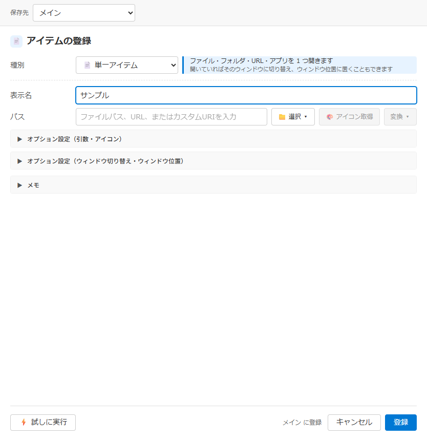

# アイテム登録・編集モーダル仕様書

## 関連ドキュメント

- [画面一覧](./README.md) - 全画面構成の概要
- [メインウィンドウ](./main-window.md) - メイン画面の詳細仕様
- [管理ウィンドウ](./admin-window.md) - 管理画面の詳細仕様
- [セット](../features/set.md) - セットの機能の詳細
- [セットの編集画面](./set-editor-modals.md) - セットの欄から開く小さな画面（アイテムの追加・ウィンドウを追加・ウィンドウ位置を更新・行の詳細）
- [アイコンシステム](../features/icons.md) - アイコン取得・カスタムアイコンの仕組み

## 1. 概要

アイテム登録・編集モーダルは、ランチャーに新しいアイテムを追加したり、既存アイテムを編集するためのフォームです。単一アイテム、フォルダ取込、セット、クリップボードの4種類を扱うことができます。

**メインウィンドウから開くときは独立した子ウィンドウ**で開き、メインウィンドウのサイズ・位置は変わりません（v0.7.38 以降。以前はウィンドウを 850x1000 に広げて中央へ動かしていた）。保存はこのウィンドウがデータファイルに書き、メインウィンドウはデータの変更を受けて読み直し、トーストを出します。管理ウィンドウ（✏️ 詳細編集など）から開くときも、同じ子ウィンドウを管理ウィンドウを親にして開きます（v0.7.39 以降）。このときは保存せずに内容を管理画面へ返し、管理画面の編集状態（未保存の変更）に反映されます。詳細は [ウィンドウ制御 - メイン画面の子ウィンドウ](../architecture/window-control.md#メイン画面の子ウィンドウアイテムの登録編集アイコン取得結果)。

**キーボードショートカット**: Escapeキーでモーダル（子ウィンドウ）を閉じることができます（編集中の内容は破棄されます）。

### 主要機能

- **アイテム登録**: ファイル、URL、フォルダ、カスタムURIなどを新規登録
- **アイテム編集**: 既存アイテムの名前、パス、引数、保存先を変更
- **種別切り替え**: 単一アイテム、フォルダ取込、セット、クリップボードの4種類を選択
- **クリップボード保存**: 書いたテキスト、または取り込んだクリップボードの内容（テキスト、HTML、RTF、画像）を保存・復元
- **セット**: 複数のアイテムをまとめて開き、必要ならウィンドウを記録したウィンドウ位置に動かすアイテムを作成
- **ドラッグ&ドロップ対応**: ファイルやフォルダのドロップで自動登録
- **カスタムアイコン**: アイテムごとにカスタムアイコンを設定可能
- **保存先タブ選択**: 複数タブ環境で保存先を指定

### 画面イメージ

## 2. 基本情報

| 項目 | 内容 |
| --- | --- |
| **ファイル名** | `src/renderer/components/RegisterModal.tsx` `src/renderer/components/RegisterPlacementBar.tsx`（保存先の帯） |
| **コンポーネント名** | `RegisterModal` |
| **スタイル** | `src/renderer/styles/components/RegisterModal.css` |
| **表示条件** | 下記トリガーのいずれか |
| **画面タイプ** | メインウィンドウから: 独立した子ウィンドウ（`src/renderer/components/RegisterWindowPage.tsx`） 管理ウィンドウから: 同じ子ウィンドウ（管理ウィンドウが親。v0.7.39 以降） |
| **ウィンドウサイズ** | 850x900 を開き元のディスプレイの作業領域で切り詰めたもの。作業領域の中央に置き、開き元のウィンドウのサイズ・位置は変えない |
| **親画面** | メインウィンドウ、管理ウィンドウ（AdminItemManagerView） |

### 表示トリガー

| トリガー | モード | 説明 |
| --- | --- | --- |
| ➕ボタンクリック（メインウィンドウ） | 登録モード | 空のフォームを表示 |
| ➕ の「🗂️ フォルダの中身を並べる（フォルダ取込）」・空のタブの［🗂️ フォルダから］・一覧の余白の右クリックの同じ項目（メインウィンドウ） | 登録モード | 種別を「フォルダ取込」にした空のフォームを表示 |
| ファイル/フォルダをドラッグ&ドロップ | 登録モード | ドロップ内容で初期化 |
| ✏️ボタンクリック（管理ウィンドウ） | 編集モード | 既存アイテムで初期化 |
| 管理ウィンドウの種類プルダウンで「セット」「クリップボード」を選ぶ | 編集モード | 選んだ種別で開く（必須データをこの画面で入れる） |
| 右クリックメニュー「✏️ 詳細編集」（管理ウィンドウ。1 行だけ選んでいるとき） | 編集モード | 既存アイテムで初期化 |
| 右クリックメニュー「✏️ 編集」（メインウィンドウのアイテム） | 編集モード | 既存アイテムで初期化 |

## 3. 画面項目一覧

| エリア | 項目名 | 内容・説明 | 表示条件 | 機能詳細 |
| --- | --- | --- | --- | --- |
| **保存先の帯** | 保存先タブドロップダウン | ラベル「保存先タブ」。保存先のタブを選択。入力欄の前提なので、画面の上の帯に分けて出す | アイテムが 1 件のとき（複数件のときは各アイテムの欄の先頭に「保存先タブ」として出す） | [5.10](#510-保存先タブを変更) |
| **保存先の帯** | 保存先ファイルドロップダウン | タブの右に「›」でつないで出す。保存先のファイルを選択 | アイテムが 1 件で、タブに複数ファイルがある場合（複数件のときは各アイテムの欄に「保存先ファイル」として出す） | [5.11](#511-保存先ファイルを変更) |
| **ヘッダー** | タイトル | 登録モード:「アイテムの登録」 編集モード:「アイテムの編集」。アイテムが 1 件のときは、左にアイコン（取得したアイコン。無ければ種別の絵文字）を添える | 常時表示 | - |
| **ヘッダー** | 自動取込の警告 | 「このアイテムはブックマーク自動取込で管理されています。表示名と URL は、次回の自動取込実行時にブックマークの内容で上書きされます。」 | 編集モードで、ブックマーク自動取込で登録されたアイテム（自動取込ルールに紐づくアイテム）を開いた場合 | - |
| **ヘッダー** | 参照の知らせ | 青い帯で「🔗 メインウィンドウのアイテムを編集しています。ワークスペースで参照している {N} か所にも反映されます」（[ワークスペース機能 - 参照とコピー](../features/workspace.md#参照とコピー)） | 編集モードで、ワークスペースの参照（アーカイブを含む）が指しているアイテムを開いた場合。自動取込の警告の下 | - |
| **本文** | 読み込み中表示 | 「アイテム情報を読み込み中…」。表示している間はフォームの代わりに出る | アイテム情報の初期化中、またはドロップしたファイルの読み込み中 | - |
| **アイテムヘッダー** | アイコンプレビュー | アイテムのアイコンを表示 | アイテムが複数件で、アイコンがある場合 | - |
| **フォーム** | 種別ドロップダウン | ラベル「種別」。📄 単一アイテム / 🗂️ フォルダ取込 / 📦 セット / 📋 クリップボード | 常時表示 | [5.1](#51-種別を変更) |
| **フォーム** | 種別の説明 | 種別ドロップダウンの右に、選んでいる種別の説明を 2 行で出す（[5.1 の種別の説明](#種別の説明)）。下に点線を引き、以降の項目と分ける | 常時表示 | - |
| **フォーム** | 名前入力欄 | ラベル「表示名」。アイテムの表示名を入力 | 種別がフォルダ取込以外の場合 | [5.2](#52-名前を入力) |
| **フォーム** | パス入力欄 | ラベル「パス」。ファイルパス、URL、カスタムURIを入力（フォルダ取込はフォルダのパス。プレースホルダー「取り込むフォルダのパスを入力」） | 種別が単一アイテムまたはフォルダ取込の場合 | [5.3](#53-パスを入力) |
| **フォーム** | 📁 選択ボタン | パス入力欄のすぐ右。単一アイテムは「📁 選択 ▾」でファイルかフォルダを選ぶメニュー、フォルダ取込は「📁 フォルダを選択」。選んだパスを入力欄に入れる | パス入力欄がある場合（ドロップしたファイルの登録では出さない） | [5.3.4](#534-選択ボタンをクリック) |
| **フォーム** | パスが空のときの補足 | パス入力欄の下に「パスが空なので、開いているウィンドウへ切り替えるだけです」 | 種別が単一アイテムで、パスが空で対象ウィンドウ（exe 名かタイトル）があり、パスのエラーが出ていない場合 | [5.3](#パスの無い単一アイテム) |
| **フォーム** | 🎨 アイコン取得ボタン | パスからアイコンを取得してプレビューに反映 | 種別が単一アイテムの場合（パスが空・フォルダ・取得中は無効） | [5.3.1](#531-アイコン取得ボタンをクリック) |
| **フォーム** | 変換ボタン | パス（と引数）を、ブラウザの新しいウィンドウや Office アプリで開く書き方に変換するメニューを開く（関連付けがブラウザのファイルも対象） | 種別が単一アイテムの場合（変換の候補がないときは無効。ドロップしたファイルの登録では出さない） | [5.3.3](#533-変換ボタンをクリック) |
| **フォーム** | セットの行の一覧 | ラベル「行」。行ごとにアイコン・名前・2 段目（開くもの）・ウィンドウ位置（📍）と、▲・▼・✏️・× のボタン（ない間は「まだ何も入っていません。下のボタンでアイテムを追加します。」） | 種別がセットの場合 | [5.8](#58-セットの行を編集) |
| **フォーム** | 「＋ アイテムを追加」ボタン | セットに追加するアイテムを選ぶ画面を開く | 種別がセットの場合 | [5.9](#59-セットにアイテムを追加) |
| **フォーム** | 「＋ ウィンドウを追加」ボタン | 開いているウィンドウを選んで行として足す画面を開く | 種別がセットの場合 | [5.16](#516-セットにウィンドウを追加ウィンドウ位置を更新) |
| **フォーム** | 「📍 ウィンドウ位置を更新」ボタン | 開いているウィンドウから、今ある行のウィンドウ位置を取り直す画面を開く | 種別がセットの場合（行が無いときは押せない） | [5.16](#516-セットにウィンドウを追加ウィンドウ位置を更新) |
| **フォーム** | 開き方 | ラベル「開き方」のプルダウン。「順番に開く」（既定）／「同時に開く」 | 種別がセットの場合 | [5.8](#58-セットの行を編集) |
| **フォーム** | セットの補足文 | 一覧とボタンの下に、開き方に合わせた説明（[5.8](#58-セットの行を編集)） | 種別がセットの場合 | - |
| **フォーム** | オプション設定（折りたたみ） | 「▶」で開閉する領域（開くと ▶ が下を向く）。単一アイテムは「オプション設定（引数・アイコン）」で引数入力欄とカスタムアイコンセクションを、フォルダ取込は「フォルダ取込のオプション」でフォルダ取込オプションを収める。モーダルを開いた時点では閉じている。フォルダ取込は、閉じていても見出しの右に今の設定の要約（例「2 階層・ファイルのみ・除外 temp*」）を出す | 種別が単一アイテムまたはフォルダ取込の場合 | [5.1](#オプション設定の折りたたみ) |
| **フォーム** | 引数入力欄 | ラベル「引数」。コマンドライン引数を入力 | 種別が単一アイテムの場合 | [5.4](#54-引数を入力) |
| **フォーム** | 常に管理者として実行チェックボックス | 「🛡️ 常に管理者として実行（開くたびに UAC の確認が出ます）」。オプション設定の折りたたみの中、引数入力欄の下 | 種別が単一アイテムで、パスがアプリ（exe・.lnk・.bat/.cmd など。ストアアプリを除く）の場合 | [5.4.1](#541-常に管理者として実行を付ける) |
| **フォーム** | フォルダ取込オプション | 階層の深さ・取得する種類・ファイル名の条件など | 種別がフォルダ取込の場合 | [5.6](#56-フォルダ取込オプションを設定) |
| **フォーム** | 取り込まれるもの（プレビュー） | フォルダ取込のオプションの下。「🔍 プレビュー」を押すと、取り込まれるものを件数とともに一覧にする | 種別がフォルダ取込の場合 | [5.6.1](#561-取り込まれるものを確かめる) |
| **フォーム** | ウィンドウ切り替え・ウィンドウ位置 | 折りたたみ「オプション設定（ウィンドウ切り替え・ウィンドウ位置）」の中で、対象ウィンドウ（exe 名・ウィンドウタイトル）・ウィンドウ位置・開くときの動きを設定（セットの行の詳細と同じ 3 つの枠）。閉じていても、ウィンドウ位置を記録していれば見出しの右に「📍 {位置}」を出す | 種別が単一アイテムの場合 | [5.5](#55-ウィンドウ切り替えウィンドウ位置を入力) |
| **フォーム** | 内容欄 | ラベル「内容」。「テキストを書く」「クリップボードから取り込む」の切り替えと、テキスト欄または取り込んだ内容のプレビュー。保存した中身の実データのファイルが見つからないときは、切り替えの上に警告を出す（[5.19](#519-内容を書く取り込む)） | 種別がクリップボードの場合 | [5.19](#519-内容を書く取り込む) |
| **フォーム** | カスタムアイコンセクション | ラベル「カスタムアイコン」。アイコンプレビュー、選択/削除ボタン | 種別が単一アイテム・クリップボード・セットの場合 | [5.12](#512-カスタムアイコンを設定) |
| **フォーム** | メモ（折りたたみ） | 見出し「メモ」の折りたたみの中に、アイテムに付ける自由記述のメモ（複数行・任意）。プレースホルダー「自由にメモを入力（任意）」。メモが空なら閉じた状態、書いてあれば開いた状態で出す。閉じているときは見出しの右にメモの 1 行目を出す | 常時表示 | [5.17](#517-メモを入力) |
| **フッター** | ⚡ 試しに実行ボタン | 保存せずにアイテムを実行。クリップボードは保存済みの中身が無いと押せない（[5.15](#515-試しに実行ボタンをクリック)） | フォルダ取込以外（単一アイテム・セット・クリップボード） | [5.15](#515-試しに実行ボタンをクリック) |
| **フッター** | 削除ボタン | 編集中のアイテムを削除する（確認ダイアログあり） | 編集モードの場合。ただし、メインウィンドウのフォルダの中身（フォルダ取込で並んだアイテム）から開いた場合は非表示 | [5.18](#518-削除ボタンをクリック) |
| **フッター** | キャンセルボタン | モーダルを閉じる | 常時表示 | [5.13](#513-キャンセルボタンをクリック) |
| **フッター** | 登録/保存ボタン | 登録モード:「登録」 編集モード:「保存」 | 常時表示 | [5.14](#514-登録保存ボタンをクリック) |
| **通知** | トースト通知 | アイコン取得、クリップボードの取り込み・保存、ドロップしたファイルの読み込みなどの失敗を知らせる | 失敗したとき | [5.3.2](#532-トースト通知) |
| **エラー表示** | エラーメッセージ | バリデーションエラーを各項目の下に、入力欄の左端にそろえて表示 | エラーがある場合 | - |
| **オーバーレイ** | ドロップ表示 | 「ファイルをドロップして追加」 | 開いている画面の上にファイルやフォルダをドラッグしている間（種別がセットのときは出さない） | [5.21](#521-開いた画面にファイルをドロップ) |

フォームの項目は上の表の順に並ぶ。項目は枠や背景で囲まず、画面の白地にそのまま並べる。ただし単一アイテムのカスタムアイコンセクションは、引数入力欄とともにオプション設定の折りたたみの中に表示する。メモの折りたたみの上は、上の項目（オプション設定の折りたたみなど）と付かないよう少し空ける。ラベルと入力欄を横に並べる項目では、エラーメッセージとパスが空のときの補足を入力欄の下の段に出し、入力欄の左端にそろえる。トースト通知はフォームの外に重ねて表示する。フッターは「⚡ 試しに実行」を左端に置き、削除・キャンセル・登録/保存を右に寄せて並べる。アイテムが 1 件のときは、右側のボタンの左に保存先を「「メイン」タブに登録」（編集モードは「「メイン」タブに保存」）と出す。タブに複数のデータファイルがあるときは「「仕事」タブの「資料」に登録」の形でファイルの名前も出す。

## 4. アクション一覧

| No | アクション名 | トリガー | 主な処理内容 | 詳細 |
| --- | --- | --- | --- | --- |
| 5.1 | 種別を変更 | 種別ドロップダウン変更 | フォーム項目の表示切り替え | [詳細](#51-種別を変更) |
| 5.2 | 名前を入力 | テキスト入力 | アイテム名の更新 | [詳細](#52-名前を入力) |
| 5.3 | パスを入力 | テキスト入力 | パス/URL/URIの更新、フォーカスが外れたときにタイプ自動検出 | [詳細](#53-パスを入力) |
| 5.3.1 | アイコン取得ボタンをクリック | ボタンクリック | パスからアイコンを取得してプレビューに反映 | [詳細](#531-アイコン取得ボタンをクリック) |
| 5.3.2 | トースト通知 | アイコン取得失敗時 | エラーメッセージを画面内に表示 | [詳細](#532-トースト通知) |
| 5.3.3 | 変換ボタンをクリック | ボタンクリック | URL をブラウザの新しいウィンドウ・アプリのウィンドウ・シークレットで開く形（関連付けがブラウザのファイルは新しいウィンドウだけ）や Office アプリで開く形に変換し、変換した形から URL・ファイルに戻す | [詳細](#533-変換ボタンをクリック) |
| 5.3.4 | 選択ボタンをクリック | ボタンクリック | ファイルかフォルダを選ぶダイアログを開き、選んだパスを入力欄に入れる | [詳細](#534-選択ボタンをクリック) |
| 5.4 | 引数を入力 | テキスト入力 | コマンドライン引数の更新 | [詳細](#54-引数を入力) |
| 5.4.1 | 常に管理者として実行を付ける | チェックボックス | 開くたびに管理者として起動する設定の更新 | [詳細](#541-常に管理者として実行を付ける) |
| 5.5 | ウィンドウ切り替え・ウィンドウ位置を入力 | テキスト/数値入力、プルダウン、ボタンクリック | 対象ウィンドウ・ウィンドウ位置・開くときの動きの更新 | [詳細](#55-ウィンドウ切り替えウィンドウ位置を入力) |
| 5.6 | フォルダ取込オプションを設定 | オプション変更 | フォルダ取込オプションの更新 | [詳細](#56-フォルダ取込オプションを設定) |
| 5.6.1 | 取り込まれるものを確かめる | ボタンクリック | フォルダを読み、取り込まれるものを一覧にする | [詳細](#561-取り込まれるものを確かめる) |
| 5.7 | 以前のウィンドウ操作アイテムを開く | 編集・管理画面からの詳細編集 | パスの無い単一アイテムとして表示 | [詳細](#57-以前のウィンドウ操作アイテムを開く) |
| 5.8 | セットの行を編集 | 行のボタン・ドラッグ、開き方の変更 | 行の並べ替え・削除・詳細、開き方の切り替え | [詳細](#58-セットの行を編集) |
| 5.9 | セットにアイテムを追加 | 「＋ アイテムを追加」クリック | 選んだアイテムを行として足す | [詳細](#59-セットにアイテムを追加) |
| 5.10 | 保存先タブを変更 | ドロップダウン変更 | 保存先タブの更新 | [詳細](#510-保存先タブを変更) |
| 5.11 | 保存先ファイルを変更 | ドロップダウン変更 | 保存先ファイルの更新 | [詳細](#511-保存先ファイルを変更) |
| 5.12 | カスタムアイコンを設定 | ファイル選択/削除 | カスタムアイコンの管理 | [詳細](#512-カスタムアイコンを設定) |
| 5.13 | キャンセルボタンをクリック | ボタンクリック | モーダルを閉じる | [詳細](#513-キャンセルボタンをクリック) |
| 5.14 | 登録/保存ボタンをクリック | ボタンクリック | バリデーションと登録/保存処理 | [詳細](#514-登録保存ボタンをクリック) |
| 5.15 | 試しに実行ボタンをクリック | ボタンクリック | 保存せずにアイテムを実行 | [詳細](#515-試しに実行ボタンをクリック) |
| 5.16 | セットにウィンドウを追加・ウィンドウ位置を更新 | 「＋ ウィンドウを追加」「📍 ウィンドウ位置を更新」クリック | 開いているウィンドウを行にする・ウィンドウ位置を行に取り込む | [詳細](#516-セットにウィンドウを追加ウィンドウ位置を更新) |
| 5.17 | メモを入力 | テキスト入力 | アイテムのメモの更新 | [詳細](#517-メモを入力) |
| 5.18 | 削除ボタンをクリック | ボタンクリック | 確認のうえアイテムを削除 | [詳細](#518-削除ボタンをクリック) |
| 5.19 | 内容を書く・取り込む | テキスト入力・ボタンクリック | 書いたテキストか取り込んだクリップボードを、登録時に保存 | [詳細](#519-内容を書く取り込む) |
| 5.20 | 画面を開く | 登録・編集・ドロップ | 開き方に応じてフォームを初期化 | [詳細](#520-画面を開く) |
| 5.21 | 開いた画面にファイルをドロップ | ドラッグ&ドロップ | 先頭のパスでフォームの先頭アイテムを置き換え | [詳細](#521-開いた画面にファイルをドロップ) |
| 5.22 | ウィンドウ選択モーダル | 単一アイテムの「🔍 開いているウィンドウから選ぶ」クリック | 実行中のウィンドウから対象ウィンドウ（とウィンドウ位置）を取り込む | [詳細](#522-ウィンドウ選択モーダル) |

## 5. 機能詳細

### 5.1. 種別を変更

#### アクション

- 種別ドロップダウンで「📄 単一アイテム」「🗂️ フォルダ取込」「📦 セット」「📋 クリップボード」のいずれかを選択

#### 処理フロー

1. 選択した種別に応じてフォーム項目を切り替え
2. 種別固有の初期値を設定

#### 種別の説明

種別ドロップダウンの右に、選んでいる種別の説明を出す。1 行目は何をする種別か、2 行目は補足。どの種別でも 2 行で高さが変わらないので、種別を変えても下の項目は上下しない。

| 種別 | 1 行目 | 2 行目 |
| --- | --- | --- |
| 📄 単一アイテム | ファイル・フォルダ・URL・アプリを 1 つ開きます | 開いていればそのウィンドウに切り替え、ウィンドウ位置に置くこともできます |
| 🗂️ フォルダ取込 | フォルダの中身を 1 件ずつ一覧に並べます | 中身が増えたり減ったりしても、自動で追従します |
| 📦 セット | 複数のアイテムをまとめて開きます | 開いたウィンドウを、記録したウィンドウ位置に並べられます |
| 📋 クリップボード | 定型文や画像を、クリップボードにコピーします | あとは Ctrl+V で貼り付けるだけです |

#### 種別ごとの表示項目

| 項目 | 単一アイテム | フォルダ取込 | セット | クリップボード |
| --- | :---: | :---: | :---: | :---: |
| 名前 | ○ | - | ○ | ○ |
| パス | ○ | ○ | - | - |
| 引数 | ○ | - | - | - |
| 常に管理者として実行（パスがアプリのときだけ） | ○ | - | - | - |
| ウィンドウ切り替え・ウィンドウ位置（折りたたみ「オプション設定（ウィンドウ切り替え・ウィンドウ位置）」） | ○ | - | - | - |
| フォルダ取込オプション | - | ○ | - | - |
| 取り込まれるもの（プレビュー） | - | ○ | - | - |
| セットの行の一覧・開き方 | - | - | ○ | - |
| 内容欄 | - | - | - | ○ |
| カスタムアイコン | ○ | - | ○ | ○ |
| メモ | ○ | ○ | ○ | ○ |

#### オプション設定の折りたたみ

単一アイテムとフォルダ取込では、補助的な項目を折りたたみ領域にまとめる。見出しの「▶」をクリックすると開き（▶ が下を向く）、もう一度クリックすると閉じる。モーダルを開いた時点では閉じている。

| 種別 | 見出し | 中に入る項目 |
| --- | --- | --- |
| 単一アイテム | オプション設定（引数・アイコン） | 引数入力欄、常に管理者として実行チェックボックス（パスがアプリのときだけ）、カスタムアイコンセクション |
| フォルダ取込 | フォルダ取込のオプション | フォルダ取込オプション |

単一アイテムのウィンドウ切り替えは、この領域とは別の折りたたみ（「オプション設定（ウィンドウ切り替え・ウィンドウ位置）」）で表示する（[5.5](#55-ウィンドウ切り替えウィンドウ位置を入力)）。

フォルダ取込の見出しの右には、閉じていても今の設定の要約を出す。中身はアイテム管理の「パスと引数」列に添える要約と同じ（階層の深さ・取得する種類・ファイル名の条件・除外する条件のうち、既定と違うものを「・」でつなぐ）。単一アイテムは、「常に管理者として実行」を付けているときだけ、閉じていても見出しの右に「🛡️ 常に管理者として実行」と出す。

メモも同じ形の折りたたみ（見出し「メモ」）に収める。種別を問わずフォームの末尾に出す。開いた状態で出すか閉じた状態で出すかは [5.17](#517-メモを入力) を参照。

#### 種別変更時の初期化処理

**フォルダ取込に変更時:**

- フォルダ処理モードを「展開」に設定
- フォルダ取込オプションが未設定なら既定値で初期化
- クリップボード関連の情報をクリア

**セットに変更時:**

- セットの行が未設定なら空で用意
- フォルダ取込・クリップボード関連の情報をクリア

**単一アイテムに変更時:**

- フォルダ取込関連の情報をクリア
- クリップボード関連の情報をクリア

**クリップボードに変更時:**

- パスを空にする
- フォルダ取込関連の情報をクリア
- 内容欄を「テキストを書く」で表示する。クリップボードは読まない（取り込みは「クリップボードから取り込む」に切り替えてボタンを押したときだけ。[5.19](#519-内容を書く取り込む)）

### 5.2. 名前を入力

#### アクション

- 名前入力欄にテキストを入力

#### 処理フロー

1. 入力値を取得
2. アイテムの名前を更新
3. 入力時にエラー状態をクリア

#### プレースホルダー

- 単一アイテム: 「表示名を入力」
- セット: 「セットの名前を入力」
- クリップボード: 「クリップボードアイテムの表示名を入力」

#### バリデーション

- **単一アイテム**: 必須（空の場合「表示名を入力してください」）
- **セット・クリップボード**: 必須（空の場合「表示名を入力してください」）
- **フォルダ取込**: 不要（表示されない）

### 5.3. パスを入力

#### アクション

- パス入力欄にファイルパス、URL、カスタムURIを入力

#### 処理フロー

1. 入力値でアイテムのパスを更新し、パスのエラー表示を消す
2. パス入力欄からフォーカスが外れたとき、パスの形からアイテムタイプを判定する（種別がクリップボードのときは判定しない。単一アイテムでパスが空なら、開いているウィンドウへ切り替えるだけのタイプにする）
3. フォルダと判定したら下記「フォルダ検出時の追加処理」を行う。それ以外ならフォルダ関連の設定を消し、アイコンキャッシュがあればプレビューに反映する

#### アイテムタイプの自動検出

上から順に判定し、最初に当てはまったタイプにする。入力欄での判定はパスの形だけで行い、ファイルシステムは確かめない（ドロップしたパスはフォルダかファイルかも確かめ、フォルダならフォルダ、ファイルなら拡張子が無くてもファイルにする）。

| 入力パターン | 検出タイプ |
| --- | --- |
| `://` を含み、スキームが `http`・`https`・`ftp` | URL |
| `://` を含み、上記以外のスキーム（`obsidian://` など） | カスタムURI |
| `shell:AppsFolder\` で始まる | アプリ |
| それ以外の `shell:` で始まる | フォルダ |
| `ms-todo:` のように「2文字以上のスキーム＋`:`」で始まる（`shell:`・`file:` を除く。`C:` のような1文字はドライブとみなす） | カスタムURI |
| 拡張子が `.exe`・`.bat`・`.cmd`・`.com`・`.lnk` | アプリ |
| 拡張子がない、または末尾が `\`・`/` | フォルダ |
| 上記以外 | ファイル |

#### フォルダ検出時の追加処理

- フォルダの扱いが決まっていなければ「フォルダを開く」にする。単一アイテムのフォルダは開くだけで、中身を展開して並べるのは種別「フォルダ取込」のとき
- フォルダ取込オプションが未設定なら既定値で初期化

#### プレースホルダー

- 単一アイテム: 「ファイルパス、URL、またはカスタムURIを入力」
- フォルダ取込: 「取り込むフォルダのパスを入力」

#### ドロップ・クリップボードから開いたとき

- ドラッグ&ドロップやクリップボードから開いた場合も、パスは手入力のときと同じく書き換えられる（書き換えたら、手入力と同じく種別とアイコンを取り直す）

#### パスの無い単一アイテム

- 単一アイテムは、対象ウィンドウ（[5.5](#55-ウィンドウ切り替えウィンドウ位置を入力) の exe 名かウィンドウタイトル）を入れれば、パスを空のまま保存できる。開いたとき、そのウィンドウが開いていれば切り替え、開いていなければ何も開かない（[5.5 の動作仕様](#動作仕様)）
- パス入力欄の placeholder はそのまま。パスが空で対象ウィンドウがあるときだけ、パス入力欄の下に「パスが空なので、開いているウィンドウへ切り替えるだけです」と出す
- パスの無い単一アイテムを編集で開くと、「オプション設定（ウィンドウ切り替え・ウィンドウ位置）」は開いた状態で出る

#### バリデーション

- **単一アイテム**: パスか対象ウィンドウ（exe 名かウィンドウタイトル）のどちらかが要る（両方とも空の場合「パスか対象ウィンドウのどちらかを入力してください」）
- **フォルダ取込**: 必須（空の場合「パスを入力してください」）
- **セット・クリップボード**: 不要（表示されない）

### 5.3.1. アイコン取得ボタンをクリック

#### アクション

- パス入力欄の横にある「🎨 アイコン取得」ボタンをクリック

#### 表示条件

- 単一アイテムで表示（フォルダ取込はアイコンを取らないので出さない）
- パスが空、取得中、またはパスがフォルダの場合は無効

#### 処理フロー

1. パスの種類（URL・ファイル・アプリ・カスタムURI）に応じてアイコンを取得（URL はファビコン。キャッシュがあればそれを使う）
2. 取得成功時: タイトルの左のアイコン（複数件のときはアイテムヘッダーのアイコンプレビュー）を更新
3. 取得できなかった場合: 「アイコンを取得できませんでした」を警告のトーストで表示
4. エラー時: 「アイコン取得中にエラーが発生しました」をエラーのトーストで表示

#### 注意

- カスタムアイコン（[5.12](#512-カスタムアイコンを設定)）は変更しない

### 5.3.2. トースト通知

#### 表示条件

- アイコン取得に失敗した場合（v0.6.0以降）
- クリップボードの取り込みや保存に失敗した場合
- ドロップしたファイルの読み込みに失敗した場合
- アイテムの保存や削除に失敗した場合

#### 表示内容

| きっかけ | トースト |
| --- | --- |
| アイコンを取得できなかった | 警告「アイコンを取得できませんでした」（3秒で自動的に消える） |
| アイコン取得でエラー | エラー「アイコン取得中にエラーが発生しました」（4秒で自動的に消える） |
| クリップボードの取り込みに失敗 | エラー（失敗の理由。理由がなければ「キャプチャに失敗しました」） |
| 登録/保存時のクリップボードデータの保存に失敗 | エラー（失敗の理由。理由がなければ「クリップボードデータの保存に失敗しました」） |
| ドロップしたファイルの読み込みに失敗 | エラー「ファイルの読み込み中にエラーが発生しました」（[5.21](#521-開いた画面にファイルをドロップ)） |
| アイテムの保存に失敗（メインウィンドウから開いたとき） | エラー「アイテムの保存に失敗しました」（[5.14](#514-登録保存ボタンをクリック)） |
| アイテムの削除に失敗 | エラー「アイテムの削除に失敗しました」（[5.18](#518-削除ボタンをクリック)） |

エラーのトーストは 4 秒で自動的に消える。

#### 表示方法

- 画面の右下に重ねて表示し、フォームの操作は妨げない

### 5.3.3. 変換ボタンをクリック

いまのパスと引数を、別の開き方の書き方に変換する。入力を書き換える補助で、アイテムが開き方を設定として持つわけではない（書き換えた後は手で直してもよい）。

#### アクション

- パス入力欄の横にある「変換 ▾」ボタンをクリック（マウスを重ねると「パスを別の開き方の書き方に変換します（ブラウザの新しいウィンドウ・Office アプリなど）」と出る）

#### 表示条件

- 単一アイテムで表示する（フォルダ取込は変換の候補が無いので出さない）
- 変換の候補がないときは押せない。マウスを重ねると「この入力に使える変換はありません」と出る。パスが URL で、既定のブラウザが下の表にないときは「既定のブラウザ（ブラウザ名）には対応していません」と出る

#### 処理フロー

1. ボタンを押すとメニューを開く。もう一度押すか、メニューの外側をクリックすると閉じる
2. いまのパスと引数から元の URL を読み取り、変換の候補を見出しごとに並べる（下の「変換の候補」）。候補ごとに名前・変換後の書き方（exe はファイル名だけ）・説明を表示する。いまの書き方は候補に出さない
3. 候補を選ぶと、パスと引数を書き換えてメニューを閉じる
   - 種別もパスに合わせて変わる（ブラウザの exe ならアプリ、`ms-excel:` などならカスタム URI、URL なら URL）。前の種別で読み込んだアイコンは外す
   - 書き換えた欄を一瞬黄色く光らせる。引数に何か入ったときは、閉じていた「オプション設定」を開いて引数欄を見せる
   - 成功のトーストを出す（「Google Chrome で開く形に変換しました」「Excel アプリで開く形に変換しました」「URL に戻しました」）
4. 保存するまではアイテムは変わらない

#### 変換の候補

いまの入力によって、次の見出しの候補を出す。

| いまの入力 | 出す見出し |
| --- | --- |
| http・https の URL | ブラウザ（既定のブラウザ）。SharePoint・OneDrive 上の Office ファイルなら Office アプリも |
| パスが下の表のブラウザの exe で、引数に URL がある | URL（URL に戻す）、ブラウザ（そのブラウザの別の形）。既定のブラウザと違う exe なら既定のブラウザの見出しも。Office ファイルの URL なら Office アプリも |
| `ms-excel:`・`ms-word:`・`ms-powerpoint:` で始まる | URL（URL に戻す）、ブラウザ（既定のブラウザ）、Office アプリ（別の開き方） |
| ローカルのファイル（ドライブ文字か `\\server\share` で始まり、拡張子がある。exe・bat・cmd・com・lnk は除く）で、その拡張子の関連付けが下の表のブラウザ | ブラウザ（関連付けのブラウザ。新しいウィンドウだけで、アプリのウィンドウ・シークレットは出さない） |
| パスが下の表のブラウザの exe で、引数に `file://` の URL がある | ファイル（ファイルに戻す）、ブラウザ（そのブラウザの別の形）。その拡張子の関連付けが下の表のブラウザで、いまの exe と違うなら関連付けのブラウザの見出しも |
| 上のどれでもない（関連付けがブラウザでないファイル・フォルダ・空など） | なし（ボタンは押せない） |

「URL に戻す」はパスを元の URL にし、引数を空にする（既定のブラウザの新しいタブで開く）。「ファイルに戻す」はパスを元のファイルのパスにし、引数を空にする（関連付けられたアプリで開く）。

##### ブラウザ

既定のブラウザ（https を開くプログラム）を Windows に問い合わせ、その exe のフルパスをパスに、開き方の引数と URL を引数に入れる。ブラウザの別の形に変えるときは、開き方と URL 以外の引数（`--profile-directory=...` など）を書かれたまま残す。

| ブラウザ（exe） | 新しいウィンドウで開く形 | アプリのウィンドウで開く形（タブとアドレスバーの無いウィンドウ） | シークレットで開く形 |
| --- | --- | --- | --- |
| Chrome（chrome.exe）・Brave（brave.exe）・Vivaldi（vivaldi.exe）・Chromium（chromium.exe） | `--new-window URL` | `--app=URL` | シークレット ウィンドウ（`--incognito URL`） |
| Edge（msedge.exe） | `--new-window URL` | `--app=URL` | InPrivate ウィンドウ（`--inprivate URL`） |
| Firefox（firefox.exe） | `-new-window URL` | なし | プライベート ウィンドウ（`-private-window URL`） |

ファイルは `file:///C:/…`（UNC は `file://server/share/…`）の URL にして渡す。空白・`#`・`?`・`%` だけを符号化し、日本語はそのまま入れる。ファイルには新しいウィンドウの形だけを出す。シークレットではブラウザの拡張機能が既定で動かず、.md などを整形して見られない。アプリのウィンドウ（`--app=file:///…`）は、アプリのウィンドウとして表示されない。

上の表にないブラウザが既定（ファイルなら関連付け）のときは、ブラウザの見出しを出さない。パスは exe の名前だけでなくフルパスで入れる（名前だけでは起動できない。QDL は PATH のフォルダしか探さない）。

##### Office アプリ

対象は、`sharepoint.com` または `docs.live.net` を含み、各拡張子のファイルを指す URL。パスの先頭に文字列を付ける（すでに `ms-excel:` などが付いているときは外して付け直す）。

| 見出し | 拡張子 | 候補（付ける文字列） |
| --- | --- | --- |
| SharePoint/OneDrive Excel | .xlsx・.xls | 編集用に開く（SharePoint標準）（`ms-excel:ofe\|ofc\|u\|`）、編集用に開く（`ms-excel:ofe\|u\|`）、読み取り専用（`ms-excel:ofv\|u\|`） |
| SharePoint/OneDrive Word | .docx・.doc | 編集用に開く（`ms-word:ofe\|u\|`）、読み取り専用（`ms-word:ofv\|u\|`） |
| SharePoint/OneDrive PowerPoint | .pptx・.ppt | 編集用に開く（`ms-powerpoint:ofe\|u\|`）、読み取り専用（`ms-powerpoint:ofv\|u\|`） |

ワークスペースアイテムの編集ウィンドウも同じ欄を使うので、このボタンも同じように働く（[ワークスペースウィンドウ - 編集](./workspace-window.md#各メニュー項目の処理)）。

### 5.3.4. 選択ボタンをクリック

パスを OS のダイアログで選んで入力欄に入れる。入力欄は手で打てるまま残し、このボタンは補助にする。

#### アクション

- 単一アイテム: パス入力欄の右の「📁 選択 ▾」をクリックし、メニューから「📄 ファイルを選択」か「📁 フォルダを選択」を選ぶ（マウスを重ねると「ファイルやフォルダを選んで、パスに入れます」と出る）
- フォルダ取込: パス入力欄の右の「📁 フォルダを選択」をクリック（マウスを重ねると「取り込むフォルダを選んで、パスに入れます」と出る）

#### 表示条件

- パス入力欄がある種別（単一アイテム・フォルダ取込）で表示する
- メニューは、メニューの外をクリックするか Escape で閉じる（Escape で画面は閉じない）

#### 処理フロー

1. ファイルを選ぶダイアログ（タイトル「ファイルを選択」）か、フォルダを選ぶダイアログ（タイトル「フォルダを選択」）を、この画面を親にして開く
2. ダイアログは、入力欄のパスが実在すればその場所から開く（ファイルのパスでフォルダを選ぶときは、そのファイルのあるフォルダ）。パスが無いときはその親のフォルダから、どちらも無いとき・URL などのときは OS が決める場所から開く。環境変数（%USERPROFILE% など）は展開して探す
3. 選んだら、そのパスを入力欄に入れ、パス入力欄からフォーカスが外れたときと同じくアイテムタイプを判定する（[5.3](#53-パスを入力)）
4. ダイアログを閉じた（キャンセル）ときは何もしない

### 5.4. 引数を入力

#### アクション

- 「オプション設定（引数・アイコン）」の折りたたみを開き、引数入力欄にコマンドライン引数を入力

#### 処理フロー

1. 入力値を取得
2. アイテムの引数を更新

#### プレースホルダー

- 「コマンドライン引数（実行ファイルやアプリの場合のみ有効）」

#### バリデーション

- 任意項目（バリデーションなし）

#### 実行したときの動き

- 引数があると、実行ファイル（.exe・.bat・.cmd・.com）に引数を渡して起動する。作業フォルダは、引数がないときと同じく実行ファイルのあるフォルダ（パスが絶対パスのとき）
- ショートカット（.lnk）と登録アプリ（`shell:AppsFolder\` で始まるもの）には引数を渡さない（ショートカットは設定どおりに開く）

### 5.4.1. 常に管理者として実行を付ける

#### アクション

- 「オプション設定（引数・アイコン）」の折りたたみを開き、「🛡️ 常に管理者として実行（開くたびに UAC の確認が出ます）」にチェックを入れる

#### 表示条件

- 種別が単一アイテムで、パスがアプリ（exe・ショートカット（.lnk）・.bat/.cmd など）のとき。ストアアプリ（`shell:AppsFolder\` で始まるもの）・URL・ファイル・フォルダでは出さない。パス欄を書き換えると、すぐに出し分けを変える

#### 処理フロー

1. チェックの状態を保存する内容に反映する（既定はオフ）
2. 保存すると、オンのときだけアイテムに設定を書く。パスをアプリ以外に変えて保存したときは、チェックが隠れていても設定を外す

#### 実行したときの動き

- オンのアイテムは、メインウィンドウの Enter・クリック、ワークスペースのクリック、セットの行、QuickDashLauncher CLI の open のどれで開いても、管理者として起動する（右クリックの「🛡️ 管理者として実行」と同じ。[右クリックメニュー](./context-menu.md#414-管理者として実行)）。「⚡ 試しに実行」でも管理者として起動する
- UAC の確認で「いいえ」を押したときは何も知らせず、起動の記録にも数えない
- ウィンドウ切り替えを決めたアイテムは、開いているウィンドウがあればそれを前面に出す（開き直さない）。管理者として開いたウィンドウは、権限の低い QuickDashLauncher から前面に出したりウィンドウ位置を当てたりできないことがある

### 5.5. ウィンドウ切り替え・ウィンドウ位置を入力

種別「📄 単一アイテム」で、開く前に探すウィンドウ（対象ウィンドウ）と、そのウィンドウを置くウィンドウ位置を決める。中身は [セットの行の詳細](./set-editor-modals.md#5-行の詳細) の「対象ウィンドウ」「ウィンドウ位置」「開くときの動き」の 3 つの枠と同じで、見出し・ラベル・プルダウン・ボタン・文言・並びがそろっている。考え方は [セット](../features/set.md) と同じ。

#### アクション

- 折りたたみ「オプション設定（ウィンドウ切り替え・ウィンドウ位置）」を開き、3 つの枠の欄を直す
- 対象ウィンドウの枠の見出しの右の「🔍 開いているウィンドウから選ぶ」をクリックし、ウィンドウ選択モーダル（[5.22](#522-ウィンドウ選択モーダル)）でウィンドウを選んで、対象ウィンドウとウィンドウ位置をまとめて入れる
- ウィンドウ位置の枠の「📍 ウィンドウ位置を更新」をクリックし、今の条件に合うウィンドウの今の位置だけを記録し直す（[行の詳細 - ウィンドウ位置を更新](./set-editor-modals.md#55-ウィンドウ位置を更新)）

#### 見出し

- 見出しの「▶」をクリックすると開き（▶ が下を向く）、もう一度クリックすると閉じる。モーダルを開いた時点では閉じている。ただし、パスが空で対象ウィンドウがある（パスの無い単一アイテム）ときは開いた状態で出す
- ウィンドウ位置を記録していれば、閉じていても見出しの右に「📍 {位置}」を出す（例「📍 画面 1・中央 1708×1032・デスクトップ 2」）。位置の言葉はセットの行と同じ。全デスクトップに表示するときは、デスクトップの番号を付けずに「・全デスクトップ」を添える（ウィンドウ位置の図の横の言葉も番号を付けない）

#### 画面項目

| 枠 | 項目 | 内容・説明 | 表示条件 |
| --- | --- | --- | --- |
| **対象ウィンドウ** | 「🔍 開いているウィンドウから選ぶ」・exe 名・ウィンドウタイトル・探し方の補足・元に戻す・一部だけで探す・今合うウィンドウ | セットの行の詳細と同じ（[行の詳細 - 画面項目一覧](./set-editor-modals.md#52-画面項目一覧)） | セットの行の詳細と同じ |
| **対象ウィンドウ** | 説明 | 枠の先頭（見出しの直下）に「このアイテムを開いたとき、合うウィンドウが開いていれば、開き直さずにそのウィンドウへ切り替えます。」 | 常時表示 |
| **ウィンドウ位置** | 記録したウィンドウ位置・「📍 ウィンドウ位置を更新」・「ウィンドウ位置を外す」・補足・注意・仮想デスクトップ・「📌 全デスクトップに表示」 | セットの行の詳細と同じ。注意のうちタブで開く旨は、パスがフォルダ・URL で対象ウィンドウがあるときに出す | セットの行の詳細と同じ |
| **開くときの動き** | 開いていたら | 「開かずに、そのウィンドウを使う」（既定）／「もう 1 つ開く」 | パスがあるとき |
| **開くときの動き** | 前面に出す | 「出す」（既定）／「出さない」 | ウィンドウ位置を記録したとき |
| **開くときの動き** | ウィンドウが出るのを待つ（秒） | 1 以上の秒数。空なら 30 秒 | パスがあり、ウィンドウ位置を記録したとき |

開くときの動きの枠は、出す欄が無いとき（パスが空で、ウィンドウ位置も無いとき）は出さない。

セットの行の詳細との違いは次の 3 つ。

- 「開くもの」の枠は無い（上のパスが開くもの）
- 対象ウィンドウの説明の主語が「このアイテム」で、見つかったウィンドウへ切り替える旨を書く
- 「前面に出す」の既定が「出す」（セットの行は「出さない」）

#### 欄を直す

- 欄の直し方（一部だけで探す候補・元に戻す・今合うウィンドウ・待つ秒数と仮想デスクトップの扱い）はセットの行の詳細と同じ（[行の詳細 - 欄を直す](./set-editor-modals.md#53-欄を直す)）。元に戻す先と候補の元は、この画面を開いたときのタイトル
- 「🔍 開いているウィンドウから選ぶ」「📍 ウィンドウ位置を更新」で入るものもセットの行の詳細と同じ（[行の詳細 - 開いているウィンドウから選ぶ](./set-editor-modals.md#54-開いているウィンドウから選ぶ)・[ウィンドウ位置を更新](./set-editor-modals.md#55-ウィンドウ位置を更新)）。全デスクトップに表示するときは、デスクトップの番号を入れない
- 入れた内容は、登録/保存ボタンを押したときに保存する（[データ保存形式](#データ保存形式)）

#### 動作仕様

**アイテム起動時の挙動:**

1. 対象ウィンドウ（exe 名・ウィンドウタイトル）に合うウィンドウを探す（すべての仮想デスクトップが対象。exe 名は部分一致。タイトルは `*`（任意の文字列）・`?`（任意の 1 文字）を含めばパターンとして、含まなければ全体の一致で照合する。どちらも大文字小文字を区別しない）。「開いていたら」が「もう 1 つ開く」なら探さずに 3 へ進む
2. **ウィンドウが見つかった場合**は次の順に操作し、アイテムは開かない
   1. ウィンドウを通常表示に戻す（最小化を解除。最大化は、ウィンドウ位置があるときだけ解除）
   2. 「📌 全デスクトップに表示」にチェックがあれば、すべての仮想デスクトップに表示する
   3. ウィンドウ位置があれば、移動・リサイズする
   4. 仮想デスクトップの番号があり、全デスクトップに表示していなければ、ウィンドウをそのデスクトップへ移す。ウィンドウ位置があれば、移したあとにもう一度当てる
   5. 「前面に出す」が「出す」なら前面に出してフォーカスする（「出さない」なら前面に出さない）。仮想デスクトップの番号も全デスクトップへの表示も無く、ウィンドウが別の仮想デスクトップにあれば、先にそのデスクトップへ切り替える
3. **ウィンドウが見つからない場合**は、アイテムを開く
   - ウィンドウ位置が無ければ、開くだけ（開いたウィンドウは動かさない）
   - ウィンドウ位置があれば、ウィンドウが出るのを「ウィンドウが出るのを待つ（秒）」の秒数（空なら 30 秒）まで待ち、出てきたウィンドウに 2 と同じ操作をする。出てこなければ「ウィンドウが出るのを N 秒待ちましたが、見つかりませんでした」をトーストで知らせる
4. 開いている途中で同じアイテムをもう一度実行しても、重ねては開かない（ウィンドウが出る前に 2 つ目を開かないため）

**パスが空のとき（パスの無い単一アイテム）:**

- 開くものが無いので、「開いていたら」に関係なく探す。見つかれば 2 と同じ操作をする（ウィンドウ位置があれば当て、前面に出すかは「前面に出す」のとおり）
- 見つからなければ何も開かず、情報のトースト「開いていないので切り替えませんでした」を出す

**マルチモニタ対応:**

- 座標系は仮想スクリーン座標（Virtual Screen Coordinates）
- プライマリモニターの左上が原点 (0, 0)
- セカンダリモニターは相対位置に配置

#### データ保存形式

入力内容は、保存先のデータファイルに単一アイテム（**[通常アイテム](../architecture/file-formats/data-format.md#31-通常アイテムjsonlauncheritem)**）のウィンドウ切り替えとして、セットの行と同じキーで保存します。項目の定義は **[3.1.5. ウィンドウ切り替え](../architecture/file-formats/data-format.md#315-ウィンドウ切り替えitemwindowswitch)** を参照してください。

- 既定の値（開いていたら「開かずに、そのウィンドウを使う」・前面に出す「出す」・空の秒数）は書かない。「出さない」にしたときだけ前面に出すを書く
- 画面で触らなかった欄は、読み込んだときの値のまま保存する（最大化して置く記録なども消えない）

#### バリデーション

- 登録/保存時には検証しない（すべて任意項目）。ただしパスが空のときは、exe 名かウィンドウタイトルが要る（[5.3 のバリデーション](#バリデーション-1)）
- exe 名とウィンドウタイトルの両方が空なら、ウィンドウ位置などが残っていても、ウィンドウ切り替えは保存しない（探す相手が無いため）。通常どおり開くだけのアイテムになる

### 5.6. フォルダ取込オプションを設定

#### アクション

- 「フォルダ取込のオプション」の折りたたみを開き、オプションを編集

#### 処理フロー

1. 各オプションを変更
2. アイテムのフォルダ取込オプションを更新

#### 設定可能なオプション

| オプション | 説明 | 既定 |
| --- | --- | --- |
| 階層の深さ | サブフォルダをどこまでたどるか（現在のフォルダのみ／1〜3階層下まで／無制限） | 現在のフォルダのみ |
| 取得する種類 | 取り込む種類（ファイルのみ／フォルダのみ／ファイルとフォルダ） | ファイルとフォルダ |
| ファイル名の条件 | ファイル名を絞り込むパターン（例: \*.txt） | なし |
| 除外する条件 | 除外するパターン（例: temp\*） | なし |
| 頭に付ける文字 | 表示名の前に、入力したとおりにつなぐ文字（区切りや括弧は足さない） | なし |
| 後ろに付ける文字 | 表示名の後に、入力したとおりにつなぐ文字（区切りや括弧は足さない） | なし |

保存される項目名と既定値は [データファイル形式 - スキャンオプション](../architecture/file-formats/data-format.md#322-スキャンオプションjsondiroptions) を参照してください。

#### 使用例

次のように入力すると、`C:\Projects` の 2 階層下までのファイルのうち `*.{js,ts}` に一致し `node_modules` を除いたものが並ぶ。展開されたアイテムの表示名は「【Src】ファイル名」になる。既定値（階層の深さ「現在のフォルダのみ」、取得する種類「ファイルとフォルダ」）と空欄の項目は保存しない。保存される形は [データファイル形式仕様 - 使用例](../architecture/file-formats/data-format.md#323-使用例) にある。

| 入力項目 | 入力値 |
| --- | --- |
| パス | `C:\Projects` |
| 階層の深さ | 2階層下まで |
| 取得する種類 | ファイルのみ |
| ファイル名の条件 | `*.{js,ts}` |
| 除外する条件 | `node_modules` |
| 頭に付ける文字 | `【Src】` |

#### 展開されたアイテムの確認

メインウィンドウで展開されたアイテムにマウスを乗せると、ツールチップに展開元・取込元・設定が出る（[メインウィンドウ - アイテムにマウスホバー](./main-window.md#520-アイテムにマウスホバー)）。

#### 関連ドキュメント

- [dir-options-editor.md](./dir-options-editor.md) - フォルダ取込オプションエディタの詳細仕様
- [データファイル形式仕様 - フォルダ取込アイテム](../architecture/file-formats/data-format.md#32-フォルダ取込アイテムjsondiritem) - 保存形式・スキャンオプション・展開時の動作
- [データファイル形式仕様 - フォルダ取込アイテムのエラー処理](../architecture/file-formats/data-format.md#52-フォルダ取込アイテムのエラー処理) - 展開時のエラー処理

### 5.6.1. 取り込まれるものを確かめる

フォルダ取込で何が取り込まれるかを、登録する前に確かめる。中身は、登録した後に読み込むときと同じ走査で作る。

#### アクション

- フォルダ取込のオプションの下の「取り込まれるもの」の右にある「🔍 プレビュー」をクリック（マウスを重ねると「フォルダを読んで、取り込まれるものを確かめます」と出る）

#### 表示条件

- 種別がフォルダ取込のときに出す。折りたたまない
- パスが空のときは押せない

#### いつフォルダを読むか

ネットワークのフォルダなどで重くならないよう、フォルダを読むのは「🔍 プレビュー」を押したときだけ。

| 操作 | 動き |
| --- | --- |
| 「🔍 プレビュー」を押す | フォルダを読む。読んでいる間はボタンが「中止」に変わり、押すとやめる。見出しの右に「数えています…」 |
| パス・階層の深さ・取得する種類・ファイル名の条件・除外する条件を変える | 読み直さない。前の結果を薄くし、一覧の上に「条件を変えました。「🔍 プレビュー」を押すと今の条件で数え直します」と出す |
| 頭に付ける文字・後ろに付ける文字を変える | 読み直さずに、今の結果の表示名にその場で反映する |
| 画面を開いたとき（登録・編集とも） | 読まない。「「🔍 プレビュー」を押すと、取り込まれるものを確かめられます」「フォルダを読むのは押したときだけです」と出す（パスが空なら「フォルダを選んでから「🔍 プレビュー」を押してください」） |
| 読んでいる間に画面を閉じる・種別を変える | 読むのをやめる |

#### 表示内容

- 見出しの右に件数（「3 件を取り込みます」）
- 1 行に 1 件。アイコン（フォルダ 📁・ショートカット 🔗・それ以外 📄）、表示名、右端に選んだフォルダから見た入っているフォルダ（直下なら空。ショートカットは「→ リンク先」）
- 表示名は、頭・後ろに付ける文字を付けたもの。付けた文字は背景の色で分ける
- 並べるのは先頭 100 件まで。残りは「ほか N 件」とまとめる
- 1000 件見つけたら読むのをやめ、「1000 件以上を取り込みます」「ほか N 件以上」と出す
- 30 秒で読み終わらなければやめる

#### 一覧の代わりに出す案内

| 場面 | 案内 |
| --- | --- |
| 条件に合うものが無い | 「ファイル名の条件 {条件} に合うものがありません」（条件が無ければ「取り込めるものがありません」）と「条件を見直して、もう一度「🔍 プレビュー」を押してください」 |
| フォルダが無い・つながらない | 「フォルダが見つかりません（ネットワークのフォルダなら、つながっているか確かめてください）」 |
| パスがファイル | 「パスがフォルダではありません」 |
| 時間切れ | 「30 秒たっても読み終わらなかったので、やめました」 |
| 中止した | 「プレビューをやめました」 |

### 5.7. 以前のウィンドウ操作アイテムを開く

種別「ウィンドウ操作」は廃止した。種別ドロップダウンにも出ない。

#### 変換のされ方

以前に登録したウィンドウ操作アイテムは、データファイル・ワークスペースを読み込むときに 1 回だけ、パスの無い単一アイテムに変換して書き戻す（書き換える前にバックアップ `_pre-window-migration` を残す）。そのため、この画面で開くと種別は「📄 単一アイテム」で、パスは空になる。

| 以前の設定 | 変換後 |
| --- | --- |
| id・表示名・メモ・カスタムアイコン | そのまま |
| ウィンドウタイトル・プロセス名 | 対象ウィンドウ（ウィンドウタイトル・exe 名）。タイトルが空や `*` だけなら、タイトルは入れない（exe 名も無いときは `*` を残す） |
| 位置・サイズ・仮想デスクトップ番号 | ウィンドウ位置 |
| 「ウィンドウを前面に表示する」・「全デスクトップに表示」 | 開くときの動きの同じ設定 |
| 「カーソルがあるモニターの中央に配置」 | 捨てる（単一アイテムには無い） |

開いたあとは、ふつうのパスの無い単一アイテムとして編集する（[5.3 のパスの無い単一アイテム](#パスの無い単一アイテム)・[5.5](#55-ウィンドウ切り替えウィンドウ位置を入力)）。パスを入れれば、ウィンドウが開いていないときに開けるようになる。

### 5.8. セットの行を編集

種別「📦 セット」は、複数のアイテムをまとめて開き、必要ならウィンドウを記録したウィンドウ位置に動かすアイテムです。開くものは行の一覧で編集します。行・開くもの・対象ウィンドウ・ウィンドウ位置などの考え方は [セット](../features/set.md)、保存される形は [データファイル形式 - セット](../architecture/file-formats/data-format.md#33-セットjsonsetitem) を参照してください。

#### アクション

- 行の「▲」「▼」、または行のドラッグで並べ替える
- 行の「✏️」（「行の詳細」）か行のダブルクリックで、行の詳細の画面を開く（[セットの編集画面 - 行の詳細](./set-editor-modals.md#5-行の詳細)）
- 行の「×」（「行を削除」）で行を消す（確認は出さない）
- 「開き方」のプルダウンで「順番に開く」と「同時に開く」を切り替える

#### 行の表示

行の一覧は高さを決めず、行が増えるとそのまま縦に伸びる。一覧の中ではスクロールせず、登録画面全体のスクロールで見る。

| 項目 | 内容 |
| --- | --- |
| ⠿ | ドラッグで並べ替えるつまみ。ドラッグ中は落とす先の行の上か下に線を出す |
| 番号 | 上から 1, 2, …。セット全体の図の番号と同じ。ウィンドウ位置を記録した行が 1 つ以上あるときだけ |
| アイコン | 開くもののアイコン。無ければ種類の絵文字 |
| 名前 | 行の名前。開くものが見つからない行は「アイテムが見つかりません」の印を添える（名前の横に収まらなければ下の段に回す）。開くものが見つからず行の名前も無いときは「（消えたアイテム）」。画面を開いた直後、選べるアイテムを読み終えるまでは印を出さない（一瞬だけ「見つかりません」と出ないように） |
| 2 段目 | 開くもののパス。開かずにウィンドウを動かすだけの行（パスの無い単一アイテムを指す行も）は、「ウィンドウを動かすだけ」の印と、対象ウィンドウの exe 名（exe 名が無ければウィンドウタイトル。行に無ければ指すアイテムのもの）。開くものが見つからない行は出さない |
| 📍 ウィンドウ位置 | 極小の図（[ウィンドウ位置の図](#ウィンドウ位置の図)）の列と言葉の列。どちらも決まった幅で、行ごとに縦をそろえる（位置の無い行は空ける。長い言葉は省略し、カーソルを当てると全文）。画面が狭いときは、名前の幅を残すよう言葉の列のほうを縮める。ウィンドウ位置を記録した行が 1 つも無いときは、どちらの列も出さない。言葉は「画面 1・左半分」のように、どの画面のどのあたりかを言葉で出す。形は「全体」「左半分」「右 1/3」などで、どれにも当てはまらなければ「中央 800×600」のように寄りと大きさ、最大化なら「最大化」。画面が 1 つなら「画面 n・」を付けず、今は無い画面なら「今は無い画面」。仮想デスクトップの番号があれば「・デスクトップ N」を添える（名前を付けたデスクトップは「・デスクトップ 2: 仕事」）。全デスクトップに表示する行は、番号があっても添えない |
| ▲・▼ | 1 つ上・下へ動かす（先頭の ▲・末尾の ▼ は押せない） |
| ✏️・× | 行の詳細を開く・行を削除する |

#### セット全体の図

ウィンドウ位置を記録した行が 1 つ以上あるときは、行の一覧の上に、全部の行の位置を 1 枚にまとめた図（[ウィンドウ位置の図](#ウィンドウ位置の図)）を出す。

- 各行の位置の四角の中に行の番号を書く。位置の無い行は描かない
- 図の下に「数字は行の番号。行にマウスを乗せると、その行の位置が濃くなります」
- 行にマウスを乗せると、その行の位置だけを濃く、ほかの行の位置を薄く描く。位置の無い行に乗せたときは何も変えない。行を消したり並べ替えたりしたら、濃淡を元に戻す

#### ウィンドウ位置の図

記録したウィンドウ位置は、言葉（📍 …）に加えて、画面の並びを縮めた図で見せる。セットの行の一覧のほか、単一アイテムのウィンドウ切り替え・行の詳細・ウィンドウを追加・ウィンドウ位置を更新・ウィンドウ位置を選ぶ画面で使う。

- 今つながっている画面を、実物の大きさと並び（左右・上下・段違い・縦置き）のまま縮める。画面が 2 つ以上あれば、各画面の左上に言葉と同じ番号（左から 1, 2, …）を書く
- ウィンドウが乗っている画面は薄い青、タスクバーなど作業領域の外は濃いめの灰色で描く
- ウィンドウ位置は青の半透明の四角（上辺を濃くする）。最大化は、乗っている画面の作業領域いっぱいに描く
- 今は無い画面の位置は、今の画面の外に赤の破線で描く
- 仮想デスクトップは図に描かない（言葉の「・デスクトップ N」で示す）
- 大きさは 3 つ。一覧の行では行の高さに収まる極小の図（番号なし）、ウィンドウ位置の欄では小さな図、セット全体の図は中くらい。極小以外は、画面の並びの縦横比に合わせて縮める
- 図にマウスを乗せる（Tab キーで選ぶ）と、大きな図と位置の言葉を吹き出しで出す。下に収まらなければ上に出す。出したままスクロールやドラッグをすると閉じる
- 画面の情報が取れないときと、座標の無いウィンドウ位置（仮想デスクトップの番号だけなど）は図を出さない（言葉だけ）。ウィンドウ位置を更新で前の位置に座標が無ければ、新しい位置だけを描く

#### 開き方と補足文

| 開き方 | 動き | 「開き方」の真下に右寄せで出す説明 |
| --- | --- | --- |
| 順番に開く（既定） | 上の行から順に開く | 「上の行から順に開きます」 |
| 同時に開く | 全部の行を一度に開く | 「全部の行を一度に開きます」 |

その下に、ボタンの使い方を 1 行に 1 つの箇条書きで出す（ボタンの名前は太字）。

- 「＋ ウィンドウを追加: 開いているウィンドウを、今の位置ごと行にします」
- 「📍 ウィンドウ位置を更新: ウィンドウを並べ直したあとに押すと、行のウィンドウ位置を今の位置に合わせます」
- 動かすだけの行（開くものが見つからない行を除く）があるときだけ、「（ウィンドウを動かすだけの印）の行は、ウィンドウが開いているときだけ動かします（開くものは ✏️ で足せます）」

#### 処理フロー

1. 行の並べ替え・削除・詳細の変更は、すぐに行の一覧に反映する（保存は「登録」「保存」のとき）
2. 行が 1 つ以上になると、行の一覧の下のエラー表示を消す

#### エラーハンドリング

- 行が 0 のまま「登録」「保存」を押すと、行の一覧の下に「セットに行を 1 つ以上入れてください」と表示する（[5.14](#514-登録保存ボタンをクリック)）

### 5.9. セットにアイテムを追加

#### アクション

- 「＋ アイテムを追加」ボタンをクリック

#### 処理フロー

1. セットに追加するアイテムを選ぶ画面を開く（[セットの編集画面 - セットに追加するアイテム](./set-editor-modals.md#2-セットに追加するアイテム)）
2. 選んだアイテムを、行の一覧の末尾に 1 つずつ行として足す
3. エラー表示を消す

#### 選べるアイテム

- すべてのタブの単一アイテム（パスの無い単一アイテムも）と、フォルダ取込で展開したアイテム。保存先と同じタブのアイテムを先に並べる
- すでに行にあるアイテムは「追加済み」と表示し、選べない
- 編集中のアイテム自身は一覧に出さない（選べない）

### 5.10. 保存先タブを変更

#### アクション

- 保存先タブドロップダウンで対象タブを選択

#### 処理フロー

1. 選択したタブを取得
2. 保存先タブを更新
3. タブの先頭のファイルを保存先ファイルに設定（タブのファイル数に関係なく）

#### 選択肢の生成

- 設定ファイルのタブ情報から取得
- 各タブの名前を表示
- タブの最初のファイルが保存先となる
- 複数ファイルを持つタブで別のファイルに保存するときは、保存先ファイルドロップダウンで選ぶ（[5.11](#511-保存先ファイルを変更)）

### 5.11. 保存先ファイルを変更

#### アクション

- 保存先ファイルドロップダウンでファイルを選択

#### 表示条件

- 選択されているタブに複数のファイルがある場合のみ表示

#### 処理フロー

1. 選択したファイルを取得
2. 保存先ファイルを更新

### 5.12. カスタムアイコンを設定

#### アクション

- 「ファイルから選択」ボタンでアイコンファイルを選択
- 「削除」ボタンでカスタムアイコンを削除
- 単一アイテムでは「オプション設定（引数・アイコン）」の折りたたみの中にある

#### 処理フロー（選択時）

1. ファイル選択ダイアログを開く
2. ユーザーが画像ファイルを選択
3. アイコンファイルを設定フォルダにコピー
4. プレビュー用にアイコンを読み込み
5. アイテムのカスタムアイコンを更新

#### 処理フロー（削除時）

1. アイコンファイルを削除
2. プレビューをクリア
3. アイテムのカスタムアイコンをクリア

#### 表示

- カスタムアイコンがあるときは、プレビュー画像と「削除」ボタンを表示する
- ないときは「未設定」を表示する

#### エラーハンドリング

- 選択に失敗したら、アラートで「カスタムアイコンの選択に失敗しました: <エラー内容>」を表示する
- 削除に失敗したら、アラートで「カスタムアイコンの削除に失敗しました: <エラー内容>」を表示する

#### ファイル選択ダイアログの表示

- タイトル: 「カスタムアイコンを選択」
- 選べるファイル: 画像ファイル
- 説明: 「アイコンとして使用する画像ファイルを選択してください。」

#### 関連ドキュメント

- [dialogs.md](./dialogs.md) - ファイル選択ダイアログの詳細仕様

### 5.13. キャンセルボタンをクリック

#### アクション

- 「キャンセル」ボタンをクリック、またはEscapeキーを押下

#### 処理フロー

1. 取り込んだまま保存していないクリップボードのデータ（[5.19](#519-内容を書く取り込む)）を破棄
2. 入力内容を破棄
3. モーダルを閉じる

#### 注意

- 編集中の内容は保存されずに破棄される
- 確認ダイアログは表示されない

### 5.14. 登録/保存ボタンをクリック

#### アクション

- 「登録」または「保存」ボタンをクリック

#### バリデーション処理

1. 全アイテムに対してバリデーションを実行
2. エラーがある場合は各項目の下にエラーメッセージを表示して処理を中止（エラーのある入力欄は赤枠になる。その項目を入力し直すとエラーは消える）

#### バリデーションルール

| 種別 | 項目 | ルール | エラーメッセージ |
| --- | --- | --- | --- |
| 単一アイテム | 名前 | 必須 | 「表示名を入力してください」 |
| 単一アイテム | パス・対象ウィンドウ | どちらか一方は必須（[5.3](#パスの無い単一アイテム)） | 「パスか対象ウィンドウのどちらかを入力してください」 |
| フォルダ取込 | パス | 必須 | 「パスを入力してください」 |
| セット | 名前 | 必須 | 「表示名を入力してください」 |
| セット | 行 | 1 行以上 | 「セットに行を 1 つ以上入れてください」（行の一覧の下に表示。行を足すと消える） |
| クリップボード | 名前 | 必須 | 「表示名を入力してください」 |
| クリップボード | 内容 | 書いたテキストが空でない、または取り込み済み（保存済み） | 「テキストを書くか、クリップボードを取り込んでください」 |
| クリップボード | 内容 | 保存済みの中身なら、実データのファイルがある（[5.19](#519-内容を書く取り込む)） | 「保存したクリップボードの中身が見つかりません。取り込み直すか、テキストを書いてください」 |

#### 登録処理フロー

1. バリデーション成功
2. クリップボードアイテムに、書いたテキストか、取り込んだまま保存していないデータがあれば保存する（テキストはテキストだけのデータとして保存する）。保存に失敗したら、エラーのトースト（「クリップボードデータの保存に失敗しました」など）を表示し、登録/保存を中止して画面は閉じない
3. 登録/保存処理を実行する。開いた画面によって異なる
   - **メインウィンドウから開いたとき**: 保存先のデータファイルに保存し、メインウィンドウに知らせる。保存に失敗したときは「アイテムの保存に失敗しました」をエラーのトーストで表示する（ウィンドウは閉じる）
   - **管理ウィンドウから開いたとき**: 保存せず、入力内容を管理画面の未保存の変更に反映する（確定は管理画面の「変更を保存」）
4. モーダルを閉じる

メモ欄の内容は、種別を問わずアイテムのメモとして保存先のデータファイルに書き込む（[5.17](#517-メモを入力)）。

### 5.15. 試しに実行ボタンをクリック

#### アクション

- 「⚡ 試しに実行」ボタンをクリック

#### 表示条件

- フォルダ取込アイテムでは非表示
- 単一アイテム・セット・クリップボードで表示
- クリップボードは保存済みの中身をコピーするので、次のときはボタンを押せなくし、ツールチップ「まだ保存していない中身は試せません。保存すると試せます」を出す
  - 取り込み（取り込み直し）をしたまま、まだ保存していない
  - テキストを書いた（書き換えた）か、「テキストとして編集」を押して、書きかけのテキストがある（保存済みのテキストの全文を出しただけなら押せる）
  - 保存済みの中身が無い（新規など）
  - 保存済みの中身の実データのファイルが見つからない（[5.19](#519-内容を書く取り込む)）

#### 処理フロー

1. 現在の入力内容でアイテムを実行する（保存はしない）
   - **単一アイテム**: アイテムを起動する（ウィンドウ切り替えがあれば[5.5](#55-ウィンドウ切り替えウィンドウ位置を入力)の動作仕様に従う）
   - **セット**: 今の行と開き方でセットを開く（メインウィンドウでセットを開いたときと同じ。[メインウィンドウ - アイテムをクリック](./main-window.md#56-アイテムをクリック)）
   - **クリップボード**: 保存済みの中身をクリップボードにコピーする（メインウィンドウでクリップボードアイテムを開いたときと同じ）

#### 実行内容

**単一アイテムの場合:**

- 現在の入力内容（名前、パス、引数、カスタムアイコン、ウィンドウ切り替え）でアイテムを起動する
- アイテムは保存されない（試しに実行のみ）

**セットの場合:**

- 今の行と開き方で行を開き、ウィンドウ位置を記録した行はウィンドウを動かす。行が指すアイテムは、すべてのタブのアイテムから探す
- アイテムは保存されない（試しに実行のみ）

#### 実行後も編集を続けられる理由

- 登録・編集は独立した子ウィンドウで開き、開いている間はメインウィンドウがモーダルモードになる（アイテムを実行しても隠れない）
- v0.7.38 より前はメインウィンドウの中のモーダルだったため、実行中だけピンモードを一時的に切り替えていた

#### 注意事項

- フォルダ取込アイテムは試しに実行できないため、ボタンを表示しない
- 実行エラーが発生した場合、コンソールにエラーが出力される

### 5.16. セットにウィンドウを追加・ウィンドウ位置を更新

#### アクション

- 「＋ ウィンドウを追加」ボタンをクリック
- 「📍 ウィンドウ位置を更新」ボタンをクリック（行が無いときは押せない）

#### 処理フロー

- **ウィンドウを追加**: ウィンドウを選ぶ画面を開く（[セットの編集画面 - ウィンドウを追加](./set-editor-modals.md#3-ウィンドウを追加)）。選んだウィンドウを、今のウィンドウ位置を持つ動かすだけの行として末尾に足す（保存は「登録」「保存」のとき）
- **ウィンドウ位置を更新**: ウィンドウ位置を更新する画面を開く（[セットの編集画面 - ウィンドウ位置を更新](./set-editor-modals.md#4-ウィンドウ位置を更新)）。開いているウィンドウを今ある行と自動で結び付けて見せ、「更新する」で行の対象ウィンドウとウィンドウ位置を書き換える。行は足さない（保存は「登録」「保存」のとき）

保存したセットのウィンドウ位置だけを取り直すときは、メインウィンドウの右クリック「📍 ウィンドウ位置を更新」も使える（[右クリックメニュー](./context-menu.md#43-ウィンドウ位置を更新)）。

### 5.17. メモを入力

#### アクション

- フォーム末尾の折りたたみ「メモ」を開き、メモ欄（複数行）に自由にテキストを入力

#### 折りたたみの開閉

- 画面を開いたとき、メモが空なら閉じ、書いてあれば開いて出す（編集でメモに気づけるように）
- 見出しをクリックすると開閉する。閉じているときは、見出しの右にメモの 1 行目を出す（入りきらない分は「…」で切る）

#### 処理フロー

1. 入力内容をアイテムのメモとして保持
2. 登録/保存時に、アイテムのメモとして保存先のデータファイルに書き込む（すべての種別が対象。項目は [データファイル形式](../architecture/file-formats/data-format.md)）

#### バリデーション

- 任意項目（バリデーションなし）

#### メモが表示されるところ

- メインウィンドウのアイテム一覧で、メモのあるアイテム名の横に「📝」を表示する。クリックするとメモ表示モーダルが開く
- アイテムの右クリックメニューに「📝 メモを表示」が加わる（[コンテキストメニュー - メモを表示](./context-menu.md#42-メモを表示)）
- メモ表示モーダルは、アイテム名を見出しにしてメモ本文を表示し、「📋 コピー」でメモをクリップボードにコピー、「閉じる」で閉じる（[メインウィンドウ - メモを表示](./main-window.md#5101-メモを表示)）

### 5.18. 削除ボタンをクリック

#### アクション

- フッターの「削除」ボタンをクリック

#### 表示条件

- 編集モードで表示（メインウィンドウの「編集」と、管理ウィンドウの ✏️ 詳細編集のどちらから開いた場合も）。登録モードでは表示しない
- メインウィンドウのフォルダの中身（フォルダ取込で並んだアイテム）から開いた場合は表示しない。このときは展開元のフォルダ取込アイテムを編集するので、消すとフォルダ取込のアイテムごと消えるため
- フッターの右側で、「キャンセル」の左に並ぶ

#### 処理フロー

1. 確認ダイアログ「「<表示名>」を削除してもよろしいですか？」を表示（危険操作の表示）。ワークスペースから参照されているアイテムなら、次の行に「ワークスペースから {N} 件参照されています。削除すると、その参照は「元のアイテムが見つかりません」になります。」を添える（参照は消さない）
2. 確認したあとは、開いた画面によって異なる
   - **メインウィンドウから開いたとき**: 保存先のデータファイルからアイテムを削除し、メインウィンドウに削除したことを知らせて、登録・編集ウィンドウを閉じる
   - **管理ウィンドウから開いたとき**: データファイルは変えず、管理画面に削除を返して登録・編集ウィンドウを閉じる。管理画面では未保存の削除になり、「変更を保存」で確定する（[管理ウィンドウ](./admin-window.md)）
3. 確認ダイアログでキャンセルした場合は何もしない

#### エラーハンドリング

- 削除に失敗した場合は「アイテムの削除に失敗しました」をエラーのトーストで表示し、ウィンドウは開いたままにする

### 5.19. 内容を書く・取り込む

#### アクション

- 種別「📋 クリップボード」の内容欄で、テキストを書く、または「クリップボードから取り込む」に切り替えて「今のクリップボードを取り込む」をクリック

#### 表示内容

内容欄は、上に「テキストを書く」「クリップボードから取り込む」の切り替え、その下に中身の箱を出す。箱の高さは決まっていて、切り替えても下の項目（カスタムアイコン・メモ）は上下しない。

保存済みの中身を指しているのに、その実データのファイルが見つからないときは、切り替えの上に警告「⚠ 保存したクリップボードの中身（実データのファイル）が見つかりません。取り込み直すか、テキストを書いてください」を出し、プレビューは「プレビューなし」にし、下の行の「保存済み <日時>」と「テキストとして編集」は出さない。取り込み直すかテキストを書くと警告は消える。そのまま登録/保存を押すと、内容欄のエラーで止める（[5.14](#514-登録保存ボタンをクリック)）。

| 状態 | 箱の中身 |
| --- | --- |
| テキストを書く | テキスト欄（プレースホルダー「貼り付けたい文章をここに書きます」）と、下に「テキストだけを保存します（書式なし）」と文字数。取り込んだ書式付き・画像の内容をテキストに置き換えるときは、代わりに「保存するとテキストだけになり、取り込んだ書式（HTML・RTF）や画像は使いません。」 |
| 取り込む前 | 「今のクリップボードを取り込む」ボタン（取り込み中は「取り込み中…」）と、押したときの中身を保存し、画面を開いただけでは読まないことの説明 |
| 取り込んだ後・保存済み | 画像は縮小版、それ以外はプレビュー（なければ「プレビューなし」）。下の行に形式（テキスト / HTML / RTF / 画像 / ファイル）、画像なら「画像は 10MB まで」、「取り込み <日時>（未保存）」または「保存済み <日時>」、操作（「元に戻す」「テキストとして編集」「取り込み直す」） |

#### 処理フロー

1. 画面を開いたときは、クリップボードを読まない。新規と、保存済みの中身がテキストだけのアイテムは「テキストを書く」で開き、テキストだけのアイテムは保存してある全文をテキスト欄に出す。書式付き・画像などのアイテムは「クリップボードから取り込む」で開き、保存済みの中身を見せる
2. テキストを書くと、名前が空（または前にこの欄で付けた名前のまま）なら、空でない最初の行の先頭 30 文字（超える分は「...」）を名前に入れる。保存済みの全文を出しただけでは保存し直さず、書き換えたときだけ、登録/保存時に新しいテキストとして保存する（[5.14](#514-登録保存ボタンをクリック)）
3. 「今のクリップボードを取り込む」「取り込み直す」を押したときだけクリップボードを読み、一時データとして取り込む。名前が空（または前にこの欄で付けた名前のまま）なら、プレビューの先頭 30 文字を名前に入れる（プレビューがなければ「クリップボード」）
4. 取り込み直した直後は「元に戻す」を出し、押すと 1 つ前の中身に戻す（新しく取り込んだ一時データは破棄）
5. 「テキストとして編集」を押すと、取り込んだ中身のテキストの全文をテキスト欄に出して「テキストを書く」に切り替える。「クリップボードから取り込む」に戻すと、書いたテキストは使わず取り込んだ中身を保存する
6. 登録/保存時に、書いたテキストか一時データを保存する（[5.14](#514-登録保存ボタンをクリック)）。キャンセルしたとき（[5.13](#513-キャンセルボタンをクリック)）、種別をクリップボード以外に変えたときは一時データを破棄する
7. ウィンドウを × で閉じたときなど、保存も破棄もされなかった一時データは、次に取り込むときに捨てる（24 時間より古いもの、または 20 件を超えた古いもの）。捨てられた一時データの画面で登録すると「セッションが見つかりません」のエラーになり、登録は止まる（取り込み直せば登録できる）

#### エラーハンドリング

- 取り込みに失敗したら、理由（または「キャプチャに失敗しました」）をエラーのトーストで表示
- 書いたテキストの保存に失敗したら、理由（または「クリップボードデータの保存に失敗しました」）をエラーのトーストで表示し、登録/保存を中止する
- 「テキストとして編集」で中身の全文を読めなかったら、エラーのトースト「保存した内容を読み込めませんでした」を表示する

### 5.20. 画面を開く

#### アクション

- 編集（右クリックメニューの「編集」・管理画面の詳細編集）、アイテムのドロップ、➕ボタンなどで画面を開く（[表示トリガー](#表示トリガー)）

開き方によって、フォームの初期化が異なる。

#### 編集モードの場合

1. 既存アイテムの情報をフォームに読み込む
2. カスタムアイコンがある場合はプレビューを読み込む（単一アイテム・クリップボード・セット）
3. 保存先タブ/ファイルを現在の設定から取得
4. ブックマーク自動取込で登録されたアイテムなら、タイトルの下に自動取込の警告を表示（表示名と URL は次回の自動取込で上書きされる旨）
5. ワークスペースから参照されているアイテムなら、その下に参照の知らせ（参照している数）を青い帯で表示

#### ドラッグ&ドロップの場合

1. 各パスに対してアイテム情報を自動検出
2. アイコンを取得（存在する場合）
3. 現在のタブを保存先として設定

編集・ドロップしたパスの順に見て、最初にあるもので初期化する。

#### 手動登録の場合（編集でもドロップでもないとき）

1. 空のテンプレートアイテムを1つ作成
2. 現在のタブを保存先として設定
3. 既定値で初期化

#### エラーハンドリング

- 編集アイテムの初期化に失敗したら、アラートで「編集アイテムの初期化中にエラーが発生しました: <エラー内容>」を表示する
- ドロップや新規登録での初期化に失敗したら、アラートで「アイテムの初期化中にエラーが発生しました: <エラー内容>」を表示する

### 5.21. 開いた画面にファイルをドロップ

#### 処理フロー

1. 開いている登録・編集画面の上にファイルやフォルダをドラッグすると、「ファイルをドロップして追加」を重ねて表示する
2. ドロップすると、先頭のパス 1 件からアイテム情報を作り（[ドラッグ&ドロップの場合](#ドラッグドロップの場合)と同じ自動検出）、フォームの先頭アイテムを置き換える。2 件目以降のパスは使わない。表示中のバリデーションエラーは消える
3. 読み込みに失敗したら「ファイルの読み込み中にエラーが発生しました」をエラーのトーストで表示

種別がセットのときは、ファイルのドロップを受けず、「ファイルをドロップして追加」も出さない（先頭のアイテムを置き換えるとセットの行が消えるため）。

### 5.22. ウィンドウ選択モーダル

単一アイテムの「🔍 開いているウィンドウから選ぶ」（[5.5](#55-ウィンドウ切り替えウィンドウ位置を入力)）をクリックすると表示されるモーダルです。セットの「ウィンドウ位置を更新」の「ウィンドウを選ぶ」・「別のウィンドウにする」と、行の詳細の「🔍 開いているウィンドウから選ぶ」でも同じモーダルを開きます（[セットの編集画面](./set-editor-modals.md)）。

#### 基本情報

| 項目 | 内容 |
| --- | --- |
| **ファイル名** | `src/renderer/components/WindowSelectorModal.tsx` |
| **コンポーネント名** | `WindowSelectorModal` |
| **スタイル** | `src/renderer/styles/components/WindowSelectorModal.css` |

#### 表示内容

**ヘッダー:**

- タイトル: 「ウィンドウを選択」
- 閉じるボタン（×）

**仮想デスクトップタブ:**

- 「すべて」「デスクトップ N」（名前を付けたデスクトップは「デスクトップ 2: 仕事」。現在のデスクトップは「（現在）」付き）と、デスクトップ番号が分からないウィンドウがあれば「不明」を、件数つきで表示
- 仮想デスクトップが使えて 2 つ以上あるときだけ表示し、初期表示は現在のデスクトップ

**絞り込みセクション:**

- 絞り込み入力欄（プレースホルダー「タイトル・exe 名で絞り込む」）。ウィンドウタイトルと実行ファイルパスに部分一致で絞り込む（大文字小文字を区別しない）

**ウィンドウリスト:**

- 実行中のウィンドウを一覧表示
- 各ウィンドウの表示項目：
  - アイコン（実行ファイルのアイコン）
  - ウィンドウタイトル
  - 位置: (X, Y)
  - サイズ: 幅 × 高さ
  - 実行ファイル名（ツールチップに実行ファイルパス）
  - デスクトップ番号（「すべて」タブのとき）
- 取得中は「開いているウィンドウを取得中…」、取得に失敗したら「開いているウィンドウの取得に失敗しました」、該当がなければ「表示可能なウィンドウが見つかりませんでした」

**フッター:**

- キャンセルボタン

#### 操作

1. ウィンドウ一覧から選択したいウィンドウをクリック
2. 選択したウィンドウを、開いた元の欄に取り込む
   - 単一アイテムの「🔍 開いているウィンドウから選ぶ」: 対象ウィンドウとウィンドウ位置（[5.5](#55-ウィンドウ切り替えウィンドウ位置を入力)）
   - セットの画面から開いた場合: そのセットの行に結び付ける（[セットの編集画面](./set-editor-modals.md)）
3. モーダルが自動的に閉じる

×・キャンセル・外側クリック・Escapeキーで、選ばずにこのモーダルだけを閉じます。

#### データ取得

モーダルを開いたときに、仮想デスクトップの情報と、すべての仮想デスクトップのウィンドウ一覧（タイトル・位置・サイズ・実行ファイルパス・プロセス名・アイコン・仮想デスクトップ番号など）を取得します。

## 6. キーボード操作

### モーダル内のキー制御

| キー | 動作 |
| --- | --- |
| Escape | モーダルを閉じる。編集中の内容と、保存前のクリップボードのデータは破棄する。上にサブ画面（セットに追加するアイテム・ウィンドウを追加・ウィンドウ位置を更新・行の詳細・ウィンドウ選択・ファイル選択・削除の確認）やパスの「📁 選択 ▾」メニューが開いているときは、それだけを閉じる |
| Tab | フォーカス移動（モーダル内で循環） |
| Shift+Tab | フォーカス逆移動（モーダル内で循環） |
| 入力フィールド内の編集キー | 通常の入力操作として許可 |

### フォーカストラップ

- モーダル内でTabキーによるフォーカス移動が循環
- 最後の要素でTabを押すと最初の要素に移動
- 最初の要素でShift+Tabを押すと最後の要素に移動
- 上にサブ画面が開いているときは、この画面では循環させず、Tab・Shift+Tab をサブ画面に任せる。セットに追加するアイテム・ウィンドウを追加・ウィンドウ位置を更新・行の詳細・ウィンドウ選択は、それぞれの画面の中でフォーカスを循環させる。ファイル選択と削除の確認はフォーカスを閉じ込めない
