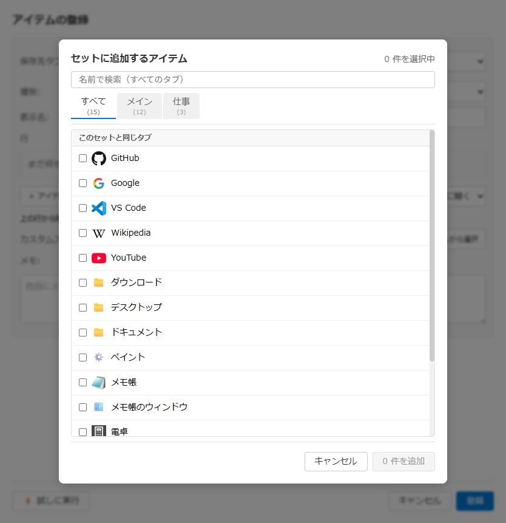

# セットの編集画面 仕様書

## 関連ドキュメント

- [画面一覧](./README.md) - 全画面構成の概要
- [アイテム登録・編集モーダル](./register-modal.md) - セットの欄（行の一覧）がある親画面
- [ワークスペースウィンドウ](./workspace-window.md) - ワークスペースのアイテムの編集（同じセットの欄を使う）
- [右クリックメニュー](./context-menu.md#43-ウィンドウ位置を更新) - 保存したセットの位置だけを取り直す「ウィンドウ位置を更新」
- [セット](../features/set.md) - セットの機能の詳細

## 1. 概要

登録・編集画面で種別がセットのとき、セットの欄（行の一覧）から開く 4 つの小さな画面です。どれも登録・編集画面の上に重ねて開き、閉じると元の画面に戻ります。ここでの変更は行の一覧に反映するだけで、保存は登録・編集画面の「登録」「更新」のときです。

### 対象の画面

| 画面 | 開き方 | 役割 |
| --- | --- | --- |
| [セットに追加するアイテム](#2-セットに追加するアイテム) | 「＋ アイテムを追加」、または行の詳細の「アイテムを選ぶ」「別のアイテムにする」 | 登録済みのアイテムを選んで、行として足す。行の詳細からは、行で開くアイテムを 1 つだけ選ぶ |
| [ウィンドウを追加](#3-ウィンドウを追加) | 「＋ ウィンドウを追加」 | 開いているウィンドウを選んで、今のウィンドウ位置を持つ行として足す |
| [位置を更新](#4-ウィンドウ位置を更新) | 「📍 ウィンドウ位置を更新」 | 開いているウィンドウの今の位置を、今ある行に入れ直す。行は足さない |
| [行の詳細](#5-行の詳細) | 行の「✏️」、または行のダブルクリック | 1 つの行の開くもの・対象ウィンドウ・ウィンドウ位置・開くときの動きを直す |

### 共通の動き

- 外側（暗くした部分）のクリックと Escape キーで閉じる。上にウィンドウ選択モーダルを重ねているときは、Escape はそちらだけを閉じる
- Tab・Shift+Tab のフォーカスは画面の中で循環する（セットに追加するアイテム・ウィンドウを追加の検索入力欄では、タブの切り替えに使う。[2.3](#23-アイテムを絞り込む)・[3.3](#33-ウィンドウを絞り込む)）
- 画面の中のキー操作は、下の登録・編集画面に伝わらない

### 画面イメージ

ウィンドウを追加・ウィンドウ位置を更新・行の詳細は、そのときに開いているウィンドウで中身が変わるので、画面イメージを置いていない。

## 2. セットに追加するアイテム

### 2.1. 基本情報

| 項目 | 内容 |
| --- | --- |
| **ファイル名** | `src/renderer/components/SetItemPickerModal.tsx` |
| **コンポーネント名** | `SetItemPickerModal` |
| **スタイル** | `src/renderer/styles/components/SetEditor.css`（タブの形は `WindowSelectorModal.css` と共用） |
| **表示条件** | セットの欄の「＋ アイテムを追加」をクリック。または行の詳細の「アイテムを選ぶ」「別のアイテムにする」をクリック（1 つだけ選ぶ形） |
| **画面タイプ** | モーダル |
| **親画面** | アイテム登録・編集モーダル、ワークスペースアイテム編集、行の詳細 |
| **呼び出し元で変わる挙動** | 登録・編集画面では、すべてのタブのアイテムを出し、セットの保存先と同じタブのアイテムを先に並べる。ワークスペースのアイテム編集では、ワークスペースのアイテムを先に、データファイルのアイテムを後に並べる。行の詳細から開いたときは 1 つだけ選ぶ形になる（[2.6](#26-行の詳細から-1-つだけ選ぶ)） |

### 2.2. 画面項目一覧

| エリア | 項目名 | 内容・説明 | 表示条件 | 機能詳細 |
| --- | --- | --- | --- | --- |
| **ヘッダー** | タイトル | 「セットに追加するアイテム」 | 常時表示 | - |
| **ヘッダー** | 選択数 | 「n 件を選択中」 | 常時表示 | - |
| **検索** | 検索入力欄 | プレースホルダー「名前で検索（すべてのタブ）」。開いたときにフォーカスが入る | 常時表示 | [2.3](#23-アイテムを絞り込む) |
| **タブ** | 絞り込みのタブ | 「すべて」と、タブの名前（ワークスペースのアイテムは「ワークスペース」）を件数つきで並べる。初期表示は「すべて」。検索入力欄で Tab・Shift+Tab を押しても切り替わる | アイテムの所属が 2 つ以上あるとき | [2.3](#23-アイテムを絞り込む) |
| **一覧** | 見出し | 「このセットと同じタブ」と「ほかのタブ」 | 両方にアイテムがあるとき | - |
| **一覧** | アイテム行 | チェックボックス・アイコン（無ければ種類の絵文字）・名前。ほかのタブのアイテムにはタブの名前を右に添える | 常時表示 | [2.4](#24-アイテムを選んで追加する) |
| **一覧** | 追加済み | すでに行にあるアイテムは「追加済み」と出し、チェックできない | 行にあるアイテム | - |
| **一覧** | 空のときの表示 | 「追加できるアイテムがありません」、絞り込みで 0 件なら「検索結果がありません」 | 0 件のとき | - |
| **フッター** | キャンセル | 追加せずに閉じる | 常時表示 | [2.5](#25-閉じる) |
| **フッター** | 追加ボタン | 「n 件を追加」。1 件も選んでいないときは押せない | 常時表示 | [2.4](#24-アイテムを選んで追加する) |

### 2.3. アイテムを絞り込む

#### 選べるアイテム

- データファイルの単一アイテム（URL・ファイル・フォルダ・アプリ・カスタム URI、パスの無い単一アイテムも）と、フォルダ取込で展開したアイテム。パスの無い単一アイテムは 🪟 で出し、それを指す行は「ウィンドウを動かすだけ」の行になる。セット・クリップボード・フォルダ取込そのものは出さない
- ワークスペースのアイテム編集から開いたときは、ワークスペースの通常アイテム（パスの無い単一アイテムも）も出す
- 編集中のアイテム自身は出さない（種別をセットに変えて編集しているときなど）
- 並びは、同じタブ（ワークスペースから開いたときはワークスペース）のアイテムが先で、その中はデータファイルの並びのまま

#### 処理フロー

1. 検索入力欄の文字を名前に部分一致で探す（大文字小文字を区別しない）
2. タブを選んでいるときは、そのタブのアイテムだけに絞る
3. 両方の条件に合うアイテムを表示する

#### キーボードでタブを切り替える

- 検索入力欄で Tab を押すと次のタブ、Shift+Tab を押すと前のタブに切り替わる（端では反対の端へ回る。メインウィンドウの Tab と同じ）。フォーカスは検索入力欄のまま
- 検索入力欄に文字があるときは、合うアイテムの無いタブを飛ばす
- タブが出ていない（アイテムの所属が 1 つだけの）ときと、フォーカスが検索入力欄の外にあるときは、Tab はフォーカスの移動に使う

### 2.4. アイテムを選んで追加する

#### アクション

- アイテム行をクリックしてチェックを付け外しし、「n 件を追加」をクリック

#### 処理フロー

1. チェックを付けたアイテムを、一覧の並びのまま行の一覧の末尾に足す
   - 登録済みのアイテムは、アイテムを指す行になる。アイテムを直すと、このセットにも効く
   - フォルダ取込で展開したアイテムは、パスを書いた行になる（名前は展開したアイテムの名前）
2. 画面を閉じ、検索・タブ・選択を元に戻す

### 2.5. 閉じる

- 「キャンセル」・外側のクリック・Escape キーで、追加せずに閉じる。検索・タブ・選択は元に戻す

### 2.6. 行の詳細から 1 つだけ選ぶ

行の詳細の「アイテムを選ぶ」「別のアイテムにする」から開いたときは、行で開くアイテムを 1 つだけ選ぶ形になる。並びと絞り込みは「＋ アイテムを追加」から開いたときと同じ。

- タイトルは「この行で開くアイテム」。選択数は出さない
- アイテム行はチェックボックスの代わりにラジオで、1 つだけ選べる。「追加済み」は出さない
- 追加ボタンの代わりに「選ぶ」（選んでいないときは押せない）。押すと、行が開くものをそのアイテムにして閉じる。対象ウィンドウ・ウィンドウ位置・行の名前は変わらない

## 3. ウィンドウを追加

### 3.1. 基本情報

| 項目 | 内容 |
| --- | --- |
| **ファイル名** | `src/renderer/components/SetAddWindowsModal.tsx` |
| **コンポーネント名** | `SetAddWindowsModal` |
| **スタイル** | `src/renderer/styles/components/SetEditor.css`（タブの形は `WindowSelectorModal.css` と共用） |
| **表示条件** | セットの欄の「＋ ウィンドウを追加」をクリック |
| **画面タイプ** | モーダル |
| **親画面** | アイテム登録・編集モーダル、ワークスペースアイテム編集 |

### 3.2. 画面項目一覧

| エリア | 項目名 | 内容・説明 | 表示条件 | 機能詳細 |
| --- | --- | --- | --- | --- |
| **ヘッダー** | タイトル | 「ウィンドウを追加」 | 常時表示 | - |
| **ヘッダー** | 選択数 | 「n 件を選択中」 | 常時表示 | - |
| **ヘッダー** | 説明 | 「選んだウィンドウを、今のウィンドウ位置ごと行にします。」 | 常時表示 | - |
| **検索** | 検索入力欄 | プレースホルダー「タイトル・exe 名で絞り込む」。開いたときにフォーカスが入る | 常時表示 | [3.3](#33-ウィンドウを絞り込む) |
| **タブ** | 仮想デスクトップのタブ | 「すべて」と仮想デスクトップごと（「デスクトップ N」。今のデスクトップは「デスクトップ N (現在)」、名前を付けたデスクトップは名前も）を件数つきで並べる。デスクトップの分からないウィンドウがあれば「不明」も。初期表示は今のデスクトップ。検索入力欄で Tab・Shift+Tab を押しても切り替わる | 仮想デスクトップが 2 つ以上あるとき | [3.3](#33-ウィンドウを絞り込む) |
| **一覧** | ウィンドウ行 | チェックボックス・アイコン（無ければ 🪟）・タイトル・2 段目に極小の図（[ウィンドウ位置の図](./register-modal.md#ウィンドウ位置の図)）と「{exe 名}・📍 {位置}」（最小化中は図を出さず「{exe 名}・最小化中（ウィンドウ位置なし）」）。「すべて」のタブでは右に「デスクトップ N」を添える | 常時表示 | [3.4](#34-ウィンドウを選んで追加する) |
| **一覧** | 追加済み | 今ある行と結び付くウィンドウは、2 段目を「追加済み（{行の名前}）」にしてチェックできない | 行と結び付くウィンドウ | [3.4](#34-ウィンドウを選んで追加する) |
| **一覧** | 注意 | 管理者権限で動いているウィンドウに「管理者権限で動いているため、QDL から動かせないことがあります」 | 該当するとき | - |
| **一覧** | 読み込み中・空のときの表示 | 「ウィンドウを調べています…」。ウィンドウが無ければ「開いているウィンドウがありません」、絞り込みで 0 件なら「合うウィンドウがありません」 | 該当するとき | - |
| **本文** | 足した行の注意 | 「足した行は「ウィンドウを動かすだけ」の行です（開いているときだけ動かします）。閉じていても開きたいときは、足したあとに行の詳細 ✏️ で開くもの（アイテムかパス）を足します。タイトルは全体が同じウィンドウを探します。タブの切り替えや更新でタイトルが変わるものは、行の詳細 ✏️ で一部だけにできます。」 | 常時表示 | [3.4](#34-ウィンドウを選んで追加する) |
| **フッター** | 表示中をすべて選ぶ | 左端。今のタブと検索で見えているウィンドウのうち、追加済みでないものにすべてチェックを付ける | 常時表示（選べるウィンドウが見えていないときは押せない） | [3.4](#34-ウィンドウを選んで追加する) |
| **フッター** | キャンセル | 追加せずに閉じる | 常時表示 | [3.5](#35-閉じる) |
| **フッター** | 追加ボタン | 「n 件を追加」（選んでいないときは「追加」で押せない） | 常時表示 | [3.4](#34-ウィンドウを選んで追加する) |

📍 のウィンドウ位置の書き方は、登録・編集画面の行の一覧と同じ（[アイテム登録・編集モーダル - セットの行を編集](./register-modal.md#58-セットの行を編集)）。仮想デスクトップが 2 つ以上あるときは、ウィンドウのいるデスクトップを「・デスクトップ N」と添え、全デスクトップに表示中のウィンドウには「・全デスクトップ」と添える。

### 3.3. ウィンドウを絞り込む

#### 出すウィンドウ

- すべての仮想デスクトップの開いているウィンドウ。QuickDashLauncher 自身のウィンドウは除く
- 最小化中のウィンドウも出す

#### 処理フロー

1. 検索入力欄の文字を、タイトルと exe 名に部分一致で探す（大文字小文字を区別しない）
2. タブを選んでいるときは、その仮想デスクトップのウィンドウだけに絞る
3. 両方の条件に合うウィンドウを表示する。タブの件数も検索に合うものだけを数える

#### キーボードでタブを切り替える

- 検索入力欄で Tab を押すと次のタブ、Shift+Tab を押すと前のタブに切り替わる（端では反対の端へ回る。セットに追加するアイテムと同じ）。フォーカスは検索入力欄のまま
- 検索入力欄に文字があるときは、合うウィンドウの無いタブを飛ばす
- タブが出ていないときと、フォーカスが検索入力欄の外にあるときは、Tab はフォーカスの移動に使う

### 3.4. ウィンドウを選んで追加する

#### アクション

- ウィンドウ行をクリックしてチェックを付け外しし、「n 件を追加」をクリック
- 「表示中をすべて選ぶ」で、見えているウィンドウにまとめてチェックを付ける（付けたチェックは、タブや検索を変えても残る）

#### 追加済み

- 開いたときに、今ある行とウィンドウを自動で結び付ける（結び付け方は [4.3](#43-開いたとき) と同じ）。結び付いたウィンドウは、その行で動かすので「追加済み」にする

#### 処理フロー

1. チェックを付けたウィンドウを、一覧の並びのまま行の一覧の末尾に足す
   - 行の名前はウィンドウタイトル（空なら exe 名）
   - 対象ウィンドウは、exe 名とウィンドウタイトル全体（開いているウィンドウの数によらない）
   - ウィンドウ位置は、ウィンドウの今の位置・大きさ・仮想デスクトップ（最大化中なら最大化）。仮想デスクトップが 1 つのときは、デスクトップの番号を記録しない。最小化中のウィンドウは位置を持たない（元の大きさに戻してから「ウィンドウ位置を更新」で入れる）
   - 開くものは持たない「動かすだけ」の行になる（ほかのアプリが起動したときの引数は取れず、実行ファイルを開いても開いていたファイルは開かないため）。開くものは後から行の詳細で足す（[5.3](#53-欄を直す)）
2. 画面を閉じる

### 3.5. 閉じる

- 「キャンセル」・外側のクリック・Escape キーで、追加せずに閉じる。検索・選択は次に開いたときに元に戻す

## 4. ウィンドウ位置を更新

### 4.1. 基本情報

| 項目 | 内容 |
| --- | --- |
| **ファイル名** | `src/renderer/components/SetUpdatePositionsModal.tsx` |
| **コンポーネント名** | `SetUpdatePositionsModal` |
| **スタイル** | `src/renderer/styles/components/SetEditor.css` |
| **表示条件** | セットの欄の「📍 ウィンドウ位置を更新」をクリック（行が無いときは押せない） |
| **画面タイプ** | モーダル |
| **親画面** | アイテム登録・編集モーダル、ワークスペースアイテム編集 |

### 4.2. 画面項目一覧

| エリア | 項目名 | 内容・説明 | 表示条件 | 機能詳細 |
| --- | --- | --- | --- | --- |
| **ヘッダー** | タイトル | 「ウィンドウ位置を更新」 | 常時表示 | - |
| **ヘッダー** | 説明 | 「いま開いているウィンドウから、このセットの行のウィンドウ位置を取り直します。」 | 常時表示 | - |
| **本文** | 読み込み中 | 「ウィンドウを調べています…」 | ウィンドウを調べている間 | [4.3](#43-開いたとき) |
| **ウィンドウ位置を取れた行** | 見出し | 「ウィンドウ位置を取れた行（n）」と「違っていたら、右のプルダウンで「別のウィンドウにする」を選びます」 | 常時表示（説明は 1 行以上あるとき） | [4.4](#44-ウィンドウ位置を取れた行) |
| **ウィンドウ位置を取れた行** | 行 | アイコン・行の名前・「ウィンドウ: {タイトル}」（アプリのアイコンつき）・極小の図と 📍 位置・プルダウン。図には前のウィンドウ位置（灰色の破線）と新しい位置を重ねて描き、マウスを乗せると大きな図と「破線＝前の位置（{前の位置}）／青＝新しい位置（{新しい位置}）」を出す（前の位置が無い行は新しい位置だけ） | ウィンドウと結び付いた行 | [4.4](#44-ウィンドウ位置を取れた行) |
| **ウィンドウ位置を取れなかった行** | 見出し | 「ウィンドウ位置を取れなかった行（n）」と「このままでも更新できます」 | 1 行以上あるとき | [4.5](#45-ウィンドウ位置を取れなかった行) |
| **ウィンドウ位置を取れなかった行** | 行 | アイコン・行の名前・理由と結果・「ウィンドウを選ぶ」ボタン | ウィンドウと結び付かなかった行 | [4.5](#45-ウィンドウ位置を取れなかった行) |
| **フッター** | キャンセル | 更新せずに閉じる | 常時表示 | [4.7](#47-閉じる) |
| **フッター** | 更新する | 選んだ内容を行に入れて閉じる | 常時表示（ウィンドウを調べている間は押せない） | [4.6](#46-更新する) |

📍 のウィンドウ位置の書き方は、登録・編集画面の行の一覧と同じ（[アイテム登録・編集モーダル - セットの行を編集](./register-modal.md#58-セットの行を編集)）。仮想デスクトップが 2 つ以上あるときは、ウィンドウのいるデスクトップを「・デスクトップ N」（名前を付けたデスクトップは「・デスクトップ 2: 仕事」）と添え、全デスクトップに表示中のウィンドウには「・全デスクトップ」と添える。

### 4.3. 開いたとき

1. すべての仮想デスクトップの開いているウィンドウを調べる。QuickDashLauncher 自身のウィンドウは除く
2. 行とウィンドウを自動で結び付ける。上の行から順に、まだどの行とも結び付いていないウィンドウを探す（1 つのウィンドウは 1 つの行とだけ。最小化中のウィンドウは使わない）
   - 対象ウィンドウ（exe 名・ウィンドウタイトル）を持つ行は、それに合うウィンドウ
   - 合うウィンドウが複数の仮想デスクトップにあれば、行の仮想デスクトップにあるものを先に使う
   - 持たない行は、開くものから推測する。アプリは実行ファイルのパス、フォルダはエクスプローラーでフォルダ名のタイトル、ファイルはファイル名を含むタイトル
   - URL・カスタム URI の行は、どのウィンドウに開くか分からないので自動では探さない
3. 結び付いた行と結び付かなかった行に分けて表示する。行に無いウィンドウは出さない（行にするのは「ウィンドウを追加」。[3](#3-ウィンドウを追加)）

ウィンドウを調べられなかったときは、ウィンドウが 1 つも無いものとして表示する（エラーは出さない）。

### 4.4. ウィンドウ位置を取れた行

#### アクション

- 行の右のプルダウンで「このまま」（既定）・「別のウィンドウにする」・「ウィンドウ位置を記録しない」を選ぶ

#### 処理フロー

- **このまま**: 何もしない。更新すると、そのウィンドウの今のウィンドウ位置を行に入れる
- **別のウィンドウにする**: ウィンドウ選択モーダル（[アイテム登録・編集モーダル - ウィンドウ選択モーダル](./register-modal.md#522-ウィンドウ選択モーダル)）を開き、選んだウィンドウをその行に結び付ける。そのウィンドウがほかの行に結び付いていたら、その行からは外す
- **ウィンドウ位置を記録しない**: 行をウィンドウから外し、「ウィンドウ位置を取れなかった行」に移す

#### 表示条件

- 行がタブとして開く種類（フォルダ・URL）なら、「既にあるウィンドウにタブで開くと、そのウィンドウごと動きます」と添える
- 結び付いたウィンドウが最小化中なら「最小化中なのでウィンドウ位置は入れません。元の大きさに戻してから更新してください」と添え、位置の代わりに「前のウィンドウ位置のまま」（前に位置を記録していないなら「ウィンドウ位置は記録しない」）と出す
- 結び付いたウィンドウが管理者権限で動いていれば「管理者権限で動いているため、QDL から動かせないことがあります」と添える

### 4.5. ウィンドウ位置を取れなかった行

#### 表示内容

行の名前の下に「{理由}。このまま更新すると: {結果}」を出す。

| 理由 | 出る場合 |
| --- | --- |
| 「URL は自動では探せません」 | 対象ウィンドウを持たない URL・カスタム URI の行 |
| 「「ウィンドウ位置を記録しない」にしました」 | ウィンドウ位置を取れた行で「ウィンドウ位置を記録しない」を選んだ行 |
| 「合うウィンドウがありません」 | それ以外 |

| 結果 | 出る場合 |
| --- | --- |
| 「前のウィンドウ位置のまま（{位置}）」 | 前に位置を記録した行（「ウィンドウ位置を記録しない」を選んだ行を除く） |
| 「開いていれば前面に出すだけ」 | 開くものを持たない動かすだけの行で、上に当たらないもの |
| 「開くだけ」 | 上のどれにも当たらない行（前に位置を記録していない行と、「ウィンドウ位置を記録しない」を選んだ行） |

行が指すアイテムが見つからないときは、理由と結果の代わりに「アイテムが見つかりません」だけを出す。

行がタブとして開く種類（フォルダ・URL）なら、[4.4](#44-ウィンドウ位置を取れた行) と同じく「既にあるウィンドウにタブで開くと、そのウィンドウごと動きます」と添える。

#### アクション

- 「ウィンドウを選ぶ」でウィンドウ選択モーダルを開き、選んだウィンドウをその行に結び付ける（行は「ウィンドウ位置を取れた行」に移る）

### 4.6. 更新する

#### アクション

- 「更新する」をクリック

#### 処理フロー

1. ウィンドウと結び付いた行は、対象ウィンドウとウィンドウ位置を取り込む
   - 対象ウィンドウは、行の前のものがそのウィンドウにも合えばそのまま残す。合わない（手で選んだ・付け替えた）ときは、ウィンドウから決め直す。exe 名とウィンドウタイトル全体にする（開いているウィンドウの数によらない）
   - ウィンドウ位置は、ウィンドウの今の位置・大きさ・仮想デスクトップ（最大化中なら最大化）にする。仮想デスクトップが 1 つのときは、デスクトップの番号を記録しない。最小化中のウィンドウは位置を取らず、前のウィンドウ位置のままにする
2. 「ウィンドウ位置を記録しない」にした行は、対象ウィンドウと位置を外す。ただし開くものを持たない動かすだけの行は、位置だけを外す（対象ウィンドウまで外すと何もできない行になるため）
3. ほかのウィンドウ位置を取れなかった行は変えない
4. 画面を閉じる（行の数と並びは変えない）

### 4.7. 閉じる

- 「キャンセル」・外側のクリック・Escape キーで、何も変えずに閉じる

## 5. 行の詳細

### 5.1. 基本情報

| 項目 | 内容 |
| --- | --- |
| **ファイル名** | `src/renderer/components/SetEntryDetailModal.tsx` |
| **コンポーネント名** | `SetEntryDetailModal` |
| **スタイル** | `src/renderer/styles/components/SetEditor.css` |
| **表示条件** | セットの行の「✏️」（「行の詳細」）をクリック、または行をダブルクリック |
| **画面タイプ** | モーダル |
| **親画面** | アイテム登録・編集モーダル、ワークスペースアイテム編集 |

### 5.2. 画面項目一覧

欄は 4 つの枠にまとめて並べる。ボタンの文字は折り返さない（狭いときはボタンごと次の行へ送る）。単一アイテムのウィンドウ切り替え（[アイテム登録・編集モーダル](./register-modal.md#55-ウィンドウ切り替えウィンドウ位置を入力)）と同じ部品で、違うのは「開くもの」の枠・説明文の主語・「前面に出す」の既定だけ。

| エリア | 項目名 | 内容・説明 | 表示条件 | 機能詳細 |
| --- | --- | --- | --- | --- |
| **ヘッダー** | タイトル | 「行の詳細: {行の名前}」 | 常時表示 | - |
| **開くもの** | 持ち方 | ラジオ「なし（動かすだけ）」／「アイテム」／「パス」。開いたときは行の今の持ち方を選んでいる | 常時表示 | [5.3](#53-欄を直す) |
| **開くもの** | アイテム | 選んだアイテムのアイコン・名前・パスと「別のアイテムにする」。下に「アイテムを直すと、このセットにも効きます。」（アイテムが見つからなければ「アイテムが見つかりません（消されたか、読み込めていません）」）。まだ選んでいなければ「アイテムを選ぶ」だけ | 「アイテム」を選んだとき | [5.3](#53-欄を直す) |
| **開くもの** | パス・引数 | パスと引数の入力欄（プレースホルダーは登録・編集画面と同じ）。下に「このセットに書いたパス（アイテムは作りません）。」 | 「パス」を選んだとき | [5.3](#53-欄を直す) |
| **案内** | アイテムの設定で開く旨 | 「開くもの」の枠の下に 1 行「ℹ️ アイテム「{アイテム名}」の設定で開きます。下で入れると、この行の設定が優先されます。」 | 「アイテム」を選び、行に対象ウィンドウ（exe 名・タイトル）もウィンドウ位置も無く、指すアイテムにウィンドウ切り替えの設定があるとき | [5.3](#アイテムの設定で開く行) |
| **対象ウィンドウ** | 「🔍 開いているウィンドウから選ぶ」 | 枠の見出しの右。ウィンドウ選択モーダルを開く | 常時表示 | [5.4](#54-開いているウィンドウから選ぶ) |
| **対象ウィンドウ** | 説明 | 枠の先頭（見出しの直下）に「このセットを開いたとき、合うウィンドウを記録したウィンドウ位置へ動かします。」 | 常時表示 | - |
| **対象ウィンドウ** | exe 名 | プレースホルダー「例: notepad.exe」（アイテムの設定で開く行で、アイテムに exe 名があれば「アイテムの設定（{exe 名}）」）。欄の下に「一部でも探せます（例: sakura）」 | 常時表示 | [5.3](#53-欄を直す) |
| **対象ウィンドウ** | ウィンドウタイトル | プレースホルダー「空ならタイトルは問わない」（アイテムの設定で開く行で、アイテムにタイトルがあれば「アイテムの設定（{タイトル}）」）。欄の下に「全体が同じものを探します。\* は任意の文字（例: \*Obsidian）」 | 常時表示 | [5.3](#53-欄を直す) |
| **対象ウィンドウ** | 元に戻す | 欄の右の「↺ 元に戻す」 | 開いたときにタイトルがあり、欄をそこから変えたとき | [5.3](#53-欄を直す) |
| **対象ウィンドウ** | 一部だけで探す | 探し方の補足の下に、小見出し「タイトルの一部だけで探す」と、その下に小さな丸い候補ボタンだけを並べる。先頭に「タイトルを問わない」（カーソルを当てると「exe 名だけで探します（タイトルは問いません）」）、続けてタイトルを区切りで分けた部品 | exe 名があるとき、または部品が 2 つ以上あるとき（「タイトルを問わない」は exe 名があるときだけ） | [5.3](#53-欄を直す) |
| **対象ウィンドウ** | 今合うウィンドウ | 「今合うウィンドウ: 0 件」（灰）／「今合うウィンドウ: 1 件（{タイトル}）」（緑）／「今合うウィンドウ: n 件（別のウィンドウにも当たります）」（赤） | exe 名かウィンドウタイトルがあるとき | [5.3](#53-欄を直す) |
| **ウィンドウ位置** | 記録したウィンドウ位置 | 1 行目の左に小さな図（[ウィンドウ位置の図](./register-modal.md#ウィンドウ位置の図)。マウスを乗せると大きな図）、右に「📍 {位置}」。仮想デスクトップの番号があれば「・デスクトップ N」を添える。記録していなければ「まだ記録していません」（アイテムの設定で開く行で、アイテムにウィンドウ位置があれば、その位置の図と薄い字で「アイテムの設定（📍 {位置}）」） | 常時表示 | - |
| **ウィンドウ位置** | 「📍 ウィンドウ位置を更新」 | 2 行目（「ウィンドウ位置を外す」と横並び）。今の条件に合うウィンドウの今の位置だけを記録し直す。今合うウィンドウが無ければ押せない（カーソルを当てると「合うウィンドウが開いていません」） | 常時表示（ウィンドウ位置がまだ無くても押せる） | [5.5](#55-ウィンドウ位置を更新) |
| **ウィンドウ位置** | 「ウィンドウ位置を外す」 | 記録した位置を消す | ウィンドウ位置を記録した行 | [5.3](#53-欄を直す) |
| **ウィンドウ位置** | 補足 | 3 行目に「今合うウィンドウの、今の位置と大きさを記録し直します（条件は変えません）」 | 常時表示 | - |
| **ウィンドウ位置** | 注意 | タブとして開く種類（フォルダ・URL）の行は「既にあるウィンドウにタブで開くと、そのウィンドウごと動きます」。ほかに、選んだウィンドウについての注意（[5.4](#54-開いているウィンドウから選ぶ)・[5.5](#55-ウィンドウ位置を更新)） | 該当するとき | - |
| **ウィンドウ位置** | 仮想デスクトップ | 1 以上の整数。空なら「変えない」。右に「📌 全デスクトップに表示」のチェック。チェックを入れると、デスクトップの番号を消して入力できなくする | 行は常時表示（番号の欄はウィンドウ位置を記録した行だけ） | [5.3](#53-欄を直す) |
| **開くときの動き** | 開いていたら | 「開かずに、そのウィンドウを使う」（既定）／「もう 1 つ開く」 | 常時表示 | [5.3](#53-欄を直す) |
| **開くときの動き** | 前面に出す | 「出さない」（既定）／「出す」 | ウィンドウ位置を記録した行 | [5.3](#53-欄を直す) |
| **開くときの動き** | ウィンドウが出るのを待つ（秒） | 1 以上の秒数。空なら 30 秒 | ウィンドウ位置を記録した行 | [5.3](#53-欄を直す) |
| **フッター** | 閉じる | 直した内容を行に反映して閉じる | 常時表示 | [5.6](#56-閉じる) |

### 5.3. 欄を直す

- 入力した内容は、閉じたときに行に反映する
- exe 名とウィンドウタイトルの両方を空にすると、対象ウィンドウを持たない行になる

#### 開くもの

- **なし（動かすだけ）**: 開くものを外す（対象ウィンドウの exe 名もタイトルも無い行では押せない。カーソルを当てると「対象ウィンドウが無い行は、開くものが要ります」）
- **アイテム**: 「アイテムを選ぶ」「別のアイテムにする」で、セットに追加するアイテムの画面を 1 つだけ選ぶ形で開く（[2.6](#26-行の詳細から-1-つだけ選ぶ)）。選んだアイテムを行が開くものにする。フォルダ取込で展開したアイテムを選んだときは、パスを書いた行になり、持ち方も「パス」に変わる。対象ウィンドウ・ウィンドウ位置・行の名前は変わらない。アイテムを選ぶまでは、開くものの無い動かすだけの行のまま
- **パス**: パスと引数を行に書く。切り替えた最初は空（実行ファイルなどを自動では入れない）。パスが空のまま閉じると、動かすだけの行になる
- 閉じたときに、開くもの・対象ウィンドウ・ウィンドウ位置のどれも無い行になるとき（アイテムを選ばずに閉じた・パスを空のまま閉じたなど）は、開いたときの開くものに戻す（何もできない行を作らない）

#### アイテムの設定で開く行

- 行がアイテム（パスのあるもの・無いもの両方）を指し、行に対象ウィンドウもウィンドウ位置も無いときは、実行はアイテムのウィンドウ切り替えの設定（対象ウィンドウ・ウィンドウ位置・前面に出す・全デスクトップに表示）で動く（[データファイル形式 3.3.5](../architecture/file-formats/data-format.md#335-動作仕様)）。アイテムを単独で開いたときと同じ動き
- 画面ではそのことを「開くもの」の枠の下の 1 行で案内し、アイテムの値は欄の薄い字（placeholder）で見せる。動きは変えない
- 対象ウィンドウかウィンドウ位置を入れると、このセットでは行の設定が優先され、案内と薄い字は消える
- パスの無い単一アイテムを指す行は、行に対象ウィンドウが無ければ、位置のある行でもアイテムの対象ウィンドウで探す（「📍 ウィンドウ位置を更新」で位置を取っても、行に対象ウィンドウは書かない）

#### ウィンドウタイトル

- 候補の部品は、開いたときのタイトルから `*` と `?` を取り除き、「 - 」「 | 」「 — 」「 – 」で分けて作る（同じ部品は 1 つにする）。区切りが無ければ部品は出さない。開いたときのタイトルが空か、`*` か `?` を含むときは、今合うウィンドウが 1 つならそのウィンドウのタイトルから作る
- 「タイトルを問わない」を押すと、欄が「*」になる（exe 名だけで探す）
- 候補を押すと、欄が「\*{部品}\*」になる（タイトルの一部を含むウィンドウを探す）
- 「↺ 元に戻す」を押すと、欄を開いたときのタイトルに戻す
- 「今合うウィンドウ」は、画面を開いたときに開いていたウィンドウのうち、exe 名とウィンドウタイトルの欄に今合うものを数える。欄を直すたびに数え直す

#### その他の欄

- 待つ秒数に 0 以下を入れると、空（30 秒）として扱う
- 仮想デスクトップに 1 以上の整数でないもの（0・負の数・小数）を入れると、空（変えない）として扱う
- 「📌 全デスクトップに表示」を入れると、セットを開いたときにその行のウィンドウを全デスクトップに表示する（位置のある行・無い行のどちらも）。デスクトップの番号は持たない
- 欄の意味（開いていたらどうするか・前面に出すか・待つ秒数など）は [セット](../features/set.md) を参照

### 5.4. 開いているウィンドウから選ぶ

#### アクション

- 対象ウィンドウの枠の見出しの右の「🔍 開いているウィンドウから選ぶ」をクリックし、ウィンドウ選択モーダル（[アイテム登録・編集モーダル - ウィンドウ選択モーダル](./register-modal.md#522-ウィンドウ選択モーダル)）でウィンドウを選ぶ

#### 処理フロー

1. 選んだウィンドウの exe 名とウィンドウタイトル全体を、対象ウィンドウに入れる（開いているウィンドウの数によらない。タイトルが空なら exe 名だけ）
2. ウィンドウの今の位置・大きさ・仮想デスクトップ（最大化中なら最大化）をウィンドウ位置に入れる。仮想デスクトップが 1 つのとき・全デスクトップに表示する行では、デスクトップの番号を入れない
3. 選んだウィンドウについて、次の注意をウィンドウ位置の枠に出す
   - 最小化中: 位置は取らず、対象ウィンドウだけ入れて「最小化中のウィンドウなので、対象ウィンドウだけ取りました。ウィンドウ位置は元の大きさに戻してから取ってください」
   - 管理者権限で動いている: 「管理者権限で動いているため、QDL から動かせないことがあります」

### 5.5. ウィンドウ位置を更新

対象ウィンドウ（exe 名・タイトル）はそのままで、ウィンドウ位置だけを取り直す。セットの編集画面の「📍 ウィンドウ位置を更新」（[4](#4-ウィンドウ位置を更新)）が全部の行をまとめて取り直すのに対し、こちらはこの行だけを取り直す。

#### アクション

- ウィンドウ位置の枠の「📍 ウィンドウ位置を更新」をクリック

#### 処理フロー

1. 押した時点で開いているウィンドウを読み直し、今の条件（exe 名・ウィンドウタイトル）に合うものを探す（合うかの判定は「今合うウィンドウ」と同じ）
2. 合うウィンドウの数で分ける
   - 0 件: ボタンは押せない（画面を開いたときの「今合うウィンドウ」が 0 件のとき）。押した時点で 0 件になっていたら何もしない
   - 1 件: そのウィンドウを使う
   - 2 件以上: 合うウィンドウだけを並べた画面「どのウィンドウの位置を記録しますか」を出す。各行にタイトル・exe 名・今のウィンドウ位置の極小の図と言葉（最小化中は図を出さず「最小化中（ウィンドウ位置なし）」）。ラジオで 1 つ選び（最初は先頭）、「記録する」で使う。「キャンセル」・外側のクリック・Escape キーで何もせず閉じる
3. 使うウィンドウの今の位置・大きさ・仮想デスクトップ（最大化中なら最大化）をウィンドウ位置に記録する。exe 名・タイトルは変えない。仮想デスクトップが 1 つのとき・全デスクトップに表示する行では、デスクトップの番号を入れない
4. 選んだウィンドウについて、次の注意をウィンドウ位置の枠に出す
   - 最小化中: 位置は取らずに「最小化中のウィンドウなので、ウィンドウ位置は取りませんでした。元の大きさに戻してから押してください」
   - 管理者権限で動いている: 「管理者権限で動いているため、QDL から動かせないことがあります」

選ぶ画面のコンポーネントは `WindowPlacementPickModal`（`src/renderer/components/WindowPlacementPickModal.tsx`）。

### 5.6. 閉じる

- 「閉じる」・外側のクリック・Escape キーで、直した内容を行に反映して閉じる。直す前に戻すボタンは無い

## 6. キーボード操作

4 つの画面で共通。

| キー | 動作 |
| --- | --- |
| Escape | 画面を閉じる（行の詳細は直した内容を反映して閉じる）。上にウィンドウ選択モーダル・ウィンドウ位置を記録するウィンドウを選ぶ画面を重ねているときは、そちらだけを閉じる |
| Tab / Shift+Tab | 画面の中でフォーカスを循環する。セットに追加するアイテム・ウィンドウを追加の検索入力欄では、次・前のタブに切り替える（[2.3](#23-アイテムを絞り込む)・[3.3](#33-ウィンドウを絞り込む)） |
| 入力欄の中の編集キー | 通常の入力として扱う |
