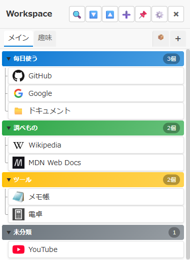

# ワークスペースウィンドウ 仕様書

## 関連ドキュメント

- [画面一覧](./README.md) - 全画面構成の概要
- [ワークスペース機能](../features/workspace.md) - 機能の使い方
- [ワークスペースファイル形式](../architecture/file-formats/workspace-format.md) - 保存先のファイル（ワークスペース・グループ・アイテム、アーカイブ、折りたたみなどの UI 状態）と保存場所・形式
- [IPC通信](../architecture/ipc-channels.md) - ワークスペース関連のIPCチャンネル
- [ウィンドウ制御](../architecture/window-control.md#ワークスペースウィンドウ制御) - ウィンドウの表示・位置・子ウィンドウの制御
- [キーボードショートカット](../features/keyboard-shortcuts.md) - 全ショートカット一覧
- [CSSデザインシステム](../architecture/css-design.md) - スタイルガイドライン

## 1. 概要

よく使うアイテムを登録して、画面右端の専用ウィンドウで素早くアクセスできる機能です。グループ化、名前変更、並び替えに対応します。

**キーボードショートカット**: `Ctrl+W` (表示/非表示切り替え)

### 主要機能

- **アイテム管理**: メイン画面からアイテムを追加・削除・名前変更
- **クリップボードペースト**: Ctrl+VでURL、ファイルパス、ファイル、テキスト・画像（クリップボードアイテム）を直接追加
- **グループ管理**: アイテムをグループに分類して整理
- **ドラッグ&ドロップ**: アイテムの並び替えやグループ間移動
- **メインウィンドウへの登録**: アイテムをメインウィンドウへドラッグするか右クリックの「🚀 メインウィンドウに登録」で、メインウィンドウのアイテムとして登録
- **キーワード絞り込み**: キーワード検索+スコープ選択（すべて/グループ/アイテム）でアイテムを絞り込む
- **コンテキストメニュー**: 右クリックでグループ操作・アイテム操作
- **ウィンドウカスタマイズ**: 不透明度調整、サイズ変更、ピン留め
- **アーカイブ**: グループ単位でアーカイブ・復元

### 画面イメージ



## 2. 基本情報

| 項目 | 内容 |
| --- | --- |
| **ファイル名** | `src/renderer/WorkspaceApp.tsx` |
| **コンポーネント名** | `WorkspaceApp` |
| **スタイル** | `src/renderer/styles/components/WorkspaceWindow.css` |
| **子ウィンドウ** | アイテムの編集: `src/renderer/components/WorkspaceItemEditPage.tsx`（フォームは `WorkspaceItemEditModal`） |
| **表示条件** | メイン画面で`Ctrl+W`、メイン画面の ⚙️ メニュー「⭐ ワークスペースの表示/非表示」、設定「メインウィンドウ表示時にワークスペースを自動表示」が有効なときのメイン画面表示時（トレイメニューに項目はない） |
| **画面タイプ** | ウィンドウ（AlwaysOnTop切り替え可能、フレームレス） |
| **サイズ** | 幅380px。高さは開いたときは画面の作業領域いっぱいで、以後は内容の高さに合わせて自動で変わる（最小150px、最大は画面の作業領域の高さ） |
| **サイズ変更** | 8方向（4隅・4辺）のハンドルをドラッグしてリサイズできる。4隅は隣り合う2辺、4辺はその辺が動く（最小: 幅300px × 高さ400px） |
| **配置位置** | 既定は画面右端。⚙️ メニューの「⬅️ 左端に寄せる」「➡️ 右端に寄せる」で切り替え、ドラッグで移動可能 |
| **透過** | 設定画面の「不透明度」スライダー（0%=完全透明、100%=完全不透明）で調整。「背景のみを透過（アイテムやグループは通常表示）」を有効にするとウィンドウ背景だけが透過され、アイテムやボタンは不透明のまま表示。設定の変更は開き直さなくても反映される |

## 3. 画面項目一覧

| エリア | 項目名 | 内容・説明 | 表示条件 | 機能詳細 |
| --- | --- | --- | --- | --- |
| **タブバー** | ワークスペースタブ | ワークスペース名を表示するタブ（クリックで切り替え、ダブルクリック/右クリックで名前変更、右クリックで削除）。長い名前は 160px で「…」と省略し、全体はツールチップに出す。収まらないときはワークスペースのタブだけを横にスクロールでき（マウスホイール。スクロールバーは出さない）、続きがある側の端をぼかす。選んだタブは見える位置まで自動で動く | ワークスペース存在時（常時） | [5.17](#517-ワークスペースタブ操作) |
| **タブバー** | タブ追加ボタン（+） | 新しいワークスペースを作成。アーカイブタブと並んでタブバーの右端に固定する（ワークスペースのタブと一緒にスクロールしない） | 常時表示 | [5.17.2](#5172-タブを追加) |
| **ヘッダー** | タイトル | 「ワークスペース」（表示言語が英語なら「Workspace」） | 常時表示 | - |
| **ヘッダー** | 絞り込みボタン（🔍） | 絞り込みバーの表示/非表示を切り替え | 常時表示 | [5.1](#51-絞り込みを変更) |
| **ヘッダー** | すべて展開ボタン（🔽） | すべてのグループと未分類セクションを展開 | 常時表示 | [5.2](#52-すべて展開ボタンをクリック) |
| **ヘッダー** | すべて折りたたむボタン（🔼） | すべてのグループと未分類セクションを折りたたむ | 常時表示 | [5.3](#53-すべて折りたたむボタンをクリック) |
| **ヘッダー** | グループ追加ボタン（➕） | 新しいグループを追加 | 常時表示 | [5.4](#54-グループ追加ボタンをクリック) |
| **タブバー** | アーカイブタブ（🗄️） | アーカイブ一覧に切り替え（並びはワークスペースタブ、🗄️、+ の順。🗄️ と + は右端に固定） | 常時表示 | [5.5](#55-アーカイブタブをクリック) |
| **ヘッダー** | ピン留めボタン（📌） | ウィンドウを最前面に固定 | 常時表示 | [5.6](#56-ピン留めボタンをクリック) |
| **ヘッダー** | 設定ボタン（⚙️） | メニューを表示（項目: 「⚙️ 設定」「⬅️ 左端に寄せる」「➡️ 右端に寄せる」「🙈 切り離しウィンドウをすべて非表示」「👁️ 切り離しウィンドウをすべて表示」） | 常時表示 | [5.18](#518-設定メニューを開く) |
| **ヘッダー** | 閉じるボタン（×） | ウィンドウを非表示 | 常時表示 | [5.7](#57-閉じるボタンをクリック) |
| **絞り込みバー** | キーワード入力欄 | 絞り込みテキストを入力（プレースホルダー: 「絞り込み…」） | 絞り込みバー表示時 | [5.1](#51-絞り込みを変更) |
| **絞り込みバー** | スコープ選択（すべて/グループ/アイテム） | 絞り込みの適用範囲を選択 | 絞り込みバー表示時 | [5.1](#51-絞り込みを変更) |
| **絞り込みバー** | 絞り込みを閉じるボタン（×） | 絞り込みバーを閉じる | 絞り込みバー表示時 | [5.1](#51-絞り込みを変更) |
| **グループ** | グループヘッダー | グループ名・アイテム数バッジ（折りたたみ/展開、右クリックでコンテキストメニュー） | グループ存在時 | [5.8](#58-グループヘッダー操作) |
| **グループ** | └ 折りたたみアイコン（▼） | グループの折りたたみ/展開状態を表示 | グループ存在時 | [5.8.1](#581-折りたたみボタンをクリック) |
| **グループ** | └ グループ名 | グループ名（右クリック→名前を変更で編集可能） | グループ存在時 | [5.8.2](#582-グループを右クリックして名前を変更) |
| **グループ** | └ アイテム数バッジ | グループ内のアイテム数を表示（例: 「3 件」） | グループ存在時 | - |
| **グループ** | アイテムカード | グループ内のアイテム一覧 | グループ内にアイテム存在時 | [5.9](#59-アイテムカード操作) |
| **未分類** | 未分類セクション | グループに所属していないアイテム | 未分類アイテム存在時 | [5.10](#510-未分類セクション操作) |
| **全体** | 空のときの表示 | 「ワークスペースは空です」と、その下に「メインウィンドウのアイテムを右クリックして「ワークスペースに追加」を選択してください」 | 今のワークスペース（またはアーカイブ）にグループもアイテムもないとき | - |
| **全体** | コンテキストメニュー | 右クリック時の操作メニュー（グループ操作・アイテム操作） | 右クリック時 | [5.11](#511-コンテキストメニュー操作) |
| **全体** | ドラッグ&ドロップオーバーレイ | ドラッグ中の視覚的フィードバック | ドラッグ中 | [5.12](#512-ドラッグドロップ操作) |

## 4. アクション一覧

| No | アクション名 | トリガー | 主な処理内容 | 詳細 |
| --- | --- | --- | --- | --- |
| 5.1 | 絞り込みを変更 | 🔍ボタンクリック → キーワード入力/スコープ選択 | キーワード+スコープで絞り込み | [詳細](#51-絞り込みを変更) |
| 5.2 | すべて展開ボタンをクリック | 🔽ボタンクリック | すべてのグループと未分類セクションを展開 | [詳細](#52-すべて展開ボタンをクリック) |
| 5.3 | すべて折りたたむボタンをクリック | 🔼ボタンクリック | すべてのグループと未分類セクションを折りたたむ | [詳細](#53-すべて折りたたむボタンをクリック) |
| 5.4 | グループ追加ボタンをクリック | ➕ボタンクリック | 新しいグループを追加 | [詳細](#54-グループ追加ボタンをクリック) |
| 5.5 | アーカイブタブをクリック | 🗄️タブクリック | タブバーのアーカイブタブに切り替え | [詳細](#55-アーカイブタブをクリック) |
| 5.6 | ピン留めボタンをクリック | 📌ボタンクリック | ウィンドウを最前面に固定/解除 | [詳細](#56-ピン留めボタンをクリック) |
| 5.7 | 閉じるボタンをクリック | ×ボタンクリック | ウィンドウを非表示 | [詳細](#57-閉じるボタンをクリック) |
| 5.8 | グループヘッダー操作 | ヘッダークリック / 右クリックコンテキストメニュー | グループの折りたたみ、編集、色変更、アーカイブ、削除 | [詳細](#58-グループヘッダー操作) |
| 5.8.1 | グループヘッダーをクリック | ヘッダークリック | グループの折りたたみ/展開 | [詳細](#581-折りたたみボタンをクリック) |
| 5.8.2 | 右クリック→名前を変更 | 右クリック → 名前を変更 | グループ名を編集モードに | [詳細](#582-グループを右クリックして名前を変更) |
| 5.8.3 | 右クリック→色を変更 | 右クリック → 色を変更 | グループの色を変更 | [詳細](#583-グループを右クリックして色を変更) |
| 5.8.4 | 右クリック→アーカイブ | 右クリック → アーカイブ | グループとアイテムをアーカイブに移動 | [詳細](#584-グループを右クリックしてアーカイブ) |
| 5.8.5 | 右クリック→削除 | 右クリック → 削除 | グループを削除（既定ではアイテムは未分類に移動） | [詳細](#585-グループを右クリックして削除) |
| 5.8.6 | 右クリック→サブグループを追加 | 右クリック → サブグループを追加 | 選択したグループの子としてサブグループを作成 | [詳細](#586-グループを右クリックしてサブグループを追加) |
| 5.8.7 | 右クリック→テキストでコピー | 右クリック → テキストでコピー | グループとアイテムをテキスト形式でクリップボードにコピー | [詳細](#587-グループを右クリックしてテキストでコピー) |
| 5.8.8 | 右クリック→ワークスペースを移動 | 右クリック → ワークスペースを移動 → 移動先を選択 | グループと子孫サブグループ・アイテムを別ワークスペースへ移動 | [詳細](#588-グループを右クリックしてワークスペースを移動) |
| 5.9 | アイテムカード操作 | アイテムカードの各種操作 | アイテムの起動、名前変更、削除 | [詳細](#59-アイテムカード操作) |
| 5.9.1 | アイテムをクリック | アイテムクリック | アイテムを起動 | [詳細](#591-アイテムをクリック) |
| 5.9.2 | アイテム名をその場で変更 | 右クリック → 表示名を変更 | アイテム名を編集モードに | [詳細](#592-アイテム名をその場で変更) |
| 5.9.3 | 削除ボタンをクリック | ×ボタンクリック | アイテムをワークスペースから削除 | [詳細](#593-削除ボタンをクリック) |
| 5.9.4 | アイテムにマウスホバー | アイテムにホバー | ツールチップで詳細情報を表示 | [詳細](#594-アイテムにマウスホバー) |
| 5.10 | 未分類セクション操作 | 未分類セクションの各種操作 | 未分類アイテムの折りたたみ/展開 | [詳細](#510-未分類セクション操作) |
| 5.11 | コンテキストメニュー操作 | 右クリック / メニュー項目選択 | 右クリックメニューの表示と各種操作 | [詳細](#511-コンテキストメニュー操作) |
| 5.12 | ドラッグ&ドロップ操作 | ドラッグ / ドロップ操作 | アイテムの並び替え、グループ間移動、ネイティブファイル追加、メインウィンドウへの登録 | [詳細](#512-ドラッグドロップ操作) |
| 5.13 | Ctrl+Vでペースト | Ctrl+Vキー押下 | クリップボードからファイル・フォルダ・URL・テキスト・画像を追加 | [詳細](#513-ctrlvでペースト) |
| 5.14 | グループ名を編集 | 編集モード時のテキスト入力 / Enterキー | グループ名の変更を確定 | [詳細](#514-グループ名を編集) |
| 5.15 | アイテム名を編集 | 編集モード時のテキスト入力 / Enterキー | アイテム名の変更を確定 | [詳細](#515-アイテム名を編集) |
| 5.16 | 編集モードでEscapeキー押下 | Escapeキー | 編集をキャンセル | [詳細](#516-編集モードでescapeキー押下) |
| 5.17 | ワークスペースタブ操作 | タブバーの各種操作 | ワークスペースの切り替え・作成・名前変更・削除・並べ替え | [詳細](#517-ワークスペースタブ操作) |
| 5.18 | 設定メニューを開く | ⚙️ボタンクリック | 設定を開く、左端・右端に寄せる、切り離しウィンドウの一括非表示・表示 | [詳細](#518-設定メニューを開く) |
| 5.19 | グループを切り離す | グループヘッダーをウィンドウの外へドロップ | グループを独立したウィンドウとして表示 | [詳細](#519-グループを切り離す) |

## 5. 機能詳細

### 5.1. 絞り込みを変更

#### アクション

- ヘッダーの「🔍」ボタンをクリックして（または`Ctrl+F`で）絞り込みバーを表示し、キーワードを入力してアイテムを絞り込む

#### 処理フロー

1. ヘッダーの「🔍」ボタンをクリックすると絞り込みバーが表示される（`Ctrl+F`でも表示され、入力欄にフォーカスする。切り離しウィンドウでは`Ctrl+F`は効かない）
2. 絞り込みバーのキーワード入力欄にテキストを入力（フォーカスは自動的に入力欄に移動）
3. スコープ選択ドロップダウンで検索対象を選択：
   - **すべて**: グループ名・アイテム名の両方を検索
   - **グループ**: グループ名のみを検索
   - **アイテム**: アイテム名のみを検索
4. 入力したキーワードに一致するアイテム・グループが表示される
5. Escapeキーでキーワードをクリアして絞り込みバーを閉じる（1回の押下で両方行う）
6. 絞り込みバーの「×」ボタンでもキーワードをクリアして絞り込みバーを閉じる

#### 注意

- 絞り込みはグループ化されたアイテムと未分類アイテムの両方に適用される
- キーワードをクリアすると全アイテムが再表示される

### 5.2. すべて展開ボタンをクリック

#### アクション

- ヘッダーの「🔽」ボタンをクリック

#### 処理フロー

1. すべてのグループセクションを展開
2. 未分類セクションを展開
3. 各セクションのアイテムが表示される

### 5.3. すべて折りたたむボタンをクリック

#### アクション

- ヘッダーの「🔼」ボタンをクリック

#### 処理フロー

1. すべてのグループセクションを折りたたむ
2. 未分類セクションを折りたたむ
3. 各セクションのアイテムが非表示になる

### 5.4. グループ追加ボタンをクリック

#### アクション

- ヘッダーの「➕」ボタンをクリック

#### 処理フロー

1. 新しいグループを作成
2. グループ名を「グループ {N}」（Nは現在のグループ数+1）にする（編集モードには入らない）
3. グループをリストの末尾に追加
4. データを保存

#### 表示条件

- ボタンは常時表示

### 5.5. アーカイブタブをクリック

#### アクション

- タブバーの「🗄️」タブをクリック

#### 処理フロー

1. タブバーのアーカイブタブに切り替え
2. アーカイブされたグループを一覧表示
3. 各グループのコンテキストメニュー（「📋 テキストでコピー」「↩️ ワークスペースへ復元」「🗑️ アーカイブから削除」）から復元または完全削除が可能
4. アーカイブ表示中に効く操作はアイテムの起動とグループの折りたたみ/展開だけ。名前変更・アイテム削除・並べ替えなどの変更操作は効かない
5. 「🗑️ アーカイブから削除」は、グループが空でも必ず確認ウィンドウ「アーカイブから削除」を表示する。文面は「「{グループ名}」をアーカイブから完全に削除してもよろしいですか？」に続けて、含まれるサブグループ・アイテムの個数と「アイテムごと削除され、元に戻せません。」。ボタンは「削除」「キャンセル」で、チェックボックスはない

### 5.6. ピン留めボタンをクリック

#### アクション

- ヘッダーの「📌」ボタンをクリック

#### 処理フロー

1. ピン留め状態を切り替え
2. ピン留めON時：
   - ウィンドウを常に最前面に固定
   - ボタンが赤色の強調表示に変わる
   - ツールチップを「ピン留めを解除」に変更
3. ピン留めOFF時：
   - 通常の表示レイヤーに戻す
   - ボタンのスタイルを通常に戻す
   - ツールチップを「ピン留め（常に最前面）」に変更
4. 状態を保存

### 5.7. 閉じるボタンをクリック

#### アクション

- ヘッダーの「×」ボタンをクリック

#### 処理フロー

1. ウィンドウを非表示にする
2. ワークスペースデータは保持される

### 5.8. グループヘッダー操作

グループヘッダーに対する操作は以下の2つです：

- **ヘッダークリック**: グループの折りたたみ/展開を切り替え
- **右クリックコンテキストメニュー**: サブグループ追加・名前変更・色変更・テキストでコピー・ワークスペースを移動・アーカイブ・削除などの操作

> グループヘッダー上にインライン操作ボタン（✏️🎨📦🗑️）は表示されません。これらの操作はすべて右クリックコンテキストメニューから実行します。

#### 5.8.1. 折りたたみボタンをクリック

##### アクション

- グループヘッダーをクリック（折りたたみアイコン▼をクリック、またはヘッダー全体をクリック）

##### 処理フロー

1. グループの折りたたみ状態を切り替え
2. 折りたたみON時：
   - グループ内のアイテムを非表示
   - 折りたたみアイコン（▼）が回転して折りたたみ状態を表す
3. 折りたたみOFF時：
   - グループ内のアイテムを表示
   - 折りたたみアイコンが通常表示

#### 5.8.2. グループを右クリックして「名前を変更」

##### アクション

- グループヘッダーを右クリック → コンテキストメニューから「✏️ グループ名を変更」を選択

##### 処理フロー

1. グループ名の編集モードに入る
2. テキスト入力フィールドに変更
3. 現在のグループ名を選択状態で表示
4. フォーカスを入力フィールドに移動
5. Enter（日本語入力の変換を確定する Enter では確定しない）またはフォーカスを外すと確定する。前後の空白は除き、空のまま、または変更なしなら元の名前に戻る。Escape で取り消す

#### 5.8.3. グループを右クリックして「色を変更」

##### アクション

- グループヘッダーを右クリック → コンテキストメニューから「🎨 色を変更」を選択

##### 処理フロー

1. カラーピッカー（モーダル）を表示。`Escape`キーまたはモーダルの外側のクリックで閉じる
2. 以下の色トークンから選択可能（色を選んでいないグループは、階層で既定の色が変わる。トップレベルは青、サブグループは青緑、その下は灰色）：
   - 青
   - 緑
   - 赤
   - 黄
   - 水色
   - 灰色
   - 紫
   - 青緑
   - ピンク
   - 藍
   - オレンジ
   - シアン

   色は 4 列のマスで並び、マウスを重ねると上の名前が出る（英語表示では Blue, Green, Red, Yellow, Light blue, Gray, Purple, Teal, Pink, Indigo, Orange, Cyan）。今の色のマスは枠を太くし、白い ✓ を重ねて示す（選択中の状態として読み上げにも伝える）
3. 色を選択するとモーダルが閉じる
4. グループヘッダーの背景色を変更
5. データを保存

#### 5.8.4. グループを右クリックして「アーカイブ」

##### アクション

- グループヘッダーを右クリック → コンテキストメニューから「🗄️ グループをアーカイブ」を選択

##### 処理フロー

1. 子ウィンドウ「グループのアーカイブ」を開いて確認する（このウィンドウは閉じるまで操作できない）。文面は「「{グループ名}」をアーカイブしてもよろしいですか？」に続けて「このグループには（サブグループ {M} 件と、）{N} 件のアイテムが含まれています。」「アーカイブしたグループは後で復元できます。」。ボタンは「アーカイブ」「キャンセル」
2. 「アーカイブ」の場合：
   - グループと子孫サブグループ、そのすべてのアイテムをアーカイブに移動
   - ワークスペースから削除
   - アーカイブデータを保存
3. 「キャンセル」の場合：処理を中止

#### 5.8.5. グループを右クリックして「削除」

##### アクション

- グループヘッダーを右クリック → コンテキストメニューから「🗑️ グループを削除」を選択

##### 処理フロー

1. グループが空（アイテムもサブグループもない）の場合は、確認なしでそのまま削除する
2. それ以外は子ウィンドウ「グループの削除」を開いて確認する（このウィンドウは閉じるまで操作できない）。文面は「「{グループ名}」を削除してもよろしいですか？」に続けて「このグループには（サブグループ {M} 件と、）{N} 件のアイテムが含まれています。」。ボタンは「削除」「キャンセル」で、チェックボックス「グループ内のアイテムも削除する」（既定はオフ）がある
3. 「削除」の場合：
   - グループと子孫サブグループを削除
   - チェックボックスがオンならグループ内のアイテムも削除、オフならアイテムを未分類に移動
   - データを保存
4. 「キャンセル」の場合：処理を中止

確認の子ウィンドウ（5.8.4・5.8.5・5.9.3 と、アーカイブから削除）が確認する内容を受け取れなかったときは、文面の代わりに「確認する内容が見つかりません。」と「閉じる」ボタンを出す。

#### 5.8.6. グループを右クリックして「サブグループを追加」

##### アクション

- グループヘッダーを右クリック → コンテキストメニューから「➕ サブグループを追加」を選択

##### 処理フロー

1. 選択したグループの子として新しいサブグループを作成
2. サブグループ名を「サブグループ {N}」（Nは親グループ直下のサブグループ数+1）にする（編集モードには入らない）
3. データを保存

##### 表示条件

- 深さの上限（2階層）に達しているグループでは、このメニュー項目自体が表示されない

#### 5.8.7. グループを右クリックして「テキストでコピー」

##### アクション

- グループヘッダーを右クリック → コンテキストメニューから「📋 テキストでコピー」を選択

##### 処理フロー

1. グループ名とグループ内アイテムの一覧をテキスト形式に整形
2. クリップボードにコピー（成功通知は出ない）

#### 5.8.8. グループを右クリックして「ワークスペースを移動」

##### アクション

- グループヘッダーを右クリック → コンテキストメニューから「📁 ワークスペースを移動」→ サブメニューから移動先ワークスペースを選択

##### 処理フロー

1. 選択したグループとその子孫サブグループの所属ワークスペースを移動先に変える
2. 選択したグループがサブグループだった場合は、親グループから外して移動先の最上位に置く
3. グループ内のアイテムの所属ワークスペースも合わせて変える（データの項目は [ワークスペースファイル形式](../architecture/file-formats/workspace-format.md)）
4. アーカイブ済みのグループに対して実行した場合（メニュー名は「↩️ ワークスペースへ復元」）は、復元しつつ指定したワークスペースに追加される
5. データを保存

##### 表示条件

- 他にワークスペースが存在するときだけメニュー項目が表示される（自ワークスペース1つのみの場合は非表示）

### 5.9. アイテムカード操作

アイテムカードには以下の機能があります：

- クリックで起動
- ×ボタンで削除
- マウスホバーで詳細表示
- 右クリックで編集・名前の変更などのメニュー（5.11）

ダブルクリックには何も割り当てていない（メインウィンドウと同じ）。キーボードでの操作（`F2` など）は無い。ワークスペースには選択中のアイテムが無いため。

#### 5.9.1. アイテムをクリック

##### アクション

- アイテムカードをクリック

##### 処理フロー

1. アイテムを起動（開く）
2. アイテムの種別に応じて実行：
   - URL: 既定のブラウザで開く
   - ファイル: 関連付けられたアプリで開く
   - フォルダ: エクスプローラーで開く
   - アプリケーション: 実行ファイルを起動
   - パスの無い単一アイテム: 対象ウィンドウが開いていれば切り替え、開いていなければ何も開かずに「開いていないので切り替えませんでした」と知らせる（[メインウィンドウ - アイテムをクリック](./main-window.md#56-アイテムをクリック)）
   - クリップボード: 保存した中身をクリップボードに書き戻し、書き戻せたら「クリップボードにコピーしました」とトーストで知らせる（書き戻せないときはエラーのトースト）
   - セット: メインウィンドウと同じように行を開き、ウィンドウ位置を記録した行はウィンドウを動かす（[メインウィンドウ - アイテムをクリック](./main-window.md#56-アイテムをクリック)）。行が指すアイテムは、データファイルとワークスペースの両方から探す（同じ id ならワークスペースのアイテムを使う）。トーストは本体側で出し、「n 件のアイテムを起動します」と、名前の分かる行の先頭 3 件の名前を出す（行の名前をデータファイルのアイテムからも引くため）。実行中のセットを押し直したときは何もせず、トーストも出さない

#### 5.9.2. アイテム名をその場で変更

##### アクション

- アイテムを右クリック → 「🏷️ 表示名を変更」

##### 処理フロー

1. アイテム名の編集モードに入る
2. テキスト入力フィールドに変更
3. 現在のアイテム名を選択状態で表示
4. フォーカスを入力フィールドに移動
5. Enter（日本語入力の変換を確定する Enter では確定しない）またはフォーカスを外すと確定する。前後の空白は除き、空のまま、または変更なしなら元の名前に戻る。Escape で取り消す

#### 5.9.3. 削除ボタンをクリック

##### アクション

- アイテムカードの「×」ボタンをクリック（ホバー時に表示）

##### 処理フロー

1. 確認の子ウィンドウ「ワークスペースから削除」を開く（このウィンドウは閉じるまで操作できない）。文面は「「{アイテム名}」をワークスペースから削除しますか？」、ボタンは赤の「ワークスペースから削除」と「キャンセル」
2. 「ワークスペースから削除」の場合：アイテムをワークスペースから削除し、データを保存
3. キャンセルの場合：何もしない

#### 5.9.4. アイテムにマウスホバー

##### アクション

- アイテムカードにマウスカーソルをホバー

##### 処理フロー

1. ツールチップを表示
2. ツールチップには以下の情報を表示：
   - 1行目: 種別に応じた内容（通常アイテムはパス。パスの無い単一アイテムは「開いているウィンドウに切り替えるだけ: {exe 名} / {タイトル}」。ほかは「セット: N 件」「クリップボード: プレビュー」）
   - 「行: 名前1、名前2、名前3」（セットのとき。名前の分かる行の先頭 3 件。残りの行（名前の分からない行を含む）があれば「ほか n 件」を添える。名前が 1 つも分からなければこの行は出さない。行が指すアイテムの名前はワークスペースのアイテムから引く）
   - 「リンク先: …」（通常アイテムでショートカットの場合）
   - 「引数: …」（通常アイテムで設定されている場合）
   - 「メモ: …」（設定されている場合）
   - 空行のあと「追加日時: …」（表示言語の書式の日付と時刻、秒なし）

##### ツールチップ表示例

**通常のアイテム:**

```
C:\Users\Desktop\myapp.exe

追加日時: 2025/12/18 10:30
```

**引数・メモ付きアイテム:**

```
C:\Program Files\Code\Code.exe
引数: --new-window
メモ: 作業用

追加日時: 2025/12/18 10:30
```

**ショートカットファイル:**

```
C:\Users\Desktop\app.lnk
リンク先: C:\Program Files\App\app.exe

追加日時: 2025/12/18 10:30
```

### 5.10. 未分類セクション操作

#### アクション

- 未分類セクションヘッダーをクリック

#### 処理フロー

1. 未分類セクションの折りたたみ状態を切り替え
2. 折りたたみON時：
   - 未分類アイテムを非表示
   - 折りたたみアイコン（▼）が回転して折りたたみ状態を表す
3. 折りたたみOFF時：
   - 未分類アイテムを表示
   - 折りたたみアイコン（▼）が元の向きに戻る

#### 表示条件

- 未分類アイテムが存在する場合のみ表示
- ヘッダーのバッジはアイテム数の数字だけ（グループのバッジは「3 件」のように「件」が付く）

### 5.11. コンテキストメニュー操作

#### アクション

- アイテムを右クリック

#### 処理フロー

1. 右クリックした位置にOSのネイティブメニューを出す
2. アイテムの種類に応じてメニュー項目を出し分ける

#### メニュー項目

| メニュー項目 | 説明 | 表示条件 |
| --- | --- | --- |
| **✏️ 編集** | 独立した編集ウィンドウを開く | 全アイテム |
| **🏷️ 表示名を変更** | アイテム名を編集モードに | 全アイテム |
| **📝 メモを表示** | メモをモーダルで表示 | メモがあるアイテムのみ |
| **──────────────** | 区切り線 | 下の 2 つのどちらかがあるときのみ |
| **📁 ワークスペースを移動 ▶** | サブメニューから移動先ワークスペースを選択 | 他にワークスペースがあるときのみ |
| **📤 グループから外す** | グループから外して未分類に移動 | グループ所属アイテムのみ |
| **──────────────** | 区切り線 | 全アイテム |
| **🚀 メインウィンドウに登録** | アイテムを初期値にして、メインウィンドウの登録画面を開く | 全アイテム |
| **──────────────** | 区切り線 | 通常アイテムのみ（パスの無い単一アイテムを除く。以下のパスの項目も同じ） |
| **📋 パスをコピー** | アイテムのパス（引数なし）をクリップボードにコピー | 通常アイテムのみ |
| **📋 親フォルダのパスをコピー** | 親フォルダのパスをコピー | 通常アイテムで、URL・カスタムURI以外 |
| **📂 親フォルダを開く** | 親フォルダをエクスプローラーで開く | 通常アイテムで、URL・カスタムURI以外 |
| **──────────────** | 区切り線 | ショートカットのリンク先があるときのみ |
| **📋 リンク先のパスをコピー** | ショートカットのリンク先パスをコピー | ショートカットのリンク先があるときのみ |
| **📋 リンク先の親フォルダのパスをコピー** | リンク先の親フォルダのパスをコピー | ショートカットのリンク先があるときのみ |
| **📂 リンク先の親フォルダを開く** | リンク先の親フォルダを開く | ショートカットのリンク先があるときのみ |
| **──────────────** | 区切り線 | 全アイテム |
| **🗑️ ワークスペースから削除** | ワークスペースから完全に削除 | 全アイテム |

#### 各メニュー項目の処理

並びはメインウィンドウの右クリックに合わせている（編集を先頭に置き、パスの項目は後ろ）。起動はクリックでできるので、メニューには置かない。

**表示名を変更:**

- アイテム名の編集モードに入る（5.9.2）

**メモを表示:**

- メモを閲覧用のモーダルに出す。「コピー」でメモをクリップボードにコピーし、「閉じる」・Escape・外側のクリックで閉じる（メインウィンドウの「メモを表示」と同じ）

**パスをコピー:**

- アイテムのパス（引数は含まない）をクリップボードにコピー（成功通知は出ない）

**親フォルダのパスをコピー:**

- 親ディレクトリパスをクリップボードにコピー（成功通知は出ない）

**親フォルダを開く:**

- エクスプローラーで親フォルダを開く（アイテムは選択しない）。フォルダが見つからないときは何もしない

**リンク先のパスをコピー (.lnkファイルのみ):**

- ショートカットのリンク先パスをクリップボードにコピー（成功通知は出ない）

**リンク先の親フォルダのパスをコピー (.lnkファイルのみ):**

- リンク先の親ディレクトリパスをクリップボードにコピー（成功通知は出ない）

**リンク先の親フォルダを開く (.lnkファイルのみ):**

- リンク先の親フォルダをエクスプローラーで開く（リンク先は選択しない）。フォルダが見つからないときは何もしない

**編集:**

- 独立した編集ウィンドウを開き、表示名・パス・引数・ウィンドウ切り替えなどを詳細編集する
- 欄はメインの[アイテム登録・編集](./register-modal.md)と同じ（パス欄のアイコン取得・変換、「オプション設定」の折りたたみの中の引数・カスタムアイコン、単一アイテムの「オプション設定（ウィンドウ切り替え・ウィンドウ位置）」（[対象ウィンドウ・ウィンドウ位置・開くときの動き](./register-modal.md#55-ウィンドウ切り替えウィンドウ位置を入力)）、クリップボードの取り込み欄など）。違いは次のとおり
  - タイトルは「ワークスペースアイテムの編集」。タイトル横のアイコンはメインと同じく、設定したアイコンがあればそれ、無ければ種別の絵文字
  - 保存先（タブ・データファイル）の欄が無い（保存先はワークスペース。上の保存先の帯とフッターの「〜 に登録」も出ない）
  - 種別は表示だけで変えられない（フォルダ取込は無い）
  - セットの「＋ アイテムを追加」で、データファイルのアイテムに加えてワークスペースのアイテムも選べる（[セットの編集画面](./set-editor-modals.md#2-セットに追加するアイテム)）
  - 「⚡ 試しに実行」は保存前の編集中の内容で動かし、実行の間はワークスペースウィンドウを最前面に固定する（もともと固定していなければ、終わったら戻す）。クリップボードアイテムは、取り直した直後や書きかけのテキストがあっても保存済みの中身をコピーして試す。保存済みの中身が無い・実データのファイルが見つからないときだけ押せず、ツールチップ「保存したクリップボードの中身が無いので試せません」を出す（メインの登録画面は、まだ保存していない中身のときも押せない）（[試しに実行ボタンをクリック](./register-modal.md#515-試しに実行ボタンをクリック)）
  - クリップボードアイテムの実データのファイルが見つからないときは、メインと同じく内容欄に警告を出し、そのまま「保存」を押すと「保存したクリップボードの中身が見つかりません。取り込み直すか、テキストを書いてください」で止める（[内容を書く・取り込む](./register-modal.md#519-内容を書く取り込む)）
  - 削除のボタンは「ワークスペースから削除」
- 通常のアイテムは、ファイル・フォルダをドロップするとパスを置き換える（表示名などはそのまま。新しいパスの種別を判定し直す）。ほかの種別ではドロップを受けない
- 編集ウィンドウは開き元（本体または切り離しウィンドウ）と同じディスプレイの中央に 850x800（作業領域で切り詰め）で開き、開き元に対してモーダル。**ワークスペースウィンドウのサイズ・位置は変わらない**（以前はウィンドウを広げて右端へ動かしていた）
- 「保存」で変更を保存して閉じ、ワークスペース側は保存を受けて表示を読み直す。保存に失敗したときは編集ウィンドウにエラーのトーストで「ワークスペースアイテムの更新に失敗しました」と出し、開いたままにする。クリップボードを取り直していたら、保存のときに取り込んだ中身を確定する
- セットは、行が 0 件のままでは保存できない。「保存」を押すと、行の一覧の下に「セットに行を 1 つ以上入れてください」と出す（メインの登録・編集と同じ）
- 「キャンセル」と Escape は閉じるだけ（取り直したクリップボードは捨てる）
- 開いたときに編集するアイテムが見つからない（開くまでの間に削除されたなど）ときは、フォームの代わりに「編集するアイテムが見つかりません（削除された可能性があります）。」と「閉じる」ボタンを出す
- 「ワークスペースから削除」は、カードの × と同じ確認の子ウィンドウ（編集ウィンドウが親。名前は保存済みの名前。タイトル「ワークスペースから削除」、本文「「{アイテム名}」をワークスペースから削除しますか？」、赤のボタン「ワークスペースから削除」）を出し、確かめたらアイテムをワークスペースから削除して閉じる。削除に失敗したときはエラーのトーストで「ワークスペースからの削除に失敗しました」と出し、開いたままにする
- 詳細は [ウィンドウ制御](../architecture/window-control.md#アイテム編集ウィンドウ独立した子ウィンドウ)

**ワークスペースを移動:**

- サブメニューに他のワークスペース名が並び、選択したワークスペースへアイテムを移動する
- アイテムはグループから外れる（移動先ワークスペースには元のグループが存在しないため）
- アーカイブ済みのアイテムに対して実行した場合は、復元しつつ指定したワークスペースに追加される

**グループから外す:**

- アイテムをグループから外し、未分類セクションに移動
- データを保存

**メインウィンドウに登録:**

- メインウィンドウのメニューの「⭐ ワークスペースに追加」の逆向き。ワークスペースのアイテムを、メインウィンドウのアイテム（データファイル）として登録する
- メインウィンドウを表示してから、メインウィンドウの子ウィンドウで登録画面（新規登録）を開く。初期値は右クリックしたアイテム（種別・名前・パス・ウィンドウ切り替え・メモなど）、保存先はメインウィンドウの今のタブ（登録画面で変えられる）。詳細は [アイテム登録・編集モーダル仕様書](./register-modal.md#520-画面を開く)
- 登録してもワークスペース側のアイテムはそのまま残る
- クリップボードアイテムは、登録するときに保存データを複製する（ワークスペース側と共有しない）
- セットは、ワークスペースのアイテムを指す行をパスを書いた行に置き換えてから登録画面を開く（メインウィンドウのセットはワークスペースのアイテムを探さないため。[ワークスペース機能](../features/workspace.md#メインウィンドウへの登録)）
- アイテムをメインウィンドウへドラッグ&ドロップしても同じ（[5.12.6](#5126-メインウィンドウへの登録)）

**ワークスペースから削除:**

- 確認の子ウィンドウを通してから、アイテムをワークスペースから完全に削除（5.9.3と同様）

### 5.12. ドラッグ&ドロップ操作

ワークスペースウィンドウでは以下のドラッグ&ドロップ操作が可能です：

- アイテムの並び替え（同じグループ内）
- アイテムのグループ間移動（`Ctrl`を押しながらドロップすると複製）
- グループの並び替え・別のグループの中への移動
- グループのウィンドウの外へのドロップ（切り離し。[5.19](#519-グループを切り離す)）
- ネイティブファイル・フォルダ・URLの追加
- メイン画面からのアイテム追加（ウィンドウ検索結果を含む）
- アイテムをメインウィンドウへドロップして登録（[5.12.6](#5126-メインウィンドウへの登録)）

#### 5.12.1. アイテムの並び替え（同じグループ内）

##### アクション

- 同じグループ内でアイテムをドラッグ&ドロップ

##### 処理フロー

1. アイテムをドラッグ開始
2. ドラッグ中の視覚的フィードバックを表示
3. ドロップ先のアイテムにホバー時、挿入位置を表示
4. ドロップ時：
   - アイテムの順序を変更
   - データを保存
5. ドラッグを終了

##### 補足

- 別のグループのアイテムの位置にドロップすると、そのグループへ移動する（5.12.2を参照）
- `Ctrl`を押しながらドロップすると、移動ではなく複製を作る

#### 5.12.2. アイテムのグループ間移動

##### アクション

- アイテムを別のグループヘッダーまたはグループ内にドラッグ&ドロップ（`Ctrl`を押しながらドロップすると、移動せずに複製）

##### 処理フロー

1. アイテムをドラッグ開始
2. ドラッグ中の視覚的フィードバックを表示
3. ドロップ先のグループにホバー時、グループをハイライト表示
4. ドロップ時：
   - ドロップ先のグループにアイテムを移動
   - データを保存
5. ドラッグを終了

##### ドロップ先の種類

- **グループヘッダー**: ドロップした位置（ヘッダーの高さ方向）で挙動が変わる。上端付近はそのグループの前、中央はそのグループの中（グループ内へ移動）、下端付近はそのグループの後に置く（深さの上限でサブグループにできないグループは、上半分が前、下半分が後）
- **グループ内のアイテム**: そのアイテムの位置に挿入
- **未分類セクションヘッダー**: グループから外して未分類に移動

#### 5.12.3. グループの並び替え

##### アクション

- グループヘッダー（名前部分以外）をドラッグ&ドロップ

##### 処理フロー

1. グループヘッダーをドラッグ開始
2. ドラッグ中の視覚的フィードバックを表示
3. ドロップ先のグループにホバー時、挿入位置を表示
4. ドロップ時：
   - グループの順序を変更
   - データを保存
5. ドラッグを終了

##### ドロップ先の種類

- **グループヘッダーの上端付近・下端付近**（高さの上 25%・下 25%）: そのグループの前・後に並べる。ドロップ先のグループと同じ階層へ移る（サブグループをトップレベルのグループの前後に落とすと、トップレベルになる）
- **グループヘッダーの中央**（高さの中央 50%）: そのグループの中へ入れ、サブグループにする
- 中へ入れると入れ子が 2 階層を超えるとき（ドラッグしたグループ自身がサブグループを持つときも含む）は、中央の判定がなく、上半分が前・下半分が後になる
- 自分の子孫のグループの中へは入れられない（ドロップしても移動しない）
- どこにも受け付けられない場所（ウィンドウの外）でドロップすると、グループを切り離す（[5.19](#519-グループを切り離す)）

##### 注意

- グループ名部分をドラッグすると編集モードに入る可能性があるため、グループ名以外の部分をドラッグしてください

#### 5.12.4. ネイティブファイル・フォルダ・URLの追加

##### アクション

- エクスプローラーからファイル・フォルダをドラッグ&ドロップ
- ブラウザからURLをドラッグ&ドロップ

##### 処理フロー

**ドラッグ中（ドロップ前）:**

1. ドラッグ状態を更新
2. 半透明オーバーレイを表示
3. ドラッグ中の視覚効果を適用

**ドロップ時:**

1. ドロップされたファイル・フォルダ・URLを取得
2. ドロップ先を判定：
   - グループヘッダーまたはグループ内：そのグループに追加
   - 未分類セクション：未分類に追加
   - その他：未分類に追加
3. パス・名前・追加日時を持つアイテムを作り、ドロップ先のグループ（あれば）に入れてワークスペースに追加
4. データを保存
5. 追加できたものを 1 件ずつトーストで知らせる。追加できなかったもの（ファイルが無い・書き込みに失敗したなど）は、件数と名前をエラーのトーストでまとめて知らせる
6. ドラッグ状態を解除してオーバーレイを非表示

ワークスペースを書き換える操作（追加・削除・名前の変更・移動・並べ替え・アーカイブなど）が失敗したときは、どの操作でもトーストで知らせる（[IPC チャンネル](../architecture/ipc-channels.md)の「失敗を利用者に知らせる」）。

##### 対応形式

- **ファイル**: .exe, .lnk, .pdf, .docx, などすべてのファイル
- **フォルダ**: ディレクトリ
- **URL**: http://, https:// で始まるもの（カスタムURIスキーマ（obsidian://, vscode://, など）はドロップでは追加できない。追加するには`Ctrl+V`でペーストする）

#### 5.12.5. メイン画面からのアイテム追加

##### アクション

- メイン画面のアイテム一覧のアイテムをワークスペースウィンドウのグループまたは未分類にドラッグ&ドロップ

##### 処理フロー

1. ドラッグしたアイテムを、ドロップ先のグループ（未分類ならグループなし）にコピーとして追加する（メイン画面側のアイテムはそのまま残る）
   - クリップボードアイテムは保存データも複製し、メインウィンドウ側と共有しない（片方を消しても、もう片方は復元できる）。元の保存データが無くて複製できないときは、元を指したまま追加する
   - ウィンドウ検索結果は、パスの無い単一アイテム（対象ウィンドウは exe 名とタイトル全体。実行ファイルのパスは入れない）に変換して追加する
   - ウィンドウ検索結果を `Ctrl` を押しながらドロップしたときだけ、今のウィンドウ位置も記録する（既定は切り替えるだけ）
2. 追加したことをトーストで知らせる（ウィンドウ位置を記録したときは「開いているときに、このウィンドウを記録したウィンドウ位置に戻します」と添える）。失敗したときはトーストで「ワークスペースへの追加に失敗しました」と表示する

##### 対応アイテム

- 通常アイテム・セット・クリップボード（メイン画面のアイテム。パスの無い単一アイテムを含む）
- ウィンドウ検索結果（開いているウィンドウ）。右クリックの「ワークスペースに追加」「⭐ ウィンドウ位置ごとワークスペースに追加」でも同じ結果になる

#### 5.12.6. メインウィンドウへの登録

##### アクション

- ワークスペースウィンドウ（切り離しウィンドウを含む）のアイテムを、メインウィンドウへドラッグ&ドロップ

##### 処理フロー

1. メインウィンドウの上にドラッグしている間、メインウィンドウに「ドロップしてメインウィンドウに登録」と表示する
2. ドロップすると、そのアイテムを初期値にした登録画面（新規登録）をメインウィンドウの子ウィンドウで開く。保存先はメインウィンドウの今のタブ（[メインウィンドウ - ドラッグ&ドロップ操作](./main-window.md#518-ドラッグドロップ操作)）
3. ワークスペース側のアイテムは動かさず、そのまま残る

##### 制限

- 対象は 1 つのアイテムだけ。グループをドラッグしても登録しない
- メインウィンドウのタブの上にドロップしても、保存先は選べない（保存先は登録画面で選ぶ）
- メインウィンドウの登録画面が開いている間は、メインウィンドウはドロップを受けない

右クリックメニューの「🚀 メインウィンドウに登録」でも同じ登録画面が開く（[5.11](#511-コンテキストメニュー操作)）。

### 5.13. Ctrl+Vでペースト

#### アクション

- Ctrl+Vキーを押下（v0.5.1以降）

#### 処理フロー

1. クリップボードに入っている形式（テキスト・HTML・リッチテキスト・画像・ファイル）を確かめる
2. 中身で振り分ける：
   - **ファイル**（エクスプローラーでコピー）: コピーしたファイル・フォルダのパスでアイテムを追加
   - **テキスト**: 1 行で URL → URL アイテム（ファビコンを取得）／カスタム URI → カスタム URI のアイテム／Windows のパス → そのパスのアイテム／それ以外・複数行 → クリップボードアイテム
   - **画像・HTML・リッチテキストだけ**: クリップボードアイテム
3. クリップボードアイテムは、クリップボードの中身を保存してから追加する
4. アクティブなグループ（あれば）に追加し、追加したことをトーストで知らせる
5. 入力欄にフォーカスがあるときは何もしない（通常の貼り付けになる）

#### 対応形式

- **ファイル・フォルダ**: エクスプローラーでコピーしたファイル・フォルダ
- **URL / カスタム URI / Windows のパス**: テキスト形式
- **それ以外のテキスト・画像**: クリップボードアイテム（起動時にクリップボードへ書き戻す）

#### 制限

- パスの実在は確かめない（ネットワークパスの応答待ちを避ける）
- 画像のサムネイルはアイコンにしない（既定の 📋 アイコン）

### 5.14. グループ名を編集

#### アクション

- 編集モード時にテキストを入力し、Enterキーを押下

#### 処理フロー

名前の確定のしかた（日本語入力の変換の Enter、空や前後の空白の扱い）は [5.8.2](#582-グループを右クリックして名前を変更) と同じ。

1. 入力されたグループ名を取得
2. グループ名を更新
3. データを保存
4. 編集モードを終了

### 5.15. アイテム名を編集

#### アクション

- 編集モード時にテキストを入力し、Enterキーを押下

#### 処理フロー

名前の確定のしかた（日本語入力の変換の Enter、空や前後の空白の扱い）は [5.9.2](#592-アイテム名をその場で変更) と同じ。

1. 入力されたアイテム名（表示名）を取得
2. アイテムの表示名を更新
3. データを保存
4. 編集モードを終了

### 5.16. 編集モードでEscapeキー押下

#### アクション

- 編集モード時にEscapeキーを押下

#### 処理フロー

1. 入力内容を破棄
2. 編集モードを終了
3. 元の名前を表示

### 5.17. ワークスペースタブ操作

ウィンドウ上部のタブバーでワークスペース（タブ）を管理します。

#### 5.17.1. タブをクリック

##### アクション

- タブバーのタブをクリック

##### 処理フロー

1. クリックしたワークスペースをアクティブにする
2. そのワークスペースに属するグループ・アイテムを表示
3. アクティブなワークスペースを記憶し、次にワークスペースウィンドウを開いたときもそのタブを選ぶ（そのワークスペースが削除されていれば先頭のタブを選ぶ）

#### 5.17.2. タブを追加

##### アクション

- タブバー右端の「+」ボタンをクリック（タブが多くても右端に固定して出ている）

##### 処理フロー

1. 「ワークスペース {N}」（Nは現在のワークスペース数+1）という名前で新しいワークスペースを作成
2. タブバーの末尾に追加

#### 5.17.3. タブの名前を変更

##### アクション

- タブをダブルクリック、または右クリック → コンテキストメニューから「✏️ 名前を変更」を選択

##### 処理フロー

1. タブ名の編集モードに入る
2. テキスト入力フィールドに変更、現在の名前を選択状態で表示
3. Enter キー（日本語入力の変換を確定する Enter では確定しない）またはフォーカスを外すと確定、Escape キーでキャンセル。前後の空白は除き、空のまま、または変更なしなら元の名前に戻る

#### 5.17.4. タブを削除

##### アクション

- タブを右クリック → コンテキストメニューから「🗑️ 削除」を選択

##### 処理フロー

1. 確認ダイアログ（タイトル「ワークスペースの削除」）を危険操作の表示で出す。文面は「ワークスペース「{ワークスペース名}」を削除しますか？」と、次の行に「所属するグループとアイテムもすべて削除されます。」。ボタンは「削除」「キャンセル」
2. 「削除」の場合：
   - ワークスペースと、それに属するグループ・アイテムをすべて削除
   - データを保存
3. キャンセルの場合：処理を中止

##### 表示条件

- ワークスペースが2つ以上あるときだけ、コンテキストメニューに「🗑️ 削除」が表示される（最後の1つは削除不可）

#### 5.17.5. タブを並べ替え

##### アクション

- タブをドラッグ&ドロップ

##### 処理フロー

1. タブのドラッグを開始
2. ドロップ先のタブの位置に応じて挿入位置を決定
3. ワークスペースの並び順を更新してデータを保存

#### 5.17.6. アーカイブタブとの関係

- タブバーの「🗄️」ボタン（ワークスペースタブの右、「+」の左。「+」と一緒に右端に固定）はワークスペースタブとは別枠で、アーカイブ一覧表示に切り替える（5.5を参照）
- アクティブなワークスペースタブとアーカイブ表示は排他（同時に選択状態にはならない）

### 5.18. 設定メニューを開く

#### アクション

- ヘッダーの「⚙️」ボタンをクリックしてメニューを開き、項目を選ぶ（メニューの外をクリックすると閉じる）
- メニューの幅は項目の長さに合わせる（ウィンドウより広くなるときだけ折り返す）。⚙ ボタンのすぐ下に、ヘッダーの右端にそろえて出す

#### メニュー項目と処理

| 項目 | 処理 |
| --- | --- |
| ⚙️ 設定 | 管理ウィンドウを設定タブで開く |
| ⬅️ 左端に寄せる | 表示位置を「ディスプレイの左端」にし、マウスカーソルがあるディスプレイを配置先にする（設定に保存し、すぐに移動する） |
| ➡️ 右端に寄せる | 表示位置を「ディスプレイの右端」にし、マウスカーソルがあるディスプレイを配置先にする（設定に保存し、すぐに移動する） |
| 🙈 切り離しウィンドウをすべて非表示 | 開いている切り離しウィンドウを隠す。📌 で表示固定・最前面固定にしているものは隠さない |
| 👁️ 切り離しウィンドウをすべて表示 | 隠れている切り離しウィンドウを、フォーカスを奪わずに表示する |

表示位置などの設定項目は [設定ファイルの形式 - ワークスペース設定](../architecture/file-formats/settings-format.md#38-ワークスペース設定) を参照。

### 5.19. グループを切り離す

#### アクション

- グループヘッダー（名前部分以外）をドラッグし、ワークスペースウィンドウの外でドロップする

#### 処理フロー

1. そのグループを表示する切り離しウィンドウを開く。すでに開いていれば、そのウィンドウを前面に出すだけ
2. 位置は、前回の位置が画面内にあればそこ、なければドロップした位置の近く（幅 380px）
3. ワークスペースウィンドウ側にも、同じグループはそのまま表示される（同じデータを両方から操作できる）

#### 切り離しウィンドウの表示

- 切り離したグループと、その子孫のサブグループ・アイテムだけを表示する。ヘッダー・タブバー・絞り込みバー・未分類セクションはない
- 右上に「📌」と「×」を置く
- ウィンドウのタイトルは「{グループ名} - QuickDashLauncher」で、タスクバーや Alt+Tab で見分けられる（グループ名を変えると追従する）
- 高さは内容に合わせて自動で変わる。8 方向のハンドルでサイズも変えられる
- アイテムの起動・名前の変更・右クリックメニュー・ドラッグによる並べ替えなどは、ワークスペースウィンドウと同じように使える。`Ctrl+F` の絞り込みは使えない

#### 📌 の 3 段階

📌 を押すたびに「通常 → 表示固定 → 最前面固定 → 通常」と切り替わる。ボタンのツールチップには、次に押したときのモード（「表示固定」「常に最前面」「ピン留めを解除」）を表示する。

| モード | 動作 |
| --- | --- |
| 通常 | 設定「メインウィンドウと一緒に切り離しウィンドウも隠す」が有効なら、メインウィンドウと一緒に隠れる。⚙️ メニューの「🙈 切り離しウィンドウをすべて非表示」でも隠れる |
| 表示固定 | 連動しても一括非表示でも隠れない |
| 最前面固定 | 表示固定に加えて、ほかのウィンドウより前面に表示する |

隠れる条件の詳細は [ウィンドウ制御 - ウィンドウ非表示の判定](../architecture/window-control.md#ウィンドウ非表示の判定) を参照。

#### 閉じる・復元

- 「×」で閉じると、そのグループの切り離しの状態（位置・📌・折りたたみ）を忘れる
- アプリを終了したときに開いていた切り離しウィンドウは、次に起動してワークスペースウィンドウを初めて表示したときに、同じ位置・📌 で開き直す（グループが残っているものだけ。表示位置の設定が「メインウィンドウと同じディスプレイ」（既定）なら、ピン留めしていないものはメイン側のディスプレイの同じ位置に開く）
- 位置・📌・折りたたみは `workspace-ui-state.json` に保存する（[ワークスペースファイル形式](../architecture/file-formats/workspace-format.md#4-workspace-ui-statejson)）
- 全仮想デスクトップへの表示と、モニター端への吸着（スナップ）は設定で変える。全仮想デスクトップへの表示は、表示するたびに当て直す（[設定ファイルの形式 - ワークスペース設定](../architecture/file-formats/settings-format.md#38-ワークスペース設定)）

## 6. キーボード操作

| キー | 動作 |
| --- | --- |
| `Ctrl+W` | メイン画面で押すと、ワークスペースウィンドウの表示/非表示を切り替える（全仮想デスクトップに表示しない設定で、表示したまま別のデスクトップにあるときは、隠さずに今のデスクトップへ呼び寄せる） |
| `Ctrl+F` | 絞り込みバーを開き、入力欄にフォーカスする（切り離しウィンドウでは効かない） |
| `Ctrl+V` | クリップボードからファイル・フォルダ・URL・テキスト・画像をペーストして追加（v0.5.1以降。テキスト・画像はクリップボードアイテム） |
| `Enter` | 編集モードで名前を確定（日本語入力の変換を確定する Enter は除く） |
| `Escape` | 絞り込みバーの入力欄にフォーカスがあるとき: キーワードをクリアして絞り込みバーを閉じる。編集モード中: 編集をキャンセル |
